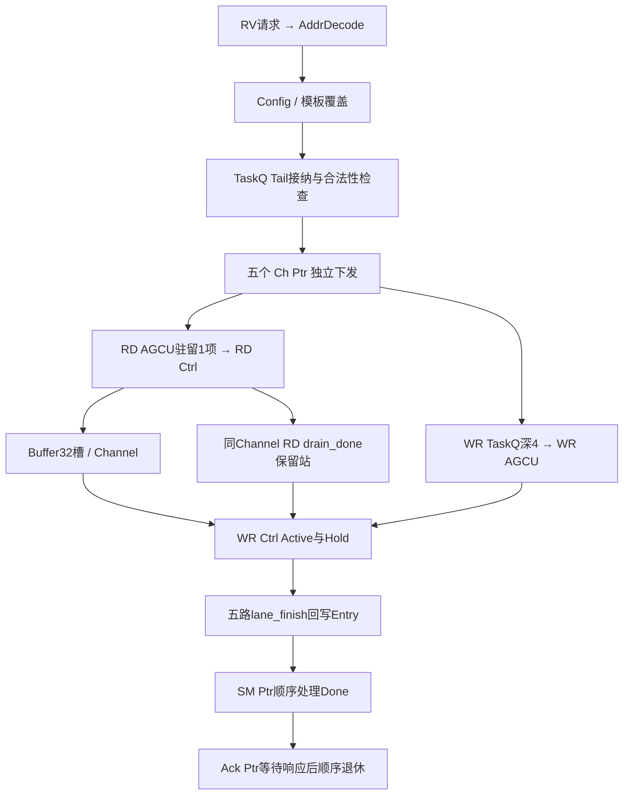

# DTE 单元设计

模式：design。层次：Core 内搬运单元接口与逐拍状态。本文供 DTE、存储端口和 RV Core 配置通路的实现与验证人员确定条目、字节和响应的归属。

原始依据：[DTE DSA详细设计文档](</home/colin/develop/perfechpitch/Bach/05_五、详细设计/02_DTE DSA详细设计文档.md>)，revision 24200。正文定义模型合同；实现状态与硬件待统一项分别记录。CFG_TRANS_MODE位域、STOP队满行为及未冻结控制字段集中登记于 [文档缺口与 TBD](../../../08-文档缺口与-TBD.md)。

## 1　定位与边界

| 模块 | 状态所有者 | 职责 |
| - | - | - |
| AddrDecode | 读请求命中的目标选择 | 译码已Fire访问，下一拍汇合目标读寄存器 |
| Config | 19字段配置、dirty有效位、8套模板 | Trigger Fire形成不可变FullTaskDesc并同拍入队 |
| Status Ctrl | RUN/STOP/ERROR、首错及派生状态 | 控制下发、调试和软件观察 |
| Glb Cfg TaskQ | 16个Entry及Tail/5个Ch Ptr/SM Ptr/Ack Ptr | 接纳、检查、下发、完成回写、有序副作用和退休 |
| 每Channel RD AGCU／Ctrl | 驻留任务、算址状态、Active/retiring与读Outstanding | 发读命令或收RX，预留Buffer并恢复响应归属 |
| 每Channel WR TaskQ／AGCU／Ctrl | 工作项、目的地址、Active/Hold与写Outstanding | 从Buffer拆分／拼接数据，收写响应，产生唯一lane_finish |
| Channel Buffer | free/reserved/valid槽及entry_id归属 | 读写阶段解耦，保持任务和段顺序 |
| XBar／M Top端口适配 | 各端点仲裁及两路128B事务 | 请求和响应不丢失，topK走[0]路拆分 |
| HeaderTable | 共享组字段与32个项内字段 | 保存/重组包头，通道读写和软件读写 |

五个Channel为InCh、OutCh0～3，每Channel各RD/WR一条issue lane。只由WR向全局Q产生lane_finish；RD drain_done留在同Channel内部。全局Entry从Trigger接纳一直保留至Ack Ptr退休，entry_id为4bit条目索引。



```svg
<svg xmlns="http://www.w3.org/2000/svg" width="100%" viewBox="0.00 0.00 791.00 1160.00" role="img" aria-label="DTE DSA 第 0 层">
<title>DTE DSA 第 0 层</title>
<g id="diagram4c501e680aa7-graph0" class="graph" transform="scale(1 1) rotate(0) translate(18 1141.52)">
<title>G</title>
<polygon fill="white" stroke="none" points="-18,18 -18,-1141.52 772.83,-1141.52 772.83,18 -18,18" />
<text xml:space="preserve" text-anchor="middle" x="377.41" y="-1104.32" font-family="Noto Sans CJK SC" font-size="16.00">DTE DSA 第 0 层</text>
<text xml:space="preserve" text-anchor="middle" x="377.41" y="-1080.32" font-family="Noto Sans CJK SC" font-size="16.00">方框为功能所有者，级间资格与状态在各节分别定义；端口字段、反压与完成条件见正文。</text>

<g id="diagram4c501e680aa7-node1" class="node">
<title>nrv</title>
<path fill="#f0fdfa" stroke="#0f766e" d="M145.29,-1067.52C145.29,-1067.52 12,-1067.52 12,-1067.52 6,-1067.52 0,-1061.52 0,-1055.52 0,-1055.52 0,-1008.24 0,-1008.24 0,-1002.24 6,-996.24 12,-996.24 12,-996.24 145.29,-996.24 145.29,-996.24 151.29,-996.24 157.29,-1002.24 157.29,-1008.24 157.29,-1008.24 157.29,-1055.52 157.29,-1055.52 157.29,-1061.52 151.29,-1067.52 145.29,-1067.52" />
<text xml:space="preserve" text-anchor="middle" x="78.64" y="-1047.48" font-family="Noto Sans CJK SC" font-size="12.00">RVCore IF / AddrDecode</text>
<text xml:space="preserve" text-anchor="middle" x="78.64" y="-1029.48" font-family="Noto Sans CJK SC" font-size="12.00">请求与STUPV保持</text>
<text xml:space="preserve" text-anchor="middle" x="78.64" y="-1011.48" font-family="Noto Sans CJK SC" font-size="12.00">读Fire采样，下一拍返回</text>
</g>

<g id="diagram4c501e680aa7-node2" class="node">
<title>ncfg</title>
<path fill="#f0fdfa" stroke="#0f766e" d="M365.04,-933.24C365.04,-933.24 248.25,-933.24 248.25,-933.24 242.25,-933.24 236.25,-927.24 236.25,-921.24 236.25,-921.24 236.25,-873.96 236.25,-873.96 236.25,-867.96 242.25,-861.96 248.25,-861.96 248.25,-861.96 365.04,-861.96 365.04,-861.96 371.04,-861.96 377.04,-867.96 377.04,-873.96 377.04,-873.96 377.04,-921.24 377.04,-921.24 377.04,-927.24 371.04,-933.24 365.04,-933.24" />
<text xml:space="preserve" text-anchor="middle" x="306.64" y="-913.2" font-family="Noto Sans CJK SC" font-size="12.00">Config / Status</text>
<text xml:space="preserve" text-anchor="middle" x="306.64" y="-895.2" font-family="Noto Sans CJK SC" font-size="12.00">19字段、dirty、8模板</text>
<text xml:space="preserve" text-anchor="middle" x="306.64" y="-877.2" font-family="Noto Sans CJK SC" font-size="12.00">RUN / STOP / ERROR</text>
</g>

<g id="diagram4c501e680aa7-edge1" class="edge">
<title>nrv-&gt;ncfg</title>
<path fill="none" stroke="#475569" d="M139.15,-995.78C169.8,-977.99 207.13,-956.33 238.77,-937.98" />
<polygon fill="#475569" stroke="#475569" points="239.78,-940.43 244.95,-934.4 237.14,-935.89 239.78,-940.43" />
<text xml:space="preserve" text-anchor="middle" x="224.61" y="-962.74" font-family="Noto Sans CJK SC" font-size="10.00">Config请求</text>
</g>

<g id="diagram4c501e680aa7-node9" class="node">
<title>nht</title>
<path fill="#f0fdfa" stroke="#0f766e" d="M135.91,-71.28C135.91,-71.28 21.38,-71.28 21.38,-71.28 15.38,-71.28 9.37,-65.28 9.37,-59.28 9.37,-59.28 9.37,-12 9.37,-12 9.37,-6 15.37,0 21.37,0 21.37,0 135.91,0 135.91,0 141.91,0 147.91,-6 147.91,-12 147.91,-12 147.91,-59.28 147.91,-59.28 147.91,-65.28 141.91,-71.28 135.91,-71.28" />
<text xml:space="preserve" text-anchor="middle" x="78.64" y="-51.24" font-family="Noto Sans CJK SC" font-size="12.00">HeaderTable</text>
<text xml:space="preserve" text-anchor="middle" x="78.64" y="-33.24" font-family="Noto Sans CJK SC" font-size="12.00">16组×32项，共800B</text>
<text xml:space="preserve" text-anchor="middle" x="78.64" y="-15.24" font-family="Noto Sans CJK SC" font-size="12.00">软件口与通道口仲裁</text>
</g>

<g id="diagram4c501e680aa7-edge15" class="edge">
<title>nrv-&gt;nht</title>
<path fill="none" stroke="#475569" d="M73.07,-995.78C66.85,-956.59 57.64,-898.6 57.64,-898.6 57.64,-898.6 57.64,-898.6 57.64,-168.92 57.64,-168.92 65.6,-118.8 71.72,-80.26" />
<polygon fill="#475569" stroke="#475569" points="74.25,-81.05 72.84,-73.24 69.07,-80.23 74.25,-81.05" />
<text xml:space="preserve" text-anchor="middle" x="77.14" y="-531.76" font-family="Noto Sans CJK SC" font-size="10.00">软件读写</text>
</g>

<g id="diagram4c501e680aa7-node3" class="node">
<title>nq</title>
<path fill="#f0fdfa" stroke="#0f766e" d="M508.66,-798.96C508.66,-798.96 386.62,-798.96 386.62,-798.96 380.62,-798.96 374.62,-792.96 374.62,-786.96 374.62,-786.96 374.62,-739.68 374.62,-739.68 374.62,-733.68 380.62,-727.68 386.62,-727.68 386.62,-727.68 508.66,-727.68 508.66,-727.68 514.66,-727.68 520.66,-733.68 520.66,-739.68 520.66,-739.68 520.66,-786.96 520.66,-786.96 520.66,-792.96 514.66,-798.96 508.66,-798.96" />
<text xml:space="preserve" text-anchor="middle" x="447.64" y="-778.92" font-family="Noto Sans CJK SC" font-size="12.00">Glb Cfg TaskQ</text>
<text xml:space="preserve" text-anchor="middle" x="447.64" y="-760.92" font-family="Noto Sans CJK SC" font-size="12.00">16项FullTaskDesc</text>
<text xml:space="preserve" text-anchor="middle" x="447.64" y="-742.92" font-family="Noto Sans CJK SC" font-size="12.00">Tail / Ch0..4 / SM / Ack</text>
</g>

<g id="diagram4c501e680aa7-edge2" class="edge">
<title>ncfg-&gt;nq</title>
<path fill="none" stroke="#475569" d="M344.06,-861.5C362.53,-844.17 384.92,-823.16 404.15,-805.12" />
<polygon fill="#475569" stroke="#475569" points="405.77,-807.21 409.44,-800.16 402.17,-803.38 405.77,-807.21" />
<text xml:space="preserve" text-anchor="middle" x="417" y="-828.46" font-family="Noto Sans CJK SC" font-size="10.00">Trigger快照入队</text>
</g>

<g id="diagram4c501e680aa7-node4" class="node">
<title>nrd</title>
<path fill="#f0fdfa" stroke="#0f766e" d="M305.91,-664.68C305.91,-664.68 173.38,-664.68 173.38,-664.68 167.38,-664.68 161.38,-658.68 161.38,-652.68 161.38,-652.68 161.38,-605.4 161.38,-605.4 161.38,-599.4 167.38,-593.4 173.38,-593.4 173.38,-593.4 305.91,-593.4 305.91,-593.4 311.91,-593.4 317.91,-599.4 317.91,-605.4 317.91,-605.4 317.91,-652.68 317.91,-652.68 317.91,-658.68 311.91,-664.68 305.91,-664.68" />
<text xml:space="preserve" text-anchor="middle" x="239.64" y="-644.64" font-family="Noto Sans CJK SC" font-size="12.00">RD AGCU / Ctrl ×5</text>
<text xml:space="preserve" text-anchor="middle" x="239.64" y="-626.64" font-family="Noto Sans CJK SC" font-size="12.00">驻留深1；Active/retiring</text>
<text xml:space="preserve" text-anchor="middle" x="239.64" y="-608.64" font-family="Noto Sans CJK SC" font-size="12.00">算址、预留、RX/读响应</text>
</g>

<g id="diagram4c501e680aa7-edge3" class="edge">
<title>nq-&gt;nrd</title>
<path fill="none" stroke="#475569" d="M374.45,-733.17C337.5,-718.45 300.39,-703.68 300.39,-703.68 300.39,-703.68 287.81,-688.42 274.09,-671.8" />
<polygon fill="#475569" stroke="#475569" points="276.36,-670.42 269.56,-666.3 272.31,-673.76 276.36,-670.42" />
<text xml:space="preserve" text-anchor="middle" x="316.52" y="-694.18" font-family="Noto Sans CJK SC" font-size="10.00">RD驻留</text>
</g>

<g id="diagram4c501e680aa7-node5" class="node">
<title>nwrq</title>
<path fill="#f0fdfa" stroke="#0f766e" d="M572.79,-569.4C572.79,-569.4 454.5,-569.4 454.5,-569.4 448.5,-569.4 442.5,-563.4 442.5,-557.4 442.5,-557.4 442.5,-510.12 442.5,-510.12 442.5,-504.12 448.5,-498.12 454.5,-498.12 454.5,-498.12 572.79,-498.12 572.79,-498.12 578.79,-498.12 584.79,-504.12 584.79,-510.12 584.79,-510.12 584.79,-557.4 584.79,-557.4 584.79,-563.4 578.79,-569.4 572.79,-569.4" />
<text xml:space="preserve" text-anchor="middle" x="513.64" y="-549.36" font-family="Noto Sans CJK SC" font-size="12.00">WR TaskQ / AGCU ×5</text>
<text xml:space="preserve" text-anchor="middle" x="513.64" y="-531.36" font-family="Noto Sans CJK SC" font-size="12.00">深4；按Channel保序</text>
<text xml:space="preserve" text-anchor="middle" x="513.64" y="-513.36" font-family="Noto Sans CJK SC" font-size="12.00">目的地址与段context</text>
</g>

<g id="diagram4c501e680aa7-edge4" class="edge">
<title>nq-&gt;nwrq</title>
<path fill="none" stroke="#475569" d="M411.1,-727.19C398.11,-714.7 386.64,-703.68 386.64,-703.68 386.64,-703.68 386.64,-688.68 386.64,-688.68 386.64,-688.68 388.64,-593.4 388.64,-593.4 388.64,-593.4 409.36,-583.68 433.93,-572.16" />
<polygon fill="#475569" stroke="#475569" points="434.97,-574.57 440.65,-569 432.74,-569.81 434.97,-574.57" />
<text xml:space="preserve" text-anchor="middle" x="413.64" y="-694.18" font-family="Noto Sans CJK SC" font-size="10.00">同拍WR入队</text>
</g>

<g id="diagram4c501e680aa7-node11" class="node">
<title>nsm</title>
<path fill="#f0fdfa" stroke="#0f766e" d="M491.91,-664.68C491.91,-664.68 413.38,-664.68 413.38,-664.68 407.38,-664.68 401.38,-658.68 401.38,-652.68 401.38,-652.68 401.38,-605.4 401.38,-605.4 401.38,-599.4 407.38,-593.4 413.38,-593.4 413.38,-593.4 491.91,-593.4 491.91,-593.4 497.91,-593.4 503.91,-599.4 503.91,-605.4 503.91,-605.4 503.91,-652.68 503.91,-652.68 503.91,-658.68 497.91,-664.68 491.91,-664.68" />
<text xml:space="preserve" text-anchor="middle" x="452.64" y="-644.64" font-family="Noto Sans CJK SC" font-size="12.00">ShareMem</text>
<text xml:space="preserve" text-anchor="middle" x="452.64" y="-626.64" font-family="Noto Sans CJK SC" font-size="12.00">4B可选控制写</text>
<text xml:space="preserve" text-anchor="middle" x="452.64" y="-608.64" font-family="Noto Sans CJK SC" font-size="12.00">等待真实bresp</text>
</g>

<g id="diagram4c501e680aa7-edge19" class="edge">
<title>nq-&gt;nsm</title>
<path fill="none" stroke="#475569" d="M447.2,-727.19C447.04,-714.7 446.89,-703.68 446.89,-703.68 446.89,-703.68 446.89,-688.68 446.89,-688.68 446.89,-688.68 447.5,-682.48 448.32,-674.11" />
<polygon fill="#475569" stroke="#475569" points="450.93,-674.39 449.05,-666.67 445.71,-673.88 450.93,-674.39" />
<text xml:space="preserve" text-anchor="middle" x="466.77" y="-694.18" font-family="Noto Sans CJK SC" font-size="10.00">SM Ptr写</text>
</g>

<g id="diagram4c501e680aa7-node12" class="node">
<title>nts</title>
<path fill="#f0fdfa" stroke="#0f766e" d="M648.16,-664.68C648.16,-664.68 541.12,-664.68 541.12,-664.68 535.12,-664.68 529.12,-658.68 529.12,-652.68 529.12,-652.68 529.12,-605.4 529.12,-605.4 529.12,-599.4 535.12,-593.4 541.12,-593.4 541.12,-593.4 648.16,-593.4 648.16,-593.4 654.16,-593.4 660.16,-599.4 660.16,-605.4 660.16,-605.4 660.16,-652.68 660.16,-652.68 660.16,-658.68 654.16,-664.68 648.16,-664.68" />
<text xml:space="preserve" text-anchor="middle" x="594.64" y="-644.64" font-family="Noto Sans CJK SC" font-size="12.00">TS done</text>
<text xml:space="preserve" text-anchor="middle" x="594.64" y="-626.64" font-family="Noto Sans CJK SC" font-size="12.00">UID16 / SID4 / TID6</text>
<text xml:space="preserve" text-anchor="middle" x="594.64" y="-608.64" font-family="Noto Sans CJK SC" font-size="12.00">Ack按序valid-only</text>
</g>

<g id="diagram4c501e680aa7-edge21" class="edge">
<title>nq-&gt;nts</title>
<path fill="none" stroke="#475569" d="M491.37,-727.19C506.92,-714.7 520.64,-703.68 520.64,-703.68 520.64,-703.68 536.25,-688.15 553.13,-671.35" />
<polygon fill="#475569" stroke="#475569" points="554.84,-673.35 558.31,-666.2 551.14,-669.63 554.84,-673.35" />
<text xml:space="preserve" text-anchor="middle" x="560.68" y="-694.18" font-family="Noto Sans CJK SC" font-size="10.00">Ack Ptr退休</text>
</g>

<g id="diagram4c501e680aa7-node6" class="node">
<title>nbuf</title>
<path fill="#f0fdfa" stroke="#0f766e" d="M478.41,-474.12C478.41,-474.12 360.88,-474.12 360.88,-474.12 354.88,-474.12 348.88,-468.12 348.88,-462.12 348.88,-462.12 348.88,-414.84 348.88,-414.84 348.88,-408.84 354.88,-402.84 360.88,-402.84 360.88,-402.84 478.41,-402.84 478.41,-402.84 484.41,-402.84 490.41,-408.84 490.41,-414.84 490.41,-414.84 490.41,-462.12 490.41,-462.12 490.41,-468.12 484.41,-474.12 478.41,-474.12" />
<text xml:space="preserve" text-anchor="middle" x="419.64" y="-454.08" font-family="Noto Sans CJK SC" font-size="12.00">Buffer ×5</text>
<text xml:space="preserve" text-anchor="middle" x="419.64" y="-436.08" font-family="Noto Sans CJK SC" font-size="12.00">每Channel32×256B</text>
<text xml:space="preserve" text-anchor="middle" x="419.64" y="-418.08" font-family="Noto Sans CJK SC" font-size="12.00">free / reserved / valid</text>
</g>

<g id="diagram4c501e680aa7-edge5" class="edge">
<title>nrd-&gt;nbuf</title>
<path fill="none" stroke="#475569" d="M268.65,-593.22C300.72,-554.74 347.89,-498.12 347.89,-498.12 347.89,-498.12 357.68,-490.13 370.02,-480.04" />
<polygon fill="#475569" stroke="#475569" points="371.35,-482.34 375.49,-475.56 368.02,-478.28 371.35,-482.34" />
<text xml:space="preserve" text-anchor="middle" x="388.77" y="-531.76" font-family="Noto Sans CJK SC" font-size="10.00">数据/响应填预留槽</text>
</g>

<g id="diagram4c501e680aa7-node7" class="node">
<title>nwr</title>
<path fill="#f0fdfa" stroke="#0f766e" d="M485.16,-339.84C485.16,-339.84 354.12,-339.84 354.12,-339.84 348.12,-339.84 342.12,-333.84 342.12,-327.84 342.12,-327.84 342.12,-280.56 342.12,-280.56 342.12,-274.56 348.12,-268.56 354.12,-268.56 354.12,-268.56 485.16,-268.56 485.16,-268.56 491.16,-268.56 497.16,-274.56 497.16,-280.56 497.16,-280.56 497.16,-327.84 497.16,-327.84 497.16,-333.84 491.16,-339.84 485.16,-339.84" />
<text xml:space="preserve" text-anchor="middle" x="419.64" y="-319.8" font-family="Noto Sans CJK SC" font-size="12.00">WR Ctrl ×5</text>
<text xml:space="preserve" text-anchor="middle" x="419.64" y="-301.8" font-family="Noto Sans CJK SC" font-size="12.00">Active与上一任务Hold</text>
<text xml:space="preserve" text-anchor="middle" x="419.64" y="-283.8" font-family="Noto Sans CJK SC" font-size="12.00">写响应与RD drain_done</text>
</g>

<g id="diagram4c501e680aa7-edge8" class="edge">
<title>nrd-&gt;nwr</title>
<path fill="none" stroke="#475569" d="M240.61,-593.35C242.36,-530.18 245.89,-402.84 245.89,-402.84 245.89,-402.84 301.45,-371.62 349.73,-344.49" />
<polygon fill="#475569" stroke="#475569" points="350.84,-346.88 356.09,-340.92 348.26,-342.3 350.84,-346.88" />
<text xml:space="preserve" text-anchor="middle" x="291.27" y="-436.48" font-family="Noto Sans CJK SC" font-size="10.00">同Entry drain_done</text>
</g>

<g id="diagram4c501e680aa7-node8" class="node">
<title>nmem</title>
<path fill="#f0fdfa" stroke="#0f766e" d="M229.04,-205.56C229.04,-205.56 118.25,-205.56 118.25,-205.56 112.25,-205.56 106.25,-199.56 106.25,-193.56 106.25,-193.56 106.25,-146.28 106.25,-146.28 106.25,-140.28 112.25,-134.28 118.25,-134.28 118.25,-134.28 229.04,-134.28 229.04,-134.28 235.04,-134.28 241.04,-140.28 241.04,-146.28 241.04,-146.28 241.04,-193.56 241.04,-193.56 241.04,-199.56 235.04,-205.56 229.04,-205.56" />
<text xml:space="preserve" text-anchor="middle" x="173.64" y="-185.52" font-family="Noto Sans CJK SC" font-size="12.00">端口仲裁与适配</text>
<text xml:space="preserve" text-anchor="middle" x="173.64" y="-167.52" font-family="Noto Sans CJK SC" font-size="12.00">CM/MM双128B</text>
<text xml:space="preserve" text-anchor="middle" x="173.64" y="-149.52" font-family="Noto Sans CJK SC" font-size="12.00">M Top MM/topK共享</text>
</g>

<g id="diagram4c501e680aa7-edge10" class="edge">
<title>nrd-&gt;nmem</title>
<path fill="none" stroke="#475569" d="M186.33,-592.91C167.38,-580.42 150.64,-569.4 150.64,-569.4 150.64,-569.4 113.39,-378.84 113.39,-378.84 113.39,-378.84 113.39,-363.84 113.39,-363.84 113.39,-363.84 154.64,-229.56 154.64,-229.56 154.64,-229.56 156.74,-223.1 159.54,-214.46" />
<polygon fill="#475569" stroke="#475569" points="161.98,-215.43 161.8,-207.49 156.99,-213.81 161.98,-215.43" />
<text xml:space="preserve" text-anchor="middle" x="128.02" y="-369.34" font-family="Noto Sans CJK SC" font-size="10.00">读请求</text>
</g>

<g id="diagram4c501e680aa7-edge6" class="edge">
<title>nwrq-&gt;nwr</title>
<path fill="none" stroke="#475569" d="M510.7,-497.94C507.44,-459.46 502.64,-402.84 502.64,-402.84 502.64,-402.84 474.64,-363.84 474.64,-363.84 474.64,-363.84 467.69,-356.42 458.72,-346.86" />
<polygon fill="#475569" stroke="#475569" points="460.67,-345.11 453.63,-341.43 456.84,-348.7 460.67,-345.11" />
<text xml:space="preserve" text-anchor="middle" x="535.24" y="-436.48" font-family="Noto Sans CJK SC" font-size="10.00">目的context</text>
</g>

<g id="diagram4c501e680aa7-edge7" class="edge">
<title>nbuf-&gt;nwr</title>
<path fill="none" stroke="#475569" d="M419.64,-402.38C419.64,-385.95 419.64,-366.23 419.64,-348.85" />
<polygon fill="#475569" stroke="#475569" points="422.27,-349.02 419.65,-341.52 417.02,-349.02 422.27,-349.02" />
<text xml:space="preserve" text-anchor="middle" x="444.02" y="-369.34" font-family="Noto Sans CJK SC" font-size="10.00">按段序消费</text>
</g>

<g id="diagram4c501e680aa7-edge9" class="edge">
<title>nwr-&gt;nq</title>
<path fill="none" stroke="#475569" d="M497.54,-321.69C579.47,-339.03 696.64,-363.84 696.64,-363.84 696.64,-363.84 696.64,-378.84 696.64,-378.84 696.64,-378.84 672.64,-664.68 672.64,-664.68 672.64,-664.68 592.64,-703.68 592.64,-703.68 592.64,-703.68 562.06,-716.05 528.98,-729.43" />
<polygon fill="#475569" stroke="#475569" points="528.37,-726.84 522.4,-732.09 530.33,-731.71 528.37,-726.84" />
<text xml:space="preserve" text-anchor="middle" x="720.7" y="-531.76" font-family="Noto Sans CJK SC" font-size="10.00">lane_finish ×5</text>
</g>

<g id="diagram4c501e680aa7-edge12" class="edge">
<title>nwr-&gt;nmem</title>
<path fill="none" stroke="#475569" d="M341.88,-270.45C309.98,-257.02 280.39,-244.56 280.39,-244.56 280.39,-244.56 256.88,-228.34 231.93,-211.13" />
<polygon fill="#475569" stroke="#475569" points="233.43,-208.97 225.76,-206.87 230.45,-213.29 233.43,-208.97" />
<text xml:space="preserve" text-anchor="middle" x="295.02" y="-235.06" font-family="Noto Sans CJK SC" font-size="10.00">写请求</text>
</g>

<g id="diagram4c501e680aa7-node10" class="node">
<title>nrouter</title>
<path fill="#f0fdfa" stroke="#0f766e" d="M558.54,-205.56C558.54,-205.56 444.75,-205.56 444.75,-205.56 438.75,-205.56 432.75,-199.56 432.75,-193.56 432.75,-193.56 432.75,-146.28 432.75,-146.28 432.75,-140.28 438.75,-134.28 444.75,-134.28 444.75,-134.28 558.54,-134.28 558.54,-134.28 564.54,-134.28 570.54,-140.28 570.54,-146.28 570.54,-146.28 570.54,-193.56 570.54,-193.56 570.54,-199.56 564.54,-205.56 558.54,-205.56" />
<text xml:space="preserve" text-anchor="middle" x="501.64" y="-185.52" font-family="Noto Sans CJK SC" font-size="12.00">Router RX / TX</text>
<text xml:space="preserve" text-anchor="middle" x="501.64" y="-167.52" font-family="Noto Sans CJK SC" font-size="12.00">RX valid/ready</text>
<text xml:space="preserve" text-anchor="middle" x="501.64" y="-149.52" font-family="Noto Sans CJK SC" font-size="12.00">TX每VC信用、flit交织</text>
</g>

<g id="diagram4c501e680aa7-edge17" class="edge">
<title>nwr-&gt;nrouter</title>
<path fill="none" stroke="#475569" d="M451.39,-268.07C462.68,-255.58 472.64,-244.56 472.64,-244.56 472.64,-244.56 478.34,-230.1 484.68,-214" />
<polygon fill="#475569" stroke="#475569" points="486.96,-215.36 487.27,-207.42 482.08,-213.44 486.96,-215.36" />
<text xml:space="preserve" text-anchor="middle" x="501.44" y="-235.06" font-family="Noto Sans CJK SC" font-size="10.00">实际TX flit</text>
</g>

<g id="diagram4c501e680aa7-edge11" class="edge">
<title>nmem-&gt;nrd</title>
<path fill="none" stroke="#475569" d="M178.69,-205.84C190.55,-288.01 220.22,-493.48 233.29,-584.02" />
<polygon fill="#475569" stroke="#475569" points="230.69,-584.38 234.36,-591.43 235.89,-583.63 230.69,-584.38" />
<text xml:space="preserve" text-anchor="middle" x="218.23" y="-369.34" font-family="Noto Sans CJK SC" font-size="10.00">读响应</text>
</g>

<g id="diagram4c501e680aa7-edge13" class="edge">
<title>nmem-&gt;nwr</title>
<path fill="none" stroke="#475569" d="M241.43,-199.72C276.33,-214.55 311.64,-229.56 311.64,-229.56 311.64,-229.56 335.64,-245.92 361,-263.21" />
<polygon fill="#475569" stroke="#475569" points="359.25,-265.2 366.92,-267.25 362.21,-260.86 359.25,-265.2" />
<text xml:space="preserve" text-anchor="middle" x="346.93" y="-235.06" font-family="Noto Sans CJK SC" font-size="10.00">写响应</text>
</g>

<g id="diagram4c501e680aa7-edge14" class="edge">
<title>nmem-&gt;nht</title>
<path fill="none" stroke="#475569" d="M148.44,-133.82C136.21,-116.79 121.43,-96.21 108.63,-78.39" />
<polygon fill="#475569" stroke="#475569" points="111.03,-77.24 104.52,-72.68 106.77,-80.3 111.03,-77.24" />
<text xml:space="preserve" text-anchor="middle" x="148.49" y="-100.78" font-family="Noto Sans CJK SC" font-size="10.00">通道读写</text>
</g>

<g id="diagram4c501e680aa7-edge16" class="edge">
<title>nrouter-&gt;nrd</title>
<path fill="none" stroke="#475569" d="M519.02,-206.05C525.19,-218.54 530.64,-229.56 530.64,-229.56 530.64,-229.56 597.64,-498.12 597.64,-498.12 597.64,-498.12 597.64,-569.4 597.64,-569.4 597.64,-569.4 388.64,-593.4 388.64,-593.4 388.64,-593.4 359.17,-600.25 326.45,-607.86" />
<polygon fill="#475569" stroke="#475569" points="326.26,-605.21 319.55,-609.46 327.45,-610.32 326.26,-605.21" />
<text xml:space="preserve" text-anchor="middle" x="599.11" y="-369.34" font-family="Noto Sans CJK SC" font-size="10.00">RX头/payload</text>
</g>

<g id="diagram4c501e680aa7-edge18" class="edge">
<title>nrouter-&gt;nwr</title>
<path fill="none" stroke="#475569" d="M449.68,-206.05C431.2,-218.54 414.89,-229.56 414.89,-229.56 414.89,-229.56 414.89,-244.56 414.89,-244.56 414.89,-244.56 415.4,-250.76 416.08,-259.13" />
<polygon fill="#475569" stroke="#475569" points="413.46,-259.3 416.68,-266.56 418.69,-258.88 413.46,-259.3" />
<text xml:space="preserve" text-anchor="middle" x="440.77" y="-235.06" font-family="Noto Sans CJK SC" font-size="10.00">每VC credit</text>
</g>

<g id="diagram4c501e680aa7-edge20" class="edge">
<title>nsm-&gt;nq</title>
<path fill="none" stroke="#475569" d="M474.21,-665.17C481.88,-677.66 488.64,-688.68 488.64,-688.68 488.64,-688.68 488.64,-703.68 488.64,-703.68 488.64,-703.68 483.75,-710.68 477.34,-719.84" />
<polygon fill="#475569" stroke="#475569" points="475.22,-718.3 473.07,-725.95 479.52,-721.31 475.22,-718.3" />
<text xml:space="preserve" text-anchor="middle" x="501.39" y="-694.18" font-family="Noto Sans CJK SC" font-size="10.00">bresp</text>
</g>
</g>
</svg>
```

| Route 逻辑编码 | 方向 | 通道与端点 |
| - | - | - |
| 000 | Router→CM | InCh；各段目的端由地址窗口确定 |
| 001 | Router→MM | InCh；各段目的端由地址窗口确定 |
| 010 | CM→Router | OutCh0～3，由 VCID 选择 |
| 011 | MM→Router | OutCh0～3，由 VCID 选择 |
| 100 | Core 内搬运 | OutCh3；支持 MM→CM 和 CM→HeaderTable |

Route 确定整体形态和 Channel。每段的 CM、MM、topK 或 HeaderTable 端点仍由该段地址窗口决定。CM→MM 的写路径不在当前 XBar 中，非法配置必须在第一笔外部请求前拦截。

每 Channel 有独立的 RD 和 WR issue lane，共十条。下发要求本 Channel 的 RD AGCU 驻留空闲、WR TaskQ 有空间，同拍交付两侧，携带同一 entry_id。RD AGCU 深度 1，WR TaskQ 深度 4。不同 Channel 可以乱序下发和物理完成，同一 Channel 保持任务顺序。

全局 TaskQ 是容量、任务身份、异常现场和退休的所有者。Tail 接纳任务，五个 Ch Ptr 分别扫描和下发，SM Ptr 处理完成后的 ShareMem 写，Ack Ptr 按接纳顺序释放条目。循环序满足 `Ack Ptr ≤ SM Ptr ≤ ChX Ptr ≤ Tail Ptr`。已下发条目不能因为 lane 空闲或物理完成提前复用。

## 2　功能清单

一功能一条，编号供“机制覆盖”一章引用。

### Header Parser

| 编号 | 功能 |
| - | - |
| F1 | InCh RD在已有驻留任务时锁存首flit的32B hflit，检查声明包长与Packet边界；不因收到Header生成任务。 |
| F2 | 包长为32B头加使能数据段总长，检查首声明及tail实际flit数；通用DTE不受RMEM 32KiB容量限制。 |
| F3 | 保存头或丢头由配置决定。保存的32B段0经Buffer和WR写所选端点，Header Parser不自行写一套GPU/token硬件表。 |
| F3a | SID/TID/UID/PID/VCID取Trigger Fire请求旁带；包头UID不是本Core SID，不假定各Core同用户必分同SID。 |
| F3c | 落点逐段由CFG_ADDRi_DST、SID×STRIDEi及地址窗口决定。DTEIN只提供模型/软件进核配置，不代替RV Trigger和段译码。 |
| F3d | B/R独立Bypass和权重搬入使用不回业务ACK的Entry；仍等待真实写响应和可选ShareMem完成。 |
| F3b | entry_id保存任务归属，进核任务与Packet按到达顺序配对；帧计数可作诊断，不扩展硬件任务身份。 |
| F4 | RX单通道包内保序，head到tail属于同一驻留Entry，不允许不同任务payload交织。 |
| F5 | 以显式head/tail判断Packet边界；首flit并行携hflit与pflit，不恢复“只有TLAST且首拍纯Header”的旧格式。 |
| F6 | RX ready由驻留任务、Buffer credit与保存首头状态决定；未ready时Router保持，纯头包仍需消费head/tail。 |
| F7 | 有效字节来自段长与8B mask/keep，累计有效量与配置一致；无效字节不能造成写副作用。 |
| F8 | 长度错误或无主Packet保留Entry与首错，禁止正常ACK；残包终止与恢复仍TBD，不用静默丢帧掩盖FIFO错配。 |

### Commit

| 编号 | 功能 |
| - | - |
| F9 | Tail先接纳全局16项Entry；Ch Ptr下发时必须同拍取得RD AGCU驻留空位与WR TaskQ空间，不产生半下发。 |
| F10 | 本Channel不能下发时保持Entry和指针；其他Channel可独立扫描，不越过同Channel较老Ready任务。 |
| F11 | entry_id是全局4bit索引，直到Ack退休才复用；地址、身份、错误、Buffer和响应始终归原Entry。 |
| F12 | 全局Q从Trigger接纳持有到退休，五Ch Ptr各扫描自己的任务；dispatch只改变状态及通道工作项，不释放Q容量。 |
| F12a | 模型Commit使用just_sent空拍观察ready，属于仿真实现；硬件吞吐按真实接纳与寄存ready合同，不能把固定空拍写为详设规则。 |
| F13 | 所有方向只经RVCore IF配置和CFG_TRIGGER创建FullTaskDesc；TS不直接注入第二种Descriptor入口。 |
| F14 | 任务配置为四段SRC/DST/STRIDE/DATA_LEN和SM地址/数据、TRANS_MODE共19字段；最后写0x0000 Trigger，字段/模板可先后复用。 |
| F14a | Trigger Fire同拍合并模板与dirty字段，快照STUPV并入全局Q；后续CSR、Config、模板变化不能改已接纳Entry。 |
| F14b | 未Fire的RV请求保持地址、类型、数据和STUPV稳定；模型额外序号去重不构成硬件字段。 |

当前详设采用8套Config Template；Fast LUT候选的命中4T及Setup<10T是旧提案估算，现已取消，评价背景保留在取舍。

### 五个物理通道与各自的 TaskQueue

| 编号 | 功能 |
| - | - |
| F15 | Status控制RUN/STOP/ERROR以及step/cancel；Q满时RUN/STOP都按确认基线反压全部RV访问。ERROR接收Trigger不入队，恢复协议另冻结。 |
| F16 | Core内搬运固定OutCh3，目的写路径支持CM和HeaderTable，不到MM；源/目的分别译码。 |
| F17 | 五Channel各自RD/WR独立，可跨Channel乱序激活和物理完成；共享端口由XBar/M Top保持归属。 |
| F18 | 同Channel各侧激活保序；全局SM与Ack必须按Trigger接纳次序推进，不能仅保证同Channel ACK顺序。 |
| F19 | issue_done表示最后请求已Fire，Active可在Hold空闲时换下一任务；旧响应、Buffer与drain仍归旧Entry。 |
| F20 | read-ahead受每Channel32槽credit、读Outstanding、WR TaskQ4项和Active/Hold边界限制。 |
| F21 | Router→CM与MM→CM/HT写共享对应写口，落选请求保持valid、地址、mask和数据，不能丢请求或提前扣字节。 |
| F21a | 五Channel到各端点的读、写分别仲裁；CM/MM配对两路一起Fire，响应每路握手，topK与MM在M Top共用物理端口。 |
| F22 | Buffer在读Fire前预留响应槽，响应填valid，WR按原任务段顺序消费；free/reserved/valid三类合计固定容量。 |
| F23 | DTE包总长32+各数据段，最大65535且8B对齐上限65528；>32KiB可流式处理，RMEM归约另受每用户32KiB限制。 |

### 中间 Buffer

| 编号 | 功能 |
| - | - |
| F24 | RD与WR可处于相邻不同Entry，Hold保留旧边界；禁止再激活使上一任务未排空上下文被覆盖。 |
| F25 | Buffer满反压RX或读请求；只有已Fire事务占Outstanding，未获准读不能提前占一个完成槽。 |
| F26 | 目的内存写必须等待所有真实写响应，Router写必须等实际TX尾拍；写侧再等待同Entry RD drain_done才finish。 |

### WR完成保留站与全局退休

| 编号 | 功能 |
| - | - |
| F27 | WR在同Channel保留站汇合RD drain_done，以entry_id归属后回写全局Q；SID/TID不同不是唯一内部键。 |
| F28 | 五WR同拍完成不同Entry均要保存；不是固定优先丢其他finish，也不建立独立无界Done Pending容量。 |
| F29 | 每Entry最多一次lane_finish及一次有序退休；ack_ts_en=1时最多一拍TS UID/SID/TID valid。 |
| F30 | 完成层级为queued、active、issue_done、drained、lane_finish、Ack退休。SM响应与队头等待属于退休条件，不是valid/ready TS握手。 |
| F31 | 按确认基线，一TS Task可拆多搬运Entry，仅最后Entry使能ack_ts_en；无ACK Entry仍执行SM副作用并正常按序退休。 |

### 三条数据流

| 编号 | 功能 |
| - | - |
| F32 | Inbound先RV Trigger入Q、Channel驻留，再接32B头/payload；WR逐段译码目的端，等写响应与RD drain后回写。 |
| F33 | Outbound逐段发读并预留Buffer，读段0重写头，WR以residue组payload，按每VC信用逐flit发，实际尾拍完成后回写。 |
| F34 | MM→CM与CM→HeaderTable走OutCh3 Core内路径；源物理地址，目的叠SID×stride，无Router TX信用消耗。 |
| F35 | 读、Buffer、WR可流水重叠；各内存端使用自己请求/响应握手，TX用信用，RX用ready，不能统一成一种接口。 |

### Hmem 与四类内容的存放

| 编号 | 功能 |
| - | - |
| F36 | 四段通用：段0固定32B，段1～3由seg_valid选择；各段内容是软件约定，端点按独立地址窗口译码。 |
| F37 | MU topK_table为16×256B，经M Top sel=1仅[0]路分两笔128B；两响应拼/聚合成一个256B逻辑拍，不是私有旁带一次写入。 |
| F38 | HeaderTable为16组，每组core_mask2B、sw_aux16B、32×hw_used1B，共800B；索引[8:5]组、[4:0]项。 |
| F39 | B/R包头典型落CM按UID保存；B data/scale/topK连续落MM软件槽，不强制用户UID索引MU的16项topK表。 |
| F40 | PID与身份来自Trigger旁带，各段长度来自DATA_LEN；不依赖path_id_table/task_len_table反查。 |
| F41 | 出Core硬件重写PID、UID、VCID、pkt_length，保持core_mask/sw_aux；软件修改共享辅助字段须显式写端点。 |
| F42 | 每段DATA_LEN独立字节单位，段0=32，topK非0且按256B整数倍；不能把topK长度记0后仍计入Packet。 |
| F42a | DATA_LEN为16bit；地址/长度8B约束，HT地址索引例外。topK起点/长度256B约束，总包长仍需校验。 |
| F43 | Router源hw_header_op=0保存32B头、=1丢弃头。Core源仍搬32B段0；是否新SID不自动决定此位。 |
| F44 | 出Core重写固定字段，包长=32+有效数据段长度；core_mask/sw_aux保持，计算结果是否带topK由seg_valid配置。 |
| F44a | 模型可先建立诊断Message，但真正hflit来自段0读取，TX按真实payload推进；不能以建好C++对象算物理完成。 |
| F44c | 远端dst_addr为模型诊断/软件兼容上下文，未列入冻结32B硬件头；Memory配置中的DST只对有效写端使用。 |
| F44b | GPU/token可随模型诊断上下文保存，不能据此扩大硬件头、HeaderTable或回读容量。 |
| F45 | seg_valid=000仍有固定32B段0；纯头任务发送一个head/tail Packet，丢头空接收仍消费对应Packet。 |
| F46 | 一般存储起址=CFG_ADDRi+SID×CFG_STRIDEi；只对有效端算址，stride=0为软件物理地址。 |
| F47 | Core内源不叠SID×stride，目的叠；窗口基址/大小参数化，CM数据/scale由bit20区分，HT索引不同于软件回读地址。 |
| F48 | scale与topK长度都由软件配段长，不隐式从data_len或专家数推算；MXFP8逻辑每32元素1B并按8B段约束补齐。 |
| F49 | 当前kernel的MM侧配stride=0、CM侧按SID跨度，属于软件布局；硬件一般寻址式不因端点MM而永久忽略stride。 |
| F49a | B token data6144+scale192+topK256连续保存MM，槽位6656对齐；计算Core scale使用CM byte坐标，权重scale模型映射到MM保留区。 |

### shareMem 写

| 编号 | 功能 |
| - | - |
| F50 | SM Ptr只对Done Entry按序发可选4B控制写，等待对应bresp；Ack不得先于写响应退休。 |
| F51 | B/R完成flag由DTE使能写，软件队列认领/发送后按各自kernel清理；不是所有DTE搬出都自动写invalid。 |
| F51a | SM地址、数据在Trigger快照保存；B flag按landing/6656、R按landing/0x3080计算，基址与是否写由软件配置。 |

### 出核前的资源与流控

TS先取得业务方向或本SID RMEM许可；DTE下发只看全局Q与Channel容量，实际TX按每VC native信用发送。不同层资源不能混为同一ready电平。

stream_cache与action式同步是原通信资料/模型兼容机制，只跟随不分配。其与三方向Credit Ctrl的硬件接口尚未冻结；当前真实Release只归还已持有方向，不将诊断cache变成额外许可所有者。

| 编号 | 功能 |
| - | - |
| F52 | 路由逻辑副本软件保持一致；当前硬件VCID由Trigger旁带，模型DTE表的兼容查询不新增独立冻结资源授权。 |
| F53 | dispatch不检查VC信用；实际OutCh TX每flit查本VC私有/共享credit，本地排队不算已发送。 |
| F54 | Q在dispatch前接纳，Entry贯穿RS/Done/SM/Ack；两侧未同时有位不动该Ch Ptr，其他Channel可独立。 |
| F55 | 全局16项包含已dispatch未退休任务；满状态反压所有RV请求，已有外部事务仍按所属Entry排空。 |
| F55a | XBar各端点读/写分别仲裁，MM和topK共享M Top；连续响应按各端点FIFO/两路half_hold归原请求，不跨任务串接。 |
| F55b | 四VC在Router TX复用点按合法flit边界交织；每VC Packet头上下文保持直到本VC尾拍，禁止全局整包锁。 |
| F56 | TS Reduce使用独立SID RMEM许可；DTE只遵循自身Q/Channel及TX信用，不重复申请TS业务方向额度。 |
| F59 | OutCh0～3独立Buffer/上下文/信用，单VC缺信用不阻止其他VC或Core内写路径。 |
| F60 | RX是单Channel packet流，Router把上游VC仲裁到进Core路径，DTE在自身接收Fire后按native接口反馈空间。 |
| F61 | TS方向许可、Router stream资源和DTE flit信用各有所有者；RMEM为独立资源，不能把它们合成一种credit。 |
| F62 | 当前native TX信用返回是每VC协议。旧action式stream_cache同步来自通信资料/模型兼容，硬件接口和方向表衔接继续TBD。 |
| F63 | 重发必须保持原用户缓存与已使用方向记录，真实Release才释放相应方向；不能产生无持有额度的重复返还。 |

### 软件配置的寄存器

| 编号 | 功能 |
| - | - |
| F64 | 模型TRANS_MODE：mode[2:0]、bit3保留、seg_valid[6:4]、header[7]、SM[8]、ACK[9]；原文另一位序仍保留TBD。 |
| F65 | CFG_TRIGGER位0选模板、[3:1]模板号0～7；写事件本身建立快照，字段和旁带在Fire前保持。 |
| F66 | 19字段与8×128B模板，模板字段偏移0x00～0x48对应Config0x04～0x4C；HeaderTable软件窗16×64B。 |
| F67 | Status/PMU/Debug硬件偏移和编码尚待冻结；模型提供STOP/RUN/首错、step/cancel/Flush与观测地址，必须明确为模型地址。 |
| F68 | 检查地址、长度、端点、Route、ECC及Packet错误，保留首错Entry，异常从实际发生的响应/阶段传播；完整恢复边界TBD。 |

### 包的边界与读写通路

| 编号 | 功能 |
| - | - |
| F69 | 纯头Packet32B，16bit包长最大65535，8B总长最大65528；不保留16B最短包或16KiB最大包的旧上限。 |
| F70 | native接口显式head/tail，长度用于校验；Packet校验不能仅靠计数推导末尾而忽略tail错误。 |
| F71 | 32B硬件头含16B sw_aux；模型Reduce payload另有16B兼容前缀，加法跳过前缀，其与sw_aux关系待统一。 |
| F72 | RX不剥离属于软件约定的数据段；hw_header_op可丢段0。软件Header回读与Diagnostic Message是不同观察视图。 |
| F73 | 软件可标量访问HeaderTable/配置，实际payload经DTE Memory接口；通道口与软件口同拍读写遵循HeaderTable规定优先级。 |
| F74 | reduce_seq是模型Router归约身份辅助信息；TS RMEM返回只有UID/valid，不据该号完成Current TID。 |

***

## 3　接口

| 信号 | 方向 | 位宽 | 合同 |
| - | - | - | - |
| rvcore2dte_rw_req_vld / dte2rvcore_rw_req_rdy | 输入／输出 | 各1 | 每拍最多Fire一笔 |
| rvcore2dte_rw_type | 输入 | 1 | 0读，1写 |
| rvcore2dte_rw_addr / wr_data | 输入 | 各32 | 字节地址和写数据 |
| rvcore2dte_sid / tid / uid / pid / vcid | 输入 | 4/6/16/8/2 | 与请求一起保持，Trigger Fire快照 |
| dte2rvcore_rd_rsp / rd_data | 输出 | 1/32 | 下一拍返回，无Ready、无ID |

valid且未ready时全部请求字段保持。Fire后不可撤销；RV kill只影响未接受请求。ready由Status和TaskQ满状态寄存产生，不组合依赖地址、读写、数据或已有未返回读。RUN满队列反压所有访问；ERROR恒ready=1，Trigger不入队而清dirty。STOP队满按用户确认的建模基线反压全部RV访问；原文另一种行为继续登记TBD。

各目标Fire当拍采样读值到自己的读寄存器，AddrDecode保存目标选择，下一拍直接选择并输出，不额外寄存、不限制在途读。连续读可每拍接收、每拍返回；之后写不改变之前读值。非法地址写无状态变化，读下一拍返回0。

| 端点 | 请求／地址／数据 | 响应／流控 |
| - | - | - |
| Router RX | hflit256bit、pflit2048bit、head/tail/vld各1 | rx_rdy，valid/ready |
| Router TX | 同RX的数据和边界宽度 | 无Ready；credit_vld1、credit_vc_id2 |
| CM | 两路vld/rdy、addr各14bit、data各1024bit、字节mask各128bit | 两路bvld/brdy；读ECC不可纠错标志 |
| MM，M Top sel=0 | 两路vld/rdy、addr各19bit、data各1024bit、字节mask各128bit | 两路bvld/brdy，ECC标志；两路请求配对 |
| topK，M Top sel=1 | 只[0]路，128B一次，addr为5bit有效单元号 | 每256B两笔，响应到齐后合成一拍 |
| HeaderTable通道 | hdr_idx9bit，数据256bit | 请求恒可接纳，读响应/写bresp下一拍 |
| ShareMem | addr32bit，数据1024bit、mask128bit中低4位有效 | 写valid/ready，bresp valid-only |

只有Actual Fire推进请求、计数和Buffer。CM/MM的响应到齐规则须与两路配对请求一致；topK两笔128B内部拆分的中间响应不得单独造成Task完成。
### 流式、完成与控制接口
| 接口 | 字段 | 接受／返回 |
| - | - | - |
| Router→DTE RX | hflit256bit、pflit2048bit、head、tail、valid | DTE ready；首包Header和Payload同拍语义 |
| DTE→Router TX | hflit256bit、pflit2048bit、VCID2、head、tail、valid | 无Ready，按每VC信用授权才发 |
| DTE→TS done | UID16、SID4、TID6、valid | 无Ready；有序Ack退休的一拍 |
| Channel RD drain_done | entry_id4及状态/错误 | 同Channel内部保留，不直接发TS |
| WR lane_finish×5 | entry_id4、状态、错误 | 同拍不同Entry分别回写 |
| Config→TaskQ | FullTaskDesc含19配置/STUPV | Trigger Fire当拍入队，Q满前级ready低 |
| TaskQ→Channel | RD驻留/WR工作项及entry_id | 两侧资格同时满足才下发 |
| cfg_noc | PCLK/PRESETn与APB事务 | 时钟域和与RV同目标冲突次序待顶层统一 |

模型CoreDataPort的seq、MessagePtr、桥接ready不是额外硬件Packet字段；diag GPU/token不占hflit容量。

## 4　存储器

16组，每组core_mask16bit、sw_header128bit、hw_used32×8bit，共6400bit=800B。组号为索引[8:5]，项号[4:0]；访问任意项都含本组共享core_mask/sw_header。

InCh.WR与OutCh3.WR共用2:1通道写口；未获grant者保持。OutCh0～3.RD共用4:1通道读口；未获grant者保持。通道写Fire更新该组共享字段和指定hw项，下一拍可读新值，bresp下一拍；通道读Fire采样，下一拍返回32B包头保存字段，其余0。

软件地址`0x3000+group×0x40`：

| 组内偏移 | 软件读写内容 |
| - | - |
| 0x00 | core_mask[15:0]；高16读0写忽略 |
| 0x04～0x10 | sw_aux四个32bit字，第n字为sw_aux[32n+31:32n] |
| 0x14～0x1C | 保留，读0写忽略 |
| 0x20～0x3C | 8个32bit字，每字4项hw_used；项k位于字节0x20+k |

软件读独立寄存器，下一拍返回，不占通道读口；软件写不被通道访问反压。同拍软件/通道写命中相同字时软件写最后覆盖该字，其他字段仍保留各自通道写；读写同拍读到旧值。未命中或保留地址不改变其他项。

HeaderTable无ECC，无端点错误响应；全部9bit索引都有表项，越范围在AGCU拦截，外部错误来源HeaderTable编码保留。配对DataIn/DataOut项号由软件分配，硬件不记录项内忙闲。
### 状态与存储组织
| 存储 | 组织与归属 | 访问与释放 |
| - | - | - |
| Config | 19×32bit视图与19bit dirty，字段有独立有效位宽 | 普通写置dirty；Trigger快照并清dirty |
| Template | 8×128B，各19字段 | RV写；Trigger可覆盖，不含Trigger自身 |
| 全局Q | 16×FullTaskDesc/错误/SM响应/Channel/状态 | Tail入，五Ch Ptr下发，SM/Ack按序释放 |
| RD AGCU | 每Channel1个驻留任务 | issue结束后Active可转retiring |
| WR TaskQ | 每Channel4个工作项 | AGCU按本Channel顺序激活 |
| Active/上一任务Hold | 各lane最多当前及上一边界 | 旧响应和drain未完不覆盖Hold |
| Buffer | 每Channel32×256B，共40KiB | 读Fire预留，响应填valid，WR消费释放 |
| prev / residue | Channel外256B重对齐暂存 | 跨拍与跨段保存字节，任务结束清理 |
| RD/WR Outstanding | 端口请求顺序及Entry/段/槽标签 | 已Fire才增加，所属响应回来才减少 |
| half_hold / topK拆分 | 每物理端口的半拍响应状态 | 两路或两笔都到齐形成一个逻辑256B完成 |
| HeaderTable | 16组×50B=800B；软件地址每组64B | 共享组字段与32个hw_used项，同拍覆盖按合同 |
| 控制/观测 | RUN/STOP/ERROR、首错、计数及观察快照 | 硬件地址未冻结与模型已提供行为分开记录 |

全局Q的完成视图与Commit视图不叠加容量；索引直到Ack退休有效。回读完整字布局与模型的每Entry256B观测步长不是冻结FullTaskDesc硬件存储宽度。

## 5　流水线总览

```svg
<svg xmlns="http://www.w3.org/2000/svg" width="100%" viewBox="0.00 0.00 823.00 1247.00" role="img" aria-label="DTE 第 1 层流水线总览">
<title>DTE 第 1 层流水线总览</title>
<g id="diagrama566b9e36aa0-graph0" class="graph" transform="scale(1 1) rotate(0) translate(18 1229.24)">
<title>G</title>
<polygon fill="white" stroke="none" points="-18,18 -18,-1229.24 805.39,-1229.24 805.39,18 -18,18" />
<text xml:space="preserve" text-anchor="middle" x="393.7" y="-1192.04" font-family="Noto Sans CJK SC" font-size="16.00">DTE 第 1 层流水线总览</text>
<text xml:space="preserve" text-anchor="middle" x="393.7" y="-1168.04" font-family="Noto Sans CJK SC" font-size="16.00">跨Channel可乱序执行，WR回写只改变本Entry；SM/Ack按Trigger次序产生副作用与退休。</text>

<g id="diagrama566b9e36aa0-node1" class="node">
<title>n0</title>
<path fill="#f0fdfa" stroke="#0f766e" d="M767.41,-1155.24C767.41,-1155.24 592.88,-1155.24 592.88,-1155.24 586.88,-1155.24 580.88,-1149.24 580.88,-1143.24 580.88,-1143.24 580.88,-1077.96 580.88,-1077.96 580.88,-1071.96 586.88,-1065.96 592.88,-1065.96 592.88,-1065.96 767.41,-1065.96 767.41,-1065.96 773.41,-1065.96 779.41,-1071.96 779.41,-1077.96 779.41,-1077.96 779.41,-1143.24 779.41,-1143.24 779.41,-1149.24 773.41,-1155.24 767.41,-1155.24" />
<text xml:space="preserve" text-anchor="middle" x="680.14" y="-1135.2" font-family="Noto Sans CJK SC" font-size="12.00">M1 · RX / Header</text>
<text xml:space="preserve" text-anchor="middle" x="680.14" y="-1117.2" font-family="Noto Sans CJK SC" font-size="12.00">任务由RV Trigger建立</text>
<text xml:space="preserve" text-anchor="middle" x="680.14" y="-1099.2" font-family="Noto Sans CJK SC" font-size="12.00">RX首flit携32B头与256B payload</text>
<text xml:space="preserve" text-anchor="middle" x="680.14" y="-1081.2" font-family="Noto Sans CJK SC" font-size="12.00">校验包长、head/tail及任务归属</text>
</g>

<g id="diagrama566b9e36aa0-node5" class="node">
<title>n4</title>
<path fill="#f0fdfa" stroke="#0f766e" d="M690.29,-1002.96C690.29,-1002.96 524,-1002.96 524,-1002.96 518,-1002.96 512,-996.96 512,-990.96 512,-990.96 512,-925.68 512,-925.68 512,-919.68 518,-913.68 524,-913.68 524,-913.68 690.29,-913.68 690.29,-913.68 696.29,-913.68 702.29,-919.68 702.29,-925.68 702.29,-925.68 702.29,-990.96 702.29,-990.96 702.29,-996.96 696.29,-1002.96 690.29,-1002.96" />
<text xml:space="preserve" text-anchor="middle" x="607.14" y="-982.92" font-family="Noto Sans CJK SC" font-size="12.00">M5 · Channel Buffer</text>
<text xml:space="preserve" text-anchor="middle" x="607.14" y="-964.92" font-family="Noto Sans CJK SC" font-size="12.00">每Channel 32 × 256B</text>
<text xml:space="preserve" text-anchor="middle" x="607.14" y="-946.92" font-family="Noto Sans CJK SC" font-size="12.00">free / reserved / valid守恒</text>
<text xml:space="preserve" text-anchor="middle" x="607.14" y="-928.92" font-family="Noto Sans CJK SC" font-size="12.00">保存entry_id、段位、有效字节</text>
</g>

<g id="diagrama566b9e36aa0-edge4" class="edge">
<title>n0-&gt;n4</title>
<path fill="none" stroke="#475569" d="M658.83,-1065.73C650.55,-1048.67 641,-1029 632.37,-1011.25" />
<polygon fill="#475569" stroke="#475569" points="634.78,-1010.21 629.14,-1004.61 630.06,-1012.5 634.78,-1010.21" />
<text xml:space="preserve" text-anchor="middle" x="661.58" y="-1032.46" font-family="Noto Sans CJK SC" font-size="10.00">RX数据</text>
</g>

<g id="diagrama566b9e36aa0-node2" class="node">
<title>n1</title>
<path fill="#f0fdfa" stroke="#0f766e" d="M622.91,-393.84C622.91,-393.84 445.38,-393.84 445.38,-393.84 439.38,-393.84 433.38,-387.84 433.38,-381.84 433.38,-381.84 433.38,-316.56 433.38,-316.56 433.38,-310.56 439.38,-304.56 445.38,-304.56 445.38,-304.56 622.91,-304.56 622.91,-304.56 628.91,-304.56 634.91,-310.56 634.91,-316.56 634.91,-316.56 634.91,-381.84 634.91,-381.84 634.91,-387.84 628.91,-393.84 622.91,-393.84" />
<text xml:space="preserve" text-anchor="middle" x="534.14" y="-373.8" font-family="Noto Sans CJK SC" font-size="12.00">M2 · 全局Q / dispatch</text>
<text xml:space="preserve" text-anchor="middle" x="534.14" y="-355.8" font-family="Noto Sans CJK SC" font-size="12.00">16 Entry从接纳持有到退休</text>
<text xml:space="preserve" text-anchor="middle" x="534.14" y="-337.8" font-family="Noto Sans CJK SC" font-size="12.00">Ch Ptr同时交付RD驻留与WR Q</text>
<text xml:space="preserve" text-anchor="middle" x="534.14" y="-319.8" font-family="Noto Sans CJK SC" font-size="12.00">同Channel保序，跨Channel独立</text>
</g>

<g id="diagrama566b9e36aa0-node3" class="node">
<title>n2</title>
<path fill="#f0fdfa" stroke="#0f766e" d="M700.41,-241.56C700.41,-241.56 531.88,-241.56 531.88,-241.56 525.88,-241.56 519.88,-235.56 519.88,-229.56 519.88,-229.56 519.88,-164.28 519.88,-164.28 519.88,-158.28 525.88,-152.28 531.88,-152.28 531.88,-152.28 700.41,-152.28 700.41,-152.28 706.41,-152.28 712.41,-158.28 712.41,-164.28 712.41,-164.28 712.41,-229.56 712.41,-229.56 712.41,-235.56 706.41,-241.56 700.41,-241.56" />
<text xml:space="preserve" text-anchor="middle" x="616.14" y="-221.52" font-family="Noto Sans CJK SC" font-size="12.00">M3 · RD / WR激活</text>
<text xml:space="preserve" text-anchor="middle" x="616.14" y="-203.52" font-family="Noto Sans CJK SC" font-size="12.00">RD AGCU深1，WR TaskQ深4</text>
<text xml:space="preserve" text-anchor="middle" x="616.14" y="-185.52" font-family="Noto Sans CJK SC" font-size="12.00">Active与上一任务Hold各有边界</text>
<text xml:space="preserve" text-anchor="middle" x="616.14" y="-167.52" font-family="Noto Sans CJK SC" font-size="12.00">段地址译码和entry_id一起锁存</text>
</g>

<g id="diagrama566b9e36aa0-edge2" class="edge">
<title>n1-&gt;n2</title>
<path fill="none" stroke="#475569" d="M558.08,-304.33C567.47,-287.12 578.32,-267.25 588.07,-249.37" />
<polygon fill="#475569" stroke="#475569" points="590.16,-251.02 591.45,-243.17 585.56,-248.5 590.16,-251.02" />
<text xml:space="preserve" text-anchor="middle" x="612.85" y="-271.06" font-family="Noto Sans CJK SC" font-size="10.00">RD/WR同拍接纳</text>
</g>

<g id="diagrama566b9e36aa0-edge3" class="edge">
<title>n2-&gt;n0</title>
<path fill="none" stroke="#475569" d="M654.51,-241.9C665.78,-254.82 675.14,-265.56 675.14,-265.56 675.14,-265.56 746.14,-348.2 746.14,-348.2 746.14,-959.32 746.14,-959.32 746.14,-959.32 746.14,-959.32 722.09,-1014.09 703.03,-1057.49" />
<polygon fill="#475569" stroke="#475569" points="700.63,-1056.42 700.02,-1064.34 705.44,-1058.53 700.63,-1056.42" />
<text xml:space="preserve" text-anchor="middle" x="766.77" y="-651.76" font-family="Noto Sans CJK SC" font-size="10.00">InCh驻留</text>
</g>

<g id="diagrama566b9e36aa0-node4" class="node">
<title>n3</title>
<path fill="#f0fdfa" stroke="#0f766e" d="M184.29,-89.28C184.29,-89.28 12,-89.28 12,-89.28 6,-89.28 0,-83.28 0,-77.28 0,-77.28 0,-12 0,-12 0,-6 6,0 12,0 12,0 184.29,0 184.29,0 190.29,0 196.29,-6 196.29,-12 196.29,-12 196.29,-77.28 196.29,-77.28 196.29,-83.28 190.29,-89.28 184.29,-89.28" />
<text xml:space="preserve" text-anchor="middle" x="98.14" y="-69.24" font-family="Noto Sans CJK SC" font-size="12.00">M4 · 读请求 / 响应</text>
<text xml:space="preserve" text-anchor="middle" x="98.14" y="-51.24" font-family="Noto Sans CJK SC" font-size="12.00">请求Fire前预留Buffer槽</text>
<text xml:space="preserve" text-anchor="middle" x="98.14" y="-33.24" font-family="Noto Sans CJK SC" font-size="12.00">CM/MM双128B，topK两笔128B</text>
<text xml:space="preserve" text-anchor="middle" x="98.14" y="-15.24" font-family="Noto Sans CJK SC" font-size="12.00">响应按端点FIFO恢复原预留项</text>
</g>

<g id="diagrama566b9e36aa0-edge5" class="edge">
<title>n2-&gt;n3</title>
<path fill="none" stroke="#475569" d="M519.62,-167.92C430.21,-141.98 297.47,-103.47 204.92,-76.62" />
<polygon fill="#475569" stroke="#475569" points="205.76,-74.13 197.82,-74.56 204.3,-79.17 205.76,-74.13" />
<text xml:space="preserve" text-anchor="middle" x="402.3" y="-118.78" font-family="Noto Sans CJK SC" font-size="10.00">OutCh读激活</text>
</g>

<g id="diagrama566b9e36aa0-node6" class="node">
<title>n5</title>
<path fill="#f0fdfa" stroke="#0f766e" d="M683.91,-850.68C683.91,-850.68 530.38,-850.68 530.38,-850.68 524.38,-850.68 518.38,-844.68 518.38,-838.68 518.38,-838.68 518.38,-773.4 518.38,-773.4 518.38,-767.4 524.38,-761.4 530.38,-761.4 530.38,-761.4 683.91,-761.4 683.91,-761.4 689.91,-761.4 695.91,-767.4 695.91,-773.4 695.91,-773.4 695.91,-838.68 695.91,-838.68 695.91,-844.68 689.91,-850.68 683.91,-850.68" />
<text xml:space="preserve" text-anchor="middle" x="607.14" y="-830.64" font-family="Noto Sans CJK SC" font-size="12.00">M6 · WR / 数据重对齐</text>
<text xml:space="preserve" text-anchor="middle" x="607.14" y="-812.64" font-family="Noto Sans CJK SC" font-size="12.00">内存写等待真实写响应</text>
<text xml:space="preserve" text-anchor="middle" x="607.14" y="-794.64" font-family="Noto Sans CJK SC" font-size="12.00">Router TX按VC credit发flit</text>
<text xml:space="preserve" text-anchor="middle" x="607.14" y="-776.64" font-family="Noto Sans CJK SC" font-size="12.00">prev/residue跨拍与跨段保留</text>
</g>

<g id="diagrama566b9e36aa0-edge7" class="edge">
<title>n2-&gt;n5</title>
<path fill="none" stroke="#475569" d="M640.85,-241.9C648.11,-254.82 654.14,-265.56 654.14,-265.56 654.14,-265.56 673.14,-348.2 673.14,-348.2 673.14,-654.76 673.14,-654.76 673.14,-654.76 673.14,-654.76 649.09,-709.53 630.03,-752.93" />
<polygon fill="#475569" stroke="#475569" points="627.63,-751.86 627.02,-759.78 632.44,-753.97 627.63,-751.86" />
<text xml:space="preserve" text-anchor="middle" x="690.39" y="-499.48" font-family="Noto Sans CJK SC" font-size="10.00">WR激活</text>
</g>

<g id="diagrama566b9e36aa0-edge6" class="edge">
<title>n3-&gt;n4</title>
<path fill="none" stroke="#475569" d="M72.75,-89.51C47.07,-133.87 11.14,-195.92 11.14,-195.92 11.14,-807.04 11.14,-807.04 11.14,-807.04 11.14,-807.04 332.41,-888.05 503.2,-931.11" />
<polygon fill="#475569" stroke="#475569" points="502.34,-933.6 510.25,-932.89 503.62,-928.51 502.34,-933.6" />
<text xml:space="preserve" text-anchor="middle" x="35.52" y="-499.48" font-family="Noto Sans CJK SC" font-size="10.00">读响应填槽</text>
</g>

<g id="diagrama566b9e36aa0-node7" class="node">
<title>n6</title>
<path fill="#f0fdfa" stroke="#0f766e" d="M461.66,-698.4C461.66,-698.4 288.62,-698.4 288.62,-698.4 282.62,-698.4 276.62,-692.4 276.62,-686.4 276.62,-686.4 276.62,-621.12 276.62,-621.12 276.62,-615.12 282.62,-609.12 288.62,-609.12 288.62,-609.12 461.66,-609.12 461.66,-609.12 467.66,-609.12 473.66,-615.12 473.66,-621.12 473.66,-621.12 473.66,-686.4 473.66,-686.4 473.66,-692.4 467.66,-698.4 461.66,-698.4" />
<text xml:space="preserve" text-anchor="middle" x="375.14" y="-678.36" font-family="Noto Sans CJK SC" font-size="12.00">M7 · lane_finish</text>
<text xml:space="preserve" text-anchor="middle" x="375.14" y="-660.36" font-family="Noto Sans CJK SC" font-size="12.00">WR等待写响应与RD drain_done</text>
<text xml:space="preserve" text-anchor="middle" x="375.14" y="-642.36" font-family="Noto Sans CJK SC" font-size="12.00">同Entry唯一一次finish</text>
<text xml:space="preserve" text-anchor="middle" x="375.14" y="-624.36" font-family="Noto Sans CJK SC" font-size="12.00">五路同拍分别更新全局Entry</text>
</g>

<g id="diagrama566b9e36aa0-edge9" class="edge">
<title>n3-&gt;n6</title>
<path fill="none" stroke="#475569" d="M98.14,-89.51C98.14,-133.87 98.14,-195.92 98.14,-195.92 98.14,-502.48 98.14,-502.48 98.14,-502.48 98.14,-502.48 205.16,-560.54 286.15,-604.48" />
<polygon fill="#475569" stroke="#475569" points="284.73,-606.7 292.58,-607.96 287.24,-602.08 284.73,-606.7" />
<text xml:space="preserve" text-anchor="middle" x="132.27" y="-347.2" font-family="Noto Sans CJK SC" font-size="10.00">RD drain_done</text>
</g>

<g id="diagrama566b9e36aa0-edge8" class="edge">
<title>n4-&gt;n5</title>
<path fill="none" stroke="#475569" d="M607.14,-913.45C607.14,-896.7 607.14,-877.43 607.14,-859.93" />
<polygon fill="#475569" stroke="#475569" points="609.77,-859.98 607.15,-852.48 604.52,-859.98 609.77,-859.98" />
<text xml:space="preserve" text-anchor="middle" x="626.64" y="-880.18" font-family="Noto Sans CJK SC" font-size="10.00">按序消费</text>
</g>

<g id="diagrama566b9e36aa0-edge10" class="edge">
<title>n5-&gt;n6</title>
<path fill="none" stroke="#475569" d="M539.1,-760.97C511.37,-743 479.19,-722.15 450.72,-703.71" />
<polygon fill="#475569" stroke="#475569" points="452.18,-701.53 444.45,-699.66 449.32,-705.94 452.18,-701.53" />
<text xml:space="preserve" text-anchor="middle" x="525.1" y="-727.9" font-family="Noto Sans CJK SC" font-size="10.00">WR真实完成</text>
</g>

<g id="diagrama566b9e36aa0-node9" class="node">
<title>n8</title>
<path fill="#f0fdfa" stroke="#0f766e" d="M453.79,-546.12C453.79,-546.12 296.5,-546.12 296.5,-546.12 290.5,-546.12 284.5,-540.12 284.5,-534.12 284.5,-534.12 284.5,-468.84 284.5,-468.84 284.5,-462.84 290.5,-456.84 296.5,-456.84 296.5,-456.84 453.79,-456.84 453.79,-456.84 459.79,-456.84 465.79,-462.84 465.79,-468.84 465.79,-468.84 465.79,-534.12 465.79,-534.12 465.79,-540.12 459.79,-546.12 453.79,-546.12" />
<text xml:space="preserve" text-anchor="middle" x="375.14" y="-526.08" font-family="Noto Sans CJK SC" font-size="12.00">M9 · 全局Q观察</text>
<text xml:space="preserve" text-anchor="middle" x="375.14" y="-508.08" font-family="Noto Sans CJK SC" font-size="12.00">Tail / Ch0..4 / SM / Ack</text>
<text xml:space="preserve" text-anchor="middle" x="375.14" y="-490.08" font-family="Noto Sans CJK SC" font-size="12.00">16项occupancy含已下发条目</text>
<text xml:space="preserve" text-anchor="middle" x="375.14" y="-472.08" font-family="Noto Sans CJK SC" font-size="12.00">错误按队头报告，不提前复用</text>
</g>

<g id="diagrama566b9e36aa0-edge11" class="edge">
<title>n6-&gt;n8</title>
<path fill="none" stroke="#475569" d="M375.14,-608.89C375.14,-592.14 375.14,-572.87 375.14,-555.37" />
<polygon fill="#475569" stroke="#475569" points="377.77,-555.42 375.15,-547.92 372.52,-555.42 377.77,-555.42" />
<text xml:space="preserve" text-anchor="middle" x="401.02" y="-575.62" font-family="Noto Sans CJK SC" font-size="10.00">Entry Done</text>
</g>

<g id="diagrama566b9e36aa0-node8" class="node">
<title>n7</title>
<path fill="#f0fdfa" stroke="#0f766e" d="M396.41,-393.84C396.41,-393.84 203.88,-393.84 203.88,-393.84 197.88,-393.84 191.88,-387.84 191.88,-381.84 191.88,-381.84 191.88,-316.56 191.88,-316.56 191.88,-310.56 197.88,-304.56 203.88,-304.56 203.88,-304.56 396.41,-304.56 396.41,-304.56 402.41,-304.56 408.41,-310.56 408.41,-316.56 408.41,-316.56 408.41,-381.84 408.41,-381.84 408.41,-387.84 402.41,-393.84 396.41,-393.84" />
<text xml:space="preserve" text-anchor="middle" x="300.14" y="-373.8" font-family="Noto Sans CJK SC" font-size="12.00">M8 · SM / Ack退休</text>
<text xml:space="preserve" text-anchor="middle" x="300.14" y="-355.8" font-family="Noto Sans CJK SC" font-size="12.00">SM Ptr按序可选4B写并等bresp</text>
<text xml:space="preserve" text-anchor="middle" x="300.14" y="-337.8" font-family="Noto Sans CJK SC" font-size="12.00">Ack Ptr按接纳顺序释放Entry</text>
<text xml:space="preserve" text-anchor="middle" x="300.14" y="-319.8" font-family="Noto Sans CJK SC" font-size="12.00">ack_ts_en=1才发valid-only TS ACK</text>
</g>

<g id="diagrama566b9e36aa0-edge1" class="edge">
<title>n8-&gt;n1</title>
<path fill="none" stroke="#475569" d="M421.56,-456.61C440.26,-438.94 461.92,-418.46 481.22,-400.22" />
<polygon fill="#475569" stroke="#475569" points="482.92,-402.22 486.57,-395.17 479.32,-398.41 482.92,-402.22" />
<text xml:space="preserve" text-anchor="middle" x="483.41" y="-423.34" font-family="Noto Sans CJK SC" font-size="10.00">Ch Ptr下发</text>
</g>

<g id="diagrama566b9e36aa0-edge12" class="edge">
<title>n8-&gt;n7</title>
<path fill="none" stroke="#475569" d="M353.25,-456.61C344.74,-439.55 334.92,-419.88 326.06,-402.13" />
<polygon fill="#475569" stroke="#475569" points="328.44,-401.02 322.74,-395.48 323.74,-403.36 328.44,-401.02" />
<text xml:space="preserve" text-anchor="middle" x="376.64" y="-423.34" font-family="Noto Sans CJK SC" font-size="10.00">SM/Ack队头处理</text>
</g>
</g>
</svg>
```

```text
setup_cycles = first_external_fire - trigger_fire
issue_cycles = last_request_fire - first_external_fire
drain_cycles = wr_finish - last_request_fire
sm_wait_cycles = sm_response - sm_fire
retire_wait_cycles = ack_retire - wr_finish
active_cycles = count(any_data_fire)
stall_cycles = count(valid && !ready)
```

读/写响应排空、SM等待、全局队头等待分别记录。Packet的有效载荷、线上padding、32B头以及topK物理两笔请求各按自己的口径计数。total_latency=ack_retire-trigger_fire；retire_wait包含SM等待，不把sm_wait再重复相加。

### 波形观测（Perfetto 十条轨道）

DTE 在波形里另留了逐拍事件，供 trace2perfetto 把每个任务的读/写两半画成十条轨道：

- **Regfile** 每笔任务发一个触发脉冲：`dsa_trigger`（写 `CFG_TRIGGER` 那一拍，F65），带这一笔配置写送进来的 STUPV 身份；同一拍再发标量 `dsa_trigger_cfg_count`，是这笔任务写 trigger 前 Config 区任务配置寄存器（`0x004`~`0x04C`，即 19 项）被写了几次（`cfg_write_cnt` 每写一次 +1，写 trigger 那一刻锁进 `trig_cfg_count` 再清零，好让下一笔任务重新数；`CFG_TRIGGER` 是提交位不算、Template 区 `0x1000+` 是持久配置不计）。它让 `trace2perfetto.py` 的 `DTE-Core` 段 args 能带上一笔任务配置了多少个寄存器。旧的 `dsa_cfg_start`（第一次写 Config 区那一拍）信号 C++ 里仍照发，但原来那条「配置 → 触发」的 `dte_rvcore` 轨道已删，Python 侧不再读它。
- **五条 Lane** 各发四个脉冲，把这一半的读/写拆成两条轨道：读侧 `rd_start`（RD 半在 Activate 里激活这个任务那一拍）→ `rd_done`（RD Hold 的响应全部返回后，在 Report 中报告完成那一拍），写侧 `wr_start`（WR 半激活）→ `wr_done`（最后一拍 wreq 发完、在 Finish 中转入 Hold 并调用 MarkWreq 那一拍）。四个脉冲的身份统一取 desc 的 `task_id` / `user_id`——读写两半各自从激活到做完带的是同一份 desc，进核/出核两侧都配对得上（旧版只用 rresp/wreq 两脉冲，进核 rresp 走包头 Message 身份对不上 desc，才换成这套激活→做完）。
- **四份内容与位置**：`rd_start` / `wr_start` 那一拍另发四份内容（head/data/scale/topk）的字节数——head 是固定 32 B 的包头上下文（进核丢头时写侧记 0），data/scale/topk 是这笔任务按 `ByteProfile` 拆出的字节数（段长统一按字节，scale/topK 看任一端 tag）。同一拍再发各份内容从哪里读 / 写到哪的位置编码 `rd_start_head_loc`~`rd_start_topk_loc` 与写侧 `wr_start_*_loc`：0 = none（这一半不搬这份内容，长度 0）、1 = Hmem（包头上下文表）、2 = Core Mem、3 = Matrix Mem、4 = Router（进核的源端 / 出核的目的端）、5 = MU（topK_ep_table）。读侧按 route 与段端点译码定源端：data/scale 进核从 Router、出核落 Core Mem（CmToRouter）或 Matrix Mem（其余）；topK 进核从 Router、出核从 MU 的表；head 进核从 Router、出核从段 0 的源端读回。写侧同理定目的端：data/scale 进核按 route 落 Core Mem/Matrix Mem、出核发 Router（MM→CM 落 Core Mem）；topK 进核与 MM→CM 写进 MU 的表、发 Router 的出核随包发出去；head 进核按 `hw_header_op` 保存到段 0 的目的端或丢弃（丢弃时记 none），出核发 Router 作包头拍，core 内搬运写到段 0 的目的端。

trace2perfetto 据此为每个有 DTE 活动的 core 在它进程下挂十条线程：`lan0_rd`/`lan0_wr`~`lan4_rd`/`lan4_wr`（读 = `rd_start` → `rd_done`，写 = `wr_start` → `wr_done`）。段按 (user, task) 配对，身份缺失填 -1。每条 lane 轨道的段 args 再带上四份内容的字节数与位置：`bytes` = data+scale+topk 一共搬的 payload 字节（不含 32 B 包头上下文），`head` / `data` / `scale` / `topk` 各多少字节，读轨道的 `head_rd` / `data_rd` / `scale_rd` / `topk_rd` 与写轨道的 `head_wr` / `data_wr` / `scale_wr` / `topk_wr` 是各份内容从哪读/写到哪（`hmem` / `cmem` / `mmem` / `router` / `mu`，这一半不搬的内容长度 0、位置 `none`）。`dsa_trigger_cfg_count` 按 (user, task) 挂到 `DTE-Core` 那一行的 args（`cfg_count`），不画成轨道。

***

## 6　逐级行为

### M1 · Header Parser

```svg
<svg xmlns="http://www.w3.org/2000/svg" width="100%" viewBox="0.00 0.00 762.00 181.00" role="img" aria-label="M1 · RX / Header">
<title>M1 · RX / Header</title>
<g id="diagram9fab602eb474-graph0" class="graph" transform="scale(1 1) rotate(0) translate(18 163.28)">
<title>G</title>
<polygon fill="white" stroke="none" points="-18,18 -18,-163.28 744.12,-163.28 744.12,18 -18,18" />
<text xml:space="preserve" text-anchor="middle" x="363.06" y="-126.08" font-family="Noto Sans CJK SC" font-size="16.00">M1 · RX / Header</text>
<text xml:space="preserve" text-anchor="middle" x="363.06" y="-102.08" font-family="Noto Sans CJK SC" font-size="16.00">详细字段、同拍冲突、错误与反压的处理以本级正文表为准。</text>

<g id="diagram9fab602eb474-node1" class="node">
<title>n0</title>
<path fill="#f0fdfa" stroke="#0f766e" d="M440.58,-89.28C440.58,-89.28 266.04,-89.28 266.04,-89.28 260.04,-89.28 254.04,-83.28 254.04,-77.28 254.04,-77.28 254.04,-12 254.04,-12 254.04,-6 260.04,0 266.04,0 266.04,0 440.58,0 440.58,0 446.58,0 452.58,-6 452.58,-12 452.58,-12 452.58,-77.28 452.58,-77.28 452.58,-83.28 446.58,-89.28 440.58,-89.28" />
<text xml:space="preserve" text-anchor="middle" x="353.31" y="-69.24" font-family="Noto Sans CJK SC" font-size="12.00">M1 · RX / Header</text>
<text xml:space="preserve" text-anchor="middle" x="353.31" y="-51.24" font-family="Noto Sans CJK SC" font-size="12.00">任务由RV Trigger建立</text>
<text xml:space="preserve" text-anchor="middle" x="353.31" y="-33.24" font-family="Noto Sans CJK SC" font-size="12.00">RX首flit携32B头与256B payload</text>
<text xml:space="preserve" text-anchor="middle" x="353.31" y="-15.24" font-family="Noto Sans CJK SC" font-size="12.00">校验包长、head/tail及任务归属</text>
</g>

<g id="diagram9fab602eb474-node3" class="node">
<title>n2</title>
<path fill="#f0fdfa" stroke="#0f766e" d="M714.12,-80.28C714.12,-80.28 557.58,-80.28 557.58,-80.28 551.58,-80.28 545.58,-74.28 545.58,-68.28 545.58,-68.28 545.58,-21 545.58,-21 545.58,-15 551.58,-9 557.58,-9 557.58,-9 714.12,-9 714.12,-9 720.12,-9 726.12,-15 726.12,-21 726.12,-21 726.12,-68.28 726.12,-68.28 726.12,-74.28 720.12,-80.28 714.12,-80.28" />
<text xml:space="preserve" text-anchor="middle" x="635.85" y="-60.24" font-family="Noto Sans CJK SC" font-size="12.00">提交与副作用</text>
<text xml:space="preserve" text-anchor="middle" x="635.85" y="-42.24" font-family="Noto Sans CJK SC" font-size="12.00">只在本节定义的Fire/提交更新</text>
<text xml:space="preserve" text-anchor="middle" x="635.85" y="-24.24" font-family="Noto Sans CJK SC" font-size="12.00">先保留归属，再释放上下文</text>
</g>

<g id="diagram9fab602eb474-edge2" class="edge">
<title>n0-&gt;n2</title>
<path fill="none" stroke="#475569" d="M452.82,-44.64C480.03,-44.64 509.55,-44.64 536.74,-44.64" />
<polygon fill="#475569" stroke="#475569" points="536.46,-47.27 543.96,-44.64 536.46,-42.02 536.46,-47.27" />
<text xml:space="preserve" text-anchor="middle" x="499.08" y="-50.14" font-family="Noto Sans CJK SC" font-size="10.00">Fire / 提交</text>
</g>

<g id="diagram9fab602eb474-node2" class="node">
<title>n1</title>
<path fill="#f0fdfa" stroke="#0f766e" d="M155.04,-80.28C155.04,-80.28 12,-80.28 12,-80.28 6,-80.28 0,-74.28 0,-68.28 0,-68.28 0,-21 0,-21 0,-15 6,-9 12,-9 12,-9 155.04,-9 155.04,-9 161.04,-9 167.04,-15 167.04,-21 167.04,-21 167.04,-68.28 167.04,-68.28 167.04,-74.28 161.04,-80.28 155.04,-80.28" />
<text xml:space="preserve" text-anchor="middle" x="83.52" y="-60.24" font-family="Noto Sans CJK SC" font-size="12.00">输入与保持</text>
<text xml:space="preserve" text-anchor="middle" x="83.52" y="-42.24" font-family="Noto Sans CJK SC" font-size="12.00">原任务身份与配置快照</text>
<text xml:space="preserve" text-anchor="middle" x="83.52" y="-24.24" font-family="Noto Sans CJK SC" font-size="12.00">未被接受时保持有效及字段</text>
</g>

<g id="diagram9fab602eb474-edge1" class="edge">
<title>n1-&gt;n0</title>
<path fill="none" stroke="#475569" d="M167.42,-44.64C191.98,-44.64 219.24,-44.64 245.11,-44.64" />
<polygon fill="#475569" stroke="#475569" points="244.81,-47.27 252.31,-44.64 244.81,-42.02 244.81,-47.27" />
<text xml:space="preserve" text-anchor="middle" x="210.54" y="-50.14" font-family="Noto Sans CJK SC" font-size="10.00">接入资格</text>
</g>
</g>
</svg>
```

RD AGCU深1，只合并段1～3长度、计算期望payload拍数和包长，不进行存储乘法。首flit由当前驻留Task拥有，期望payload拍数为`max(1,ceil(Σdata_len/256))`。保存包头增加一个Buffer entry但不增加Router flit数。

保存包头时首flit到达先令rx_rdy=0并采样hflit写Buffer，下一拍才接收首payload；丢弃包头不插该拍。首flitFire读取pkt_length，tailFire核对累计flit数，丢弃包头也检查长度。纯包头与丢弃包头空任务都消耗一个Packet并正常完成。

current/retiring最多两个任务上下文。tail完成current→retiring，RD可接下一Task；第三个须等retiring释放。retiring追踪已接收但未被WR消费的拍数，归零后将带entry_id的drain_done写保留站。RX不能在无驻留Task时静默吸收新包。
### 首拍保存与丢弃
首RX Fire同时带hflit与pflit。保存头时先保留首pflit，再将头写Buffer，随后继续payload；丢头时直接推进payload。无驻留Task不能接新Packet。head未闭合、tail提前/缺失、包长与实际字节错都保留该Entry现场。

### M2 · Commit 配对接纳

```svg
<svg xmlns="http://www.w3.org/2000/svg" width="100%" viewBox="0.00 0.00 765.00 181.00" role="img" aria-label="M2 · 全局Q / dispatch">
<title>M2 · 全局Q / dispatch</title>
<g id="diagram11313c06c77e-graph0" class="graph" transform="scale(1 1) rotate(0) translate(18 163.28)">
<title>G</title>
<polygon fill="white" stroke="none" points="-18,18 -18,-163.28 747.12,-163.28 747.12,18 -18,18" />
<text xml:space="preserve" text-anchor="middle" x="364.56" y="-126.08" font-family="Noto Sans CJK SC" font-size="16.00">M2 · 全局Q / dispatch</text>
<text xml:space="preserve" text-anchor="middle" x="364.56" y="-102.08" font-family="Noto Sans CJK SC" font-size="16.00">详细字段、同拍冲突、错误与反压的处理以本级正文表为准。</text>

<g id="diagram11313c06c77e-node1" class="node">
<title>n0</title>
<path fill="#f0fdfa" stroke="#0f766e" d="M443.58,-89.28C443.58,-89.28 266.04,-89.28 266.04,-89.28 260.04,-89.28 254.04,-83.28 254.04,-77.28 254.04,-77.28 254.04,-12 254.04,-12 254.04,-6 260.04,0 266.04,0 266.04,0 443.58,0 443.58,0 449.58,0 455.58,-6 455.58,-12 455.58,-12 455.58,-77.28 455.58,-77.28 455.58,-83.28 449.58,-89.28 443.58,-89.28" />
<text xml:space="preserve" text-anchor="middle" x="354.81" y="-69.24" font-family="Noto Sans CJK SC" font-size="12.00">M2 · 全局Q / dispatch</text>
<text xml:space="preserve" text-anchor="middle" x="354.81" y="-51.24" font-family="Noto Sans CJK SC" font-size="12.00">16 Entry从接纳持有到退休</text>
<text xml:space="preserve" text-anchor="middle" x="354.81" y="-33.24" font-family="Noto Sans CJK SC" font-size="12.00">Ch Ptr同时交付RD驻留与WR Q</text>
<text xml:space="preserve" text-anchor="middle" x="354.81" y="-15.24" font-family="Noto Sans CJK SC" font-size="12.00">同Channel保序，跨Channel独立</text>
</g>

<g id="diagram11313c06c77e-node3" class="node">
<title>n2</title>
<path fill="#f0fdfa" stroke="#0f766e" d="M717.12,-80.28C717.12,-80.28 560.58,-80.28 560.58,-80.28 554.58,-80.28 548.58,-74.28 548.58,-68.28 548.58,-68.28 548.58,-21 548.58,-21 548.58,-15 554.58,-9 560.58,-9 560.58,-9 717.12,-9 717.12,-9 723.12,-9 729.12,-15 729.12,-21 729.12,-21 729.12,-68.28 729.12,-68.28 729.12,-74.28 723.12,-80.28 717.12,-80.28" />
<text xml:space="preserve" text-anchor="middle" x="638.85" y="-60.24" font-family="Noto Sans CJK SC" font-size="12.00">提交与副作用</text>
<text xml:space="preserve" text-anchor="middle" x="638.85" y="-42.24" font-family="Noto Sans CJK SC" font-size="12.00">只在本节定义的Fire/提交更新</text>
<text xml:space="preserve" text-anchor="middle" x="638.85" y="-24.24" font-family="Noto Sans CJK SC" font-size="12.00">先保留归属，再释放上下文</text>
</g>

<g id="diagram11313c06c77e-edge2" class="edge">
<title>n0-&gt;n2</title>
<path fill="none" stroke="#475569" d="M456.04,-44.64C483.19,-44.64 512.54,-44.64 539.57,-44.64" />
<polygon fill="#475569" stroke="#475569" points="539.25,-47.27 546.75,-44.64 539.25,-42.02 539.25,-47.27" />
<text xml:space="preserve" text-anchor="middle" x="502.08" y="-50.14" font-family="Noto Sans CJK SC" font-size="10.00">Fire / 提交</text>
</g>

<g id="diagram11313c06c77e-node2" class="node">
<title>n1</title>
<path fill="#f0fdfa" stroke="#0f766e" d="M155.04,-80.28C155.04,-80.28 12,-80.28 12,-80.28 6,-80.28 0,-74.28 0,-68.28 0,-68.28 0,-21 0,-21 0,-15 6,-9 12,-9 12,-9 155.04,-9 155.04,-9 161.04,-9 167.04,-15 167.04,-21 167.04,-21 167.04,-68.28 167.04,-68.28 167.04,-74.28 161.04,-80.28 155.04,-80.28" />
<text xml:space="preserve" text-anchor="middle" x="83.52" y="-60.24" font-family="Noto Sans CJK SC" font-size="12.00">输入与保持</text>
<text xml:space="preserve" text-anchor="middle" x="83.52" y="-42.24" font-family="Noto Sans CJK SC" font-size="12.00">原任务身份与配置快照</text>
<text xml:space="preserve" text-anchor="middle" x="83.52" y="-24.24" font-family="Noto Sans CJK SC" font-size="12.00">未被接受时保持有效及字段</text>
</g>

<g id="diagram11313c06c77e-edge1" class="edge">
<title>n1-&gt;n0</title>
<path fill="none" stroke="#475569" d="M167.51,-44.64C191.95,-44.64 219.06,-44.64 244.87,-44.64" />
<polygon fill="#475569" stroke="#475569" points="244.55,-47.27 252.05,-44.64 244.55,-42.02 244.55,-47.27" />
<text xml:space="preserve" text-anchor="middle" x="210.54" y="-50.14" font-family="Noto Sans CJK SC" font-size="10.00">接入资格</text>
</g>
</g>
</svg>
```

| 当前状态 | 条件 | 更新 |
| - | - | - |
| Idle | Tail接纳合法Trigger快照 | Ready；保留FullTaskDesc |
| Ready | 接纳检查失败 | Except；不占Channel、不发外部请求 |
| Ready | 命中Channel且RD驻留空闲、WR Q有位、允许下发 | 两侧同拍接纳，置RS并推进对应Ch Ptr |
| RS | 对应WR lane_finish成功 | Done |
| RS | 带错误lane_finish | Except，保留首错与原描述符 |
| Done | SM Ptr且无需SM写 | Waiting Ack，推进SM Ptr |
| Done | SM Ptr且SM写Fire | SM Outstanding，推进SM Ptr |
| SM Outstanding | 对应SM bresp | Waiting Ack，置响应标记 |
| Waiting Ack | Ack Ptr | 退休回Idle；可选TS完成；推进Ack Ptr |
| Except | Ack Ptr | 迁移首错至Status，停机，Entry保持Except |

Tail为逻辑队尾，Ack为逻辑队头，满状态用occupancy/环回状态区分，不能仅比较4bit指针是否相等。按循环序`Ack≤SM≤每个Ch Ptr≤Tail`。16项是全部已接纳未退休任务的容量，已dispatch任务仍计入。

各Ch Ptr跳过不命中Channel或Except的条目，命中Ready才认领；不同Channel独立前进，同Channel保序。下发Fire、Ready→RS和指针前进必须原子成立；禁止RD成功而WR失败的半下发。

Entry保存FullTaskDesc、ExExceptDesc、ExceptType4、SM Resp Flag1、Channel Sel5和QueueEntry Status3。Channel Sel独热bit0 In、bit1～4 Out0～3。Router源强制In；Core内强制Out3；其它按VCID选Out。状态编码本身由实现选择，不能从某张旧图推导额外正常状态。
### 不产生半任务
目标RD AGCU空且WR Q有位才是Ch dispatch Fire。全局Entry已在接纳时占位，不另申请一个可以提前释放的RS总容量；年轻不同Channel可先下发，最终退休仍等待队头。

### M3 · 通道激活

```svg
<svg xmlns="http://www.w3.org/2000/svg" width="100%" viewBox="0.00 0.00 756.00 181.00" role="img" aria-label="M3 · RD / WR激活">
<title>M3 · RD / WR激活</title>
<g id="diagramdc8f931340ef-graph0" class="graph" transform="scale(1 1) rotate(0) translate(18 163.28)">
<title>G</title>
<polygon fill="white" stroke="none" points="-18,18 -18,-163.28 738.12,-163.28 738.12,18 -18,18" />
<text xml:space="preserve" text-anchor="middle" x="360.06" y="-126.08" font-family="Noto Sans CJK SC" font-size="16.00">M3 · RD / WR激活</text>
<text xml:space="preserve" text-anchor="middle" x="360.06" y="-102.08" font-family="Noto Sans CJK SC" font-size="16.00">详细字段、同拍冲突、错误与反压的处理以本级正文表为准。</text>

<g id="diagramdc8f931340ef-node1" class="node">
<title>n0</title>
<path fill="#f0fdfa" stroke="#0f766e" d="M434.58,-89.28C434.58,-89.28 266.04,-89.28 266.04,-89.28 260.04,-89.28 254.04,-83.28 254.04,-77.28 254.04,-77.28 254.04,-12 254.04,-12 254.04,-6 260.04,0 266.04,0 266.04,0 434.58,0 434.58,0 440.58,0 446.58,-6 446.58,-12 446.58,-12 446.58,-77.28 446.58,-77.28 446.58,-83.28 440.58,-89.28 434.58,-89.28" />
<text xml:space="preserve" text-anchor="middle" x="350.31" y="-69.24" font-family="Noto Sans CJK SC" font-size="12.00">M3 · RD / WR激活</text>
<text xml:space="preserve" text-anchor="middle" x="350.31" y="-51.24" font-family="Noto Sans CJK SC" font-size="12.00">RD AGCU深1，WR TaskQ深4</text>
<text xml:space="preserve" text-anchor="middle" x="350.31" y="-33.24" font-family="Noto Sans CJK SC" font-size="12.00">Active与上一任务Hold各有边界</text>
<text xml:space="preserve" text-anchor="middle" x="350.31" y="-15.24" font-family="Noto Sans CJK SC" font-size="12.00">段地址译码和entry_id一起锁存</text>
</g>

<g id="diagramdc8f931340ef-node3" class="node">
<title>n2</title>
<path fill="#f0fdfa" stroke="#0f766e" d="M708.12,-80.28C708.12,-80.28 551.58,-80.28 551.58,-80.28 545.58,-80.28 539.58,-74.28 539.58,-68.28 539.58,-68.28 539.58,-21 539.58,-21 539.58,-15 545.58,-9 551.58,-9 551.58,-9 708.12,-9 708.12,-9 714.12,-9 720.12,-15 720.12,-21 720.12,-21 720.12,-68.28 720.12,-68.28 720.12,-74.28 714.12,-80.28 708.12,-80.28" />
<text xml:space="preserve" text-anchor="middle" x="629.85" y="-60.24" font-family="Noto Sans CJK SC" font-size="12.00">提交与副作用</text>
<text xml:space="preserve" text-anchor="middle" x="629.85" y="-42.24" font-family="Noto Sans CJK SC" font-size="12.00">只在本节定义的Fire/提交更新</text>
<text xml:space="preserve" text-anchor="middle" x="629.85" y="-24.24" font-family="Noto Sans CJK SC" font-size="12.00">先保留归属，再释放上下文</text>
</g>

<g id="diagramdc8f931340ef-edge2" class="edge">
<title>n0-&gt;n2</title>
<path fill="none" stroke="#475569" d="M446.82,-44.64C473.85,-44.64 503.3,-44.64 530.49,-44.64" />
<polygon fill="#475569" stroke="#475569" points="530.22,-47.27 537.72,-44.64 530.22,-42.02 530.22,-47.27" />
<text xml:space="preserve" text-anchor="middle" x="493.08" y="-50.14" font-family="Noto Sans CJK SC" font-size="10.00">Fire / 提交</text>
</g>

<g id="diagramdc8f931340ef-node2" class="node">
<title>n1</title>
<path fill="#f0fdfa" stroke="#0f766e" d="M155.04,-80.28C155.04,-80.28 12,-80.28 12,-80.28 6,-80.28 0,-74.28 0,-68.28 0,-68.28 0,-21 0,-21 0,-15 6,-9 12,-9 12,-9 155.04,-9 155.04,-9 161.04,-9 167.04,-15 167.04,-21 167.04,-21 167.04,-68.28 167.04,-68.28 167.04,-74.28 161.04,-80.28 155.04,-80.28" />
<text xml:space="preserve" text-anchor="middle" x="83.52" y="-60.24" font-family="Noto Sans CJK SC" font-size="12.00">输入与保持</text>
<text xml:space="preserve" text-anchor="middle" x="83.52" y="-42.24" font-family="Noto Sans CJK SC" font-size="12.00">原任务身份与配置快照</text>
<text xml:space="preserve" text-anchor="middle" x="83.52" y="-24.24" font-family="Noto Sans CJK SC" font-size="12.00">未被接受时保持有效及字段</text>
</g>

<g id="diagramdc8f931340ef-edge1" class="edge">
<title>n1-&gt;n0</title>
<path fill="none" stroke="#475569" d="M167.21,-44.64C191.89,-44.64 219.26,-44.64 245.12,-44.64" />
<polygon fill="#475569" stroke="#475569" points="244.82,-47.27 252.32,-44.64 244.82,-42.02 244.82,-47.27" />
<text xml:space="preserve" text-anchor="middle" x="210.54" y="-50.14" font-family="Noto Sans CJK SC" font-size="10.00">接入资格</text>
</g>
</g>
</svg>
```

Router源只用DST，Router目的只用SRC；未使用的Router端地址不参与算址或校验。一般存储端为`A_i=CFG_ADDRi+SID×CFG_STRIDEi`；Core内transfer_mode100源端直接用SRC，目的端叠SID×stride。stride0走零检测旁路，但算术结果仍等于基址。

每使能段独立计算，不增加issue lane。AGCU逐段形成地址、128B单元号、起始偏移、首尾mask、rot和段/任务末请求标记。remaining只在command Fire时推进；所有使能段的最后请求发出才issue_done。乘加、末地址溢出须以足够宽度检查，不能先截到32bit。

段0的DATA_LEN必须32；CM/MM地址8B对齐，HeaderTable索引不检查字节对齐。段1～3地址/长度8B对齐。topK起点和长度都256B对齐。丢弃包头的入站任务不检查段0地址，仍要求配置包头长度32。

| 端点 | 基址／大小 | 窗口偏移到端口地址 |
| - | - | - |
| CM | 0x00000000／2MB | 数据区[20]=0；scale[20]=1；[19:7]为128B单元，scale用低8bit索引并置端口bit13 |
| MM | 0x10000000／36MB | [25:7]为19bit的128B单元，基址64MB对齐 |
| topK | 0x20000000／4KB | [11:8]项号，[7]项内半块；M Top[0]地址[11:7] |
| HeaderTable | 0x30000000／512索引 | [8:5]组，[4:0]项，hdr_idx9bit |

窗口参数按全局Core地址图设定，基址按不小于窗口大小的2的幂对齐。DTE比较高位并取低位形成偏移。基址和叠SID后的地址必须保持同端点，段范围不得越窗口。HeaderTable只检查索引范围，不以DATA_LEN0=32扩展索引末地址。

合法topK按SID访问可用基址EP_TOPK_BASE、stride256。HeaderTable组按SID访问可用EP_HTAB_BASE+item、stride32。CMscale基址使用CM窗口bit20，不能以旧端点tag2表示scale。
### 激活和切换例子
EntryA的读末请求Fire、仍有两个迟到响应时，A可转retiring/Hold并激活EntryB。两个响应仍填A的已预留槽；若Hold未排空，不能让B再结束而覆盖A。每个工作项保持entry_id和段context。

### M4 · 读侧发请求

```svg
<svg xmlns="http://www.w3.org/2000/svg" width="100%" viewBox="0.00 0.00 760.00 181.00" role="img" aria-label="M4 · 读请求 / 响应">
<title>M4 · 读请求 / 响应</title>
<g id="diagram295ba74e5903-graph0" class="graph" transform="scale(1 1) rotate(0) translate(18 163.28)">
<title>G</title>
<polygon fill="white" stroke="none" points="-18,18 -18,-163.28 741.87,-163.28 741.87,18 -18,18" />
<text xml:space="preserve" text-anchor="middle" x="361.93" y="-126.08" font-family="Noto Sans CJK SC" font-size="16.00">M4 · 读请求 / 响应</text>
<text xml:space="preserve" text-anchor="middle" x="361.93" y="-102.08" font-family="Noto Sans CJK SC" font-size="16.00">详细字段、同拍冲突、错误与反压的处理以本级正文表为准。</text>

<g id="diagram295ba74e5903-node1" class="node">
<title>n0</title>
<path fill="#f0fdfa" stroke="#0f766e" d="M438.33,-89.28C438.33,-89.28 266.04,-89.28 266.04,-89.28 260.04,-89.28 254.04,-83.28 254.04,-77.28 254.04,-77.28 254.04,-12 254.04,-12 254.04,-6 260.04,0 266.04,0 266.04,0 438.33,0 438.33,0 444.33,0 450.33,-6 450.33,-12 450.33,-12 450.33,-77.28 450.33,-77.28 450.33,-83.28 444.33,-89.28 438.33,-89.28" />
<text xml:space="preserve" text-anchor="middle" x="352.18" y="-69.24" font-family="Noto Sans CJK SC" font-size="12.00">M4 · 读请求 / 响应</text>
<text xml:space="preserve" text-anchor="middle" x="352.18" y="-51.24" font-family="Noto Sans CJK SC" font-size="12.00">请求Fire前预留Buffer槽</text>
<text xml:space="preserve" text-anchor="middle" x="352.18" y="-33.24" font-family="Noto Sans CJK SC" font-size="12.00">CM/MM双128B，topK两笔128B</text>
<text xml:space="preserve" text-anchor="middle" x="352.18" y="-15.24" font-family="Noto Sans CJK SC" font-size="12.00">响应按端点FIFO恢复原预留项</text>
</g>

<g id="diagram295ba74e5903-node3" class="node">
<title>n2</title>
<path fill="#f0fdfa" stroke="#0f766e" d="M711.87,-80.28C711.87,-80.28 555.33,-80.28 555.33,-80.28 549.33,-80.28 543.33,-74.28 543.33,-68.28 543.33,-68.28 543.33,-21 543.33,-21 543.33,-15 549.33,-9 555.33,-9 555.33,-9 711.87,-9 711.87,-9 717.87,-9 723.87,-15 723.87,-21 723.87,-21 723.87,-68.28 723.87,-68.28 723.87,-74.28 717.87,-80.28 711.87,-80.28" />
<text xml:space="preserve" text-anchor="middle" x="633.6" y="-60.24" font-family="Noto Sans CJK SC" font-size="12.00">提交与副作用</text>
<text xml:space="preserve" text-anchor="middle" x="633.6" y="-42.24" font-family="Noto Sans CJK SC" font-size="12.00">只在本节定义的Fire/提交更新</text>
<text xml:space="preserve" text-anchor="middle" x="633.6" y="-24.24" font-family="Noto Sans CJK SC" font-size="12.00">先保留归属，再释放上下文</text>
</g>

<g id="diagram295ba74e5903-edge2" class="edge">
<title>n0-&gt;n2</title>
<path fill="none" stroke="#475569" d="M450.52,-44.64C477.66,-44.64 507.16,-44.64 534.36,-44.64" />
<polygon fill="#475569" stroke="#475569" points="534.09,-47.27 541.59,-44.64 534.09,-42.02 534.09,-47.27" />
<text xml:space="preserve" text-anchor="middle" x="496.83" y="-50.14" font-family="Noto Sans CJK SC" font-size="10.00">Fire / 提交</text>
</g>

<g id="diagram295ba74e5903-node2" class="node">
<title>n1</title>
<path fill="#f0fdfa" stroke="#0f766e" d="M155.04,-80.28C155.04,-80.28 12,-80.28 12,-80.28 6,-80.28 0,-74.28 0,-68.28 0,-68.28 0,-21 0,-21 0,-15 6,-9 12,-9 12,-9 155.04,-9 155.04,-9 161.04,-9 167.04,-15 167.04,-21 167.04,-21 167.04,-68.28 167.04,-68.28 167.04,-74.28 161.04,-80.28 155.04,-80.28" />
<text xml:space="preserve" text-anchor="middle" x="83.52" y="-60.24" font-family="Noto Sans CJK SC" font-size="12.00">输入与保持</text>
<text xml:space="preserve" text-anchor="middle" x="83.52" y="-42.24" font-family="Noto Sans CJK SC" font-size="12.00">原任务身份与配置快照</text>
<text xml:space="preserve" text-anchor="middle" x="83.52" y="-24.24" font-family="Noto Sans CJK SC" font-size="12.00">未被接受时保持有效及字段</text>
</g>

<g id="diagram295ba74e5903-edge1" class="edge">
<title>n1-&gt;n0</title>
<path fill="none" stroke="#475569" d="M167.43,-44.64C192.02,-44.64 219.29,-44.64 245.13,-44.64" />
<polygon fill="#475569" stroke="#475569" points="244.82,-47.27 252.32,-44.64 244.82,-42.02 244.82,-47.27" />
<text xml:space="preserve" text-anchor="middle" x="210.54" y="-50.14" font-family="Noto Sans CJK SC" font-size="10.00">接入资格</text>
</g>
</g>
</svg>
```

RD AGCU逐使能段计算源端命令。读请求Fire即预留Buffer位置并压入Outstanding，不能等数据返回才占位。Outstanding FIFO深32，恢复entry_id、段号、Buffer槽、末请求与错误归属。

各源端维护自己的请求/响应顺序和记账；不同端点响应先后不同仍按已预留槽恢复Packet字节顺序。CM/MM接口不带硬件tag时，用端点的在途记录恢复归属；仿真可带诊断tag但不改变端口合同。读响应在请求已Fire后按bvld/brdy接收，只写对应reserved槽。

current最后请求Fire后可将旧任务转retiring并接下一任务。retiring仍占用时，年轻任务可以发非末请求，末请求须等旧drain_done或同拍交接；每条lane至多Active与一个retiring/Hold。所有旧响应收齐、outstanding归零才产生RD drain_done。
### 配对请求与响应
CM/MM的[0]/[1]地址连续，ready要同时满足才接受一个256B逻辑拍。D1[0]先返回时在half_hold等待D1[1]，后续R2响应不得借用D1预留槽。topK两笔只用[0]且地址Addr/Addr+1连续，两笔完成合成同一逻辑拍。

### M5 · 中间 Buffer

```svg
<svg xmlns="http://www.w3.org/2000/svg" width="100%" viewBox="0.00 0.00 754.00 181.00" role="img" aria-label="M5 · Channel Buffer">
<title>M5 · Channel Buffer</title>
<g id="diagramcd0b6b135c4b-graph0" class="graph" transform="scale(1 1) rotate(0) translate(18 163.28)">
<title>G</title>
<polygon fill="white" stroke="none" points="-18,18 -18,-163.28 735.87,-163.28 735.87,18 -18,18" />
<text xml:space="preserve" text-anchor="middle" x="358.93" y="-126.08" font-family="Noto Sans CJK SC" font-size="16.00">M5 · Channel Buffer</text>
<text xml:space="preserve" text-anchor="middle" x="358.93" y="-102.08" font-family="Noto Sans CJK SC" font-size="16.00">详细字段、同拍冲突、错误与反压的处理以本级正文表为准。</text>

<g id="diagramcd0b6b135c4b-node1" class="node">
<title>n0</title>
<path fill="#f0fdfa" stroke="#0f766e" d="M432.33,-89.28C432.33,-89.28 266.04,-89.28 266.04,-89.28 260.04,-89.28 254.04,-83.28 254.04,-77.28 254.04,-77.28 254.04,-12 254.04,-12 254.04,-6 260.04,0 266.04,0 266.04,0 432.33,0 432.33,0 438.33,0 444.33,-6 444.33,-12 444.33,-12 444.33,-77.28 444.33,-77.28 444.33,-83.28 438.33,-89.28 432.33,-89.28" />
<text xml:space="preserve" text-anchor="middle" x="349.18" y="-69.24" font-family="Noto Sans CJK SC" font-size="12.00">M5 · Channel Buffer</text>
<text xml:space="preserve" text-anchor="middle" x="349.18" y="-51.24" font-family="Noto Sans CJK SC" font-size="12.00">每Channel 32 × 256B</text>
<text xml:space="preserve" text-anchor="middle" x="349.18" y="-33.24" font-family="Noto Sans CJK SC" font-size="12.00">free / reserved / valid守恒</text>
<text xml:space="preserve" text-anchor="middle" x="349.18" y="-15.24" font-family="Noto Sans CJK SC" font-size="12.00">保存entry_id、段位、有效字节</text>
</g>

<g id="diagramcd0b6b135c4b-node3" class="node">
<title>n2</title>
<path fill="#f0fdfa" stroke="#0f766e" d="M705.87,-80.28C705.87,-80.28 549.33,-80.28 549.33,-80.28 543.33,-80.28 537.33,-74.28 537.33,-68.28 537.33,-68.28 537.33,-21 537.33,-21 537.33,-15 543.33,-9 549.33,-9 549.33,-9 705.87,-9 705.87,-9 711.87,-9 717.87,-15 717.87,-21 717.87,-21 717.87,-68.28 717.87,-68.28 717.87,-74.28 711.87,-80.28 705.87,-80.28" />
<text xml:space="preserve" text-anchor="middle" x="627.6" y="-60.24" font-family="Noto Sans CJK SC" font-size="12.00">提交与副作用</text>
<text xml:space="preserve" text-anchor="middle" x="627.6" y="-42.24" font-family="Noto Sans CJK SC" font-size="12.00">只在本节定义的Fire/提交更新</text>
<text xml:space="preserve" text-anchor="middle" x="627.6" y="-24.24" font-family="Noto Sans CJK SC" font-size="12.00">先保留归属，再释放上下文</text>
</g>

<g id="diagramcd0b6b135c4b-edge2" class="edge">
<title>n0-&gt;n2</title>
<path fill="none" stroke="#475569" d="M444.54,-44.64C471.49,-44.64 500.93,-44.64 528.12,-44.64" />
<polygon fill="#475569" stroke="#475569" points="527.86,-47.27 535.36,-44.64 527.86,-42.02 527.86,-47.27" />
<text xml:space="preserve" text-anchor="middle" x="490.83" y="-50.14" font-family="Noto Sans CJK SC" font-size="10.00">Fire / 提交</text>
</g>

<g id="diagramcd0b6b135c4b-node2" class="node">
<title>n1</title>
<path fill="#f0fdfa" stroke="#0f766e" d="M155.04,-80.28C155.04,-80.28 12,-80.28 12,-80.28 6,-80.28 0,-74.28 0,-68.28 0,-68.28 0,-21 0,-21 0,-15 6,-9 12,-9 12,-9 155.04,-9 155.04,-9 161.04,-9 167.04,-15 167.04,-21 167.04,-21 167.04,-68.28 167.04,-68.28 167.04,-74.28 161.04,-80.28 155.04,-80.28" />
<text xml:space="preserve" text-anchor="middle" x="83.52" y="-60.24" font-family="Noto Sans CJK SC" font-size="12.00">输入与保持</text>
<text xml:space="preserve" text-anchor="middle" x="83.52" y="-42.24" font-family="Noto Sans CJK SC" font-size="12.00">原任务身份与配置快照</text>
<text xml:space="preserve" text-anchor="middle" x="83.52" y="-24.24" font-family="Noto Sans CJK SC" font-size="12.00">未被接受时保持有效及字段</text>
</g>

<g id="diagramcd0b6b135c4b-edge1" class="edge">
<title>n1-&gt;n0</title>
<path fill="none" stroke="#475569" d="M167.22,-44.64C191.92,-44.64 219.3,-44.64 245.12,-44.64" />
<polygon fill="#475569" stroke="#475569" points="244.81,-47.27 252.31,-44.64 244.81,-42.02 244.81,-47.27" />
<text xml:space="preserve" text-anchor="middle" x="210.54" y="-50.14" font-family="Noto Sans CJK SC" font-size="10.00">接入资格</text>
</g>
</g>
</svg>
```

每Channel32×256B。Outbound槽分free/reserved/valid，恒满足`free+reserved+valid=32`；free即Shadow Credits，reserved即在途读预留，valid即Size。Inbound无异步读预留，满足`shadow_credits+size=32`。包头entry也消耗Buffer空间。

同一Buffer允许多个Task的连续数据，不按Task分区，metadata保存entry_id、段号、有效lane、末标记和错误。Outstanding与Buffer槽一一对应，WR不能越过尚未返回的预留槽读取后续数据。

RD drain_done保留站保存按任务顺序尚未被WR配对的完成信息，其容量约束与WR Q/控制器上下文共同决定领先量；具体容量参数若未冻结保留为参数，不沿用当前代码的四个drain_q当硬件固定值。

内部数据拍256B含32个8B lane，keep为32bit。普通CM/MM一次访存覆盖相邻两路128B，起始单元u、u+1，偏移决定rot和首尾mask。段长8B并不要求256B对齐。

Inbound在Buffer外保留256B prev，与本拍组成跨两拍窗口，8B粒度旋转后写目的端。段切换或端点切换不清prev，共享一拍由prev持有。Outbound保留256B residue，按段顺序累积形成Router payload，末flit才清空。Buffer是单读口/单写口，不以多项并行读代替重对齐。

输出项建立不提前pop，目的端Fire才pop并推进字节位置。CM/MM两路必须一起Fire；任一路未ready时两路请求字段全保持。单拍段的mask是首尾mask交集。MM部分字节写按后端SRAM无byte mask的约束走读改写，统计额外端口和bank占用。
例：free=30、reserved=1、valid=1。一个读Fire使free减1、reserved加1；响应回来使reserved减1、valid加1；WR消费使valid减1、free加1。三者总数一直32。跨段读响应可能来自不同端点，必须按预留顺序输出，不能按响应到达顺序拼Packet。

### M6 · 写侧取数写出

```svg
<svg xmlns="http://www.w3.org/2000/svg" width="100%" viewBox="0.00 0.00 741.00 181.00" role="img" aria-label="M6 · WR / 数据重对齐">
<title>M6 · WR / 数据重对齐</title>
<g id="diagramd8910f64bce0-graph0" class="graph" transform="scale(1 1) rotate(0) translate(18 163.28)">
<title>G</title>
<polygon fill="white" stroke="none" points="-18,18 -18,-163.28 723.12,-163.28 723.12,18 -18,18" />
<text xml:space="preserve" text-anchor="middle" x="352.56" y="-126.08" font-family="Noto Sans CJK SC" font-size="16.00">M6 · WR / 数据重对齐</text>
<text xml:space="preserve" text-anchor="middle" x="352.56" y="-102.08" font-family="Noto Sans CJK SC" font-size="16.00">详细字段、同拍冲突、错误与反压的处理以本级正文表为准。</text>

<g id="diagramd8910f64bce0-node1" class="node">
<title>n0</title>
<path fill="#f0fdfa" stroke="#0f766e" d="M419.58,-89.28C419.58,-89.28 266.04,-89.28 266.04,-89.28 260.04,-89.28 254.04,-83.28 254.04,-77.28 254.04,-77.28 254.04,-12 254.04,-12 254.04,-6 260.04,0 266.04,0 266.04,0 419.58,0 419.58,0 425.58,0 431.58,-6 431.58,-12 431.58,-12 431.58,-77.28 431.58,-77.28 431.58,-83.28 425.58,-89.28 419.58,-89.28" />
<text xml:space="preserve" text-anchor="middle" x="342.81" y="-69.24" font-family="Noto Sans CJK SC" font-size="12.00">M6 · WR / 数据重对齐</text>
<text xml:space="preserve" text-anchor="middle" x="342.81" y="-51.24" font-family="Noto Sans CJK SC" font-size="12.00">内存写等待真实写响应</text>
<text xml:space="preserve" text-anchor="middle" x="342.81" y="-33.24" font-family="Noto Sans CJK SC" font-size="12.00">Router TX按VC credit发flit</text>
<text xml:space="preserve" text-anchor="middle" x="342.81" y="-15.24" font-family="Noto Sans CJK SC" font-size="12.00">prev/residue跨拍与跨段保留</text>
</g>

<g id="diagramd8910f64bce0-node3" class="node">
<title>n2</title>
<path fill="#f0fdfa" stroke="#0f766e" d="M693.12,-80.28C693.12,-80.28 536.58,-80.28 536.58,-80.28 530.58,-80.28 524.58,-74.28 524.58,-68.28 524.58,-68.28 524.58,-21 524.58,-21 524.58,-15 530.58,-9 536.58,-9 536.58,-9 693.12,-9 693.12,-9 699.12,-9 705.12,-15 705.12,-21 705.12,-21 705.12,-68.28 705.12,-68.28 705.12,-74.28 699.12,-80.28 693.12,-80.28" />
<text xml:space="preserve" text-anchor="middle" x="614.85" y="-60.24" font-family="Noto Sans CJK SC" font-size="12.00">提交与副作用</text>
<text xml:space="preserve" text-anchor="middle" x="614.85" y="-42.24" font-family="Noto Sans CJK SC" font-size="12.00">只在本节定义的Fire/提交更新</text>
<text xml:space="preserve" text-anchor="middle" x="614.85" y="-24.24" font-family="Noto Sans CJK SC" font-size="12.00">先保留归属，再释放上下文</text>
</g>

<g id="diagramd8910f64bce0-edge2" class="edge">
<title>n0-&gt;n2</title>
<path fill="none" stroke="#475569" d="M431.86,-44.64C458.66,-44.64 488.29,-44.64 515.71,-44.64" />
<polygon fill="#475569" stroke="#475569" points="515.52,-47.27 523.02,-44.64 515.52,-42.02 515.52,-47.27" />
<text xml:space="preserve" text-anchor="middle" x="478.08" y="-50.14" font-family="Noto Sans CJK SC" font-size="10.00">Fire / 提交</text>
</g>

<g id="diagramd8910f64bce0-node2" class="node">
<title>n1</title>
<path fill="#f0fdfa" stroke="#0f766e" d="M155.04,-80.28C155.04,-80.28 12,-80.28 12,-80.28 6,-80.28 0,-74.28 0,-68.28 0,-68.28 0,-21 0,-21 0,-15 6,-9 12,-9 12,-9 155.04,-9 155.04,-9 161.04,-9 167.04,-15 167.04,-21 167.04,-21 167.04,-68.28 167.04,-68.28 167.04,-74.28 161.04,-80.28 155.04,-80.28" />
<text xml:space="preserve" text-anchor="middle" x="83.52" y="-60.24" font-family="Noto Sans CJK SC" font-size="12.00">输入与保持</text>
<text xml:space="preserve" text-anchor="middle" x="83.52" y="-42.24" font-family="Noto Sans CJK SC" font-size="12.00">原任务身份与配置快照</text>
<text xml:space="preserve" text-anchor="middle" x="83.52" y="-24.24" font-family="Noto Sans CJK SC" font-size="12.00">未被接受时保持有效及字段</text>
</g>

<g id="diagramd8910f64bce0-edge1" class="edge">
<title>n1-&gt;n0</title>
<path fill="none" stroke="#475569" d="M167.34,-44.64C192.05,-44.64 219.35,-44.64 244.87,-44.64" />
<polygon fill="#475569" stroke="#475569" points="244.8,-47.27 252.3,-44.64 244.8,-42.02 244.8,-47.27" />
<text xml:space="preserve" text-anchor="middle" x="210.54" y="-50.14" font-family="Noto Sans CJK SC" font-size="10.00">接入资格</text>
</g>
</g>
</svg>
```

WR Q深4，WR AGCU逐段计算目的地址和mask。WR Ctrl先配对command与Buffer数据，锁定addr/data/mask到SEND，Fire才pop并增加该目的端outstanding。

Active与Hold各保存CM、MM、MU、HeaderTable四个目的端计数。Hold中某端outstanding非0时，该端响应归Hold，否则归Active；请求与响应同拍按`next=cur+fire−resp`统一计算。四端同时归零且RD drain_done同entry_id时才lane_finish。

Hold占用时年轻Active可发非末请求，末请求只能在Hold空或旧Finish同拍被接纳时Fire。ERROR停止该Task新请求，仍接收已Fire事务的响应，并携首错经Finish回原Entry。

每通道装载一次段0包头到32B寄存器，该拍不发送flit。payload经residue和rot拼接，每flit使用该Packet hflit。首flit取得该VC的Packet所有权，tailFire释放。其他VC可在4to1复用点按flit交织。

每VC计credit，复位初值取Router公告值；返回匹配VC加1、发送flit减1。credit=0或Buffer无数时停本通道，不能因为另一个VC为0拉低全局Ready。发送tail即tx_packet_done，无Router写响应；随后等本Task RD drain_done，产生一次Finish。

读错误随Buffer metadata进入WR首错。已经发head的Packet遇错仍须按协议发完或终止，禁止遗留半包；协议终止格式尚未冻结，不自行构造错误tail。
### 写请求已发而响应未回
目的内存最后command Fire只令issue_done；上一任务进入Hold后继续等待全部bresp。Router内部队列收到tail也不是native TX已发tail，只有本VC信用允许的真实发拍才能完成Router写侧。

### M7 · WR汇合与lane_finish

```svg
<svg xmlns="http://www.w3.org/2000/svg" width="100%" viewBox="0.00 0.00 761.00 181.00" role="img" aria-label="M7 · lane_finish">
<title>M7 · lane_finish</title>
<g id="diagram7cf542c6b316-graph0" class="graph" transform="scale(1 1) rotate(0) translate(18 163.28)">
<title>G</title>
<polygon fill="white" stroke="none" points="-18,18 -18,-163.28 742.62,-163.28 742.62,18 -18,18" />
<text xml:space="preserve" text-anchor="middle" x="362.31" y="-126.08" font-family="Noto Sans CJK SC" font-size="16.00">M7 · lane_finish</text>
<text xml:space="preserve" text-anchor="middle" x="362.31" y="-102.08" font-family="Noto Sans CJK SC" font-size="16.00">详细字段、同拍冲突、错误与反压的处理以本级正文表为准。</text>

<g id="diagram7cf542c6b316-node1" class="node">
<title>n0</title>
<path fill="#f0fdfa" stroke="#0f766e" d="M439.08,-89.28C439.08,-89.28 266.04,-89.28 266.04,-89.28 260.04,-89.28 254.04,-83.28 254.04,-77.28 254.04,-77.28 254.04,-12 254.04,-12 254.04,-6 260.04,0 266.04,0 266.04,0 439.08,0 439.08,0 445.08,0 451.08,-6 451.08,-12 451.08,-12 451.08,-77.28 451.08,-77.28 451.08,-83.28 445.08,-89.28 439.08,-89.28" />
<text xml:space="preserve" text-anchor="middle" x="352.56" y="-69.24" font-family="Noto Sans CJK SC" font-size="12.00">M7 · lane_finish</text>
<text xml:space="preserve" text-anchor="middle" x="352.56" y="-51.24" font-family="Noto Sans CJK SC" font-size="12.00">WR等待写响应与RD drain_done</text>
<text xml:space="preserve" text-anchor="middle" x="352.56" y="-33.24" font-family="Noto Sans CJK SC" font-size="12.00">同Entry唯一一次finish</text>
<text xml:space="preserve" text-anchor="middle" x="352.56" y="-15.24" font-family="Noto Sans CJK SC" font-size="12.00">五路同拍分别更新全局Entry</text>
</g>

<g id="diagram7cf542c6b316-node3" class="node">
<title>n2</title>
<path fill="#f0fdfa" stroke="#0f766e" d="M712.62,-80.28C712.62,-80.28 556.08,-80.28 556.08,-80.28 550.08,-80.28 544.08,-74.28 544.08,-68.28 544.08,-68.28 544.08,-21 544.08,-21 544.08,-15 550.08,-9 556.08,-9 556.08,-9 712.62,-9 712.62,-9 718.62,-9 724.62,-15 724.62,-21 724.62,-21 724.62,-68.28 724.62,-68.28 724.62,-74.28 718.62,-80.28 712.62,-80.28" />
<text xml:space="preserve" text-anchor="middle" x="634.35" y="-60.24" font-family="Noto Sans CJK SC" font-size="12.00">提交与副作用</text>
<text xml:space="preserve" text-anchor="middle" x="634.35" y="-42.24" font-family="Noto Sans CJK SC" font-size="12.00">只在本节定义的Fire/提交更新</text>
<text xml:space="preserve" text-anchor="middle" x="634.35" y="-24.24" font-family="Noto Sans CJK SC" font-size="12.00">先保留归属，再释放上下文</text>
</g>

<g id="diagram7cf542c6b316-edge2" class="edge">
<title>n0-&gt;n2</title>
<path fill="none" stroke="#475569" d="M451.42,-44.64C478.58,-44.64 508.07,-44.64 535.24,-44.64" />
<polygon fill="#475569" stroke="#475569" points="534.96,-47.27 542.46,-44.64 534.96,-42.02 534.96,-47.27" />
<text xml:space="preserve" text-anchor="middle" x="497.58" y="-50.14" font-family="Noto Sans CJK SC" font-size="10.00">Fire / 提交</text>
</g>

<g id="diagram7cf542c6b316-node2" class="node">
<title>n1</title>
<path fill="#f0fdfa" stroke="#0f766e" d="M155.04,-80.28C155.04,-80.28 12,-80.28 12,-80.28 6,-80.28 0,-74.28 0,-68.28 0,-68.28 0,-21 0,-21 0,-15 6,-9 12,-9 12,-9 155.04,-9 155.04,-9 161.04,-9 167.04,-15 167.04,-21 167.04,-21 167.04,-68.28 167.04,-68.28 167.04,-74.28 161.04,-80.28 155.04,-80.28" />
<text xml:space="preserve" text-anchor="middle" x="83.52" y="-60.24" font-family="Noto Sans CJK SC" font-size="12.00">输入与保持</text>
<text xml:space="preserve" text-anchor="middle" x="83.52" y="-42.24" font-family="Noto Sans CJK SC" font-size="12.00">原任务身份与配置快照</text>
<text xml:space="preserve" text-anchor="middle" x="83.52" y="-24.24" font-family="Noto Sans CJK SC" font-size="12.00">未被接受时保持有效及字段</text>
</g>

<g id="diagram7cf542c6b316-edge1" class="edge">
<title>n1-&gt;n0</title>
<path fill="none" stroke="#475569" d="M167.18,-44.64C191.82,-44.64 219.17,-44.64 245.1,-44.64" />
<polygon fill="#475569" stroke="#475569" points="244.82,-47.27 252.32,-44.64 244.82,-42.02 244.82,-47.27" />
<text xml:space="preserve" text-anchor="middle" x="210.54" y="-50.14" font-family="Noto Sans CJK SC" font-size="10.00">接入资格</text>
</g>
</g>
</svg>
```

五个WR lane_finish具有五路独立接纳能力，同拍命中不同Entry都必须保存，不能先压成固定优先单脉冲。每条Finish带entry_id、status、error；一个Task最多一次Finish。RD不发独立对外Finish。

年轻任务先Done只改变自身Entry。SM和Ack各每拍处理一项，依次推进，不能用年轻完成绕过队头。entry_id直到Ack释放前保持有效，所有RD/WR工作项、Active/Hold、响应、Buffer和异常都保留这一归属。
| 情况 | 是否finish | 保留内容 |
| - | - | - |
| WR已发完，写响应未齐 | 否 | WR Hold、Outstanding与原Entry |
| 写侧结束，RD drain未到 | 否 | 同Channel完成保留站 |
| RD/WR同Entry都齐 | 是，一次 | 回写Entry状态与错误 |
| 五Channel同拍齐不同Entry | 五笔均保存 | 不压成单优先脉冲 |
| 不同SID同TID | 各自处理 | entry_id不能用TID替代 |

### M8 · SM与Ack有序退休

```svg
<svg xmlns="http://www.w3.org/2000/svg" width="100%" viewBox="0.00 0.00 780.00 181.00" role="img" aria-label="M8 · SM / Ack退休">
<title>M8 · SM / Ack退休</title>
<g id="diagram878ca28bdc79-graph0" class="graph" transform="scale(1 1) rotate(0) translate(18 163.28)">
<title>G</title>
<polygon fill="white" stroke="none" points="-18,18 -18,-163.28 762.12,-163.28 762.12,18 -18,18" />
<text xml:space="preserve" text-anchor="middle" x="372.06" y="-126.08" font-family="Noto Sans CJK SC" font-size="16.00">M8 · SM / Ack退休</text>
<text xml:space="preserve" text-anchor="middle" x="372.06" y="-102.08" font-family="Noto Sans CJK SC" font-size="16.00">详细字段、同拍冲突、错误与反压的处理以本级正文表为准。</text>

<g id="diagram878ca28bdc79-node1" class="node">
<title>n0</title>
<path fill="#f0fdfa" stroke="#0f766e" d="M458.58,-89.28C458.58,-89.28 266.04,-89.28 266.04,-89.28 260.04,-89.28 254.04,-83.28 254.04,-77.28 254.04,-77.28 254.04,-12 254.04,-12 254.04,-6 260.04,0 266.04,0 266.04,0 458.58,0 458.58,0 464.58,0 470.58,-6 470.58,-12 470.58,-12 470.58,-77.28 470.58,-77.28 470.58,-83.28 464.58,-89.28 458.58,-89.28" />
<text xml:space="preserve" text-anchor="middle" x="362.31" y="-69.24" font-family="Noto Sans CJK SC" font-size="12.00">M8 · SM / Ack退休</text>
<text xml:space="preserve" text-anchor="middle" x="362.31" y="-51.24" font-family="Noto Sans CJK SC" font-size="12.00">SM Ptr按序可选4B写并等bresp</text>
<text xml:space="preserve" text-anchor="middle" x="362.31" y="-33.24" font-family="Noto Sans CJK SC" font-size="12.00">Ack Ptr按接纳顺序释放Entry</text>
<text xml:space="preserve" text-anchor="middle" x="362.31" y="-15.24" font-family="Noto Sans CJK SC" font-size="12.00">ack_ts_en=1才发valid-only TS ACK</text>
</g>

<g id="diagram878ca28bdc79-node3" class="node">
<title>n2</title>
<path fill="#f0fdfa" stroke="#0f766e" d="M732.12,-80.28C732.12,-80.28 575.58,-80.28 575.58,-80.28 569.58,-80.28 563.58,-74.28 563.58,-68.28 563.58,-68.28 563.58,-21 563.58,-21 563.58,-15 569.58,-9 575.58,-9 575.58,-9 732.12,-9 732.12,-9 738.12,-9 744.12,-15 744.12,-21 744.12,-21 744.12,-68.28 744.12,-68.28 744.12,-74.28 738.12,-80.28 732.12,-80.28" />
<text xml:space="preserve" text-anchor="middle" x="653.85" y="-60.24" font-family="Noto Sans CJK SC" font-size="12.00">提交与副作用</text>
<text xml:space="preserve" text-anchor="middle" x="653.85" y="-42.24" font-family="Noto Sans CJK SC" font-size="12.00">只在本节定义的Fire/提交更新</text>
<text xml:space="preserve" text-anchor="middle" x="653.85" y="-24.24" font-family="Noto Sans CJK SC" font-size="12.00">先保留归属，再释放上下文</text>
</g>

<g id="diagram878ca28bdc79-edge2" class="edge">
<title>n0-&gt;n2</title>
<path fill="none" stroke="#475569" d="M470.71,-44.64C498.16,-44.64 527.53,-44.64 554.5,-44.64" />
<polygon fill="#475569" stroke="#475569" points="554.15,-47.27 561.65,-44.64 554.15,-42.02 554.15,-47.27" />
<text xml:space="preserve" text-anchor="middle" x="517.08" y="-50.14" font-family="Noto Sans CJK SC" font-size="10.00">Fire / 提交</text>
</g>

<g id="diagram878ca28bdc79-node2" class="node">
<title>n1</title>
<path fill="#f0fdfa" stroke="#0f766e" d="M155.04,-80.28C155.04,-80.28 12,-80.28 12,-80.28 6,-80.28 0,-74.28 0,-68.28 0,-68.28 0,-21 0,-21 0,-15 6,-9 12,-9 12,-9 155.04,-9 155.04,-9 161.04,-9 167.04,-15 167.04,-21 167.04,-21 167.04,-68.28 167.04,-68.28 167.04,-74.28 161.04,-80.28 155.04,-80.28" />
<text xml:space="preserve" text-anchor="middle" x="83.52" y="-60.24" font-family="Noto Sans CJK SC" font-size="12.00">输入与保持</text>
<text xml:space="preserve" text-anchor="middle" x="83.52" y="-42.24" font-family="Noto Sans CJK SC" font-size="12.00">原任务身份与配置快照</text>
<text xml:space="preserve" text-anchor="middle" x="83.52" y="-24.24" font-family="Noto Sans CJK SC" font-size="12.00">未被接受时保持有效及字段</text>
</g>

<g id="diagram878ca28bdc79-edge1" class="edge">
<title>n1-&gt;n0</title>
<path fill="none" stroke="#475569" d="M167.19,-44.64C191.59,-44.64 218.77,-44.64 244.88,-44.64" />
<polygon fill="#475569" stroke="#475569" points="244.67,-47.27 252.17,-44.64 244.67,-42.02 244.67,-47.27" />
<text xml:space="preserve" text-anchor="middle" x="210.54" y="-50.14" font-family="Noto Sans CJK SC" font-size="10.00">接入资格</text>
</g>
</g>
</svg>
```

SM Ptr仅在指向Done时发可选4B控制写，addr/data来自Trigger快照，valid且未ready时保持。Fire后记录对应Entry outstanding，bresp到达置SM Resp Flag；Ack不能提前退休。一个使能Entry恰好写一次，即使ack_ts_en=0也完成SM副作用和有序退休。

TS输出UID16、SID4、TID6和valid1，valid-only无Ready。Ack Ptr对ack_ts_en=1的Entry产生一拍，随后释放；ack_ts_en=0仍按序释放。TS观察顺序为Trigger接纳顺序，与不同Channel的物理完成顺序分开。

SM物理接口对齐128B端口，但控制写有效4B，byte mask低4位为1，其余0；接口数据的有效控制字为低32bit。请求valid/ready，响应valid-only。SM payload物理宽度不等于控制字长度。
### 年轻Entry先完成
Entry0仍在等内存响应，Entry1已Done且带SM写。SM Ptr不能越过Entry0写Entry1 flag，Ack也不能先向TS报告Entry1。Entry0完成后按接纳次序发副作用、等待写响应并退休。ack_ts_en=0的Entry同样占用该顺序。

### M9 · 全局TaskQ生命周期

```svg
<svg xmlns="http://www.w3.org/2000/svg" width="100%" viewBox="0.00 0.00 745.00 181.00" role="img" aria-label="M9 · 全局Q观察">
<title>M9 · 全局Q观察</title>
<g id="diagramc820630e4d2e-graph0" class="graph" transform="scale(1 1) rotate(0) translate(18 163.28)">
<title>G</title>
<polygon fill="white" stroke="none" points="-18,18 -18,-163.28 726.87,-163.28 726.87,18 -18,18" />
<text xml:space="preserve" text-anchor="middle" x="354.43" y="-126.08" font-family="Noto Sans CJK SC" font-size="16.00">M9 · 全局Q观察</text>
<text xml:space="preserve" text-anchor="middle" x="354.43" y="-102.08" font-family="Noto Sans CJK SC" font-size="16.00">详细字段、同拍冲突、错误与反压的处理以本级正文表为准。</text>

<g id="diagramc820630e4d2e-node1" class="node">
<title>n0</title>
<path fill="#f0fdfa" stroke="#0f766e" d="M423.33,-89.28C423.33,-89.28 266.04,-89.28 266.04,-89.28 260.04,-89.28 254.04,-83.28 254.04,-77.28 254.04,-77.28 254.04,-12 254.04,-12 254.04,-6 260.04,0 266.04,0 266.04,0 423.33,0 423.33,0 429.33,0 435.33,-6 435.33,-12 435.33,-12 435.33,-77.28 435.33,-77.28 435.33,-83.28 429.33,-89.28 423.33,-89.28" />
<text xml:space="preserve" text-anchor="middle" x="344.68" y="-69.24" font-family="Noto Sans CJK SC" font-size="12.00">M9 · 全局Q观察</text>
<text xml:space="preserve" text-anchor="middle" x="344.68" y="-51.24" font-family="Noto Sans CJK SC" font-size="12.00">Tail / Ch0..4 / SM / Ack</text>
<text xml:space="preserve" text-anchor="middle" x="344.68" y="-33.24" font-family="Noto Sans CJK SC" font-size="12.00">16项occupancy含已下发条目</text>
<text xml:space="preserve" text-anchor="middle" x="344.68" y="-15.24" font-family="Noto Sans CJK SC" font-size="12.00">错误按队头报告，不提前复用</text>
</g>

<g id="diagramc820630e4d2e-node3" class="node">
<title>n2</title>
<path fill="#f0fdfa" stroke="#0f766e" d="M696.87,-80.28C696.87,-80.28 540.33,-80.28 540.33,-80.28 534.33,-80.28 528.33,-74.28 528.33,-68.28 528.33,-68.28 528.33,-21 528.33,-21 528.33,-15 534.33,-9 540.33,-9 540.33,-9 696.87,-9 696.87,-9 702.87,-9 708.87,-15 708.87,-21 708.87,-21 708.87,-68.28 708.87,-68.28 708.87,-74.28 702.87,-80.28 696.87,-80.28" />
<text xml:space="preserve" text-anchor="middle" x="618.6" y="-60.24" font-family="Noto Sans CJK SC" font-size="12.00">提交与副作用</text>
<text xml:space="preserve" text-anchor="middle" x="618.6" y="-42.24" font-family="Noto Sans CJK SC" font-size="12.00">只在本节定义的Fire/提交更新</text>
<text xml:space="preserve" text-anchor="middle" x="618.6" y="-24.24" font-family="Noto Sans CJK SC" font-size="12.00">先保留归属，再释放上下文</text>
</g>

<g id="diagramc820630e4d2e-edge2" class="edge">
<title>n0-&gt;n2</title>
<path fill="none" stroke="#475569" d="M435.47,-44.64C462.27,-44.64 491.79,-44.64 519.12,-44.64" />
<polygon fill="#475569" stroke="#475569" points="518.89,-47.27 526.39,-44.64 518.89,-42.02 518.89,-47.27" />
<text xml:space="preserve" text-anchor="middle" x="481.83" y="-50.14" font-family="Noto Sans CJK SC" font-size="10.00">Fire / 提交</text>
</g>

<g id="diagramc820630e4d2e-node2" class="node">
<title>n1</title>
<path fill="#f0fdfa" stroke="#0f766e" d="M155.04,-80.28C155.04,-80.28 12,-80.28 12,-80.28 6,-80.28 0,-74.28 0,-68.28 0,-68.28 0,-21 0,-21 0,-15 6,-9 12,-9 12,-9 155.04,-9 155.04,-9 161.04,-9 167.04,-15 167.04,-21 167.04,-21 167.04,-68.28 167.04,-68.28 167.04,-74.28 161.04,-80.28 155.04,-80.28" />
<text xml:space="preserve" text-anchor="middle" x="83.52" y="-60.24" font-family="Noto Sans CJK SC" font-size="12.00">输入与保持</text>
<text xml:space="preserve" text-anchor="middle" x="83.52" y="-42.24" font-family="Noto Sans CJK SC" font-size="12.00">原任务身份与配置快照</text>
<text xml:space="preserve" text-anchor="middle" x="83.52" y="-24.24" font-family="Noto Sans CJK SC" font-size="12.00">未被接受时保持有效及字段</text>
</g>

<g id="diagramc820630e4d2e-edge1" class="edge">
<title>n1-&gt;n0</title>
<path fill="none" stroke="#475569" d="M167.23,-44.64C191.88,-44.64 219.14,-44.64 244.72,-44.64" />
<polygon fill="#475569" stroke="#475569" points="244.67,-47.27 252.17,-44.64 244.67,-42.02 244.67,-47.27" />
<text xml:space="preserve" text-anchor="middle" x="210.54" y="-50.14" font-family="Noto Sans CJK SC" font-size="10.00">接入资格</text>
</g>
</g>
</svg>
```

| 当前状态 | 条件 | 更新 |
| - | - | - |
| Idle | Tail接纳合法Trigger快照 | Ready；保留FullTaskDesc |
| Ready | 接纳检查失败 | Except；不占Channel、不发外部请求 |
| Ready | 命中Channel且RD驻留空闲、WR Q有位、允许下发 | 两侧同拍接纳，置RS并推进对应Ch Ptr |
| RS | 对应WR lane_finish成功 | Done |
| RS | 带错误lane_finish | Except，保留首错与原描述符 |
| Done | SM Ptr且无需SM写 | Waiting Ack，推进SM Ptr |
| Done | SM Ptr且SM写Fire | SM Outstanding，推进SM Ptr |
| SM Outstanding | 对应SM bresp | Waiting Ack，置响应标记 |
| Waiting Ack | Ack Ptr | 退休回Idle；可选TS完成；推进Ack Ptr |
| Except | Ack Ptr | 迁移首错至Status，停机，Entry保持Except |

Tail为逻辑队尾，Ack为逻辑队头，满状态用occupancy/环回状态区分，不能仅比较4bit指针是否相等。按循环序`Ack≤SM≤每个Ch Ptr≤Tail`。16项是全部已接纳未退休任务的容量，已dispatch任务仍计入。

各Ch Ptr跳过不命中Channel或Except的条目，命中Ready才认领；不同Channel独立前进，同Channel保序。下发Fire、Ready→RS和指针前进必须原子成立；禁止RD成功而WR失败的半下发。

Entry保存FullTaskDesc、ExExceptDesc、ExceptType4、SM Resp Flag1、Channel Sel5和QueueEntry Status3。Channel Sel独热bit0 In、bit1～4 Out0～3。Router源强制In；Core内强制Out3；其它按VCID选Out。状态编码本身由实现选择，不能从某张旧图推导额外正常状态。

复位STOP；RV写resume后才允许下发。stop停止新dispatch，已有任务、SM/Ack继续；step_en每resume仅下发一Entry后STOP。cancel只回收未被任一Ch Ptr下发的Ready Entry，已下发不受影响；环形指针对回收空项的跳过和Flush资源恢复须保持Entry归属。

ERROR由Ack扫到Except进入；全局指针停止推进、首错现场保存，Trigger被接收但不入队。原文Status Ctrl“继续完成已下发”与后续执行门控的细节需结合Flush规则冻结，不把ERROR当作清空所有容器。

dsa_idle至少要求全局Q、五个RD驻留和WR Q、十lane Active/Hold、Buffer、Outstanding、完成保留站、SM和TS输出均无pending。Config和模板保存值不构成busy，尚未Fire外部请求不算已接纳任务。
环形指针必须包含占用/环回资格；4bit Tail等于Ack不能区分空满。dispatch后的Entry仍计入16项，flush/cancel不能让仍有实际响应的索引被复用。Entry回读、错误现场与软件观察属于同一个生命周期。

## 7　参数汇总

| 资源／统计 | 基线 |
| - | - |
| 全局Q | 16项，直到Ack退休 |
| Channel／issue lane | 5／10 |
| RD AGCU／WR Q | 每Channel1项／4项 |
| Active/retiring或Hold | 每lane最多当前和上一任务 |
| Buffer | 每Channel32×256B=8KB，共40KB |
| RD Outstanding | 深32，与预留槽容量一致 |
| HeaderTable／模板 | 800B／8×128B |
| 包长 | 32B头+数据总和≤65535；8B对齐最大65528 |
| OutCh3发包 | 相对Out0～2多1拍 |
| PMU逻辑计数 | 总任务、InCh及Out0～3任务、读有效拍、写有效拍，共8项 |

SM控制字按4B统计，物理总线128B不能计成每Task搬128B有效数据。topK每256B耗两笔[0]路事务；MM mask写包含RMW成本。配置到下发、issue到drain、Done到SM/Ack分别统计，队头等待不能算作lane执行时间。
### 软件布局与地址算例
| 对象 | 例子 | 合同 |
| - | - | - |
| CM数据 | base0x2000、SID3、stride0x10000得到0x32000 | 字节地址，溢出与范围先检查 |
| HT段0 | SID3、item2、stride32得到索引98 | 索引不是软件回读字节地址 |
| HT软件组3 | 0x3000+3×0x40 | 共享mask、sw_aux及32个hw_used |
| MU topK SID3 | 768B，两[0]路128B请求 | 256B起点/长度整数倍 |
| B槽 | 逻辑6592B、跨度6656B、共4085软件槽 | flag按跨度索引，MM CFG_STRIDE=0 |
| R半槽 | 0x3080B，数据含16B兼容前缀 | 槽位padding不计线上有效量 |

硬件可参数化窗口、最终时延和cache边界仍以存储Owner冻结为准。模型当前MM读8T/写9T、额外诊断字段和Profile偏移是模型值，不当作RTL固定承诺。

## 8　机制覆盖

| 范围 | 必须覆盖 |
| - | - |
| Config | 连续普通写/Trigger、8模板、dirty覆盖、Fire快照、队满所有访问反压、ERROR Trigger清有效、读Fire采样下一拍返回、读写交错、非法地址 |
| Queue | 16项满、环回、dispatch不释放、同Channel保序/跨Channel乱序、RD/WR原子接纳、五路同拍Finish、年轻Done不越过SM/Ack、ack_ts_en0退休 |
| SM/完成 | valid反压保持、一次写一次bresp、SM完成后才TS、RD/WR先后及同拍、响应迟到、同TID不同SID/Entry归属 |
| 算址 | 四段SID0/15、stride0/非0/最大、乘加及末地址溢出、窗口首末/相邻越界、参数化窗口、无效段非法值忽略、Core内只目的端叠stride |
| Route/端点 | 五种Route、Out3两种Core内形态、混合CM/MM/topK/HT、禁止CM→MM、保留Route不发请求 |
| 对齐 | 8B长度与地址、256B内任意8B偏移、跨128B/256B、跨段/端点保留prev/residue、两路ready错拍不拆Fire、MM mask RMW |
| Packet | header-only、丢弃头空任务、三数据段组合、最大size65528/越界65536、入站实际长度错但flit数相同、head未闭合、tail缺失、>32KB流式包 |
| 流控 | 每VC独立credit、信用不足只停本VC、四VC交织、每flit hflit一致、head后错误收尾、topK两笔及响应反压 |
| Buffer | free/reserved/valid守恒、首包头占槽、读Fire预留、端点响应错序恢复槽、满/空、共享拍、领先达到WR Q和Hold门限 |
| HeaderTable | 组0/15项0/31、同Stream多项配对、共享字段后写覆盖、软件/通道同拍写、同拍读旧值、4读2写仲裁、软件读独立、保留地址、32B内存bit序 |
| 控制/异常 | STOP/RUN/ERROR、step/cancel、非法Entry按Ack顺序报告、first-error-wins、ECC归属、Idle包含所有pending、复位输出撤销、Flush在途响应资源回收 |
### 原功能编号到验证范围
所有原F编号仍保留于功能清单，功能改变时修正相应合同而不删除编号。以下按数据、身份和生命周期组织检查。

| 范围 | 功能编号 | 测试组／检查内容 |
| - | - | - |
| RX与Packet | F1～F8及F3a～F3d | dte_inbound；驻留资格、纯头、长度错、边界 |
| Q与配对下发 | F9～F18、F54/F55 | dte_commit；满、乱序通道、dispatch不释放 |
| Buffer、读写与drain | F19～F30、F21a | dte_lane、dte_completion；预留、迟到响应、Hold |
| 四段与HeaderTable | F36～F49a、F64～F66 | dte_tables；800B组/项、端点、模板覆盖 |
| native信用与M Top | F53、F55a/F55b、F59/F60 | dte、memory、router；两路/两笔响应、跨VC交织 |
| SM及有序完成 | F31、F50/F51/F51a | dte_completion；写响应、无ACK仍退休 |
| 状态与异常 | F15、F67～F70 | dte；首错、STOP/RUN/Flush、资源回收 |
| 软件兼容身份 | F44a～F44c、F71～F74 | e2e、rcore、bcore、moe_lpu_tokens_128 |

软件数值回归验证逻辑有效数据和资源回收；硬件固定周期、未冻结协议、面积/功耗以及错误残包恢复须另做RTL验证。

## 9　取舍

### 出口串行导致的死锁，两个方案怎么合成一个
按存储方向共用一条出口时，一个VC阻塞可把后面的其他VC任务一并挡住。按VC复制四条OutCh并按flit仲裁，保留同VC Packet所有权，使其他VC继续推进；代价是每Channel独立Buffer和上下文。

### 配对下发与全局退休
RD先开始而WR无落脚点会占满Buffer。Ch Ptr必须同拍接纳两侧；dispatch后Entry继续保留，年轻先完成不能使身份提前复用。代价是队头SM或异常可阻塞退休，但数据通道仍可在容量内独立推进。

多Entry提交必须有数量和依赖边界；当前R Core只提交两条。软件不能以无限拆分填满16项Q，使释放某VC资源所需的后续任务无法进入。按VC分通道解决出口阻塞，不取消全局容量约束。

### Active、Hold与读写领先
请求发完允许切下一任务，上一任务迟到响应由Hold和entry_id归属保存。Buffer外prev/residue提供8B重对齐，避免多读口RAM；代价是需要额外保持跨拍及跨段字节。

### 四段通用配置与模板
按内容硬化scale/topK长度可减少字段，却限制端点和格式变化。四段独立地址/长度保留灵活性，8套模板减少常量重复配置；软件仍负责字段一致、包长与项号配对。

### 软件槽对齐
MM地址只要求8B合法，6592B槽合法但多数槽跨256B边界增加请求。6656B软件槽把起点对齐到物理拍，逻辑有效载荷仍6592B；额外64B占用与访存请求减少一起纳入容量/性能评估。

### 当前模型与目标设计

`commit.h`与`completion_rs.h`分别保存全局16项队列的下发视图和完成视图，共同保持接纳至退休的生命周期。五通道独立下发；写响应、SM响应及实际TX尾拍完成后才允许全局按序反馈。

`lane.h`按段译码端点，CM/MM在256B边界执行双128B事务，保留跨拍余量；M Top的MM与topK请求共用仲裁，topK每256B分两笔128B。HeaderTable采用16组、每组32项，包头按32B硬件位序读写。Regfile、控制网络、kernel和生成产物使用同一建模基线。

ERROR保留异常队头及原描述符，停止SM与退休推进，继续收集已Fire响应。Regfile在ERROR中保持ready并丢弃Trigger、清dirty。HeaderParser按显式head/tail和有效长度检查Packet边界。HeaderTable每拍最多一读、一写；各Channel的Buffer每拍最多写入一份响应或RX数据，尚未写入的响应仍占原预留槽及Outstanding。OutCh3出Router经过额外一拍输出级，反压时保持flit，尾拍交付后才转Hold。

波形的data/scale位置仍按Route推断，尚未按每段端点记录；Route与段端点不同或多段使用不同存储时，位置参数不能准确表示实际访问。模型观测沿用下发和ACK报告两个计数，新增PMU统计不纳入当前建模范围。

控制、异常及观测的模型地址、ERROR和Flush恢复边界保存在TBD。复位及残包终止的硬件协议仍需统一；运行模型使用已确认的位序、STOP反压、多搬运任务最后一条ACK及E2许可提交。


## 控制、异常与配置检查的详细合同

| 错误阶段 | 检查／现场 | 行为 |
| - | - | - |
| 接纳／AGCU CHECK | Route、Channel独热、乘加/末地址溢出、窗口、8B/256B对齐、段0长度、出包size | 不发任何外部请求，Entry Except |
| InCh接收 | 首包长、tail flit数、无主Packet、未闭合重入 | 停止新Packet，保存Entry与首错 |
| RD响应 | CM/MM不可纠正ECC、端点错误 | 归原在途上下文，经Buffer/保留站传WR |
| WR响应 | 目的端错误、写Outstanding异常 | 归Active/Hold，完成已Fire响应收敛后Finish错误 |
| SM响应 | ShareMem控制写错误 | 保存同Entry异常，禁止正常task_done |
| Ack队头 | Except | 按接纳顺序迁移现场并停机 |

首错现场至少保留entry_id、SID/TID/UID、Route、段位、端点和配置，后续错误不能覆盖。错误Entry不走正常Done通路。DERR_ENDPOINT、WINDOW、ALIGN、LEN、OVERFLOW等逻辑分类按原文错误描述传播，最终软件码与mask极性尚未冻结。

软复位/Flush停止接纳新Trigger、dispatch和外部新请求。已assert但未Fire接口按协议保持，已Fire事务排空或协议终止后才回收tag、预留槽、Hold和Entry。禁止仅清WR Q或Buffer而留下永不退休的RS；Inbound残包、已发写取消、cancel与各指针的完整复位顺序仍TBD。

rst_n低时rx_rdy、tx_vld、所有Memory请求、RV读返回、TS完成和SM写valid为0，队列/指针/计数/状态回复位值。cfg_noc使用PCLK/PRESETn的APB，时钟域访问和与RV访问同目标的冲突次序需按顶层协议；未冻结细节不编造软件依赖。

### 配置请求与完整地址表

| 范围 | 目标 | 有效资源 |
| - | - | - |
| 0x0000～0x03FF | Config | Trigger和19个任务字段 |
| 0x0400～0x07FF | Status Ctrl | SYS_CTRL、SYS_STATUS、EXCEPT_*；具体地址尚未冻结 |
| 0x0800～0x0BFF | PMU | 任务、Channel和有效拍计数；位域/地址待冻结 |
| 0x0C00～0x0FFF | Debug | 尚未冻结 |
| 0x1000～0x1FFF | Template | 8套×128B，其余保留 |
| 0x2000～0x2FFF | TaskQ回读 | FullTaskDesc、异常、SM响应和Entry状态；完整字偏移待冻结 |
| 0x3000～0x3FFF | HeaderTable | 16组×64B占0x3000～0x33FF，其余保留 |

| 字段 | 地址 | 有效位宽 |
| - | - | - |
| CFG_TRIGGER | 0x0000 | [0]temp_valid，[3:1]temp_index；虚拟写事件 |
| CFG_ADDR0_SRC / DST | 0x0004 / 0x0008 | 各32 |
| CFG_ADDR1_SRC / DST | 0x000C / 0x0010 | 各32 |
| CFG_ADDR2_SRC / DST | 0x0014 / 0x0018 | 各32 |
| CFG_ADDR3_SRC / DST | 0x001C / 0x0020 | 各32 |
| CFG_STRIDE0～3 | 0x0024、0x0028、0x002C、0x0030 | 各32 |
| CFG_DATA_LEN0～3 | 0x0034、0x0038、0x003C、0x0040 | 各16，字节单位 |
| CFG_SM_W_ADDR / DATA | 0x0044 / 0x0048 | 各32 |
| CFG_TRANS_MODE | 0x004C | 10，模型位序mode[2:0]、保留[3]、seg_valid[6:4]、header[7]、SM[8]、ACK[9] |

任务配置字段复位0。TRANS_MODE的逻辑字段为transfer_mode3、seg_valid3、hw_header_op1、wr_sharemem_flag1、ack_ts_en1及reserved1。段0恒为包头，段1～3独立使能。丢弃包头只对Router源生效，出Core和Core内搬运仍搬32B段0。ack_ts_en只决定退休时是否通知TS。

### Trigger与模板覆盖

模板t的基址为`0x1000+t×0x80`，内部19字段偏移0x00～0x48，不含Trigger；模板字段顺序与Config字段0x04～0x4C一致。t范围0～7。

普通写Fire更新对应Config字段并置dirty。模板写只改模板。Trigger Fire时，temp_valid=1则取选定模板并以dirty字段覆盖，temp_valid=0则取Config当前值；与请求SID/TID/UID/PID/VCID共同形成完整快照，同拍写全局Q并清dirty。Config不再保留一份等待Commit的Descriptor。

已接受任务不受后续Config/模板/CSR写入影响。无效段字段可保留旧值，但不参与执行；软件优先将无关字段写0。FastLUT已取消，PID由请求旁带给出，长度由各段DATA_LEN给出。

用户确认模型允许一个TS任务包含多个DTE搬运条目，仅最后一条开启ack_ts_en。全局Q仍对每条搬运独立保存、执行与退休；原文一Task一Packet限制继续登记TBD。

### 32B包头位布局

包头Byte0是最高字节，字段位置与Router一致。

| 字节／位 | 内容 | 出Core操作 |
| - | - | - |
| Byte0，[255:248] | path_id | 改为任务PID |
| Byte1，Byte4，Byte10～15 | 保留 | HT来源为0，CM/MM来源保持 |
| Byte2～3，[239:224] | core_mask | 保持所读值 |
| Byte5，[215:208] | loopback／Hardware Used | 仅[3:2]改为任务VCID |
| Byte6～7，[207:192] | pkt_length | 改为32+使能数据段总长 |
| Byte8～9，[191:176] | user_id | 改为任务UID |
| Byte16～31，[127:0] | sw_aux | 保持所读16B |

CM/MM地址A+4k的32bit字等于header[32k+31:32k]，k=0～7，不按字段作字节翻转。故path_id在A+31，sw_aux在A+0～15。16bit字段的多字节含义按上表bit位置编解码，不沿用当前32B C++字段序列化。

### 六种配置场景

| 场景 | 段0 | 数据段 | 关键约束 |
| - | - | - | - |
| Router→CM | DST=EP_HTAB_BASE+item，stride0=32，len0=32 | DST=EP_CM_BASE+offset，stride为用户跨度，len为8B倍数 | SRC无效，ack_ts_en按是否反馈TS |
| Router→MM | DST可HT/CM/MM | DST=EP_MM_BASE+软件槽地址，stride=0 | 接收任务先驻留，目标按段地址选择 |
| CM/MM→Router | SRC为配对HT索引或32B存储包头 | SRC逐段配置，DST无效 | 包长加32B，VCID来自Trigger |
| MM→CM | SRC物理包头，DST为目标头 | SRC物理MM、DST CM+SID×stride | transfer_mode100；源不叠stride |
| CM→HeaderTable | SRC为CM32B包头，DST=EP_HTAB_BASE+item+SID×32 | 可为无数据段 | OutCh3 core_mode，不产生Router TX |
| 纯包头／空接收 | len0=32；空接收hw_header_op=1 | seg_valid=000 | 都需消费一个Packet；空接收不写存储 |

以下示例使用已确认的模型位序；硬件原文差异仍记录TBD。无关字段写0，模板dirty覆盖按单字段记录；软件调度保证所有Packet长度、项号配对和SM地址有效。
