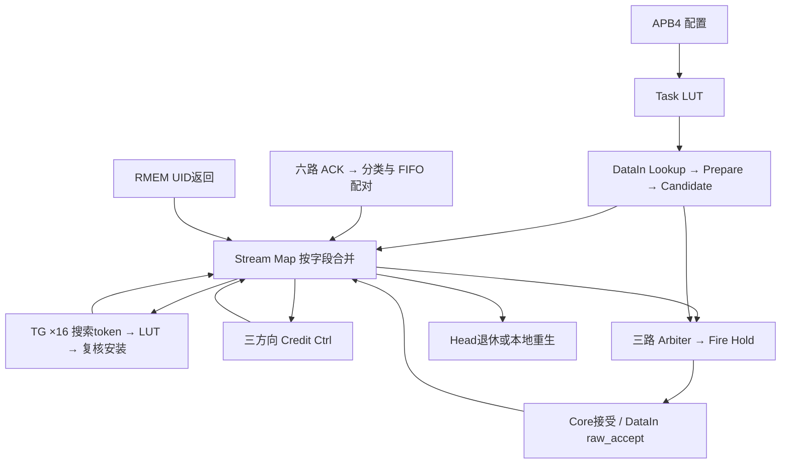

# TS 单元设计

模式：design。层次：Core 内单元接口与逐拍状态。本文供 TS 实现及验证人员确定配置、运行状态、资源许可和多源更新的设计合同。

原始依据：[Task_Scheduler_详细设计文档模板](</home/colin/develop/perfechpitch/_refs/Task_Scheduler_详细设计文档模板.md>)，revision 6452；对应 TS-FUNC-001～018。原文的 ACK 编码、RouterTable 物理位域、credit 流水、PC／VCID 缓存、整分片加载阶段划分和部分配置检查尚有分歧，集中在 [文档缺口与 TBD](../../../08-文档缺口与-TBD.md)。本设计陈述目标行为，代码实现状态独立记录在文末。

## 1　定位与边界

| 模块 | 保存的状态 | 接口职责 |
| - | - | - |
| Task LUT | 64行任务PC/ATTR、写入完整性、RouterTable、DataIn配置及配置状态 | APB、UID查询后的PID匹配、16路TG属性、ACK分类和命令属性 |
| DataIn | Lookup、Prepare、Candidate及加载请求Hold | 接收Trigger；生成Create、Skip、claim、Candidate和special_trigger |
| Task Done | 每单元一对Core/DSA FIFO | 分类ACK、配对完成、转发Skip、按UID定位RMEM归还 |
| Task Generator ×16 | 每SID的搜索token及接受旁带 | 搜索后继、查LUT、复核后提交安装 |
| Credit Ctrl | 三方向计数、16个Pending请求、配置有效标志 | 按年龄分配新增方向，扣账并处理方向归还 |
| Stream Map | 16槽用户与任务状态、Head/Tail、Task0模板、启动标志、Retire Hold | 按字段合并Create/Completion/Skip/TG/Issue/Grant/RMEM/lifecycle |
| DTE/MU/VU Arbiter | 三路独立Fire Hold；DTE normal/Bypass RR偏好 | 选择候选、保持完整命令、实际接受时提交Issue |



有效位、状态和每个字段的写使能决定更新。仿真端口可使用额外序号保证确定性，额外序号不构成硬件任务身份或外部握手。

```svg
<svg xmlns="http://www.w3.org/2000/svg" width="100%" viewBox="0.00 0.00 821.00 835.00" role="img" aria-label="TS 第 0 层">
<title>TS 第 0 层</title>
<g id="diagramc6488592b3bd-graph0" class="graph" transform="scale(1 1) rotate(0) translate(18 816.68)">
<title>G</title>
<polygon fill="white" stroke="none" points="-18,18 -18,-816.68 802.74,-816.68 802.74,18 -18,18" />
<text xml:space="preserve" text-anchor="middle" x="392.37" y="-779.48" font-family="Noto Sans CJK SC" font-size="16.00">TS 第 0 层</text>
<text xml:space="preserve" text-anchor="middle" x="392.37" y="-755.48" font-family="Noto Sans CJK SC" font-size="16.00">方框为功能所有者，级间资格与状态在各节分别定义；端口字段、反压与完成条件见正文。</text>

<g id="diagramc6488592b3bd-node1" class="node">
<title>ncfg</title>
<path fill="#f0fdfa" stroke="#0f766e" d="M361.29,-742.68C361.29,-742.68 190.5,-742.68 190.5,-742.68 184.5,-742.68 178.5,-736.68 178.5,-730.68 178.5,-730.68 178.5,-683.4 178.5,-683.4 178.5,-677.4 184.5,-671.4 190.5,-671.4 190.5,-671.4 361.29,-671.4 361.29,-671.4 367.29,-671.4 373.29,-677.4 373.29,-683.4 373.29,-683.4 373.29,-730.68 373.29,-730.68 373.29,-736.68 367.29,-742.68 361.29,-742.68" />
<text xml:space="preserve" text-anchor="middle" x="275.89" y="-722.64" font-family="Noto Sans CJK SC" font-size="12.00">Task LUT / CFG</text>
<text xml:space="preserve" text-anchor="middle" x="275.89" y="-704.64" font-family="Noto Sans CJK SC" font-size="12.00">64×PC/ATTR；独立DataIn配置</text>
<text xml:space="preserve" text-anchor="middle" x="275.89" y="-686.64" font-family="Noto Sans CJK SC" font-size="12.00">APB提交与RouterTable</text>
</g>

<g id="diagramc6488592b3bd-node2" class="node">
<title>ndin</title>
<path fill="#f0fdfa" stroke="#0f766e" d="M339.91,-608.4C339.91,-608.4 211.88,-608.4 211.88,-608.4 205.88,-608.4 199.88,-602.4 199.88,-596.4 199.88,-596.4 199.88,-549.12 199.88,-549.12 199.88,-543.12 205.88,-537.12 211.88,-537.12 211.88,-537.12 339.91,-537.12 339.91,-537.12 345.91,-537.12 351.91,-543.12 351.91,-549.12 351.91,-549.12 351.91,-596.4 351.91,-596.4 351.91,-602.4 345.91,-608.4 339.91,-608.4" />
<text xml:space="preserve" text-anchor="middle" x="275.89" y="-588.36" font-family="Noto Sans CJK SC" font-size="12.00">DataIn</text>
<text xml:space="preserve" text-anchor="middle" x="275.89" y="-570.36" font-family="Noto Sans CJK SC" font-size="12.00">UID Lookup → Prepare</text>
<text xml:space="preserve" text-anchor="middle" x="275.89" y="-552.36" font-family="Noto Sans CJK SC" font-size="12.00">Candidate / claim</text>
</g>

<g id="diagramc6488592b3bd-edge2" class="edge">
<title>ncfg-&gt;ndin</title>
<path fill="none" stroke="#475569" d="M275.89,-670.94C275.89,-654.51 275.89,-634.79 275.89,-617.41" />
<polygon fill="#475569" stroke="#475569" points="278.52,-617.58 275.9,-610.08 273.27,-617.58 278.52,-617.58" />
<text xml:space="preserve" text-anchor="middle" x="303.27" y="-637.9" font-family="Noto Sans CJK SC" font-size="10.00">PID匹配属性</text>
</g>

<g id="diagramc6488592b3bd-node5" class="node">
<title>ntg</title>
<path fill="#f0fdfa" stroke="#0f766e" d="M743.16,-339.84C743.16,-339.84 604.62,-339.84 604.62,-339.84 598.62,-339.84 592.62,-333.84 592.62,-327.84 592.62,-327.84 592.62,-280.56 592.62,-280.56 592.62,-274.56 598.62,-268.56 604.62,-268.56 604.62,-268.56 743.16,-268.56 743.16,-268.56 749.16,-268.56 755.16,-274.56 755.16,-280.56 755.16,-280.56 755.16,-327.84 755.16,-327.84 755.16,-333.84 749.16,-339.84 743.16,-339.84" />
<text xml:space="preserve" text-anchor="middle" x="673.89" y="-319.8" font-family="Noto Sans CJK SC" font-size="12.00">TG ×16</text>
<text xml:space="preserve" text-anchor="middle" x="673.89" y="-301.8" font-family="Noto Sans CJK SC" font-size="12.00">搜索token → LUT → 复核</text>
<text xml:space="preserve" text-anchor="middle" x="673.89" y="-283.8" font-family="Noto Sans CJK SC" font-size="12.00">Current属性安装</text>
</g>

<g id="diagramc6488592b3bd-edge7" class="edge">
<title>ncfg-&gt;ntg</title>
<path fill="none" stroke="#475569" d="M324.05,-671.02C440.14,-586.62 725.89,-378.84 725.89,-378.84 725.89,-378.84 725.89,-363.84 725.89,-363.84 725.89,-363.84 719.32,-356.42 710.84,-346.86" />
<polygon fill="#475569" stroke="#475569" points="712.99,-345.33 706.05,-341.46 709.06,-348.81 712.99,-345.33" />
<text xml:space="preserve" text-anchor="middle" x="576.59" y="-503.62" font-family="Noto Sans CJK SC" font-size="10.00">LUT属性</text>
</g>

<g id="diagramc6488592b3bd-node7" class="node">
<title>narb</title>
<path fill="#f0fdfa" stroke="#0f766e" d="M269.66,-339.84C269.66,-339.84 92.12,-339.84 92.12,-339.84 86.12,-339.84 80.12,-333.84 80.12,-327.84 80.12,-327.84 80.12,-280.56 80.12,-280.56 80.12,-274.56 86.12,-268.56 92.12,-268.56 92.12,-268.56 269.66,-268.56 269.66,-268.56 275.66,-268.56 281.66,-274.56 281.66,-280.56 281.66,-280.56 281.66,-327.84 281.66,-327.84 281.66,-333.84 275.66,-339.84 269.66,-339.84" />
<text xml:space="preserve" text-anchor="middle" x="180.89" y="-319.8" font-family="Noto Sans CJK SC" font-size="12.00">Arbiter ×3</text>
<text xml:space="preserve" text-anchor="middle" x="180.89" y="-301.8" font-family="Noto Sans CJK SC" font-size="12.00">年龄优先；DTE同SID DataIn优先</text>
<text xml:space="preserve" text-anchor="middle" x="180.89" y="-283.8" font-family="Noto Sans CJK SC" font-size="12.00">Fire Hold完整命令</text>
</g>

<g id="diagramc6488592b3bd-edge14" class="edge">
<title>ncfg-&gt;narb</title>
<path fill="none" stroke="#475569" d="M244.02,-671.07C218.48,-643.05 186.89,-608.4 186.89,-608.4 186.89,-608.4 132.89,-513.12 132.89,-513.12 132.89,-513.12 132.89,-498.12 132.89,-498.12 132.89,-498.12 147.89,-363.84 147.89,-363.84 147.89,-363.84 151.76,-356.98 156.84,-347.94" />
<polygon fill="#475569" stroke="#475569" points="158.99,-349.47 160.38,-341.65 154.42,-346.89 158.99,-349.47" />
<text xml:space="preserve" text-anchor="middle" x="176.39" y="-503.62" font-family="Noto Sans CJK SC" font-size="10.00">PC / 实际PID / VCID</text>
</g>

<g id="diagramc6488592b3bd-node3" class="node">
<title>nsm</title>
<path fill="#f0fdfa" stroke="#0f766e" d="M492.54,-474.12C492.54,-474.12 359.25,-474.12 359.25,-474.12 353.25,-474.12 347.25,-468.12 347.25,-462.12 347.25,-462.12 347.25,-414.84 347.25,-414.84 347.25,-408.84 353.25,-402.84 359.25,-402.84 359.25,-402.84 492.54,-402.84 492.54,-402.84 498.54,-402.84 504.54,-408.84 504.54,-414.84 504.54,-414.84 504.54,-462.12 504.54,-462.12 504.54,-468.12 498.54,-474.12 492.54,-474.12" />
<text xml:space="preserve" text-anchor="middle" x="425.89" y="-454.08" font-family="Noto Sans CJK SC" font-size="12.00">Stream Map</text>
<text xml:space="preserve" text-anchor="middle" x="425.89" y="-436.08" font-family="Noto Sans CJK SC" font-size="12.00">16槽；UID/Current/位图</text>
<text xml:space="preserve" text-anchor="middle" x="425.89" y="-418.08" font-family="Noto Sans CJK SC" font-size="12.00">多源按字段合并</text>
</g>

<g id="diagramc6488592b3bd-edge4" class="edge">
<title>ndin-&gt;nsm</title>
<path fill="none" stroke="#475569" d="M297.1,-536.67C308.56,-517.7 320.39,-498.12 320.39,-498.12 320.39,-498.12 335.85,-489.53 354.94,-478.92" />
<polygon fill="#475569" stroke="#475569" points="356.09,-481.28 361.38,-475.34 353.54,-476.69 356.09,-481.28" />
<text xml:space="preserve" text-anchor="middle" x="352.64" y="-503.62" font-family="Noto Sans CJK SC" font-size="10.00">Create / claim</text>
</g>

<g id="diagramc6488592b3bd-node4" class="node">
<title>ntd</title>
<path fill="#f0fdfa" stroke="#0f766e" d="M155.79,-71.28C155.79,-71.28 12,-71.28 12,-71.28 6,-71.28 0,-65.28 0,-59.28 0,-59.28 0,-12 0,-12 0,-6 6,0 12,0 12,0 155.79,0 155.79,0 161.79,0 167.79,-6 167.79,-12 167.79,-12 167.79,-59.28 167.79,-59.28 167.79,-65.28 161.79,-71.28 155.79,-71.28" />
<text xml:space="preserve" text-anchor="middle" x="83.89" y="-51.24" font-family="Noto Sans CJK SC" font-size="12.00">Task Done</text>
<text xml:space="preserve" text-anchor="middle" x="83.89" y="-33.24" font-family="Noto Sans CJK SC" font-size="12.00">六路ACK分类、双FIFO配对</text>
<text xml:space="preserve" text-anchor="middle" x="83.89" y="-15.24" font-family="Noto Sans CJK SC" font-size="12.00">Skip转发；RMEM独立返回</text>
</g>

<g id="diagramc6488592b3bd-edge5" class="edge">
<title>ndin-&gt;ntd</title>
<path fill="none" stroke="#475569" d="M235.06,-536.79C202.35,-508.77 161.89,-474.12 161.89,-474.12 161.89,-474.12 40.64,-339.84 40.64,-339.84 40.64,-339.84 40.64,-268.56 40.64,-268.56 40.64,-268.56 62.89,-134.28 62.89,-134.28 62.89,-134.28 70.89,-95.28 70.89,-95.28 70.89,-95.28 72.3,-88.95 74.18,-80.45" />
<polygon fill="#475569" stroke="#475569" points="76.72,-81.13 75.78,-73.24 71.59,-80 76.72,-81.13" />
<text xml:space="preserve" text-anchor="middle" x="50.77" y="-302.2" font-family="Noto Sans CJK SC" font-size="10.00">Skip</text>
</g>

<g id="diagramc6488592b3bd-edge6" class="edge">
<title>ndin-&gt;narb</title>
<path fill="none" stroke="#475569" d="M251.9,-536.79C232.67,-508.77 208.89,-474.12 208.89,-474.12 208.89,-474.12 153.89,-378.84 153.89,-378.84 153.89,-378.84 153.89,-363.84 153.89,-363.84 153.89,-363.84 156.93,-357.25 160.97,-348.48" />
<polygon fill="#475569" stroke="#475569" points="163.34,-349.61 164.09,-341.7 158.57,-347.42 163.34,-349.61" />
<text xml:space="preserve" text-anchor="middle" x="232.89" y="-436.48" font-family="Noto Sans CJK SC" font-size="10.00">Candidate</text>
</g>

<g id="diagramc6488592b3bd-edge3" class="edge">
<title>nsm-&gt;ndin</title>
<path fill="none" stroke="#475569" d="M409.22,-474.57C400.2,-493.54 390.89,-513.12 390.89,-513.12 390.89,-513.12 373.75,-521.86 352.69,-532.6" />
<polygon fill="#475569" stroke="#475569" points="351.62,-530.2 346.13,-535.95 354.01,-534.88 351.62,-530.2" />
<text xml:space="preserve" text-anchor="middle" x="453.84" y="-503.62" font-family="Noto Sans CJK SC" font-size="10.00">UID / completion / claim</text>
</g>

<g id="diagramc6488592b3bd-edge8" class="edge">
<title>nsm-&gt;ntg</title>
<path fill="none" stroke="#475569" d="M504.96,-416.31C567.69,-399.51 644.89,-378.84 644.89,-378.84 644.89,-378.84 650.59,-364.38 656.93,-348.28" />
<polygon fill="#475569" stroke="#475569" points="659.21,-349.64 659.52,-341.7 654.33,-347.72 659.21,-349.64" />
<text xml:space="preserve" text-anchor="middle" x="684.94" y="-369.34" font-family="Noto Sans CJK SC" font-size="10.00">Current FINISH</text>
</g>

<g id="diagramc6488592b3bd-node6" class="node">
<title>ncc</title>
<path fill="#f0fdfa" stroke="#0f766e" d="M635.41,-71.28C635.41,-71.28 474.38,-71.28 474.38,-71.28 468.38,-71.28 462.38,-65.28 462.38,-59.28 462.38,-59.28 462.38,-12 462.38,-12 462.38,-6 468.38,0 474.38,0 474.38,0 635.41,0 635.41,0 641.41,0 647.41,-6 647.41,-12 647.41,-12 647.41,-59.28 647.41,-59.28 647.41,-65.28 641.41,-71.28 635.41,-71.28" />
<text xml:space="preserve" text-anchor="middle" x="554.89" y="-51.24" font-family="Noto Sans CJK SC" font-size="12.00">Credit Ctrl</text>
<text xml:space="preserve" text-anchor="middle" x="554.89" y="-33.24" font-family="Noto Sans CJK SC" font-size="12.00">三方向计数初N、SID Pending</text>
<text xml:space="preserve" text-anchor="middle" x="554.89" y="-15.24" font-family="Noto Sans CJK SC" font-size="12.00">Grant；独立RMEM资格</text>
</g>

<g id="diagramc6488592b3bd-edge11" class="edge">
<title>nsm-&gt;ncc</title>
<path fill="none" stroke="#475569" d="M504.72,-422.07C593.6,-404.7 725.89,-378.84 725.89,-378.84 725.89,-378.84 767.89,-339.84 767.89,-339.84 767.89,-339.84 767.89,-268.56 767.89,-268.56 767.89,-268.56 653.98,-144.53 592.77,-77.88" />
<polygon fill="#475569" stroke="#475569" points="595.04,-76.47 588.04,-72.73 591.18,-80.03 595.04,-76.47" />
<text xml:space="preserve" text-anchor="middle" x="765.24" y="-235.06" font-family="Noto Sans CJK SC" font-size="10.00">新增需求</text>
</g>

<g id="diagramc6488592b3bd-edge13" class="edge">
<title>nsm-&gt;narb</title>
<path fill="none" stroke="#475569" d="M370.14,-402.39C340,-383.42 308.89,-363.84 308.89,-363.84 308.89,-363.84 289.47,-354.94 265.76,-344.08" />
<polygon fill="#475569" stroke="#475569" points="266.86,-341.69 258.95,-340.96 264.67,-346.47 266.86,-341.69" />
<text xml:space="preserve" text-anchor="middle" x="360.15" y="-369.34" font-family="Noto Sans CJK SC" font-size="10.00">READY / 年龄</text>
</g>

<g id="diagramc6488592b3bd-node10" class="node">
<title>nlife</title>
<path fill="#f0fdfa" stroke="#0f766e" d="M498.29,-339.84C498.29,-339.84 369.5,-339.84 369.5,-339.84 363.5,-339.84 357.5,-333.84 357.5,-327.84 357.5,-327.84 357.5,-280.56 357.5,-280.56 357.5,-274.56 363.5,-268.56 369.5,-268.56 369.5,-268.56 498.29,-268.56 498.29,-268.56 504.29,-268.56 510.29,-274.56 510.29,-280.56 510.29,-280.56 510.29,-327.84 510.29,-327.84 510.29,-333.84 504.29,-339.84 498.29,-339.84" />
<text xml:space="preserve" text-anchor="middle" x="433.89" y="-319.8" font-family="Noto Sans CJK SC" font-size="12.00">生命周期</text>
<text xml:space="preserve" text-anchor="middle" x="433.89" y="-301.8" font-family="Noto Sans CJK SC" font-size="12.00">Head资格与Retire Hold</text>
<text xml:space="preserve" text-anchor="middle" x="433.89" y="-283.8" font-family="Noto Sans CJK SC" font-size="12.00">SELF_START本地重生</text>
</g>

<g id="diagramc6488592b3bd-edge21" class="edge">
<title>nsm-&gt;nlife</title>
<path fill="none" stroke="#475569" d="M458.84,-402.35C470.55,-389.86 480.89,-378.84 480.89,-378.84 480.89,-378.84 480.89,-363.84 480.89,-363.84 480.89,-363.84 475.06,-356.56 467.51,-347.13" />
<polygon fill="#475569" stroke="#475569" points="469.73,-345.72 463,-341.51 465.64,-349 469.73,-345.72" />
<text xml:space="preserve" text-anchor="middle" x="503.02" y="-369.34" font-family="Noto Sans CJK SC" font-size="10.00">Head条件</text>
</g>

<g id="diagramc6488592b3bd-edge20" class="edge">
<title>ntd-&gt;nsm</title>
<path fill="none" stroke="#475569" d="M80.68,-71.58C75.57,-127.17 66.14,-229.56 66.14,-229.56 66.14,-229.56 66.14,-244.56 66.14,-244.56 66.14,-244.56 67.89,-339.84 67.89,-339.84 67.89,-339.84 153.89,-378.84 153.89,-378.84 153.89,-378.84 258.77,-401.45 338.27,-418.59" />
<polygon fill="#475569" stroke="#475569" points="337.49,-421.11 345.38,-420.12 338.6,-415.97 337.49,-421.11" />
<text xml:space="preserve" text-anchor="middle" x="113.02" y="-235.06" font-family="Noto Sans CJK SC" font-size="10.00">Completion / Return</text>
</g>

<g id="diagramc6488592b3bd-edge9" class="edge">
<title>ntg-&gt;nsm</title>
<path fill="none" stroke="#475569" d="M631.96,-340.29C609.29,-359.26 585.89,-378.84 585.89,-378.84 585.89,-378.84 550.48,-391.82 512.98,-405.56" />
<polygon fill="#475569" stroke="#475569" points="512.52,-402.94 506.38,-407.98 514.32,-407.87 512.52,-402.94" />
<text xml:space="preserve" text-anchor="middle" x="617.35" y="-369.34" font-family="Noto Sans CJK SC" font-size="10.00">Install</text>
</g>

<g id="diagramc6488592b3bd-edge12" class="edge">
<title>ncc-&gt;nsm</title>
<path fill="none" stroke="#475569" d="M552.44,-71.65C546.32,-158.87 530.89,-378.84 530.89,-378.84 530.89,-378.84 515.51,-387.43 496.52,-398.04" />
<polygon fill="#475569" stroke="#475569" points="495.38,-395.67 490.11,-401.62 497.94,-400.25 495.38,-395.67" />
<text xml:space="preserve" text-anchor="middle" x="573.49" y="-235.06" font-family="Noto Sans CJK SC" font-size="10.00">Grant / READY</text>
</g>

<g id="diagramc6488592b3bd-edge17" class="edge">
<title>narb-&gt;nsm</title>
<path fill="none" stroke="#475569" d="M168.47,-340.33C164.05,-352.82 160.14,-363.84 160.14,-363.84 160.14,-363.84 160.14,-378.84 160.14,-378.84 160.14,-378.84 261.06,-401.11 338.51,-418.2" />
<polygon fill="#475569" stroke="#475569" points="337.51,-420.67 345.4,-419.72 338.64,-415.54 337.51,-420.67" />
<text xml:space="preserve" text-anchor="middle" x="202.52" y="-369.34" font-family="Noto Sans CJK SC" font-size="10.00">Issue / raw_accept</text>
</g>

<g id="diagramc6488592b3bd-node8" class="node">
<title>ncore</title>
<path fill="#f0fdfa" stroke="#0f766e" d="M223.54,-205.56C223.54,-205.56 108.25,-205.56 108.25,-205.56 102.25,-205.56 96.25,-199.56 96.25,-193.56 96.25,-193.56 96.25,-146.28 96.25,-146.28 96.25,-140.28 102.25,-134.28 108.25,-134.28 108.25,-134.28 223.54,-134.28 223.54,-134.28 229.54,-134.28 235.54,-140.28 235.54,-146.28 235.54,-146.28 235.54,-193.56 235.54,-193.56 235.54,-199.56 229.54,-205.56 223.54,-205.56" />
<text xml:space="preserve" text-anchor="middle" x="165.89" y="-185.52" font-family="Noto Sans CJK SC" font-size="12.00">RV Core / DSA</text>
<text xml:space="preserve" text-anchor="middle" x="165.89" y="-167.52" font-family="Noto Sans CJK SC" font-size="12.00">Core valid/ready接受</text>
<text xml:space="preserve" text-anchor="middle" x="165.89" y="-149.52" font-family="Noto Sans CJK SC" font-size="12.00">Core与DSA分别ACK</text>
</g>

<g id="diagramc6488592b3bd-edge15" class="edge">
<title>narb-&gt;ncore</title>
<path fill="none" stroke="#475569" d="M171.61,-268.07C168.31,-255.58 165.39,-244.56 165.39,-244.56 165.39,-244.56 165.39,-229.56 165.39,-229.56 165.39,-229.56 165.45,-223.36 165.52,-214.99" />
<polygon fill="#475569" stroke="#475569" points="168.14,-215.08 165.58,-207.56 162.89,-215.04 168.14,-215.08" />
<text xml:space="preserve" text-anchor="middle" x="185.64" y="-235.06" font-family="Noto Sans CJK SC" font-size="10.00">Task命令</text>
</g>

<g id="diagramc6488592b3bd-edge18" class="edge">
<title>ncore-&gt;ntd</title>
<path fill="none" stroke="#475569" d="M144.14,-133.82C133.67,-116.94 121.05,-96.58 110.07,-78.86" />
<polygon fill="#475569" stroke="#475569" points="112.45,-77.72 106.27,-72.73 107.99,-80.49 112.45,-77.72" />
<text xml:space="preserve" text-anchor="middle" x="146.85" y="-100.78" font-family="Noto Sans CJK SC" font-size="10.00">六路ACK</text>
</g>

<g id="diagramc6488592b3bd-edge16" class="edge">
<title>ncore-&gt;narb</title>
<path fill="none" stroke="#475569" d="M191.05,-206.05C200,-218.54 207.89,-229.56 207.89,-229.56 207.89,-229.56 207.89,-244.56 207.89,-244.56 207.89,-244.56 204.86,-251.15 200.82,-259.92" />
<polygon fill="#475569" stroke="#475569" points="198.45,-258.79 197.7,-266.7 203.22,-260.98 198.45,-258.79" />
<text xml:space="preserve" text-anchor="middle" x="221.02" y="-235.06" font-family="Noto Sans CJK SC" font-size="10.00">ready</text>
</g>

<g id="diagramc6488592b3bd-node9" class="node">
<title>nrouter</title>
<path fill="#f0fdfa" stroke="#0f766e" d="M424.66,-205.56C424.66,-205.56 307.12,-205.56 307.12,-205.56 301.12,-205.56 295.12,-199.56 295.12,-193.56 295.12,-193.56 295.12,-146.28 295.12,-146.28 295.12,-140.28 301.12,-134.28 307.12,-134.28 307.12,-134.28 424.66,-134.28 424.66,-134.28 430.66,-134.28 436.66,-140.28 436.66,-146.28 436.66,-146.28 436.66,-193.56 436.66,-193.56 436.66,-199.56 430.66,-205.56 424.66,-205.56" />
<text xml:space="preserve" text-anchor="middle" x="365.89" y="-185.52" font-family="Noto Sans CJK SC" font-size="12.00">Router / RMEM</text>
<text xml:space="preserve" text-anchor="middle" x="365.89" y="-167.52" font-family="Noto Sans CJK SC" font-size="12.00">Trigger；方向Release</text>
<text xml:space="preserve" text-anchor="middle" x="365.89" y="-149.52" font-family="Noto Sans CJK SC" font-size="12.00">RMEM UID返回</text>
</g>

<g id="diagramc6488592b3bd-edge1" class="edge">
<title>nrouter-&gt;ndin</title>
<path fill="none" stroke="#475569" d="M350.98,-205.92C329.89,-255.4 293.89,-339.84 293.89,-339.84 293.89,-339.84 270.64,-363.84 270.64,-363.84 270.64,-363.84 270.64,-378.84 270.64,-378.84 270.64,-378.84 273.16,-471.09 274.7,-528.01" />
<polygon fill="#475569" stroke="#475569" points="272.07,-527.88 274.9,-535.31 277.32,-527.74 272.07,-527.88" />
<text xml:space="preserve" text-anchor="middle" x="286.77" y="-369.34" font-family="Noto Sans CJK SC" font-size="10.00">Trigger</text>
</g>

<g id="diagramc6488592b3bd-edge19" class="edge">
<title>nrouter-&gt;ntd</title>
<path fill="none" stroke="#475569" d="M294.73,-135.54C255.73,-117.24 207.18,-94.47 166.51,-75.39" />
<polygon fill="#475569" stroke="#475569" points="167.76,-73.08 159.85,-72.27 165.53,-77.83 167.76,-73.08" />
<text xml:space="preserve" text-anchor="middle" x="267.1" y="-100.78" font-family="Noto Sans CJK SC" font-size="10.00">RMEM UID返回</text>
</g>

<g id="diagramc6488592b3bd-edge10" class="edge">
<title>nrouter-&gt;ncc</title>
<path fill="none" stroke="#475569" d="M416.05,-133.82C441.14,-116.26 471.62,-94.92 497.63,-76.72" />
<polygon fill="#475569" stroke="#475569" points="498.96,-78.99 503.6,-72.54 495.95,-74.69 498.96,-78.99" />
<text xml:space="preserve" text-anchor="middle" x="485.56" y="-100.78" font-family="Noto Sans CJK SC" font-size="10.00">方向返回</text>
</g>

<g id="diagramc6488592b3bd-edge23" class="edge">
<title>nlife-&gt;nsm</title>
<path fill="none" stroke="#475569" d="M426.11,-340.33C423.34,-352.82 420.89,-363.84 420.89,-363.84 420.89,-363.84 420.89,-378.84 420.89,-378.84 420.89,-378.84 421.42,-385.04 422.14,-393.41" />
<polygon fill="#475569" stroke="#475569" points="419.52,-393.6 422.77,-400.85 424.75,-393.15 419.52,-393.6" />
<text xml:space="preserve" text-anchor="middle" x="447.89" y="-369.34" font-family="Noto Sans CJK SC" font-size="10.00">Special重生</text>
</g>

<g id="diagramc6488592b3bd-edge22" class="edge">
<title>nlife-&gt;nrouter</title>
<path fill="none" stroke="#475569" d="M415.85,-268.1C407.25,-251.37 396.89,-231.22 387.84,-213.61" />
<polygon fill="#475569" stroke="#475569" points="390.24,-212.54 384.48,-207.07 385.57,-214.94 390.24,-212.54" />
<text xml:space="preserve" text-anchor="middle" x="434.93" y="-235.06" font-family="Noto Sans CJK SC" font-size="10.00">普通UID Retire</text>
</g>
</g>
</svg>
```

| 模式 | 入口与启动 | 完成与退出 |
| - | - | - |
| 普通 | Trigger 查询用户并按结果创建或复用 Stream | 执行完整任务链，Head 满足条件后通知 Router |
| SELF_START | 配置保存 Task0 模板；首个已接受 Trigger 同时生成 Bypass 并激活所有启用槽 | Task0 Core ACK 绑定 UID；后续 Trigger 只生成 Bypass；用户完成后本地重生 |
| 权重加载 | 独立 DataIn PC 有效，weights_loading 标记加载阶段；PC-only DTE 请求其余身份字段为 0 | 丢弃新 ACK/RMEM 返回并暂停已有 FIFO 配对；软件用外部完成保证清 loading，再提交业务配置 |

SELF_START Bypass 使用 SID15/TID63，ACK 被过滤。它与普通计算 Stream 分别持有执行状态。WEIGHTS_MODE置位只进入加载模式；每加载阶段由一个已接受Trigger生成独立PC-only请求。加载完成由数据、写响应和队列排空共同确认。

## 2　功能清单

下表保留原稿的模块分工与实现文件对应，运行合同以TS详设一致部分及已确认建模基线为准。

| MAS 模块 | LLD 对应的节 | 模型文件（`src/bach/ip/chip/core/ts/`） |
| - | - | - |
| `CFG_REG` | Task LUT，加各配置寄存器 | `cfg_reg.h` |
| `User_Match` | Data In | `user_match.h` |
| `DataIn_task_table` | Data In 的 Candidate Hold | `user_match.h` |
| `Stream_table` | Stream Map | `stream_table.h` |
| `Task_ctrl` | Task Generator | `task_ctrl.h` |
| `DTE_Arb` | DTE Arbiter | `dte_arb.h` |
| `MU_Arb`、`VU_Arb` | MU/VU Arbitor | `mu_vu_arb.h` |
| `Except Check` | EXCEPT_CHECK（TBD） | 未建 |

Task Done负责ACK分类与配对，Credit Ctrl负责方向额度及生命周期请求；Stream Map拥有用户状态并按字段合并写入。模型文件分别为task_done.h、credit_monitor.h和stream_table.h。

一功能一条，编号供“机制覆盖”一章引用。

### CFG_REG

| 编号 | 功能 |
| - | - |
| F1 | Task LUT为64行PC32/ATTR32，地址0x000+8×TID与0x004+8×TID。软件先写PC后ATTR，各行记录写入完整性；静态依赖以数组顺序表示。 |
| F2 | ATTR保留send[1:0]、recv[3:2]、wait_wake[4]、type[7:5]、partner[13:8]、credit_en[14]、PID[22:15]、End[23]和valid[31]；00/01/10分别Core-only、DSA-only、双ACK，保留编码写入保持旧值。 |
| F3 | Task Type为普通、ReissueOut、BroadcastIn、P2PIn、Reduce及PID_UPDATE六类。PID更新只在Current、Core-only完成合法。 |
| F4 | DATAIN PC/ATTR地址0x200/0x204；独立PC用于Special Bypass和权重，普通DataIn从任务LUT取PC。 |
| F5 | STREAM_NUM 0x208取低5bit并限制到16，0提交报错；INIT_FINISH 0x20C、TS_STATE 0x210、SELF_START 0x214。 |
| F6 | RouterTable为64个PID条目，逻辑方向南北/西/东/Local，VCID随实际PID。物理位域的两种原文布局仍TBD。 |
| F7 | B_CORE_DIRECTION、trigger_task_chain_en与path发送窗口来自通信机制资料；与详设三方向计数的连接及寄存器地址尚未冻结，不增加隐含第四类授权。 |
| F8 | CONFIG阶段写N、Special配置、完整任务链及RouterTable，INIT_FINISH提交；失败清提交并修正后重试，成功后放行业务。 |
| F9 | 提交检查Task0、半写行、连续有效、唯一末尾End、合法单元与N；SELF_START要求独立DataIn。Reduce不依赖credit_en；Reissue组合检查范围仍TBD。 |
| F10 | 生成THROUGH_END_MASK及有效DataIn匹配信息；后继搜索和退休只覆盖Task0至End。 |
| F11 | Prepare按PID选最低完整匹配任务，并排除completion_bitmap和datain_claimed_mask；同PID连续包必须取不同未完成任务。 |

### User_Match

| 编号 | 功能 |
| - | - |
| F12 | Trigger携UID16/PID8/reissue及valid/ready，Lookup无法接入时反压并保持全部字段；已捕获事务经过Prepare再提交。 |
| F13 | UID查询只命中valid且uid_valid的槽，SID与分配生命周期在Pending/Prepare期间受到保护；UID在未退休期间保持唯一。 |
| F14 | Broadcast/reissue0提交搬入Candidate和配对Out Skip；P2P/reissue0只提交双Skip；reissue1提交搬入且不Skip。partner来自LUT。 |
| F15 | Skip按64位掩码与所有Completion按位OR，命中Current时允许FINISH，但Skip不绑定匿名UID，也不产生PID继承。 |
| F16 | 老用户复用SID，不因Future到达替换Current；完成、claim或生命周期变化使旧Prepare失效并刷新快照。 |
| F17 | miss提交时才原子分配SID，受N和生命周期保护；Candidate、Create、claim与Skip使用同一SID；skip-only不要求Candidate空位。 |
| F18 | 普通miss从Task0建立Current，UID即有效；初态分别处理已接受DataIn、Reduce、wait_wake与新增方向。不能从Future TID建立主线。 |
| F19 | Special Bypass用SID15/TID63、Router UID/PID与独立PC；权重命令PC之外身份全0，不参与普通UID查找。 |
| F20 | 硬件以valid/ready接受一次Trigger；模型可用额外序号去重，但序号不扩展硬件身份。 |

| t 的 `TASK_TYPE` | trigger 的 `reissue` | 派 DTE | 跳过 |
| - | - | - | - |
| 2（Broadcast 重发的搬入） | 0 | 派 t | 配对的搬出 |
| 3（P2P 重发的搬入） | 0 | 不派 | t 与配对的搬出 |
| 2 或 3 | 1 | 派 t | 不跳 |
| 其余 | 0 或 1 | 派 t | 不跳 |

### DataIn_task_table

| 编号 | 功能 |
| - | - |
| F21 | Candidate Hold深1，保存bypass、PC、UID、SID、TID、PID，原子提交时置claim而不置完成。 |
| F22 | Candidate与DTE Fire Hold交接所有权，支持旧候选移出同拍新候选写入；skip-only仍受Lookup/Prepare资格限制。 |
| F23 | 普通DataIn PC来自匹配LUT，Special/权重PC来自独立配置；硬件Map不缓存PC，模型缓存差异单独记录。 |
| F24 | Core实际接受每笔普通DataIn产生raw_accept；Future保留接受事实，匹配Current时INFLY。Candidate释放点是交给Fire Hold。 |

### Stream_table

| 编号 | 功能 |
| - | - |
| F25 | Stream Map物理16槽，启用N≤16；Head/Tail按N回绕，SID为行号，生命周期事件控制占用。 |
| F26 | valid、UID/uid_valid、reissue是用户状态；普通Create绑定UID，Special Task0合法完成绑定UID。 |
| F27 | TID、FSM与64位Completion共同表示进度；Future完成只置自己的位，不能推进Current身份。 |
| F28 | 硬件Current保存TID、实际PID、FSM、send_unit、End与方向属性；PC/recv/VCID在使用点查LUT。模型PC缓存属于实现差异。 |
| F29 | 合法Current PID_UPDATE完成置pending；仅紧邻后继继承，跳过紧邻时更后任务用自身静态PID。 |
| F30 | 每SID一份RMEM许可。REDUCE_WAIT取得许可时清可用位并READY；UID返回恢复，不能在Core接受点再次扣。 |
| F31 | Current FSM为WAIT、READY、INFLY、WAIT_CREDIT、FINISH、REDUCE_WAIT；无效槽的状态不参与调度。 |
| F32 | Map按槽与字段合并多源更新，Completion/Skip按位OR；生命周期优先，再处理获准TG、Current完成、matching Issue、raw_accept及Grant/RMEM。 |
| F33 | Core接受不可撤销，不能因状态提交晚而重发。模型请求/accepted实现要复核分配代次，硬件matching Issue无内部Ready。 |
| F34 | Completion命中Current则FINISH、Future只置位；绑定UID与合法PID副作用按各自条件提交；RMEM返回走独立更新。 |
| F35 | 方向Grant同次提交扣计数、登记drct_used并READY；RMEM Grant清本SID可用位并READY，不能混用reissue或方向额度。 |

### Task_ctrl

| 编号 | 功能 |
| - | - |
| F36 | TG只推进valid、Current FINISH且非End的槽；16个SID独立工作，不作每拍仅挑一个SID的限制。 |
| F37 | search=after_current & THROUGH_END_MASK & ~completion_bitmap，64位优先编码选最低后继；连续Skip不逐项增加拍数。 |
| F38 | 后继按DataIn已接受、Reduce、wait_wake和新增方向需求选择INFLY/REDUCE_WAIT/WAIT/WAIT_CREDIT/READY。 |
| F39 | PID继承只在获准紧邻安装时消费pending；安装被抑制不丢pending，新PID可同拍前送。 |
| F40 | TG提交Current相关字段，不能以旧快照整项覆盖用户级位图、UID、claim或方向使用记录。 |
| F41 | 每SID保存搜索token；下一拍查LUT并复核Current、分配与位图；旧token失效重搜，多SID可同拍安装。 |

### DTE_Arb

| 编号 | 功能 |
| - | - |
| F42 | DTE normal候选含READY Stream和普通DataIn，另有Special Bypass及权重请求。 |
| F43 | normal按Head年龄选；同SID由DataIn拥有候选；normal/Bypass RR，权重最高优先且不改变RR。 |
| F44 | Fire Hold非抢占保存完整命令；未ready时valid、PC和全部身份稳定。 |
| F45 | 命令含PC32、UID16、SID4、TID6、PID8、VCID2；Stream VCID按实际PID取得，DataIn/Bypass/权重VCID=0。 |
| F46 | Core接受保存Issue和raw_accept；匹配Current置INFLY，Future不改Current。Reduce许可早在READY之前取得。 |

### MU_Arb / VU_Arb

| 编号 | 功能 |
| - | - |
| F47 | MU/VU各选最老READY且send_unit匹配的有效槽，各一路Fire Hold，保持命令至接受。 |
| F48 | DTE/MU/VU可同拍各接受一笔；一执行单元反压不拖住另两路。 |
| F49 | Hold等待Core ready期间不换候选；实际接受后回IDLE再挑下一笔，接受事实与后继安装共同保护不重复下发。 |

### 完成事件合流

| 编号 | 功能 |
| - | - |
| F50 | 六路Core/DSA ACK为valid-only，每周期各收一笔；RMEM UID返回单独恢复资源，不是第七路TID完成。 |
| F51 | 双ACK使用每执行单元Core/DSA两个深16 FIFO，按队头SID/TID配对；空队直通、同拍弹入和容量边界分别处理。 |
| F52 | Reduce按recv规则由本地双ACK完成Task。RMEM Done只按UID归还空间，不比较TID/PID，不置Completion。 |
| F53 | Future完成只置其位；Current完成FINISH。Future已接受而未完成在TG安装时为INFLY。 |
| F54 | loading时丢弃新六路ACK和RMEM返回，已有配对FIFO保留并暂停；Special SID15/TID63的DTE Bypass ACK过滤。 |
| F55 | Special Task0合法执行Completion携UID绑定匿名槽；要求双ACK时收齐后绑定，Skip不能绑定。 |
| F56 | 仅Current、type5、Core-only Completion使用Core ACK新PID并置pending；Future和双ACK不更新PID。 |
| F57 | VU宏指令事件门控决定何时产生最终DSA ACK；TS把它归入VU DSA ACK，不以另一个event结束Task。 |

### credit 与退休

| 编号 | 功能 |
| - | - |
| F58 | 方向计数由Credit Ctrl管理：南北/西/东各初N，新增方向需求登记Pending；Grant按UID年龄原子满足。 |
| F59 | Reduce在REDUCE_WAIT只看本SID RMEM；前次返回后再授权，返回同拍不能复用。多搬运最后Entry带ACK。 |
| F60 | 方向Credit按用户/方向持有至相应下游真实Release；Task重复使用已持有方向不重复申请。 |
| F61 | BroadcastIn的reissue0在入口Skip配对Out，reissue1保留Out；Out走到时申请尚未持有的方向，再执行DTE重发。 |
| F62 | P2P reissue0双Skip；reissue1先搬入保存，再由配对Out等待方向资源。Skip取消对应等待，不代替其他完成。 |
| F63 | 重发仍在途或尚未成功时，原始缓存及用户资格受保护；不能覆盖数据或退休。 |
| F64 | 通信需求保留最多3方向的P2P缓存映射、容量/项数、下游Credit及重发流程；独立表接口未在当前详设冻结。 |
| F65 | 编译软件把需要业务资源的方向生成到TS RouterTable，实际流转方向由Router表决定；B_CORE_DIRECTION兼容接口另记TBD。 |
| F66 | 共享下游用户空间的多个上游须按相同用户顺序申请，Release按方向/UID同步；广播目的数不替代三方向N计数。 |
| F67 | 每方向返回先累加计数，下一周期参加新Grant；Return和当前Grant分别保留，不能同拍提前复用。 |
| F68 | 仅有效且UID已绑定的Head，through-End全部完成、RMEM空闲、无DataIn查询占用时满足退休。 |
| F69 | 普通退休先建立Retire Hold，下一拍通知UID/valid并释放槽；顶层内部ready固定1，外部无Ready。方向额度由真实Release另还。 |
| F70 | Special Head满足同样完成/资源条件后下一沿本地重生；清UID有效、完成/claim/drct_used，重装Task0并排到队尾，不发普通外部Retire。 |

### Except Check

| 编号 | 功能 |
| - | - |
| F71 | 配置错误经APB与TS_STATE报告；重复/非法ACK、无匹配PID及超时需异常检查，运行期异常码/阈值/中断待冻结。 |

### 自启动（B core 与 R core）

| 编号 | 功能 |
| - | - |
| F72 | SELF_START提交只存Task0模板、N与模式；首个被接受Trigger批量激活N槽匿名Task0 READY，发送单元取LUT。 |
| F73 | Special Bypass独立搬入，数据写完后DTE可选ShareMem flag；软件ready队列耦合搬入与计算，不把flag记成TS完成。 |
| F74 | B/R Task0占MU RV Core轮询软件队列，不调MU DSA。B随后广播/转发，R随后发两操作数到RMEM。 |
| F75 | 首Trigger后N条Task0都参加普通年龄仲裁，RV队列按接受顺序执行；软件认领ready项防止重复消费，合法完成再绑定UID。 |

### 超前发送窗口

| 编号 | 功能 |
| - | - |
| F76 | 超前发送需求假设同TP/PPTP区域各用户计算量近似，才能由本Core进度估计远端进度；跨域不能直接套用。 |
| F77 | 原需求提出每path的flowctl_en/window_n，N编译期配置；寄存器位置和与许可模块的连接仍TBD。 |
| F78 | 候选窗口规则根据正在计算UID=M与N阻止超前用户、计算推进后重新唤醒；边界是否含等号的原文示例有差异，应先统一。 |
| F79 | 超前窗口只适用于可预测进度的TP/PPTP内部P2P，跨TP组不作为已保证机制。 |
| F80 | 原通信文档未指定发送窗口在TS还是Router；恢复需求本身，不把旧模型path_flowctl存储位置写为冻结硬件。 |

***

## 3　接口

| 信号 | 方向 | 位宽 | 行为 |
| - | - | - | - |
| psel、penable、pwrite | 输入 | 各1 | 选中、访问阶段及读写类型 |
| paddr | 输入 | 15 | 32KB空间内局部字节地址，4B对齐 |
| pwdata、prdata | 输入／输出 | 各32 | 写数据、读数据 |
| pstrb | 输入 | 4 | 写仅支持1111 |
| pprot | 旧资料可选字段 | 3 | 原接口表已划删除；通用包装如保留不作权限检查，不要求RTL增加该输入 |
| pready | 输出 | 1 | 固定1，无等待周期 |
| pslverr | 输出 | 1 | 访问阶段报告未对齐、未映射、写只读或部分字节写 |
### 外部运行接口
| 接口 | 方向 | 字段／位宽 | 握手与用途 |
| - | - | - | - |
| router2ts_trigger | Router→TS | UID16、PID8、reissue1、valid/ready | 未Fire全部字段稳定，入口Lookup接纳一次 |
| 方向Credit返回 | Router→TS | 南北/西/东每方向valid；UID载荷兼容保留 | 每有效周期还一份，下一周期可用 |
| rmem2ts_credit_done | RMEM→TS | UID16、valid | 无Ready，匹配有效UID后归还SID许可 |
| ts2router_credit_release | TS→Router | UID16、valid | 外部无Ready；普通Head Retire，不是方向Grant |
| ts2dte/mu/vucore_task | TS→Core | PC32、UID16、SID4、TID6、PID8、VCID2、valid/ready | Fire Hold保持，接受一次不可撤回 |
| dte/mu/vucore2ts_done | Core→TS | UID16、SID4、TID6、PID8、valid | 六ACK中的Core侧，PID副作用另查资格 |
| dte/mu/vu2ts_done | DSA→TS | UID16、SID4、TID6、valid | 六ACK中的DSA侧，无Ready |
| ts2corestatus_int | TS→状态模块 | 异常通知 | 运行异常最终编码/阈值待冻结 |

模型通用TaskCmd中的额外seq/DSA使能等字段用于仿真和RV调度；硬件旁带以原始顶层接口为准，不据模型结构体增加外部信号。

### 内部提交接口
| 生产者 | 消费者 | 提交字段 | 保持／冲突规则 |
| - | - | - | - |
| DataIn | Map、Task Done、DTE Arbiter | Create、Skip64、claim、Candidate、credit_skip | 分配与提交使用同SID，Candidate可独立反压 |
| Task Done | Map | Completion与合法UID/PID副作用 | 同SID完成与Skip OR；Future不改Current |
| TG×16 | Map | 搜索token、Current安装属性、接受旁带 | 复核资格后原子安装；不覆盖用户级字段 |
| Arbiter | Map/TG | matching Issue与普通DataIn raw_accept | Core接受即事实，不以Map重试重新发Core |
| Credit Ctrl | Map | 新方向Grant、RMEM占用 | 方向扣账与READY同次提交，身份变化取消旧请求 |
| Map生命周期 | Retire Hold／本地重生 | SID、UID、Task0模板 | 无入口查询占用，完成位提交之后才可回收 |

## 4　存储器

| 字段 | 宽度 | 来源与生命周期 |
| - | - | - |
| entry_valid、uid_valid | 各1 | 普通创建置有效并绑定；特殊启动匿名；普通退休清除 |
| UID | 16 | 普通Trigger或匿名Task0合法完成 |
| PID、pid_pending | 8、1 | 模板／TG／合法Core PID更新，安装消耗继承标志 |
| Current TID | 6 | 普通创建/特殊启动/重生为0，TG更新 |
| task_state | 3 | WAIT000、READY001、INFLY010、WAIT_CREDIT011、FINISH100、REDUCE_WAIT101 |
| send_unit、End | 2、1 | Task0模板或TG |
| completion_bitmap | 64 | Completion及Skip按OR累计 |
| datain_claimed_mask | 64 | Candidate提交置位，新生命周期清0 |
| credit_drct、drct_used | 各3 | TG需求／有效Grant，本生命周期使用方向持续保留 |
| rmem_credit | 1 | Reduce许可扣占；UID返回归还 |

Head/Tail各4位、启动标志、Task0模板、配置有效性和普通Retire Hold是共享状态。SID由行号隐含；接收类型从LUT读取。PC／VCID是否额外缓存由原文待统一项决定，不能拿旧总位数估计目标Map面积。
### 存储对象与访问所有者
| 对象 | 组织 | 写入／读取 | 复位与容量 |
| - | - | - | - |
| Task LUT | 64×PC32/ATTR32及两半写入标志 | APB写，DataIn/TG/ACK分类/Arbiter多查询 | 配置0，业务提交检查完整 |
| DataIn配置 | 独立PC与ATTR | APB写，Special/weight读 | 未配置不能创建独立搬入 |
| RouterTable | PID0～63方向与VCID | APB写；方向与实际PID查读 | 物理位域待统一 |
| Stream Map | 16槽，用户及Current字段 | 多源按字段合并，按N环回 | invalid；UID未绑定无匹配资格 |
| completion / claimed | 每SID各64bit | Completion/Skip、Candidate各自置位 | 每新生命周期清0 |
| TG token | 每SID一项 | 搜索寄存、复核安装 | 空；不能携旧分配安装新用户 |
| Candidate / Fire Hold | 1项／每单元1项 | DataIn交接、仲裁装入、Core接受释放 | 空；反压不改字段 |
| Core/DSA配对FIFO | 每执行单元2×16项，共6 FIFO | 分类ACK入队、队头配对弹出 | 空；不得任意检索重排 |
| 方向credit / Pending | 三方向初N；每SID请求 | 返回累加、Grant扣账 | 配置初始化，取消旧身份请求 |
| drct_used / RMEM许可 | 每SID 3bit／1bit | 方向Grant／Reduce许可／UID返回 | 新生命周期清方向、RMEM可用 |
| Retire Hold | 一项有效SID/UID | Head资格建立，下一拍释放 | 空；Special不走外部通知 |

path_flowctl与P2P缓存映射是原通信需求的候选存储，接口尚未冻结，不混入以上已定义资源。

### 编译侧读入的表

软件产物由TCHAIN、DATAIN、TSRTAB、CFGMISC提供任务属性、独立搬入PC、路由逻辑属性与启动配置，装载顺序遵循配置提交规则。TSRTAB许可方向按需要下游用户资源的stream_need生成；Router实际转发flow_dir独立配置，不能把透传流量重复记成TS持有额度。

旧PATHTASK/path_task字段仅作兼容配置或诊断，当前DataIn必须根据用户自己的完成/claim位图在LUT中匹配PID；DTE身份取Trigger旁带。不存在硬件依赖的一PID固定一TID反查表。方向计数是每方向初N，不是每PID/SID按广播目的数初始化。

### 模型里四种 core 的任务链

当前生成器的EPTP-NK任务表由hwconfig/moe.py生成。下面列完整TID、kernel入口、单元、recv、wait_wake、type、credit_en、PID和End。RV_ONLY=00、DSA=01、RV_DSA=10。调DSA但只等DSA的kernel用task_done(0)，双ACK Reduce用task_done(1)。

### 计算Core（逻辑槽0～6，示例槽0）
| TID | kernel入口 | 单元 | recv | wait_wake | type | credit_en | PID | End |
| - | - | - | - | - | - | - | - | - |
| 0 | task_dte_token_datain | DTE | DSA | 1 | NORMAL | 0 | 4 | 0 |
| 1 | task_mu_part_s0 | MU | DSA | 0 | NORMAL | 0 | 0 | 0 |
| 2 | task_dte_send_part | DTE | RV_DSA | 0 | REDUCE | 0 | 3 | 0 |
| 3 | task_dte_fc2in_datain | DTE | DSA | 1 | NORMAL | 0 | 11 | 0 |
| 4 | task_mu_fc2_s0 | MU | DSA | 0 | NORMAL | 0 | 0 | 0 |
| 5 | task_dte_send_concat_s0 | DTE | DSA | 0 | NORMAL | 0 | 16 | 1 |

### dot Core（逻辑槽7）
| TID | kernel入口 | 单元 | recv | wait_wake | type | credit_en | PID | End |
| - | - | - | - | - | - | - | - | - |
| 0 | task_dte_token_datain | DTE | DSA | 1 | NORMAL | 0 | 4 | 0 |
| 1 | task_mu_part_s7 | MU | DSA | 0 | NORMAL | 0 | 0 | 0 |
| 2 | task_dte_send_part | DTE | RV_DSA | 0 | REDUCE | 0 | 3 | 0 |
| 3 | task_dte_red_datain | DTE | DSA | 1 | NORMAL | 0 | 3 | 0 |
| 4 | task_vu_gate | VU | DSA | 0 | NORMAL | 0 | 0 | 0 |
| 5 | task_dte_send_fc2in | DTE | DSA | 0 | NORMAL | 1 | 11 | 0 |
| 6 | task_mu_fc2_s7 | MU | DSA | 0 | NORMAL | 0 | 0 | 0 |
| 7 | task_dte_concat_datain_s0 | DTE | DSA | 1 | NORMAL | 0 | 16 | 0 |
| 8 | task_dte_concat_datain_s1 | DTE | DSA | 1 | NORMAL | 0 | 17 | 0 |
| 9 | task_dte_concat_datain_s2 | DTE | DSA | 1 | NORMAL | 0 | 18 | 0 |
| 10 | task_dte_concat_datain_s3 | DTE | DSA | 1 | NORMAL | 0 | 19 | 0 |
| 11 | task_dte_concat_datain_s4 | DTE | DSA | 1 | NORMAL | 0 | 20 | 0 |
| 12 | task_dte_concat_datain_s5 | DTE | DSA | 1 | NORMAL | 0 | 21 | 0 |
| 13 | task_dte_concat_datain_s6 | DTE | DSA | 1 | NORMAL | 0 | 22 | 0 |
| 14 | task_dte_send_row | DTE | RV_DSA | 0 | REDUCE | 0 | 7 | 1 |

dot的七个concat输入占TID7～13，行归约为TID14。上游行分量直接进入RMEM，按最早未完成归约和上下文忙闲保护；不恢复旧MOE_ROW_IN_OFF搬入Task14和额外Task15。硬件提前预留的许可衔接另记TBD。

### B Core
| TID | kernel入口 | 单元 | recv | wait_wake | type | credit_en | PID | End |
| - | - | - | - | - | - | - | - | - |
| 0 | task_bc_wait | MU | RV_ONLY | 0 | NORMAL | 0 | 0 | 0 |
| 1 | task_dte_bc_send | DTE | DSA | 0 | NORMAL | 1 | 4 | 0 |
| 2 | task_dte_bc_relay | DTE | DSA | 0 | NORMAL | 0 | 6 | 1 |

SELF_START首Trigger启动匿名槽；独立bc_datain收32B头及6592B逻辑载荷到MM槽。逻辑槽跨度6656B，完成flag按该跨度求下标；发送和转发使用各自实际PID、仅申请新增业务方向。

### R Core
| TID | kernel入口 | 单元 | recv | wait_wake | type | credit_en | PID | End |
| - | - | - | - | - | - | - | - | - |
| 0 | task_rc_find | MU | RV_ONLY | 0 | NORMAL | 0 | 0 | 0 |
| 1 | task_dte_rc_reduce | DTE | RV_DSA | 0 | REDUCE | 0 | 8 | 1 |

独立rc_datain收两半MM数据，各半写完再置flag。Task0按ready用户FIFO认领并绑定UID，Task1把同UID两Packet作为本地操作数送RMEM，第一Entry不带ACK、最后Entry带ACK。Core与DSA完成后仍等RMEM返回再复用TS槽。

逻辑计算槽与物理Core位置按拓扑映射：dot在前/中列为物理Core9，最后列为Core8；B为组头Core0，R为行尾Core9，坏Core只保留Router。

### 四种 core 级切分模式的任务链

当前生成器实现EPTP-NK。以下EPTP-NN、PPTP-NK、PPTP-NN保留原软件设计的完整操作分解，步骤号是跨段说明编号，不是某个Core冻结的连续TID。PPTP dot落点的原文分歧仍在TBD，未声明这些表已由当前bundle生成。

**EPTP-NN**：每个 core 的任务链相同。

| 步 | unit | 内容 |
| - | - | - |
| 0 | DTE | token data in |
| 1 | MU | FC1 / FC3 计算 |
| 2 | VU | silu × FC3 加量化 |
| 3 | MU | FC2 计算加 EP Reduce |
| 4 | DTE | FC2 结果 out，Router 上逐级 reduce |

**PPTP 两种模式的共同点**：PP 把 FC1、FC3、FC2 摆在不同行的 chip 上，**silu、dot、量化三步统一落在 FC2 段 chip 的逻辑 core 0**。FC1 段与 FC3 段各自把本段的结果送到那一个 core，dot 完再由它把结果当作 FC2 的 token 在本 chip 内广播。原始文档另有两处把 dot 摆在 FC3 chip，本套文档不采用，冲突记在第 8 章。

**PPTP-NK**：FC1 / FC3 chip 内切 K，每 core 出的是部分和，要先 chip 内逐级 reduce；FC2 chip 内切 N，出的是 y 的一段，所以是 concat。

| 段 | 步 | unit | 内容 |
| - | - | - | - |
| FC1 段 | 0 | DTE | token data in |
| FC1 段 | 1 | MU | FC1 计算 |
| FC1 段 | 2 | DTE | FC1 部分和 out，Router 上逐级 reduce |
| FC1 段 | 3 | DTE | reduce 结果 data in（只在 chip 内最后一个 core 上） |
| FC1 段 | 4 | DTE | reduce 结果 out 到 FC2 段 chip 的逻辑 core 0 |
| FC3 段 | 0～4 | 同上 | 把 FC1 换成 FC3，其余相同 |
| FC2 段 core 0 | 5 | DTE | 收 FC1 段的 reduce 结果 |
| FC2 段 core 0 | 6 | DTE | 收 FC3 段的 reduce 结果 |
| FC2 段 core 0 | 7 | VU | silu · dot · 量化 |
| FC2 段 core 0 | 8 | DTE | 结果作为 FC2 的 token 在本 chip 内广播 |
| FC2 段各 core | 9 | DTE | FC2 token data in |
| FC2 段各 core | 10 | MU | FC2 计算加 EP Reduce |
| FC2 段各 core | 11 | DTE | FC2 结果 out（concat） |
| FC2 段 concat core | 12 | DTE | 与 chip 内其他 core concat |
| FC2 段 concat core | 13 | DTE | concat 结果 out，跨 chip reduce |

**PPTP-NN**：FC1 / FC3 chip 内也切 N，每 core 出的就是 y 的一段，chip 内做 concat 而不是 reduce；FC2 chip 内切 K，出的是部分和，所以是逐级 reduce。

| 段 | 步 | unit | 内容 |
| - | - | - | - |
| FC1 段 | 0 | DTE | token data in |
| FC1 段 | 1 | MU | FC1 计算 |
| FC1 段 | 2 | DTE | FC1 结果 out（concat） |
| FC1 段 concat core | 3 | DTE | 与 chip 内其他 core concat |
| FC1 段 concat core | 4 | DTE | concat 结果 out 到 FC2 段 chip 的逻辑 core 0 |
| FC3 段 | 0～4 | 同上 | 把 FC1 换成 FC3，其余相同 |
| FC2 段 core 0 | 5 | DTE | 收 FC1 段的 concat 结果 |
| FC2 段 core 0 | 6 | DTE | 收 FC3 段的 concat 结果 |
| FC2 段 core 0 | 7 | VU | silu · dot · 量化 |
| FC2 段 core 0 | 8 | DTE | 结果作为 FC2 的 token 在本 chip 内广播 |
| FC2 段各 core | 9 | DTE | FC2 token data in |
| FC2 段各 core | 10 | MU | FC2 计算加 EP Reduce |
| FC2 段各 core | 11 | DTE | FC2 部分和 out，Router 上逐级 reduce |
| FC2 段 reduce core | 12 | DTE | chip 内 reduce 结果 data in |
| FC2 段 reduce core | 13 | DTE | 结果 out，跨 chip reduce |

***

## 5　流水线总览

```svg
<svg xmlns="http://www.w3.org/2000/svg" width="100%" viewBox="0.00 0.00 848.00 1095.00" role="img" aria-label="TS 第 1 层流水线总览">
<title>TS 第 1 层流水线总览</title>
<g id="diagram703e129d630c-graph0" class="graph" transform="scale(1 1) rotate(0) translate(18 1076.96)">
<title>G</title>
<polygon fill="white" stroke="none" points="-18,18 -18,-1076.96 830.39,-1076.96 830.39,18 -18,18" />
<text xml:space="preserve" text-anchor="middle" x="406.2" y="-1039.76" font-family="Noto Sans CJK SC" font-size="16.00">TS 第 1 层流水线总览</text>
<text xml:space="preserve" text-anchor="middle" x="406.2" y="-1015.76" font-family="Noto Sans CJK SC" font-size="16.00">入口、完成、后继、许可与生命周期是并行路径；Map不被统一计成固定流水级。</text>

<g id="diagram703e129d630c-node1" class="node">
<title>n0</title>
<path fill="#f0fdfa" stroke="#0f766e" d="M576.52,-1002.96C576.52,-1002.96 397.48,-1002.96 397.48,-1002.96 391.48,-1002.96 385.48,-996.96 385.48,-990.96 385.48,-990.96 385.48,-925.68 385.48,-925.68 385.48,-919.68 391.48,-913.68 397.48,-913.68 397.48,-913.68 576.52,-913.68 576.52,-913.68 582.52,-913.68 588.52,-919.68 588.52,-925.68 588.52,-925.68 588.52,-990.96 588.52,-990.96 588.52,-996.96 582.52,-1002.96 576.52,-1002.96" />
<text xml:space="preserve" text-anchor="middle" x="487" y="-982.92" font-family="Noto Sans CJK SC" font-size="12.00">M1 · UID Lookup</text>
<text xml:space="preserve" text-anchor="middle" x="487" y="-964.92" font-family="Noto Sans CJK SC" font-size="12.00">Trigger: UID16 / PID8 / reissue</text>
<text xml:space="preserve" text-anchor="middle" x="487" y="-946.92" font-family="Noto Sans CJK SC" font-size="12.00">锁存入口，匹配已绑定用户</text>
<text xml:space="preserve" text-anchor="middle" x="487" y="-928.92" font-family="Noto Sans CJK SC" font-size="12.00">保存SID与completion/claim快照</text>
</g>

<g id="diagram703e129d630c-node2" class="node">
<title>n1</title>
<path fill="#f0fdfa" stroke="#0f766e" d="M580.64,-850.68C580.64,-850.68 393.36,-850.68 393.36,-850.68 387.36,-850.68 381.36,-844.68 381.36,-838.68 381.36,-838.68 381.36,-773.4 381.36,-773.4 381.36,-767.4 387.36,-761.4 393.36,-761.4 393.36,-761.4 580.64,-761.4 580.64,-761.4 586.64,-761.4 592.64,-767.4 592.64,-773.4 592.64,-773.4 592.64,-838.68 592.64,-838.68 592.64,-844.68 586.64,-850.68 580.64,-850.68" />
<text xml:space="preserve" text-anchor="middle" x="487" y="-830.64" font-family="Noto Sans CJK SC" font-size="12.00">M2 · Prepare / Create</text>
<text xml:space="preserve" text-anchor="middle" x="487" y="-812.64" font-family="Noto Sans CJK SC" font-size="12.00">最低未完成、未claimed的匹配TID</text>
<text xml:space="preserve" text-anchor="middle" x="487" y="-794.64" font-family="Noto Sans CJK SC" font-size="12.00">Create + Skip + claim + Candidate</text>
<text xml:space="preserve" text-anchor="middle" x="487" y="-776.64" font-family="Noto Sans CJK SC" font-size="12.00">新用户从Task0建立Current</text>
</g>

<g id="diagram703e129d630c-edge1" class="edge">
<title>n0-&gt;n1</title>
<path fill="none" stroke="#475569" d="M487,-913.45C487,-896.7 487,-877.43 487,-859.93" />
<polygon fill="#475569" stroke="#475569" points="489.63,-859.98 487,-852.48 484.38,-859.98 489.63,-859.98" />
<text xml:space="preserve" text-anchor="middle" x="514" y="-880.18" font-family="Noto Sans CJK SC" font-size="10.00">Lookup结果</text>
</g>

<g id="diagram703e129d630c-node4" class="node">
<title>n3</title>
<path fill="#f0fdfa" stroke="#0f766e" d="M392.02,-698.4C392.02,-698.4 215.98,-698.4 215.98,-698.4 209.98,-698.4 203.98,-692.4 203.98,-686.4 203.98,-686.4 203.98,-621.12 203.98,-621.12 203.98,-615.12 209.98,-609.12 215.98,-609.12 215.98,-609.12 392.02,-609.12 392.02,-609.12 398.02,-609.12 404.02,-615.12 404.02,-621.12 404.02,-621.12 404.02,-686.4 404.02,-686.4 404.02,-692.4 398.02,-698.4 392.02,-698.4" />
<text xml:space="preserve" text-anchor="middle" x="304" y="-678.36" font-family="Noto Sans CJK SC" font-size="12.00">M4 · 仲裁 / Fire Hold</text>
<text xml:space="preserve" text-anchor="middle" x="304" y="-660.36" font-family="Noto Sans CJK SC" font-size="12.00">DTE / MU / VU三路各1条命令</text>
<text xml:space="preserve" text-anchor="middle" x="304" y="-642.36" font-family="Noto Sans CJK SC" font-size="12.00">最老普通用户，同SID优先DataIn</text>
<text xml:space="preserve" text-anchor="middle" x="304" y="-624.36" font-family="Noto Sans CJK SC" font-size="12.00">持有完整PC、PID、身份及VCID</text>
</g>

<g id="diagram703e129d630c-edge2" class="edge">
<title>n1-&gt;n3</title>
<path fill="none" stroke="#475569" d="M433.58,-761.17C411.87,-743.35 386.69,-722.67 364.33,-704.3" />
<polygon fill="#475569" stroke="#475569" points="366.12,-702.38 358.66,-699.65 362.79,-706.43 366.12,-702.38" />
<text xml:space="preserve" text-anchor="middle" x="424.99" y="-727.9" font-family="Noto Sans CJK SC" font-size="10.00">Candidate</text>
</g>

<g id="diagram703e129d630c-node6" class="node">
<title>n5</title>
<path fill="#f0fdfa" stroke="#0f766e" d="M651.64,-393.84C651.64,-393.84 482.36,-393.84 482.36,-393.84 476.36,-393.84 470.36,-387.84 470.36,-381.84 470.36,-381.84 470.36,-316.56 470.36,-316.56 470.36,-310.56 476.36,-304.56 482.36,-304.56 482.36,-304.56 651.64,-304.56 651.64,-304.56 657.64,-304.56 663.64,-310.56 663.64,-316.56 663.64,-316.56 663.64,-381.84 663.64,-381.84 663.64,-387.84 657.64,-393.84 651.64,-393.84" />
<text xml:space="preserve" text-anchor="middle" x="567" y="-373.8" font-family="Noto Sans CJK SC" font-size="12.00">M6 · ACK / Skip</text>
<text xml:space="preserve" text-anchor="middle" x="567" y="-355.8" font-family="Noto Sans CJK SC" font-size="12.00">六路valid-only ACK，分类/配对</text>
<text xml:space="preserve" text-anchor="middle" x="567" y="-337.8" font-family="Noto Sans CJK SC" font-size="12.00">completion与Skip按位OR</text>
<text xml:space="preserve" text-anchor="middle" x="567" y="-319.8" font-family="Noto Sans CJK SC" font-size="12.00">RMEM UID返回单独恢复许可</text>
</g>

<g id="diagram703e129d630c-edge3" class="edge">
<title>n1-&gt;n5</title>
<path fill="none" stroke="#475569" d="M494.74,-761.01C509.54,-676.87 541.79,-493.54 557.72,-402.98" />
<polygon fill="#475569" stroke="#475569" points="560.28,-403.58 558.99,-395.74 555.11,-402.67 560.28,-403.58" />
<text xml:space="preserve" text-anchor="middle" x="538.05" y="-575.62" font-family="Noto Sans CJK SC" font-size="10.00">Skip</text>
</g>

<g id="diagram703e129d630c-node7" class="node">
<title>n6</title>
<path fill="#f0fdfa" stroke="#0f766e" d="M346.89,-241.56C346.89,-241.56 155.11,-241.56 155.11,-241.56 149.11,-241.56 143.11,-235.56 143.11,-229.56 143.11,-229.56 143.11,-164.28 143.11,-164.28 143.11,-158.28 149.11,-152.28 155.11,-152.28 155.11,-152.28 346.89,-152.28 346.89,-152.28 352.89,-152.28 358.89,-158.28 358.89,-164.28 358.89,-164.28 358.89,-229.56 358.89,-229.56 358.89,-235.56 352.89,-241.56 346.89,-241.56" />
<text xml:space="preserve" text-anchor="middle" x="251" y="-221.52" font-family="Noto Sans CJK SC" font-size="12.00">M7 · TG ×16</text>
<text xml:space="preserve" text-anchor="middle" x="251" y="-203.52" font-family="Noto Sans CJK SC" font-size="12.00">搜索after_current &amp; mask &amp; ~done</text>
<text xml:space="preserve" text-anchor="middle" x="251" y="-185.52" font-family="Noto Sans CJK SC" font-size="12.00">下一拍查LUT、复核后安装</text>
<text xml:space="preserve" text-anchor="middle" x="251" y="-167.52" font-family="Noto Sans CJK SC" font-size="12.00">继承PID与接受事实一起处理</text>
</g>

<g id="diagram703e129d630c-edge4" class="edge">
<title>n1-&gt;n6</title>
<path fill="none" stroke="#475569" d="M381.03,-772.34C237.77,-728.13 0,-654.76 0,-654.76 0,-654.76 0,-654.76 0,-348.2 0,-348.2 96.58,-290.38 169.92,-246.47" />
<polygon fill="#475569" stroke="#475569" points="171,-248.88 176.09,-242.77 168.31,-244.37 171,-248.88" />
<text xml:space="preserve" text-anchor="middle" x="33.38" y="-499.48" font-family="Noto Sans CJK SC" font-size="10.00">Create Current</text>
</g>

<g id="diagram703e129d630c-node3" class="node">
<title>n2</title>
<path fill="#f0fdfa" stroke="#0f766e" d="M337.52,-89.28C337.52,-89.28 164.48,-89.28 164.48,-89.28 158.48,-89.28 152.48,-83.28 152.48,-77.28 152.48,-77.28 152.48,-12 152.48,-12 152.48,-6 158.48,0 164.48,0 164.48,0 337.52,0 337.52,0 343.52,0 349.52,-6 349.52,-12 349.52,-12 349.52,-77.28 349.52,-77.28 349.52,-83.28 343.52,-89.28 337.52,-89.28" />
<text xml:space="preserve" text-anchor="middle" x="251" y="-69.24" font-family="Noto Sans CJK SC" font-size="12.00">M3 · 资源许可</text>
<text xml:space="preserve" text-anchor="middle" x="251" y="-51.24" font-family="Noto Sans CJK SC" font-size="12.00">WAIT_CREDIT：三方向新增需求</text>
<text xml:space="preserve" text-anchor="middle" x="251" y="-33.24" font-family="Noto Sans CJK SC" font-size="12.00">REDUCE_WAIT：独立SID RMEM</text>
<text xml:space="preserve" text-anchor="middle" x="251" y="-15.24" font-family="Noto Sans CJK SC" font-size="12.00">提交许可与READY原子生效</text>
</g>

<g id="diagram703e129d630c-edge6" class="edge">
<title>n2-&gt;n3</title>
<path fill="none" stroke="#475569" d="M201.5,-89.63C168.44,-119.01 131,-152.28 131,-152.28 131,-152.28 105,-195.92 105,-195.92 105,-502.48 105,-502.48 105,-502.48 105,-502.48 180.64,-559.6 238.66,-603.41" />
<polygon fill="#475569" stroke="#475569" points="236.86,-605.35 244.43,-607.77 240.03,-601.16 236.86,-605.35" />
<text xml:space="preserve" text-anchor="middle" x="120" y="-347.2" font-family="Noto Sans CJK SC" font-size="10.00">READY</text>
</g>

<g id="diagram703e129d630c-node5" class="node">
<title>n4</title>
<path fill="#f0fdfa" stroke="#0f766e" d="M382.27,-546.12C382.27,-546.12 225.73,-546.12 225.73,-546.12 219.73,-546.12 213.73,-540.12 213.73,-534.12 213.73,-534.12 213.73,-468.84 213.73,-468.84 213.73,-462.84 219.73,-456.84 225.73,-456.84 225.73,-456.84 382.27,-456.84 382.27,-456.84 388.27,-456.84 394.27,-462.84 394.27,-468.84 394.27,-468.84 394.27,-534.12 394.27,-534.12 394.27,-540.12 388.27,-546.12 382.27,-546.12" />
<text xml:space="preserve" text-anchor="middle" x="304" y="-526.08" font-family="Noto Sans CJK SC" font-size="12.00">M5 · Core接受</text>
<text xml:space="preserve" text-anchor="middle" x="304" y="-508.08" font-family="Noto Sans CJK SC" font-size="12.00">valid &amp;&amp; ready才是接受</text>
<text xml:space="preserve" text-anchor="middle" x="304" y="-490.08" font-family="Noto Sans CJK SC" font-size="12.00">记录raw_accept与Issue</text>
<text xml:space="preserve" text-anchor="middle" x="304" y="-472.08" font-family="Noto Sans CJK SC" font-size="12.00">Future被接受后不可重复下发</text>
</g>

<g id="diagram703e129d630c-edge7" class="edge">
<title>n3-&gt;n4</title>
<path fill="none" stroke="#475569" d="M304,-608.89C304,-592.14 304,-572.87 304,-555.37" />
<polygon fill="#475569" stroke="#475569" points="306.63,-555.42 304,-547.92 301.38,-555.42 306.63,-555.42" />
<text xml:space="preserve" text-anchor="middle" x="324.62" y="-575.62" font-family="Noto Sans CJK SC" font-size="10.00">Core接受</text>
</g>

<g id="diagram703e129d630c-edge8" class="edge">
<title>n4-&gt;n5</title>
<path fill="none" stroke="#475569" d="M334.7,-456.74C348.61,-436.92 362,-417.84 362,-417.84 362,-417.84 411.28,-401.58 461.51,-385.01" />
<polygon fill="#475569" stroke="#475569" points="462.17,-387.55 468.47,-382.71 460.52,-382.57 462.17,-387.55" />
<text xml:space="preserve" text-anchor="middle" x="381.5" y="-423.34" font-family="Noto Sans CJK SC" font-size="10.00">执行ACK</text>
</g>

<g id="diagram703e129d630c-edge9" class="edge">
<title>n4-&gt;n6</title>
<path fill="none" stroke="#475569" d="M296.29,-456.49C286.74,-401.92 270.46,-309 260.24,-250.67" />
<polygon fill="#475569" stroke="#475569" points="262.86,-250.39 258.98,-243.46 257.69,-251.3 262.86,-250.39" />
<text xml:space="preserve" text-anchor="middle" x="311.12" y="-347.2" font-family="Noto Sans CJK SC" font-size="10.00">raw_accept</text>
</g>

<g id="diagram703e129d630c-edge10" class="edge">
<title>n5-&gt;n6</title>
<path fill="none" stroke="#475569" d="M474.32,-304.13C435.74,-285.78 390.85,-264.43 351.47,-245.7" />
<polygon fill="#475569" stroke="#475569" points="352.94,-243.49 345.04,-242.64 350.69,-248.23 352.94,-243.49" />
<text xml:space="preserve" text-anchor="middle" x="445.47" y="-271.06" font-family="Noto Sans CJK SC" font-size="10.00">Current完成</text>
</g>

<g id="diagram703e129d630c-node8" class="node">
<title>n7</title>
<path fill="#f0fdfa" stroke="#0f766e" d="M800.39,-241.56C800.39,-241.56 611.61,-241.56 611.61,-241.56 605.61,-241.56 599.61,-235.56 599.61,-229.56 599.61,-229.56 599.61,-164.28 599.61,-164.28 599.61,-158.28 605.61,-152.28 611.61,-152.28 611.61,-152.28 800.39,-152.28 800.39,-152.28 806.39,-152.28 812.39,-158.28 812.39,-164.28 812.39,-164.28 812.39,-229.56 812.39,-229.56 812.39,-235.56 806.39,-241.56 800.39,-241.56" />
<text xml:space="preserve" text-anchor="middle" x="706" y="-221.52" font-family="Noto Sans CJK SC" font-size="12.00">M8 · 生命周期</text>
<text xml:space="preserve" text-anchor="middle" x="706" y="-203.52" font-family="Noto Sans CJK SC" font-size="12.00">仅Head且绑定UID才可退休</text>
<text xml:space="preserve" text-anchor="middle" x="706" y="-185.52" font-family="Noto Sans CJK SC" font-size="12.00">全链完成、RMEM空闲、无入口占用</text>
<text xml:space="preserve" text-anchor="middle" x="706" y="-167.52" font-family="Noto Sans CJK SC" font-size="12.00">普通Retire Hold / Special重生</text>
</g>

<g id="diagram703e129d630c-edge11" class="edge">
<title>n5-&gt;n7</title>
<path fill="none" stroke="#475569" d="M596.51,-304.46C609.88,-284.64 622.75,-265.56 622.75,-265.56 622.75,-265.56 632.33,-257.77 645,-247.48" />
<polygon fill="#475569" stroke="#475569" points="646.53,-249.62 650.69,-242.86 643.22,-245.55 646.53,-249.62" />
<text xml:space="preserve" text-anchor="middle" x="653.88" y="-271.06" font-family="Noto Sans CJK SC" font-size="10.00">完成/归还资格</text>
</g>

<g id="diagram703e129d630c-edge5" class="edge">
<title>n6-&gt;n2</title>
<path fill="none" stroke="#475569" d="M251,-152.05C251,-135.3 251,-116.03 251,-98.53" />
<polygon fill="#475569" stroke="#475569" points="253.63,-98.58 251,-91.08 248.38,-98.58 253.63,-98.58" />
<text xml:space="preserve" text-anchor="middle" x="292.62" y="-118.78" font-family="Noto Sans CJK SC" font-size="10.00">新Current等待资源</text>
</g>

<g id="diagram703e129d630c-edge12" class="edge">
<title>n6-&gt;n3</title>
<path fill="none" stroke="#475569" d="M242.52,-241.84C228.25,-315.71 201,-456.84 201,-456.84 201,-456.84 201,-546.12 201,-546.12 201,-546.12 228.78,-574.88 255.48,-602.53" />
<polygon fill="#475569" stroke="#475569" points="253.36,-604.11 260.46,-607.68 257.14,-600.46 253.36,-604.11" />
<text xml:space="preserve" text-anchor="middle" x="227.67" y="-423.34" font-family="Noto Sans CJK SC" font-size="10.00">就绪后继</text>
</g>

<g id="diagram703e129d630c-edge14" class="edge">
<title>n7-&gt;n1</title>
<path fill="none" stroke="#475569" d="M705.42,-241.79C704.83,-286.15 704,-348.2 704,-348.2 704,-654.76 704,-654.76 704,-654.76 704,-654.76 621.18,-712.12 557.87,-755.96" />
<polygon fill="#475569" stroke="#475569" points="556.56,-753.68 551.89,-760.1 559.55,-757.99 556.56,-753.68" />
<text xml:space="preserve" text-anchor="middle" x="728.38" y="-499.48" font-family="Noto Sans CJK SC" font-size="10.00">普通槽复用</text>
</g>

<g id="diagram703e129d630c-edge15" class="edge">
<title>n7-&gt;n3</title>
<path fill="none" stroke="#475569" d="M599.29,-237.05C591.72,-239.83 587,-241.56 587,-241.56 587,-241.56 449,-265.56 449,-265.56 449,-265.56 407,-546.12 407,-546.12 407,-546.12 379.22,-574.88 352.52,-602.53" />
<polygon fill="#475569" stroke="#475569" points="350.86,-600.46 347.54,-607.68 354.64,-604.11 350.86,-600.46" />
<text xml:space="preserve" text-anchor="middle" x="457.56" y="-423.34" font-family="Noto Sans CJK SC" font-size="10.00">Special Task0</text>
</g>

<g id="diagram703e129d630c-node9" class="node">
<title>n8</title>
<path fill="#f0fdfa" stroke="#0f766e" d="M562.52,-241.56C562.52,-241.56 395.48,-241.56 395.48,-241.56 389.48,-241.56 383.48,-235.56 383.48,-229.56 383.48,-229.56 383.48,-164.28 383.48,-164.28 383.48,-158.28 389.48,-152.28 395.48,-152.28 395.48,-152.28 562.52,-152.28 562.52,-152.28 568.52,-152.28 574.52,-158.28 574.52,-164.28 574.52,-164.28 574.52,-229.56 574.52,-229.56 574.52,-235.56 568.52,-241.56 562.52,-241.56" />
<text xml:space="preserve" text-anchor="middle" x="479" y="-221.52" font-family="Noto Sans CJK SC" font-size="12.00">M9 · 方向Credit Ctrl</text>
<text xml:space="preserve" text-anchor="middle" x="479" y="-203.52" font-family="Noto Sans CJK SC" font-size="12.00">每方向初值N；Pending逐SID</text>
<text xml:space="preserve" text-anchor="middle" x="479" y="-185.52" font-family="Noto Sans CJK SC" font-size="12.00">同方向按年龄，多方向原子授权</text>
<text xml:space="preserve" text-anchor="middle" x="479" y="-167.52" font-family="Noto Sans CJK SC" font-size="12.00">真实返回下一周期参与分配</text>
</g>

<g id="diagram703e129d630c-edge13" class="edge">
<title>n8-&gt;n2</title>
<path fill="none" stroke="#475569" d="M412.13,-151.85C384.87,-133.88 353.25,-113.03 325.27,-94.59" />
<polygon fill="#475569" stroke="#475569" points="326.84,-92.48 319.13,-90.55 323.95,-96.86 326.84,-92.48" />
<text xml:space="preserve" text-anchor="middle" x="394.71" y="-118.78" font-family="Noto Sans CJK SC" font-size="10.00">方向Grant</text>
</g>
</g>
</svg>
```

普通DataIn无反压最短示例为E0保存入口、E1Prepare、E2提交Candidate、E3Fire Hold、E4Core接受。Reduce许可示例为E0进入REDUCE_WAIT、E1占RMEM且READY、E2Fire Hold、E3接受。特殊Bypass最快E0Candidate、E1Fire Hold、E2接受。实际延迟还受对应Hold、执行单元和资源反压限制。
E表示相邻上升沿，不是模型内部通用accepted端口的往返数。Lookup、Prepare、Candidate、Fire Hold和Core接受分别记录时间；Return先写计数，下一周期参与Grant。

## 6　逐级行为

### M1 · trigger 与 User_Match

```svg
<svg xmlns="http://www.w3.org/2000/svg" width="100%" viewBox="0.00 0.00 767.00 181.00" role="img" aria-label="M1 · UID Lookup">
<title>M1 · UID Lookup</title>
<g id="diagram4b0f0d6c897d-graph0" class="graph" transform="scale(1 1) rotate(0) translate(18 163.28)">
<title>G</title>
<polygon fill="white" stroke="none" points="-18,18 -18,-163.28 748.62,-163.28 748.62,18 -18,18" />
<text xml:space="preserve" text-anchor="middle" x="365.31" y="-126.08" font-family="Noto Sans CJK SC" font-size="16.00">M1 · UID Lookup</text>
<text xml:space="preserve" text-anchor="middle" x="365.31" y="-102.08" font-family="Noto Sans CJK SC" font-size="16.00">详细字段、同拍冲突、错误与反压的处理以本级正文表为准。</text>

<g id="diagram4b0f0d6c897d-node1" class="node">
<title>n0</title>
<path fill="#f0fdfa" stroke="#0f766e" d="M445.08,-89.28C445.08,-89.28 266.04,-89.28 266.04,-89.28 260.04,-89.28 254.04,-83.28 254.04,-77.28 254.04,-77.28 254.04,-12 254.04,-12 254.04,-6 260.04,0 266.04,0 266.04,0 445.08,0 445.08,0 451.08,0 457.08,-6 457.08,-12 457.08,-12 457.08,-77.28 457.08,-77.28 457.08,-83.28 451.08,-89.28 445.08,-89.28" />
<text xml:space="preserve" text-anchor="middle" x="355.56" y="-69.24" font-family="Noto Sans CJK SC" font-size="12.00">M1 · UID Lookup</text>
<text xml:space="preserve" text-anchor="middle" x="355.56" y="-51.24" font-family="Noto Sans CJK SC" font-size="12.00">Trigger: UID16 / PID8 / reissue</text>
<text xml:space="preserve" text-anchor="middle" x="355.56" y="-33.24" font-family="Noto Sans CJK SC" font-size="12.00">锁存入口，匹配已绑定用户</text>
<text xml:space="preserve" text-anchor="middle" x="355.56" y="-15.24" font-family="Noto Sans CJK SC" font-size="12.00">保存SID与completion/claim快照</text>
</g>

<g id="diagram4b0f0d6c897d-node3" class="node">
<title>n2</title>
<path fill="#f0fdfa" stroke="#0f766e" d="M718.62,-80.28C718.62,-80.28 562.08,-80.28 562.08,-80.28 556.08,-80.28 550.08,-74.28 550.08,-68.28 550.08,-68.28 550.08,-21 550.08,-21 550.08,-15 556.08,-9 562.08,-9 562.08,-9 718.62,-9 718.62,-9 724.62,-9 730.62,-15 730.62,-21 730.62,-21 730.62,-68.28 730.62,-68.28 730.62,-74.28 724.62,-80.28 718.62,-80.28" />
<text xml:space="preserve" text-anchor="middle" x="640.35" y="-60.24" font-family="Noto Sans CJK SC" font-size="12.00">提交与副作用</text>
<text xml:space="preserve" text-anchor="middle" x="640.35" y="-42.24" font-family="Noto Sans CJK SC" font-size="12.00">只在本节定义的Fire/提交更新</text>
<text xml:space="preserve" text-anchor="middle" x="640.35" y="-24.24" font-family="Noto Sans CJK SC" font-size="12.00">先保留归属，再释放上下文</text>
</g>

<g id="diagram4b0f0d6c897d-edge2" class="edge">
<title>n0-&gt;n2</title>
<path fill="none" stroke="#475569" d="M457.46,-44.64C484.65,-44.64 514.03,-44.64 541.08,-44.64" />
<polygon fill="#475569" stroke="#475569" points="540.76,-47.27 548.26,-44.64 540.76,-42.02 540.76,-47.27" />
<text xml:space="preserve" text-anchor="middle" x="503.58" y="-50.14" font-family="Noto Sans CJK SC" font-size="10.00">Fire / 提交</text>
</g>

<g id="diagram4b0f0d6c897d-node2" class="node">
<title>n1</title>
<path fill="#f0fdfa" stroke="#0f766e" d="M155.04,-80.28C155.04,-80.28 12,-80.28 12,-80.28 6,-80.28 0,-74.28 0,-68.28 0,-68.28 0,-21 0,-21 0,-15 6,-9 12,-9 12,-9 155.04,-9 155.04,-9 161.04,-9 167.04,-15 167.04,-21 167.04,-21 167.04,-68.28 167.04,-68.28 167.04,-74.28 161.04,-80.28 155.04,-80.28" />
<text xml:space="preserve" text-anchor="middle" x="83.52" y="-60.24" font-family="Noto Sans CJK SC" font-size="12.00">输入与保持</text>
<text xml:space="preserve" text-anchor="middle" x="83.52" y="-42.24" font-family="Noto Sans CJK SC" font-size="12.00">原任务身份与配置快照</text>
<text xml:space="preserve" text-anchor="middle" x="83.52" y="-24.24" font-family="Noto Sans CJK SC" font-size="12.00">未被接受时保持有效及字段</text>
</g>

<g id="diagram4b0f0d6c897d-edge1" class="edge">
<title>n1-&gt;n0</title>
<path fill="none" stroke="#475569" d="M167.38,-44.64C191.89,-44.64 219.12,-44.64 245.04,-44.64" />
<polygon fill="#475569" stroke="#475569" points="244.77,-47.27 252.27,-44.64 244.77,-42.02 244.77,-47.27" />
<text xml:space="preserve" text-anchor="middle" x="210.54" y="-50.14" font-family="Noto Sans CJK SC" font-size="10.00">接入资格</text>
</g>
</g>
</svg>
```

Trigger输入为UID16、PID8、reissue1和valid/ready。保留的dataout_tid6不使用。Router在未握手时保持请求全部字段；Lookup无法接入时反压。

UID查询只匹配entry_valid且uid_valid的行。响应包含hit、SID、`completion_bitmap | datain_claimed_mask`与捕获资格。hit固定当前分配，miss在提交时才获得SID；捕获资格不代表Create已成功。

Prepare使用保存的PID、SID和排除位图查LUT，选择完整有效、同PID且未被排除的最低TID，保存PC、task_type和partner_tid。用户完成或claim使排除信息变化时，先寄存新快照，再重查。Pending/Prepare正在使用的SID与UID查询结果受到退休保护；miss事务也须保留分配空间的使用资格。

Candidate Hold只有1项，字段为bypass、UID、SID、TID、PID、PC。DTE Arbiter接入Fire Hold即交接所有权，允许同拍旧候选移出、新候选写入。候选valid/字段在等待中保持。
| 事件 | 更新 | 未满足时 |
| - | - | - |
| Trigger Fire | 锁UID/PID/reissue，取得Lookup资格 | ready低，Router保持 |
| Lookup响应 | 保存SID和完成/claim排除快照 | 分配变化使结果无效 |
| Prepare | LUT匹配最低TID及partner | 排除变化先寄存后重查 |

### M2 · CREATE 建表或补跳过位

```svg
<svg xmlns="http://www.w3.org/2000/svg" width="100%" viewBox="0.00 0.00 775.00 181.00" role="img" aria-label="M2 · Prepare / Create">
<title>M2 · Prepare / Create</title>
<g id="diagram1bf24bc7289c-graph0" class="graph" transform="scale(1 1) rotate(0) translate(18 163.28)">
<title>G</title>
<polygon fill="white" stroke="none" points="-18,18 -18,-163.28 756.87,-163.28 756.87,18 -18,18" />
<text xml:space="preserve" text-anchor="middle" x="369.43" y="-126.08" font-family="Noto Sans CJK SC" font-size="16.00">M2 · Prepare / Create</text>
<text xml:space="preserve" text-anchor="middle" x="369.43" y="-102.08" font-family="Noto Sans CJK SC" font-size="16.00">详细字段、同拍冲突、错误与反压的处理以本级正文表为准。</text>

<g id="diagram1bf24bc7289c-node1" class="node">
<title>n0</title>
<path fill="#f0fdfa" stroke="#0f766e" d="M453.33,-89.28C453.33,-89.28 266.04,-89.28 266.04,-89.28 260.04,-89.28 254.04,-83.28 254.04,-77.28 254.04,-77.28 254.04,-12 254.04,-12 254.04,-6 260.04,0 266.04,0 266.04,0 453.33,0 453.33,0 459.33,0 465.33,-6 465.33,-12 465.33,-12 465.33,-77.28 465.33,-77.28 465.33,-83.28 459.33,-89.28 453.33,-89.28" />
<text xml:space="preserve" text-anchor="middle" x="359.68" y="-69.24" font-family="Noto Sans CJK SC" font-size="12.00">M2 · Prepare / Create</text>
<text xml:space="preserve" text-anchor="middle" x="359.68" y="-51.24" font-family="Noto Sans CJK SC" font-size="12.00">最低未完成、未claimed的匹配TID</text>
<text xml:space="preserve" text-anchor="middle" x="359.68" y="-33.24" font-family="Noto Sans CJK SC" font-size="12.00">Create + Skip + claim + Candidate</text>
<text xml:space="preserve" text-anchor="middle" x="359.68" y="-15.24" font-family="Noto Sans CJK SC" font-size="12.00">新用户从Task0建立Current</text>
</g>

<g id="diagram1bf24bc7289c-node3" class="node">
<title>n2</title>
<path fill="#f0fdfa" stroke="#0f766e" d="M726.87,-80.28C726.87,-80.28 570.33,-80.28 570.33,-80.28 564.33,-80.28 558.33,-74.28 558.33,-68.28 558.33,-68.28 558.33,-21 558.33,-21 558.33,-15 564.33,-9 570.33,-9 570.33,-9 726.87,-9 726.87,-9 732.87,-9 738.87,-15 738.87,-21 738.87,-21 738.87,-68.28 738.87,-68.28 738.87,-74.28 732.87,-80.28 726.87,-80.28" />
<text xml:space="preserve" text-anchor="middle" x="648.6" y="-60.24" font-family="Noto Sans CJK SC" font-size="12.00">提交与副作用</text>
<text xml:space="preserve" text-anchor="middle" x="648.6" y="-42.24" font-family="Noto Sans CJK SC" font-size="12.00">只在本节定义的Fire/提交更新</text>
<text xml:space="preserve" text-anchor="middle" x="648.6" y="-24.24" font-family="Noto Sans CJK SC" font-size="12.00">先保留归属，再释放上下文</text>
</g>

<g id="diagram1bf24bc7289c-edge2" class="edge">
<title>n0-&gt;n2</title>
<path fill="none" stroke="#475569" d="M465.49,-44.64C492.93,-44.64 522.42,-44.64 549.5,-44.64" />
<polygon fill="#475569" stroke="#475569" points="549.19,-47.27 556.69,-44.64 549.19,-42.02 549.19,-47.27" />
<text xml:space="preserve" text-anchor="middle" x="511.83" y="-50.14" font-family="Noto Sans CJK SC" font-size="10.00">Fire / 提交</text>
</g>

<g id="diagram1bf24bc7289c-node2" class="node">
<title>n1</title>
<path fill="#f0fdfa" stroke="#0f766e" d="M155.04,-80.28C155.04,-80.28 12,-80.28 12,-80.28 6,-80.28 0,-74.28 0,-68.28 0,-68.28 0,-21 0,-21 0,-15 6,-9 12,-9 12,-9 155.04,-9 155.04,-9 161.04,-9 167.04,-15 167.04,-21 167.04,-21 167.04,-68.28 167.04,-68.28 167.04,-74.28 161.04,-80.28 155.04,-80.28" />
<text xml:space="preserve" text-anchor="middle" x="83.52" y="-60.24" font-family="Noto Sans CJK SC" font-size="12.00">输入与保持</text>
<text xml:space="preserve" text-anchor="middle" x="83.52" y="-42.24" font-family="Noto Sans CJK SC" font-size="12.00">原任务身份与配置快照</text>
<text xml:space="preserve" text-anchor="middle" x="83.52" y="-24.24" font-family="Noto Sans CJK SC" font-size="12.00">未被接受时保持有效及字段</text>
</g>

<g id="diagram1bf24bc7289c-edge1" class="edge">
<title>n1-&gt;n0</title>
<path fill="none" stroke="#475569" d="M167.52,-44.64C191.88,-44.64 218.94,-44.64 244.87,-44.64" />
<polygon fill="#475569" stroke="#475569" points="244.6,-47.27 252.1,-44.64 244.6,-42.02 244.6,-47.27" />
<text xml:space="preserve" text-anchor="middle" x="210.54" y="-50.14" font-family="Noto Sans CJK SC" font-size="10.00">接入资格</text>
</g>
</g>
</svg>
```

Broadcast/reissue0提交搬入Candidate和配对搬出Skip；P2P/reissue0提交双Skip；reissue1提交搬入Candidate，无Skip。普通miss无论是否需要Candidate均创建用户，Current从Task0起，不能从触发的Future TID起步。

Create、Skip、Candidate和claim原子提交，SID一致。Skip送Task Done直接转发，credit_skip只取消已有行的credit wait，不能替代64位完成Skip。Candidate置claim不置completion。Skip-only无需Candidate空位，但仍受Lookup/Prepare和生命周期限制。

Candidate Hold只有1项，字段为bypass、UID、SID、TID、PID、PC。DTE Arbiter接入Fire Hold即交接所有权，允许同拍旧候选移出、新候选写入。候选valid/字段在等待中保持。
Create、Skip、claim和Candidate使用同SID，miss建立Task0。skip-only释放入口资格但不占Candidate；同时交接旧候选和接纳新候选必须保持两笔身份。Create的硬件内部握手与模型通用accepted口不同，未冻结处保留TBD。

### M3 · WAKE credit 唤醒

```svg
<svg xmlns="http://www.w3.org/2000/svg" width="100%" viewBox="0.00 0.00 761.00 181.00" role="img" aria-label="M3 · 资源许可">
<title>M3 · 资源许可</title>
<g id="diagram728261dd500d-graph0" class="graph" transform="scale(1 1) rotate(0) translate(18 163.28)">
<title>G</title>
<polygon fill="white" stroke="none" points="-18,18 -18,-163.28 742.62,-163.28 742.62,18 -18,18" />
<text xml:space="preserve" text-anchor="middle" x="362.31" y="-126.08" font-family="Noto Sans CJK SC" font-size="16.00">M3 · 资源许可</text>
<text xml:space="preserve" text-anchor="middle" x="362.31" y="-102.08" font-family="Noto Sans CJK SC" font-size="16.00">详细字段、同拍冲突、错误与反压的处理以本级正文表为准。</text>

<g id="diagram728261dd500d-node1" class="node">
<title>n0</title>
<path fill="#f0fdfa" stroke="#0f766e" d="M439.08,-89.28C439.08,-89.28 266.04,-89.28 266.04,-89.28 260.04,-89.28 254.04,-83.28 254.04,-77.28 254.04,-77.28 254.04,-12 254.04,-12 254.04,-6 260.04,0 266.04,0 266.04,0 439.08,0 439.08,0 445.08,0 451.08,-6 451.08,-12 451.08,-12 451.08,-77.28 451.08,-77.28 451.08,-83.28 445.08,-89.28 439.08,-89.28" />
<text xml:space="preserve" text-anchor="middle" x="352.56" y="-69.24" font-family="Noto Sans CJK SC" font-size="12.00">M3 · 资源许可</text>
<text xml:space="preserve" text-anchor="middle" x="352.56" y="-51.24" font-family="Noto Sans CJK SC" font-size="12.00">WAIT_CREDIT：三方向新增需求</text>
<text xml:space="preserve" text-anchor="middle" x="352.56" y="-33.24" font-family="Noto Sans CJK SC" font-size="12.00">REDUCE_WAIT：独立SID RMEM</text>
<text xml:space="preserve" text-anchor="middle" x="352.56" y="-15.24" font-family="Noto Sans CJK SC" font-size="12.00">提交许可与READY原子生效</text>
</g>

<g id="diagram728261dd500d-node3" class="node">
<title>n2</title>
<path fill="#f0fdfa" stroke="#0f766e" d="M712.62,-80.28C712.62,-80.28 556.08,-80.28 556.08,-80.28 550.08,-80.28 544.08,-74.28 544.08,-68.28 544.08,-68.28 544.08,-21 544.08,-21 544.08,-15 550.08,-9 556.08,-9 556.08,-9 712.62,-9 712.62,-9 718.62,-9 724.62,-15 724.62,-21 724.62,-21 724.62,-68.28 724.62,-68.28 724.62,-74.28 718.62,-80.28 712.62,-80.28" />
<text xml:space="preserve" text-anchor="middle" x="634.35" y="-60.24" font-family="Noto Sans CJK SC" font-size="12.00">提交与副作用</text>
<text xml:space="preserve" text-anchor="middle" x="634.35" y="-42.24" font-family="Noto Sans CJK SC" font-size="12.00">只在本节定义的Fire/提交更新</text>
<text xml:space="preserve" text-anchor="middle" x="634.35" y="-24.24" font-family="Noto Sans CJK SC" font-size="12.00">先保留归属，再释放上下文</text>
</g>

<g id="diagram728261dd500d-edge2" class="edge">
<title>n0-&gt;n2</title>
<path fill="none" stroke="#475569" d="M451.42,-44.64C478.58,-44.64 508.07,-44.64 535.24,-44.64" />
<polygon fill="#475569" stroke="#475569" points="534.96,-47.27 542.46,-44.64 534.96,-42.02 534.96,-47.27" />
<text xml:space="preserve" text-anchor="middle" x="497.58" y="-50.14" font-family="Noto Sans CJK SC" font-size="10.00">Fire / 提交</text>
</g>

<g id="diagram728261dd500d-node2" class="node">
<title>n1</title>
<path fill="#f0fdfa" stroke="#0f766e" d="M155.04,-80.28C155.04,-80.28 12,-80.28 12,-80.28 6,-80.28 0,-74.28 0,-68.28 0,-68.28 0,-21 0,-21 0,-15 6,-9 12,-9 12,-9 155.04,-9 155.04,-9 161.04,-9 167.04,-15 167.04,-21 167.04,-21 167.04,-68.28 167.04,-68.28 167.04,-74.28 161.04,-80.28 155.04,-80.28" />
<text xml:space="preserve" text-anchor="middle" x="83.52" y="-60.24" font-family="Noto Sans CJK SC" font-size="12.00">输入与保持</text>
<text xml:space="preserve" text-anchor="middle" x="83.52" y="-42.24" font-family="Noto Sans CJK SC" font-size="12.00">原任务身份与配置快照</text>
<text xml:space="preserve" text-anchor="middle" x="83.52" y="-24.24" font-family="Noto Sans CJK SC" font-size="12.00">未被接受时保持有效及字段</text>
</g>

<g id="diagram728261dd500d-edge1" class="edge">
<title>n1-&gt;n0</title>
<path fill="none" stroke="#475569" d="M167.18,-44.64C191.82,-44.64 219.17,-44.64 245.1,-44.64" />
<polygon fill="#475569" stroke="#475569" points="244.82,-47.27 252.32,-44.64 244.82,-42.02 244.82,-47.27" />
<text xml:space="preserve" text-anchor="middle" x="210.54" y="-50.14" font-family="Noto Sans CJK SC" font-size="10.00">接入资格</text>
</g>
</g>
</svg>
```

每槽rmem_credit复位／新生命周期为1。REDUCE_WAIT且空间可用时同沿清为0并READY，16槽独立判断；credit_en不改变Reduce资源种类。执行ACK完成可推进链，空间仍0。下一Reduce和用户退休等待归还；不借方向Credit或Fire Hold代替RMEM额度。
| 同拍事件 | 处理 |
| - | - |
| 返回与新方向Grant | 返回先累加，不给同拍新Grant使用 |
| Skip或完成等待任务 | 取消Pending，旧Grant不得置READY |
| 多方向不足一个 | 整体不授予，不扣任一方向 |
| 两用户仅不同方向 | 可独立授权，不能全局串行阻塞 |

### M4 · 选最老发射

```svg
<svg xmlns="http://www.w3.org/2000/svg" width="100%" viewBox="0.00 0.00 764.00 181.00" role="img" aria-label="M4 · 仲裁 / Fire Hold">
<title>M4 · 仲裁 / Fire Hold</title>
<g id="diagram11da6039c2d7-graph0" class="graph" transform="scale(1 1) rotate(0) translate(18 163.28)">
<title>G</title>
<polygon fill="white" stroke="none" points="-18,18 -18,-163.28 745.62,-163.28 745.62,18 -18,18" />
<text xml:space="preserve" text-anchor="middle" x="363.81" y="-126.08" font-family="Noto Sans CJK SC" font-size="16.00">M4 · 仲裁 / Fire Hold</text>
<text xml:space="preserve" text-anchor="middle" x="363.81" y="-102.08" font-family="Noto Sans CJK SC" font-size="16.00">详细字段、同拍冲突、错误与反压的处理以本级正文表为准。</text>

<g id="diagram11da6039c2d7-node1" class="node">
<title>n0</title>
<path fill="#f0fdfa" stroke="#0f766e" d="M442.08,-89.28C442.08,-89.28 266.04,-89.28 266.04,-89.28 260.04,-89.28 254.04,-83.28 254.04,-77.28 254.04,-77.28 254.04,-12 254.04,-12 254.04,-6 260.04,0 266.04,0 266.04,0 442.08,0 442.08,0 448.08,0 454.08,-6 454.08,-12 454.08,-12 454.08,-77.28 454.08,-77.28 454.08,-83.28 448.08,-89.28 442.08,-89.28" />
<text xml:space="preserve" text-anchor="middle" x="354.06" y="-69.24" font-family="Noto Sans CJK SC" font-size="12.00">M4 · 仲裁 / Fire Hold</text>
<text xml:space="preserve" text-anchor="middle" x="354.06" y="-51.24" font-family="Noto Sans CJK SC" font-size="12.00">DTE / MU / VU三路各1条命令</text>
<text xml:space="preserve" text-anchor="middle" x="354.06" y="-33.24" font-family="Noto Sans CJK SC" font-size="12.00">最老普通用户，同SID优先DataIn</text>
<text xml:space="preserve" text-anchor="middle" x="354.06" y="-15.24" font-family="Noto Sans CJK SC" font-size="12.00">持有完整PC、PID、身份及VCID</text>
</g>

<g id="diagram11da6039c2d7-node3" class="node">
<title>n2</title>
<path fill="#f0fdfa" stroke="#0f766e" d="M715.62,-80.28C715.62,-80.28 559.08,-80.28 559.08,-80.28 553.08,-80.28 547.08,-74.28 547.08,-68.28 547.08,-68.28 547.08,-21 547.08,-21 547.08,-15 553.08,-9 559.08,-9 559.08,-9 715.62,-9 715.62,-9 721.62,-9 727.62,-15 727.62,-21 727.62,-21 727.62,-68.28 727.62,-68.28 727.62,-74.28 721.62,-80.28 715.62,-80.28" />
<text xml:space="preserve" text-anchor="middle" x="637.35" y="-60.24" font-family="Noto Sans CJK SC" font-size="12.00">提交与副作用</text>
<text xml:space="preserve" text-anchor="middle" x="637.35" y="-42.24" font-family="Noto Sans CJK SC" font-size="12.00">只在本节定义的Fire/提交更新</text>
<text xml:space="preserve" text-anchor="middle" x="637.35" y="-24.24" font-family="Noto Sans CJK SC" font-size="12.00">先保留归属，再释放上下文</text>
</g>

<g id="diagram11da6039c2d7-edge2" class="edge">
<title>n0-&gt;n2</title>
<path fill="none" stroke="#475569" d="M454.23,-44.64C481.49,-44.64 511.04,-44.64 538.24,-44.64" />
<polygon fill="#475569" stroke="#475569" points="537.97,-47.27 545.47,-44.64 537.97,-42.02 537.97,-47.27" />
<text xml:space="preserve" text-anchor="middle" x="500.58" y="-50.14" font-family="Noto Sans CJK SC" font-size="10.00">Fire / 提交</text>
</g>

<g id="diagram11da6039c2d7-node2" class="node">
<title>n1</title>
<path fill="#f0fdfa" stroke="#0f766e" d="M155.04,-80.28C155.04,-80.28 12,-80.28 12,-80.28 6,-80.28 0,-74.28 0,-68.28 0,-68.28 0,-21 0,-21 0,-15 6,-9 12,-9 12,-9 155.04,-9 155.04,-9 161.04,-9 167.04,-15 167.04,-21 167.04,-21 167.04,-68.28 167.04,-68.28 167.04,-74.28 161.04,-80.28 155.04,-80.28" />
<text xml:space="preserve" text-anchor="middle" x="83.52" y="-60.24" font-family="Noto Sans CJK SC" font-size="12.00">输入与保持</text>
<text xml:space="preserve" text-anchor="middle" x="83.52" y="-42.24" font-family="Noto Sans CJK SC" font-size="12.00">原任务身份与配置快照</text>
<text xml:space="preserve" text-anchor="middle" x="83.52" y="-24.24" font-family="Noto Sans CJK SC" font-size="12.00">未被接受时保持有效及字段</text>
</g>

<g id="diagram11da6039c2d7-edge1" class="edge">
<title>n1-&gt;n0</title>
<path fill="none" stroke="#475569" d="M167.28,-44.64C191.79,-44.64 218.99,-44.64 244.86,-44.64" />
<polygon fill="#475569" stroke="#475569" points="244.56,-47.27 252.06,-44.64 244.56,-42.02 244.56,-47.27" />
<text xml:space="preserve" text-anchor="middle" x="210.54" y="-50.14" font-family="Noto Sans CJK SC" font-size="10.00">接入资格</text>
</g>
</g>
</svg>
```

DTE、MU、VU各从Head起环形扫描READY且send_unit匹配的有效槽。各路每次只保持一笔命令，彼此反压独立。MU/VU按实际PID带VCID；DTE需要VCID的Stream命令按实际PID查询，DataIn、Bypass、权重VCID=0。

DTE的normal集合同时包含Stream候选和普通DataIn。SID不同按年龄选，SID相同由DataIn Bundle拥有该候选。normal/Bypass采用二源RR，装入Fire Hold后偏好切到另一源，复位优先normal。权重最高优先，不改变RR。

Fire Hold包含PC32、UID16、SID4、TID6、PID8、VCID2及valid。Core valid与ready同拍有效才接受一次；等待时保持全部字段。普通DataIn持有时持续复核Map分配，缺响应或分配失效不拉task_valid，继续持有；系统保证正常生命周期不会撤销已持有命令。

Core接受产生matching SID/TID的Issue，无内部Ready或重试队列，Map必须同拍接入。Completion/Skip命中该任务时优先处理其完成。接受后回IDLE再选下一笔，不将旧模型的Issue accepted延迟作为硬件要求。
例：较老普通Stream与较年轻DataIn竞争，按SID年龄；同SID DataIn与Generated同时存在时DataIn优先。normal与Bypass按RR，进入Hold后即切偏好；Core反压期间不得因新老关系变化改已持命令。

### M5 · ACCEPT 回写

```svg
<svg xmlns="http://www.w3.org/2000/svg" width="100%" viewBox="0.00 0.00 744.00 181.00" role="img" aria-label="M5 · Core接受">
<title>M5 · Core接受</title>
<g id="diagramb34cd8bb0ef2-graph0" class="graph" transform="scale(1 1) rotate(0) translate(18 163.28)">
<title>G</title>
<polygon fill="white" stroke="none" points="-18,18 -18,-163.28 726.12,-163.28 726.12,18 -18,18" />
<text xml:space="preserve" text-anchor="middle" x="354.06" y="-126.08" font-family="Noto Sans CJK SC" font-size="16.00">M5 · Core接受</text>
<text xml:space="preserve" text-anchor="middle" x="354.06" y="-102.08" font-family="Noto Sans CJK SC" font-size="16.00">详细字段、同拍冲突、错误与反压的处理以本级正文表为准。</text>

<g id="diagramb34cd8bb0ef2-node1" class="node">
<title>n0</title>
<path fill="#f0fdfa" stroke="#0f766e" d="M422.58,-89.28C422.58,-89.28 266.04,-89.28 266.04,-89.28 260.04,-89.28 254.04,-83.28 254.04,-77.28 254.04,-77.28 254.04,-12 254.04,-12 254.04,-6 260.04,0 266.04,0 266.04,0 422.58,0 422.58,0 428.58,0 434.58,-6 434.58,-12 434.58,-12 434.58,-77.28 434.58,-77.28 434.58,-83.28 428.58,-89.28 422.58,-89.28" />
<text xml:space="preserve" text-anchor="middle" x="344.31" y="-69.24" font-family="Noto Sans CJK SC" font-size="12.00">M5 · Core接受</text>
<text xml:space="preserve" text-anchor="middle" x="344.31" y="-51.24" font-family="Noto Sans CJK SC" font-size="12.00">valid &amp;&amp; ready才是接受</text>
<text xml:space="preserve" text-anchor="middle" x="344.31" y="-33.24" font-family="Noto Sans CJK SC" font-size="12.00">记录raw_accept与Issue</text>
<text xml:space="preserve" text-anchor="middle" x="344.31" y="-15.24" font-family="Noto Sans CJK SC" font-size="12.00">Future被接受后不可重复下发</text>
</g>

<g id="diagramb34cd8bb0ef2-node3" class="node">
<title>n2</title>
<path fill="#f0fdfa" stroke="#0f766e" d="M696.12,-80.28C696.12,-80.28 539.58,-80.28 539.58,-80.28 533.58,-80.28 527.58,-74.28 527.58,-68.28 527.58,-68.28 527.58,-21 527.58,-21 527.58,-15 533.58,-9 539.58,-9 539.58,-9 696.12,-9 696.12,-9 702.12,-9 708.12,-15 708.12,-21 708.12,-21 708.12,-68.28 708.12,-68.28 708.12,-74.28 702.12,-80.28 696.12,-80.28" />
<text xml:space="preserve" text-anchor="middle" x="617.85" y="-60.24" font-family="Noto Sans CJK SC" font-size="12.00">提交与副作用</text>
<text xml:space="preserve" text-anchor="middle" x="617.85" y="-42.24" font-family="Noto Sans CJK SC" font-size="12.00">只在本节定义的Fire/提交更新</text>
<text xml:space="preserve" text-anchor="middle" x="617.85" y="-24.24" font-family="Noto Sans CJK SC" font-size="12.00">先保留归属，再释放上下文</text>
</g>

<g id="diagramb34cd8bb0ef2-edge2" class="edge">
<title>n0-&gt;n2</title>
<path fill="none" stroke="#475569" d="M434.97,-44.64C461.74,-44.64 491.21,-44.64 518.5,-44.64" />
<polygon fill="#475569" stroke="#475569" points="518.27,-47.27 525.77,-44.64 518.27,-42.02 518.27,-47.27" />
<text xml:space="preserve" text-anchor="middle" x="481.08" y="-50.14" font-family="Noto Sans CJK SC" font-size="10.00">Fire / 提交</text>
</g>

<g id="diagramb34cd8bb0ef2-node2" class="node">
<title>n1</title>
<path fill="#f0fdfa" stroke="#0f766e" d="M155.04,-80.28C155.04,-80.28 12,-80.28 12,-80.28 6,-80.28 0,-74.28 0,-68.28 0,-68.28 0,-21 0,-21 0,-15 6,-9 12,-9 12,-9 155.04,-9 155.04,-9 161.04,-9 167.04,-15 167.04,-21 167.04,-21 167.04,-68.28 167.04,-68.28 167.04,-74.28 161.04,-80.28 155.04,-80.28" />
<text xml:space="preserve" text-anchor="middle" x="83.52" y="-60.24" font-family="Noto Sans CJK SC" font-size="12.00">输入与保持</text>
<text xml:space="preserve" text-anchor="middle" x="83.52" y="-42.24" font-family="Noto Sans CJK SC" font-size="12.00">原任务身份与配置快照</text>
<text xml:space="preserve" text-anchor="middle" x="83.52" y="-24.24" font-family="Noto Sans CJK SC" font-size="12.00">未被接受时保持有效及字段</text>
</g>

<g id="diagramb34cd8bb0ef2-edge1" class="edge">
<title>n1-&gt;n0</title>
<path fill="none" stroke="#475569" d="M167.47,-44.64C192.07,-44.64 219.25,-44.64 244.74,-44.64" />
<polygon fill="#475569" stroke="#475569" points="244.66,-47.27 252.16,-44.64 244.66,-42.02 244.66,-47.27" />
<text xml:space="preserve" text-anchor="middle" x="210.54" y="-50.14" font-family="Noto Sans CJK SC" font-size="10.00">接入资格</text>
</g>
</g>
</svg>
```

普通DataIn被Core真正接受时，Arbiter复核SID仍有效并读取最新Current TID。TID匹配Current产生INFLY Issue；Future不覆盖Current。每次普通DataIn接受都产生raw_accept SID/TID，TG搜索token、同拍安装和已提交Current共同使用该事实。

安装目标已被接受而尚未完成的DataIn时，初态为INFLY；目标已完成或Skip则取消本次安装后重搜。反压期间Future转Current也按实际接受拍判断。claimed仅用于入口排除，不能代替这些接受事实。
### Future在反压期间变成Current
Candidate最初为Task7 Future，Hold等待时TG可能推进Current到Task7。真正Core接受的拍重新判断Current：记录raw_accept，同时使当前Task7为INFLY。若TG同拍安装Task7，也必须安装INFLY；若Task7同拍完成，完成优先。

### M6 · 完成事件合流

```svg
<svg xmlns="http://www.w3.org/2000/svg" width="100%" viewBox="0.00 0.00 757.00 181.00" role="img" aria-label="M6 · ACK / Skip">
<title>M6 · ACK / Skip</title>
<g id="diagram654068e7d6fe-graph0" class="graph" transform="scale(1 1) rotate(0) translate(18 163.28)">
<title>G</title>
<polygon fill="white" stroke="none" points="-18,18 -18,-163.28 738.87,-163.28 738.87,18 -18,18" />
<text xml:space="preserve" text-anchor="middle" x="360.43" y="-126.08" font-family="Noto Sans CJK SC" font-size="16.00">M6 · ACK / Skip</text>
<text xml:space="preserve" text-anchor="middle" x="360.43" y="-102.08" font-family="Noto Sans CJK SC" font-size="16.00">详细字段、同拍冲突、错误与反压的处理以本级正文表为准。</text>

<g id="diagram654068e7d6fe-node1" class="node">
<title>n0</title>
<path fill="#f0fdfa" stroke="#0f766e" d="M435.33,-89.28C435.33,-89.28 266.04,-89.28 266.04,-89.28 260.04,-89.28 254.04,-83.28 254.04,-77.28 254.04,-77.28 254.04,-12 254.04,-12 254.04,-6 260.04,0 266.04,0 266.04,0 435.33,0 435.33,0 441.33,0 447.33,-6 447.33,-12 447.33,-12 447.33,-77.28 447.33,-77.28 447.33,-83.28 441.33,-89.28 435.33,-89.28" />
<text xml:space="preserve" text-anchor="middle" x="350.68" y="-69.24" font-family="Noto Sans CJK SC" font-size="12.00">M6 · ACK / Skip</text>
<text xml:space="preserve" text-anchor="middle" x="350.68" y="-51.24" font-family="Noto Sans CJK SC" font-size="12.00">六路valid-only ACK，分类/配对</text>
<text xml:space="preserve" text-anchor="middle" x="350.68" y="-33.24" font-family="Noto Sans CJK SC" font-size="12.00">completion与Skip按位OR</text>
<text xml:space="preserve" text-anchor="middle" x="350.68" y="-15.24" font-family="Noto Sans CJK SC" font-size="12.00">RMEM UID返回单独恢复许可</text>
</g>

<g id="diagram654068e7d6fe-node3" class="node">
<title>n2</title>
<path fill="#f0fdfa" stroke="#0f766e" d="M708.87,-80.28C708.87,-80.28 552.33,-80.28 552.33,-80.28 546.33,-80.28 540.33,-74.28 540.33,-68.28 540.33,-68.28 540.33,-21 540.33,-21 540.33,-15 546.33,-9 552.33,-9 552.33,-9 708.87,-9 708.87,-9 714.87,-9 720.87,-15 720.87,-21 720.87,-21 720.87,-68.28 720.87,-68.28 720.87,-74.28 714.87,-80.28 708.87,-80.28" />
<text xml:space="preserve" text-anchor="middle" x="630.6" y="-60.24" font-family="Noto Sans CJK SC" font-size="12.00">提交与副作用</text>
<text xml:space="preserve" text-anchor="middle" x="630.6" y="-42.24" font-family="Noto Sans CJK SC" font-size="12.00">只在本节定义的Fire/提交更新</text>
<text xml:space="preserve" text-anchor="middle" x="630.6" y="-24.24" font-family="Noto Sans CJK SC" font-size="12.00">先保留归属，再释放上下文</text>
</g>

<g id="diagram654068e7d6fe-edge2" class="edge">
<title>n0-&gt;n2</title>
<path fill="none" stroke="#475569" d="M447.72,-44.64C474.76,-44.64 504.2,-44.64 531.37,-44.64" />
<polygon fill="#475569" stroke="#475569" points="531.09,-47.27 538.59,-44.64 531.09,-42.02 531.09,-47.27" />
<text xml:space="preserve" text-anchor="middle" x="493.83" y="-50.14" font-family="Noto Sans CJK SC" font-size="10.00">Fire / 提交</text>
</g>

<g id="diagram654068e7d6fe-node2" class="node">
<title>n1</title>
<path fill="#f0fdfa" stroke="#0f766e" d="M155.04,-80.28C155.04,-80.28 12,-80.28 12,-80.28 6,-80.28 0,-74.28 0,-68.28 0,-68.28 0,-21 0,-21 0,-15 6,-9 12,-9 12,-9 155.04,-9 155.04,-9 161.04,-9 167.04,-15 167.04,-21 167.04,-21 167.04,-68.28 167.04,-68.28 167.04,-74.28 161.04,-80.28 155.04,-80.28" />
<text xml:space="preserve" text-anchor="middle" x="83.52" y="-60.24" font-family="Noto Sans CJK SC" font-size="12.00">输入与保持</text>
<text xml:space="preserve" text-anchor="middle" x="83.52" y="-42.24" font-family="Noto Sans CJK SC" font-size="12.00">原任务身份与配置快照</text>
<text xml:space="preserve" text-anchor="middle" x="83.52" y="-24.24" font-family="Noto Sans CJK SC" font-size="12.00">未被接受时保持有效及字段</text>
</g>

<g id="diagram654068e7d6fe-edge1" class="edge">
<title>n1-&gt;n0</title>
<path fill="none" stroke="#475569" d="M167.33,-44.64C191.9,-44.64 219.15,-44.64 244.92,-44.64" />
<polygon fill="#475569" stroke="#475569" points="244.59,-47.27 252.09,-44.64 244.59,-42.02 244.59,-47.27" />
<text xml:space="preserve" text-anchor="middle" x="210.54" y="-50.14" font-family="Noto Sans CJK SC" font-size="10.00">接入资格</text>
</g>
</g>
</svg>
```

Core ACK各有UID16、SID4、TID6、PID8和valid；DSA ACK各有UID16、SID4、TID6和valid。六路各周期独立接收，没有Ready。无效SID对应的本地ACK不生成完成。原文不要求比较ACK UID和Map UID；UID载荷的合法性由系统保证。

recv_unit的本设计基线为00只认Core、01只认DSA、10收齐同执行单元两路。双ACK分别进入该单元的Core/DSA FIFO，深度16，各保存UID/SID/TID。队头SID/TID相同才同拍弹出并生成一次配对完成，UID取Core侧。空FIFO允许输入直通，与另一侧队头同拍配对；同拍弹出后可继续收新ACK。

两侧顺序由系统保证一致，任一侧先到都合法，FIFO不溢出是系统容量合同。队头不匹配不得跳过去找任意相同SID/TID。Core-only、DSA-only、配对完成各执行单元独立输出；原文后续表给出九路有效完成加一路固定无效的Router兼容通道，旧六／七路示意已过时。

Completion提交SID/TID/UID及合法PID副作用，Map同SID按位OR累计。Current完成将状态改为FINISH；Future仅置对应位，不改Current。Task0合法Completion绑定SELF_START匿名UID，Skip不绑定UID；若Task0要求双ACK，配对完成后才绑定。

PID_UPDATE只接受Current、type5、Core-only完成的PID载荷。pid_pending置1；直接相邻后继实际安装时继承PID并清pending。TG安装被抑制则保留pending；相邻后继已完成/Skip时所选更后任务用自己的LUT PID。新PID值不由TS另作动态合法性检查，软件保证路由配置完整。

RMEM输入仅UID16/valid，无Ready。匹配entry_valid且uid_valid的用户后输出独立SID归还，恢复rmem_credit。它不读取Current TID、不比较PID/TID、不置Completion。每次Reduce应归还一次；返回同拍不直接触发重新占用。
例：Core侧先收SID2/TID4，再收SID3/TID1；DSA侧必须维持相同顺序。DSA先到另一SID不能越过队头配对；深16容量与双侧顺序由系统合同保证。

### M7 · INSTALL 生成后继

```svg
<svg xmlns="http://www.w3.org/2000/svg" width="100%" viewBox="0.00 0.00 779.00 181.00" role="img" aria-label="M7 · TG ×16">
<title>M7 · TG ×16</title>
<g id="diagram5ff21c3a1977-graph0" class="graph" transform="scale(1 1) rotate(0) translate(18 163.28)">
<title>G</title>
<polygon fill="white" stroke="none" points="-18,18 -18,-163.28 761.37,-163.28 761.37,18 -18,18" />
<text xml:space="preserve" text-anchor="middle" x="371.68" y="-126.08" font-family="Noto Sans CJK SC" font-size="16.00">M7 · TG ×16</text>
<text xml:space="preserve" text-anchor="middle" x="371.68" y="-102.08" font-family="Noto Sans CJK SC" font-size="16.00">详细字段、同拍冲突、错误与反压的处理以本级正文表为准。</text>

<g id="diagram5ff21c3a1977-node1" class="node">
<title>n0</title>
<path fill="#f0fdfa" stroke="#0f766e" d="M457.83,-89.28C457.83,-89.28 266.04,-89.28 266.04,-89.28 260.04,-89.28 254.04,-83.28 254.04,-77.28 254.04,-77.28 254.04,-12 254.04,-12 254.04,-6 260.04,0 266.04,0 266.04,0 457.83,0 457.83,0 463.83,0 469.83,-6 469.83,-12 469.83,-12 469.83,-77.28 469.83,-77.28 469.83,-83.28 463.83,-89.28 457.83,-89.28" />
<text xml:space="preserve" text-anchor="middle" x="361.93" y="-69.24" font-family="Noto Sans CJK SC" font-size="12.00">M7 · TG ×16</text>
<text xml:space="preserve" text-anchor="middle" x="361.93" y="-51.24" font-family="Noto Sans CJK SC" font-size="12.00">搜索after_current &amp; mask &amp; ~done</text>
<text xml:space="preserve" text-anchor="middle" x="361.93" y="-33.24" font-family="Noto Sans CJK SC" font-size="12.00">下一拍查LUT、复核后安装</text>
<text xml:space="preserve" text-anchor="middle" x="361.93" y="-15.24" font-family="Noto Sans CJK SC" font-size="12.00">继承PID与接受事实一起处理</text>
</g>

<g id="diagram5ff21c3a1977-node3" class="node">
<title>n2</title>
<path fill="#f0fdfa" stroke="#0f766e" d="M731.37,-80.28C731.37,-80.28 574.83,-80.28 574.83,-80.28 568.83,-80.28 562.83,-74.28 562.83,-68.28 562.83,-68.28 562.83,-21 562.83,-21 562.83,-15 568.83,-9 574.83,-9 574.83,-9 731.37,-9 731.37,-9 737.37,-9 743.37,-15 743.37,-21 743.37,-21 743.37,-68.28 743.37,-68.28 743.37,-74.28 737.37,-80.28 731.37,-80.28" />
<text xml:space="preserve" text-anchor="middle" x="653.1" y="-60.24" font-family="Noto Sans CJK SC" font-size="12.00">提交与副作用</text>
<text xml:space="preserve" text-anchor="middle" x="653.1" y="-42.24" font-family="Noto Sans CJK SC" font-size="12.00">只在本节定义的Fire/提交更新</text>
<text xml:space="preserve" text-anchor="middle" x="653.1" y="-24.24" font-family="Noto Sans CJK SC" font-size="12.00">先保留归属，再释放上下文</text>
</g>

<g id="diagram5ff21c3a1977-edge2" class="edge">
<title>n0-&gt;n2</title>
<path fill="none" stroke="#475569" d="M470.2,-44.64C497.49,-44.64 526.69,-44.64 553.52,-44.64" />
<polygon fill="#475569" stroke="#475569" points="553.52,-47.27 561.02,-44.64 553.52,-42.02 553.52,-47.27" />
<text xml:space="preserve" text-anchor="middle" x="516.33" y="-50.14" font-family="Noto Sans CJK SC" font-size="10.00">Fire / 提交</text>
</g>

<g id="diagram5ff21c3a1977-node2" class="node">
<title>n1</title>
<path fill="#f0fdfa" stroke="#0f766e" d="M155.04,-80.28C155.04,-80.28 12,-80.28 12,-80.28 6,-80.28 0,-74.28 0,-68.28 0,-68.28 0,-21 0,-21 0,-15 6,-9 12,-9 12,-9 155.04,-9 155.04,-9 161.04,-9 167.04,-15 167.04,-21 167.04,-21 167.04,-68.28 167.04,-68.28 167.04,-74.28 161.04,-80.28 155.04,-80.28" />
<text xml:space="preserve" text-anchor="middle" x="83.52" y="-60.24" font-family="Noto Sans CJK SC" font-size="12.00">输入与保持</text>
<text xml:space="preserve" text-anchor="middle" x="83.52" y="-42.24" font-family="Noto Sans CJK SC" font-size="12.00">原任务身份与配置快照</text>
<text xml:space="preserve" text-anchor="middle" x="83.52" y="-24.24" font-family="Noto Sans CJK SC" font-size="12.00">未被接受时保持有效及字段</text>
</g>

<g id="diagram5ff21c3a1977-edge1" class="edge">
<title>n1-&gt;n0</title>
<path fill="none" stroke="#475569" d="M167.45,-44.64C191.81,-44.64 218.92,-44.64 244.94,-44.64" />
<polygon fill="#475569" stroke="#475569" points="244.7,-47.27 252.2,-44.64 244.7,-42.02 244.7,-47.27" />
<text xml:space="preserve" text-anchor="middle" x="210.54" y="-50.14" font-family="Noto Sans CJK SC" font-size="10.00">接入资格</text>
</g>
</g>
</svg>
```

有效槽Current为FINISH且自身不是End时，TG形成64位搜索掩码：Current之后、through-End之内且completion未置位。最低位作为target_tid/onehot，连同原Current身份保存进PE token。空掩码不查询、不安装，交退休检查处理。

下一周期16路TG分别按token查LUT。复核Current身份、kill、配置有效性、同拍Completion/Skip及DataIn接受旁带。命中目标的完成/Skip取消安装；仅完成其他TID可与安装合并。生命周期被退休或替换时取消在途token。

安装含next_tid、实际PID、send_unit、end、初态和credit_drct，SID由通道号确定。DataIn进入WAIT或已接受的INFLY；Reduce进入REDUCE_WAIT；有新增方向需求进入WAIT_CREDIT；其余READY。PC／VCID缓存边界等待原文统一，不将某一旧图的组合查询串入另一个版本的寄存时序。
TG只替换Current字段；完成位、claimed与方向持有不由token旧快照覆盖。紧邻PID继承与同拍完成前送一起判定；同拍新完成使选择目标无效时重新搜索。

### M8 · RETIRE

```svg
<svg xmlns="http://www.w3.org/2000/svg" width="100%" viewBox="0.00 0.00 776.00 181.00" role="img" aria-label="M8 · 生命周期">
<title>M8 · 生命周期</title>
<g id="diagram05a752eb8a9b-graph0" class="graph" transform="scale(1 1) rotate(0) translate(18 163.28)">
<title>G</title>
<polygon fill="white" stroke="none" points="-18,18 -18,-163.28 758.37,-163.28 758.37,18 -18,18" />
<text xml:space="preserve" text-anchor="middle" x="370.18" y="-126.08" font-family="Noto Sans CJK SC" font-size="16.00">M8 · 生命周期</text>
<text xml:space="preserve" text-anchor="middle" x="370.18" y="-102.08" font-family="Noto Sans CJK SC" font-size="16.00">详细字段、同拍冲突、错误与反压的处理以本级正文表为准。</text>

<g id="diagram05a752eb8a9b-node1" class="node">
<title>n0</title>
<path fill="#f0fdfa" stroke="#0f766e" d="M454.83,-89.28C454.83,-89.28 266.04,-89.28 266.04,-89.28 260.04,-89.28 254.04,-83.28 254.04,-77.28 254.04,-77.28 254.04,-12 254.04,-12 254.04,-6 260.04,0 266.04,0 266.04,0 454.83,0 454.83,0 460.83,0 466.83,-6 466.83,-12 466.83,-12 466.83,-77.28 466.83,-77.28 466.83,-83.28 460.83,-89.28 454.83,-89.28" />
<text xml:space="preserve" text-anchor="middle" x="360.43" y="-69.24" font-family="Noto Sans CJK SC" font-size="12.00">M8 · 生命周期</text>
<text xml:space="preserve" text-anchor="middle" x="360.43" y="-51.24" font-family="Noto Sans CJK SC" font-size="12.00">仅Head且绑定UID才可退休</text>
<text xml:space="preserve" text-anchor="middle" x="360.43" y="-33.24" font-family="Noto Sans CJK SC" font-size="12.00">全链完成、RMEM空闲、无入口占用</text>
<text xml:space="preserve" text-anchor="middle" x="360.43" y="-15.24" font-family="Noto Sans CJK SC" font-size="12.00">普通Retire Hold / Special重生</text>
</g>

<g id="diagram05a752eb8a9b-node3" class="node">
<title>n2</title>
<path fill="#f0fdfa" stroke="#0f766e" d="M728.37,-80.28C728.37,-80.28 571.83,-80.28 571.83,-80.28 565.83,-80.28 559.83,-74.28 559.83,-68.28 559.83,-68.28 559.83,-21 559.83,-21 559.83,-15 565.83,-9 571.83,-9 571.83,-9 728.37,-9 728.37,-9 734.37,-9 740.37,-15 740.37,-21 740.37,-21 740.37,-68.28 740.37,-68.28 740.37,-74.28 734.37,-80.28 728.37,-80.28" />
<text xml:space="preserve" text-anchor="middle" x="650.1" y="-60.24" font-family="Noto Sans CJK SC" font-size="12.00">提交与副作用</text>
<text xml:space="preserve" text-anchor="middle" x="650.1" y="-42.24" font-family="Noto Sans CJK SC" font-size="12.00">只在本节定义的Fire/提交更新</text>
<text xml:space="preserve" text-anchor="middle" x="650.1" y="-24.24" font-family="Noto Sans CJK SC" font-size="12.00">先保留归属，再释放上下文</text>
</g>

<g id="diagram05a752eb8a9b-edge2" class="edge">
<title>n0-&gt;n2</title>
<path fill="none" stroke="#475569" d="M467.33,-44.64C494.53,-44.64 523.68,-44.64 550.5,-44.64" />
<polygon fill="#475569" stroke="#475569" points="550.48,-47.27 557.98,-44.64 550.48,-42.02 550.48,-47.27" />
<text xml:space="preserve" text-anchor="middle" x="513.33" y="-50.14" font-family="Noto Sans CJK SC" font-size="10.00">Fire / 提交</text>
</g>

<g id="diagram05a752eb8a9b-node2" class="node">
<title>n1</title>
<path fill="#f0fdfa" stroke="#0f766e" d="M155.04,-80.28C155.04,-80.28 12,-80.28 12,-80.28 6,-80.28 0,-74.28 0,-68.28 0,-68.28 0,-21 0,-21 0,-15 6,-9 12,-9 12,-9 155.04,-9 155.04,-9 161.04,-9 167.04,-15 167.04,-21 167.04,-21 167.04,-68.28 167.04,-68.28 167.04,-74.28 161.04,-80.28 155.04,-80.28" />
<text xml:space="preserve" text-anchor="middle" x="83.52" y="-60.24" font-family="Noto Sans CJK SC" font-size="12.00">输入与保持</text>
<text xml:space="preserve" text-anchor="middle" x="83.52" y="-42.24" font-family="Noto Sans CJK SC" font-size="12.00">原任务身份与配置快照</text>
<text xml:space="preserve" text-anchor="middle" x="83.52" y="-24.24" font-family="Noto Sans CJK SC" font-size="12.00">未被接受时保持有效及字段</text>
</g>

<g id="diagram05a752eb8a9b-edge1" class="edge">
<title>n1-&gt;n0</title>
<path fill="none" stroke="#475569" d="M167.38,-44.64C191.74,-44.64 218.83,-44.64 244.8,-44.64" />
<polygon fill="#475569" stroke="#475569" points="244.55,-47.27 252.05,-44.64 244.55,-42.02 244.55,-47.27" />
<text xml:space="preserve" text-anchor="middle" x="210.54" y="-50.14" font-family="Noto Sans CJK SC" font-size="10.00">接入资格</text>
</g>
</g>
</svg>
```

Head须有效且UID有效、through-End所有位完成、RMEM空闲，无DataIn Pending/Prepare使用其查询结果。普通退休Hold保存valid/SID/UID，内部ready在顶层固定1；外部仅UID/单拍valid，Router无条件接收。退休通知不自动加回TS三方向计数，各方向仍由返回输入归还。

SELF_START首次Trigger设置core_started、Head=0、Tail=N−1，激活N槽匿名Task0 READY。其后Trigger不重复初始化。Task0完成绑定UID后参与正常退休资格检查。最后完成先写入Map，下一沿在旧Head SID重装Task0，清UID有效、pending、completion、claimed、drct_used，恢复RMEM可用并推进Head/Tail到队尾。重生不发普通用户退休通知。
### 匿名、唯一用户与复用
匿名槽UID无效不能退休；唯一用户普通退休与新建可在合规沿复用同SID；Special完成位先写，下一沿才重生。Pending/Prepare使用的SID仍受保护，不能为了释放Head忽略查询资格。

### M9 · credit 申请

```svg
<svg xmlns="http://www.w3.org/2000/svg" width="100%" viewBox="0.00 0.00 755.00 181.00" role="img" aria-label="M9 · 方向Credit Ctrl">
<title>M9 · 方向Credit Ctrl</title>
<g id="diagramc37e1e6dbdce-graph0" class="graph" transform="scale(1 1) rotate(0) translate(18 163.28)">
<title>G</title>
<polygon fill="white" stroke="none" points="-18,18 -18,-163.28 736.62,-163.28 736.62,18 -18,18" />
<text xml:space="preserve" text-anchor="middle" x="359.31" y="-126.08" font-family="Noto Sans CJK SC" font-size="16.00">M9 · 方向Credit Ctrl</text>
<text xml:space="preserve" text-anchor="middle" x="359.31" y="-102.08" font-family="Noto Sans CJK SC" font-size="16.00">详细字段、同拍冲突、错误与反压的处理以本级正文表为准。</text>

<g id="diagramc37e1e6dbdce-node1" class="node">
<title>n0</title>
<path fill="#f0fdfa" stroke="#0f766e" d="M433.08,-89.28C433.08,-89.28 266.04,-89.28 266.04,-89.28 260.04,-89.28 254.04,-83.28 254.04,-77.28 254.04,-77.28 254.04,-12 254.04,-12 254.04,-6 260.04,0 266.04,0 266.04,0 433.08,0 433.08,0 439.08,0 445.08,-6 445.08,-12 445.08,-12 445.08,-77.28 445.08,-77.28 445.08,-83.28 439.08,-89.28 433.08,-89.28" />
<text xml:space="preserve" text-anchor="middle" x="349.56" y="-69.24" font-family="Noto Sans CJK SC" font-size="12.00">M9 · 方向Credit Ctrl</text>
<text xml:space="preserve" text-anchor="middle" x="349.56" y="-51.24" font-family="Noto Sans CJK SC" font-size="12.00">每方向初值N；Pending逐SID</text>
<text xml:space="preserve" text-anchor="middle" x="349.56" y="-33.24" font-family="Noto Sans CJK SC" font-size="12.00">同方向按年龄，多方向原子授权</text>
<text xml:space="preserve" text-anchor="middle" x="349.56" y="-15.24" font-family="Noto Sans CJK SC" font-size="12.00">真实返回下一周期参与分配</text>
</g>

<g id="diagramc37e1e6dbdce-node3" class="node">
<title>n2</title>
<path fill="#f0fdfa" stroke="#0f766e" d="M706.62,-80.28C706.62,-80.28 550.08,-80.28 550.08,-80.28 544.08,-80.28 538.08,-74.28 538.08,-68.28 538.08,-68.28 538.08,-21 538.08,-21 538.08,-15 544.08,-9 550.08,-9 550.08,-9 706.62,-9 706.62,-9 712.62,-9 718.62,-15 718.62,-21 718.62,-21 718.62,-68.28 718.62,-68.28 718.62,-74.28 712.62,-80.28 706.62,-80.28" />
<text xml:space="preserve" text-anchor="middle" x="628.35" y="-60.24" font-family="Noto Sans CJK SC" font-size="12.00">提交与副作用</text>
<text xml:space="preserve" text-anchor="middle" x="628.35" y="-42.24" font-family="Noto Sans CJK SC" font-size="12.00">只在本节定义的Fire/提交更新</text>
<text xml:space="preserve" text-anchor="middle" x="628.35" y="-24.24" font-family="Noto Sans CJK SC" font-size="12.00">先保留归属，再释放上下文</text>
</g>

<g id="diagramc37e1e6dbdce-edge2" class="edge">
<title>n0-&gt;n2</title>
<path fill="none" stroke="#475569" d="M445.43,-44.64C472.4,-44.64 501.83,-44.64 529,-44.64" />
<polygon fill="#475569" stroke="#475569" points="528.72,-47.27 536.22,-44.64 528.72,-42.02 528.72,-47.27" />
<text xml:space="preserve" text-anchor="middle" x="491.58" y="-50.14" font-family="Noto Sans CJK SC" font-size="10.00">Fire / 提交</text>
</g>

<g id="diagramc37e1e6dbdce-node2" class="node">
<title>n1</title>
<path fill="#f0fdfa" stroke="#0f766e" d="M155.04,-80.28C155.04,-80.28 12,-80.28 12,-80.28 6,-80.28 0,-74.28 0,-68.28 0,-68.28 0,-21 0,-21 0,-15 6,-9 12,-9 12,-9 155.04,-9 155.04,-9 161.04,-9 167.04,-15 167.04,-21 167.04,-21 167.04,-68.28 167.04,-68.28 167.04,-74.28 161.04,-80.28 155.04,-80.28" />
<text xml:space="preserve" text-anchor="middle" x="83.52" y="-60.24" font-family="Noto Sans CJK SC" font-size="12.00">输入与保持</text>
<text xml:space="preserve" text-anchor="middle" x="83.52" y="-42.24" font-family="Noto Sans CJK SC" font-size="12.00">原任务身份与配置快照</text>
<text xml:space="preserve" text-anchor="middle" x="83.52" y="-24.24" font-family="Noto Sans CJK SC" font-size="12.00">未被接受时保持有效及字段</text>
</g>

<g id="diagramc37e1e6dbdce-edge1" class="edge">
<title>n1-&gt;n0</title>
<path fill="none" stroke="#475569" d="M167.34,-44.64C191.83,-44.64 218.95,-44.64 244.59,-44.64" />
<polygon fill="#475569" stroke="#475569" points="244.58,-47.27 252.08,-44.64 244.58,-42.02 244.58,-47.27" />
<text xml:space="preserve" text-anchor="middle" x="210.54" y="-50.14" font-family="Noto Sans CJK SC" font-size="10.00">接入资格</text>
</g>
</g>
</svg>
```

Credit Ctrl有initialized1、Pending valid16、Pending TID6×16、Pending need3×16、credit_count5×3。每SID最多一个Pending，方向返回bit0南北、bit1西、bit2东。

Map提供有效等待SID、Current TID、新方向与Head。Credit Ctrl登记后按年龄试算，每用户所需方向全部足够才获准；试算可以放行多个SID。更老用户刚产生或改变请求、尚未登记时，保护其年龄，暂挡年轻用户提交。

提交前再次匹配等待资格、TID和需求。无效请求清除，试占的预算本拍不再转给后来用户。最终有效Grant无Ready，同沿扣各方向计数、将drct_used按OR置位并将任务READY。实际扣账不等待Core接受或ACK。

归还在沿写计数，下一拍才试分配；归还不清用户drct_used。三个方向初值各为N。计数没有饱和或重复UID检查，外部不得重复／超额归还。模型按已确认的E2提交；原文E3场景仍待硬件统一。
### 已用方向与fork
用户已持West，本次需求West+East，新增只为East。East不足则整笔等待，但不得再次扣West；下一任务仍向West发时不新申请。VC信用仍每flit检查，TS许可不能保证数据链路当拍可发。

## 7　参数汇总

| 结构 | 基线 |
| - | - |
| Task LUT／RouterTable | 各64行 |
| Stream Map | 16物理槽，启用N=1～16 |
| Lookup／Prepare／Candidate | 入口各自保留事务；Candidate1项 |
| TG | 16路，各自搜索token |
| 双ACK FIFO | 三组×两侧×16条，每条26bit身份 |
| 方向计数／请求 | 三个5bit计数，16个Pending |
| RMEM许可 | 每SID一位 |
| Fire Hold | DTE/MU/VU各1项 |
| 普通退休Hold | 1项UID/SID/valid |

普通DataIn无反压最短示例为E0保存入口、E1Prepare、E2提交Candidate、E3Fire Hold、E4Core接受。Reduce许可示例为E0进入REDUCE_WAIT、E1占RMEM且READY、E2Fire Hold、E3接受。特殊Bypass最快E0Candidate、E1Fire Hold、E2接受。实际延迟还受对应Hold、执行单元和资源反压限制。
| 参数 | 值或状态 |
| - | - |
| 三执行通路 | 各一Fire Hold、各每拍最多接受1命令 |
| 双ACK | 每执行单元2×16项FIFO，三单元共6 |
| UID/PID/SID/TID | 16 / 8 / 4 / 6 bit |
| RMEM | 每SID一份32KiB用户上下文资格 |
| 方向额度 | 南北/西/东独立，初值均N |
| P2P缓存与发送窗口 | 原需求完整保留，接口与寄存器位置待统一 |
| 周期 | 入口、TG、方向Grant、RMEM与退休分别记录，不统一固定16T |

## 8　机制覆盖

| 范围 | 必须验证的条件 |
| - | - |
| 配置 | 每PC/ATTR独立半写、Task0缺失、中间空行、End错误、非法编码保持、N=0/1/16/超过16、APB读写错误、失败保留重试、加载中业务提交 |
| DataIn | 同UID复用、miss提交才建、Future触发建槽、相同PID多个TID、未完成已claimed不能重选、排除变化重查、Candidate与Skip同拍、Skip-only不等候选空位 |
| Reissue | Broadcast/P2P×reissue0/1、partner来自LUT、Skip含Current/Future、Skip取消credit wait |
| 仲裁 | 三单元并发、最老优先、同SID DataIn优先、normal/Bypass RR、权重最高、Hold反压完整字段不变 |
| 接受事实 | Future接受、反压期间转Current、raw_accept与TG同拍、分配保护、Issue无重试合同、接受后不重复下发 |
| 完成 | 00/01/10合法源、六路连续valid、两侧先后/同拍、FIFO直通与满边界、队头错配、同SID多TID完成OR、Future不改Current、无效SID过滤 |
| PID | 仅Current/Core-only/type5更新、Future和双ACK不更新、紧邻继承、跳过紧邻取消继承、动态PID的方向/VCID |
| 方向额度 | 每方向独立N、所有新方向原子满足、同方向老用户优先、多SID同拍、新老请求保护、请求取消不重分预算、返回下一拍可用、已用方向复用 |
| RMEM | 独立16槽、占用点为许可而非接受、ACK完成与归还解耦、返回不置完成、同拍不可重用、未还不得退休 |
| 生命周期 | 仅Head退休、UID有效、DataIn占用保护、N范围回绕、唯一用户同拍复用、首Trigger批量启动、匿名Task0绑定、本地下一拍重生、Bypass过滤 |
| 加载 | PC-only零身份、单阶段一次请求、ACK丢弃、已有FIFO保留且暂停、外部完成后退出 |

上述条目是后续建模的验收要求，不声明现有测试已经覆盖。固定周期断言须等待相关原文时序项统一。

| 原始Feature | 规则所属部分 |
| - | - |
| TS-FUNC-001 | 配置寄存器与生效／特殊请求配置 |
| TS-FUNC-002 | APB4地址字段／提交检查 |
| TS-FUNC-003 | Stream Map字段合并与生命周期 |
| TS-FUNC-004 | Lookup与普通用户创建 |
| TS-FUNC-005 | PID匹配与claimed排除 |
| TS-FUNC-006 | 结果提交与任务级Skip |
| TS-FUNC-007 | 每SID后继搜索、token复核安装 |
| TS-FUNC-008 | 执行仲裁、Fire Hold与实际接受 |
| TS-FUNC-009 | ACK接收、FIFO及Current/Future完成 |
| TS-FUNC-010 | P2P reissue结果提交 |
| TS-FUNC-011 | 普通UID/valid退休通知 |
| TS-FUNC-012 | Broadcast reissue结果提交 |
| TS-FUNC-013 | RMEM许可与独立UID返回 |
| TS-FUNC-014 | Head条件、N内回绕及下一拍重生 |
| TS-FUNC-015 | 首Trigger激活与独立Bypass |
| TS-FUNC-016 | Current Core-only PID更新及直接后继继承 |
| TS-FUNC-017 | 实际PID的VCID与逻辑方向 |
| TS-FUNC-018 | 三方向Pending、原子Grant及返回时序 |
### 本地测试索引
| 行为 | 相关测试组／核查范围 |
| - | - |
| 配置与提交 | ts_config；字段保留、半写行、N、End、模式 |
| 入口匹配／claim／Future接受 | ts、ts_issue；同PID连续包与反压 |
| Map合并／16路TG／生命周期 | ts_chain；同SID字段冲突、完成与安装、回绕 |
| ACK FIFO／独立RMEM | ts_done、ts_credit；双侧先后、配对、返回不完成 |
| 归约提前接收 | e2e.LaterReduceCanReceiveWhileLocalComputeIsWaiting；前次许可与未准入阻止 |
| 软件双链和多用户 | bcore、rcore、moe_chip、moe_lpu_tokens、moe_lpu_tokens_128 |

此表是行为到测试位置的索引，不声称原文所有RTL固定周期、面积及未冻结接口已被软件测试证明。当前实现与硬件仍待统一项如下。

模型已实现DataIn占用及接受记录、同拍Map合并、16路后继搜索、顺序双ACK FIFO、方向许可及RMEM占用、valid-only退休和首Trigger启动。普通模式的指针在启用槽数内回绕，SELF_START重生保留匿名槽位，通过内部通知回收旧UID的RMEM上下文，不发送对外用户资源归还。

软件将需要业务资源的方向写入TS RouterTable。Core连接按真实release归还TS已取得的方向许可，Data NOC转发方向由独立RouterTable配置。Reduce使用Core与DTE双ACK，RMEM返回独立处理。

APB访问检查地址、完整字写入和提交完整性；配置错误阻止普通模式及SELF_START启动。ATTR写入分别过滤send、recv和type的保留编码，保留对应旧字段，其余合法字段照常更新；boot辅助接口使用相同规则。原文尚未统一的寄存边界、整分片加载阶段划分和检查清单保存在TBD。

## 9　取舍

### DataIn与Current分别记录
先到包如果等待Current，会长期占住Router入口。独立Candidate、claim和接受事实允许搬入提前；代价是需要防止Future被重复选择，并在TG安装时合并已发生事实。

### 完成与资源释放分别记录
本地双ACK表示执行条件满足，RMEM返回表示物理空间可再次授权；相应DataIn表示结果已经落地。把三者合成一次完成会失去资源保护或数据依赖。

### 归约接入的两种软件/模型方案
Core Mem暂存再发两操作数可由本地链序保证归约顺序，但每token增加一笔搬入与一笔读出。直接接RMEM减少搬运，必须阻止后续归约早于前次任务，且物理预留与TS许可的衔接待统一。当前模型采用直接接入，不将旧暂存方案的图和任务号当作现行配置。

### Head退休与双链软件队列
Head-only使年龄有确定基准；代价是年轻已完成用户也可能等待。B/R Core另用大容量MM和软件ready队列缓解16槽限制。SELF_START本地重生与普通Retire有不同通知语义。

### 逐跳资源和超前窗口
逐跳credit缩短往返覆盖距离；合流必须保持用户申请顺序，坏Core只透传。发送窗口根据同TP组计算进度主动减速，能避免被动Reissue产生长队，但寄存器与授权连接尚未冻结。

### 固定Task LUT与配置变更
64项全序LUT便于优先编码和有限状态控制；代价是软件先做依赖排序、换场景重新配置，且运行期不支持热重配。
