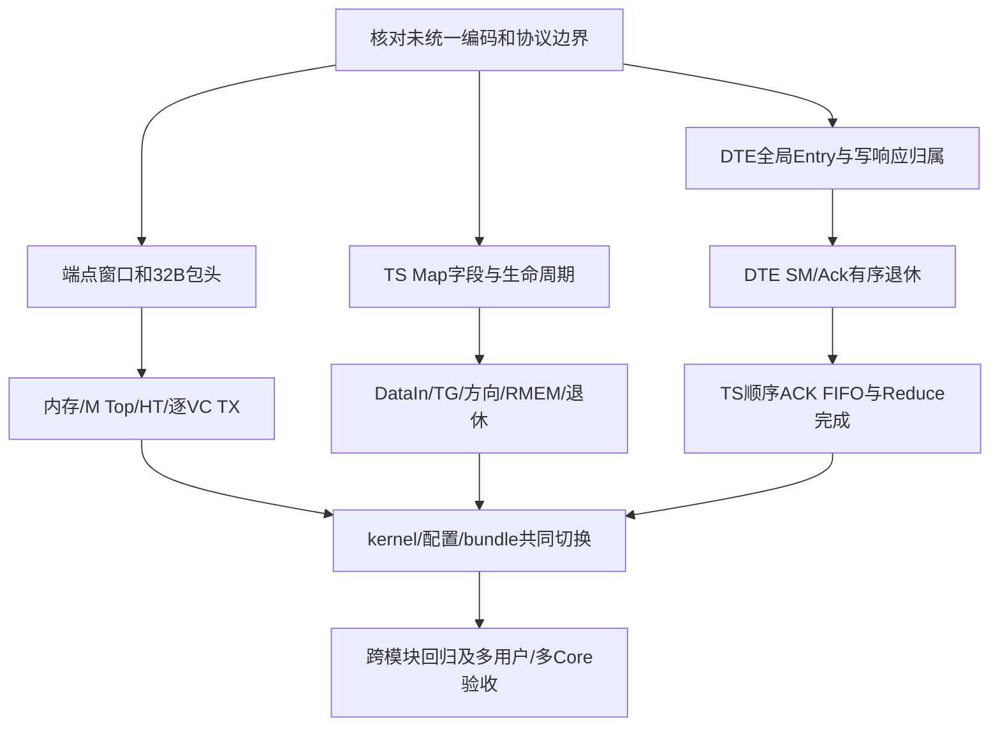

# TS 与 DTE 实现差异及改动计划

模式：design（实现迁移计划）。层次：Core 模型、执行软件与接口联调。本文供实现和验证人员拆分工作、评审变更及确认对齐结果，逐项列出当前差异、目标行为、改动位置、依赖和验收要求。

当前实现与详设的主要差距是完成与资源生命周期、数据布局、任务并发和接口协议，需要模型、kernel、配置产物及测试共同迁移。本文记录待实施工作，不声明代码已经完成对齐。

## 基线与实施状态

### 设计依据

| 依据 | 本地同步基准 | 用途 |
| - | - | - |
| [Task_Scheduler_详细设计文档模板](</home/colin/develop/perfechpitch/_refs/Task_Scheduler_详细设计文档模板.md>) | revision 6452 | TS功能、状态、任务/ACK/许可接口 |
| [DTE DSA详细设计文档](</home/colin/develop/perfechpitch/Bach/05_五、详细设计/02_DTE DSA详细设计文档.md>) | revision 24200 | DTE配置、端点、Channel、完成和退休 |
| 本项目 `src/bach/ip/chip/core/`、`src/bach/compiler/` 与对应测试 | 2026-10-12 代码核对及定向验证 | 当前实现证据及具体修改范围 |

[TS单元设计](07-units/chip/core/ts.md)和[DTE单元设计](07-units/chip/core/dte.md)保存详细目标合同；[文档缺口与TBD](08-文档缺口与-TBD.md)保存原文分歧。本计划引用它们组织实施，设计事实仍以上述原始详设为依据。

### 状态与范围

TS-01～13、DTE-01～13共26项按确认的建模基线逐项验收。异常条目保留、ERROR接纳规则、Packet边界检查、HeaderTable仲裁、Buffer单写口、OutCh3附加时延和TS保留编码过滤已实现，并补充边界回归。硬件待统一项单独保留。新增PMU统计不纳入当前建模范围；波形位置按段端点记录仍待对齐。

模型、kernel、装配、测试和四套bundle已共同修改。下文的改动前行为保留审查依据，验证结果在回归记录中登记；云端文档保持只读。

N表示启用Stream槽数，范围1～16；UID是用户身份，SID是本Core槽号，TID是链内任务号，PID是路径，VCID是虚拟通道，entry_id是DTE全局条目索引。任务执行完成、RMEM空间归还、DTE物理完成和全局退休分别记账。

各条按建模基线分别标记实施状态；硬件未冻结部分保持“待统一”。“待统一”只阻塞对应物理编码、寄存时序或协议选择，已经明确的逻辑行为可以先实施。新增类名、内部消息对象和代码拆分方式由实现阶段选择，不在本计划中假定已冻结。

## 优先级与实施依赖

P0表示优先处理功能、资源容量或接口兼容问题；P1表示随后处理并发/时序/配置与可观察性。两类都必须纳入最终验收。

| 最严重的问题 | 差异编号 | 直接影响 |
| - | - | - |
| DTE写响应未收齐即可能报告 | DTE-03 | 后继读取未完成数据，SM标志与TS完成先后错误 |
| Reduce完成与RMEM归还混用 | TS-01、TS-10 | 任务推进、下一Reduce与用户退休不符合独立条件 |
| 全局Q提前释放及跨Channel越序报告 | DTE-01、DTE-02 | 队列容量/反压错误，副作用及ACK顺序错误 |
| DataIn缺claimed/Future接受记录 | TS-03、TS-04 | 重复选择在途TID，Current/Future状态失真 |
| 旧地址与48B/单项包头布局 | DTE-04～08 | 端点误判、配对字段覆盖、硬件内存不兼容 |
| TS向Router申请而非管理三方向计数 | TS-02 | 许可所有权、重复方向复用及原子授权不同 |
| PID更新资格过宽、MU/VU VCID丢失 | TS-09、TS-11 | 后继路由方向或VC错误 |
| 配置即启动、退休等待Router | TS-08、TS-10、TS-13 | B/R启动、重生、分配回绕与资源复用不符 |

建议先建立以下公共状态和接口，再迁移使用方。该图是代码实施依赖，不规定硬件执行周期。

DTE有序ACK先于TS改用顺序配对FIFO；新地址构造和新AGCU同时切换；写响应归属先于放开提前完成；Map字段合并与DataIn接受事实共同上线。仅调整其中一层可能让旧协议与新协议混用。

## DTE 改动明细

### DTE-01　全局 TaskQ 生命周期

优先级：P0。状态：已实施。正常及异常Entry均保留原描述符；Except队头保持占用和索引。硬件待统一项保留。

改动前的行为及影响：Commit central_q 只保存未 dispatch 的任务，下发即 erase，完成放在另一张 CompletionRS。 16 项容量变成未下发容量，任务现场和回读无法保持，队满/接纳行为不同。

目标行为：16 项全局 Entry 从 Trigger 接纳一直保留到 Ack Ptr 退休，保存 descriptor、状态、异常与 SM 响应，Channel 指针独立扫描。

主要位置：[commit.h](../../../src/bach/ip/chip/core/dte/commit.h)、[dte_types.h](../../../src/bach/ip/chip/core/dte/dte_types.h)。

改动点：

1. 将全局16条Entry设为任务全生命周期所有者；从Trigger接纳保留到Ack退休，不在dispatch erase。
2. 每Entry保存FullTaskDesc、状态、Channel选择、异常现场及SM响应标记，使用稳定entry_id贯穿RD/WR、Buffer和响应。
3. 实现Tail、五个Ch Ptr、SM Ptr和Ack Ptr的循环扫描和满空判定，所有未退休Entry计入容量。
4. 命中Ready且RD AGCU空闲、WR Q有位时，两侧同拍接纳并置RS；Except跳过，不产生半下发。
5. 重构现有Commit与CompletionRS的职责，保留commit_seq仅作模型内部诊断，不能作为外部硬件ID替代entry_id。

依赖及待统一项：与DTE-02/03一起设计条目状态；U-DTE-QTABLE以正文持有至退休为基线，U-DTE-TASK决定拆分身份。

验收条件：dispatch后占用不减；16任务未退休时不再接受；环回不复用未退Entry；一个Channel阻塞其它可前进；RD/WR原子接纳。

### DTE-02　跨通道全局顺序退休

优先级：P0。状态：已实施。正常SM与ACK全局保序；Except队头阻止年轻Entry的SM推进和退休，已Fire响应继续收集。硬件待统一项保留。

改动前的行为及影响：CompletionRs 只按同一通道阻止越序；跨通道年轻任务可先 Join/Report；to_ts 只填写 SID/TID，UID 默认 0。 不满足 TS 双 ACK FIFO 的一致任务顺序；跨通道软件标志与完成观察顺序不同。

目标行为：允许各 Channel 乱序执行/物理完成；SM 副作用、task_done 按 Entry 接纳顺序，Ack Ptr 每拍最多退休一项；完成 ACK 带 UID/SID/TID。

主要位置：[completion_rs.h](../../../src/bach/ip/chip/core/dte/completion_rs.h)。

改动点：

1. 五路WR lane_finish按entry_id独立回写，同拍多Entry完成无损接纳；只有WR对外Finish，RD保留同Channel drain_done。
2. 年轻Entry可以先Done，但SM副作用和Ack退休必须按全局接纳顺序，删除跨Channel先Join先Report。
3. SM Ptr/Ack Ptr每拍各处理一个Entry，SM是否使能和响应到达决定Waiting Ack资格。
4. ack_ts_en=0也有序退休，只不发TS ACK；ack_ts_en=1完整输出UID/SID/TID和单拍valid，无Ready。
5. 先落实DTE可见ACK顺序，再切换TS双ACK FIFO，避免两侧队头因顺序不一致停住。

依赖及待统一项：DTE-01及DTE-03；TS-07切换FIFO之前完成；任务拆分/ACK开关组合受U-DTE-TASK影响。

验收条件：A/B/C接纳而B/C/A物理完成，TS仍A/B/C；五路同拍Finish；SM副作用保序；ack_ts_en0正常退休；UID/SID/TID完整。

### DTE-03　内存写与 ShareMem 写响应等待

优先级：P0。状态：已按建模基线实施，硬件待统一项保留。

改动前的行为及影响：Lane::ReportDrained 写侧只检查 Buffer 无该任务数据；DteXbar 仅转发读响应；CompletionRs 发 SM Write 下一拍就可 Report，不等待响应。 task_done 可能早于存储写生效/可见；软件标志可能未完成即推进 TS。

目标行为：WR lane_finish 等自身所有目的端写响应归零及同 Channel RD drain_done；SM 写 bresp 到达后才允许 Ack 退休。

主要位置：[lane.h](../../../src/bach/ip/chip/core/dte/lane.h)、[dma_xbar.h](../../../src/bach/ip/chip/core/dte/dma_xbar.h)、[completion_rs.h](../../../src/bach/ip/chip/core/dte/completion_rs.h)。

改动点：

1. DMA XBar补写响应返回与原Channel/任务归属，不能只转发读响应。
2. WR Active/Hold按CM、MM、MU、HeaderTable分别记outstanding，请求/响应同拍统一加减。
3. 自身所有目的端写响应收齐、数据已提交且同entry_id RD drain_done到达后才Finish；Buffer空只是一项条件。
4. SM控制写Fire后保存对应Entry outstanding，收到bresp才允许Ack，不能在Write下一拍直接报告。
5. 目标端反压期间保持输出项和资源，延迟/错序/错误响应均归原任务；一Task只Finish一次，一SM使能Entry只写一次。

依赖及待统一项：DTE-01/02、端点响应接口及存储模型；Buffer/上下文按DTE-13统一。

验收条件：最后写已发但bresp迟到不能Finish；多端点写响应全部归零；SM反压、响应迟到和错误；同拍请求/响应不丢；正常完成恰一次。

### DTE-04　HeaderTable 分组及项号

优先级：P0。状态：已实施。组与项布局已实现；通道口采用4:1读仲裁和2:1写仲裁，每拍最多一读、一写。硬件待统一项保留。

改动前的行为及影响：Hmem 16 个 HmemEntry 只按 SID；所有任务共享一份 hardware_used，段 0 地址的组/项号没有用于 Entry 选择。 同 Stream 多对 DataIn/DataOut 保存的 Hardware Used 被覆盖，不能实现多项配对。

目标行为：16 组，各组 core_mask 2B、sw_aux 16B、32 项 hw_used 各 1B，合计 800B；段 0 索引[8:5]组/[4:0]项，stride0=32。

主要位置：[hmem.h](../../../src/bach/ip/chip/core/dte/hmem.h)、[lane.h](../../../src/bach/ip/chip/core/dte/lane.h)、[kernel_dte.c](../../../src/bach/compiler/kernel/kernel_dte.c)。

改动点：

1. HeaderTable改为16组，每组共享core_mask16bit和sw_aux128bit，并有32项独立hw_used8bit，共800B。
2. 段0索引按组[8:5]/项[4:0]译码，按SID分组时stride0=32，不能仅调用Entry(stream_id)。
3. 实现OutCh0～3四路读仲裁、InCh/OutCh3两路写仲裁，以及软件独立读寄存器和读写入口。
4. 软件0x3000+group×0x40布局：core_mask0、sw_aux0x04～0x10、保留0x14～0x1C、hw_used0x20～0x3C。
5. 同拍读写读旧值；软件与通道同拍写命中字软件最后覆盖，其余通道字段仍更新；kernel分配配对项号，不增加硬件忙闲表。

依赖及待统一项：DTE-05/06/07和kernel项号分配；软件/通道访问按已明确的覆盖规则实现。

验收条件：组0/15项0/31；同SID先写项a再写b后读a，hw_used仍为a、共享字段为后写值；软件同拍写优先、读旧值、通道仲裁和保留地址。

### DTE-05　32B 包头及字段保持

优先级：P0。状态：已按建模基线实施，硬件待统一项保留。

改动前的行为及影响：CM 上用 48B 模型上下文；Hmem hardware_used 固定为 1，sw_header 没有写通路；非 HeaderTable 包头同步 Peek/Poke CM，MM 包头无相应通路。 硬件软件可见存储布局不同，32B 相邻包头会被写 48B 覆盖；软件辅助字段丢失；段 0 不计访存时延。

目标行为：段 0 固定 32B，可在 HeaderTable、CM、MM；保存真实 loopback/core_mask/sw_aux；出 Core 重写 PID/UID/VCID/size，其余字段保持。

主要位置：[hmem.h](../../../src/bach/ip/chip/core/dte/hmem.h)、[lane.h](../../../src/bach/ip/chip/core/dte/lane.h)、[commit.h](../../../src/bach/ip/chip/core/dte/commit.h)。

改动点：

1. 实现规定的32B包头位级编解码，不在硬件内存保存48B C++结构；CM/MM只读写32B。
2. 保存真实loopback、core_mask、sw_aux；删除hardware_used固定1和软件包头恒0的假设。
3. 出Core按任务重写PID、UID、loopback[3:2]和pkt_length，其余字节保持；HT未保存字节填0。
4. 包头通过实际HT/CM/MM读写路径，等待响应并计入Buffer，删除运行期同步Peek/Poke绕过端口竞争和时延。
5. 把gpu_id/token_id等诊断身份从硬件内存序列化中分离；软件16B payload前缀与头内sw_aux的关系单独统一。

依赖及待统一项：DTE-04/06/07与Message/Router字段适配；诊断身份和软件payload前缀迁移须先定兼容边界。

验收条件：32B字段逐bit往返；A+32相邻数据未覆盖；HT/CM/MM三来源重写相同任务字段；sw_aux不丢；不同访问的端口竞争与响应时延可见。

### DTE-06　端点窗口与合法性

优先级：P0。状态：已按建模基线实施，硬件待统一项保留。

改动前的行为及影响：用高 4bit tag：2=scale、3=topK、4=Header；其余 tag 默认 CM；算地址前剥 tag，不重新检查端点或范围。 同一配置地址在新旧模型被解释成不同端点；非法 tag 被静默解释成 CM。

目标行为：默认 CM 0/2MB（bit20 scale），MM 0x10000000/36MB，topK 0x20000000/4KB，HT 0x30000000/512 索引；基址/大小可参数化，检查窗口及乘加越界。

主要位置：[agcu.h](../../../src/bach/ip/chip/core/dte/agcu.h)、[bach.h](../../../src/bach/compiler/kernel/bach.h)。

改动点：

1. 以实现参数描述端点基址/大小，按完整段地址窗口译码，替换旧高4bit tag与未知tag默认CM。
2. 默认窗口CM0/2MB、MM0x10000000/36MB、topK0x20000000/4KB、HT0x30000000/512索引；窗口地址与软件寄存器地址分开。
3. 乘加后重新确认端点没有变化，检查32bit算术溢出、段末溢出和窗口越界；无效端字段/段不参与检查。
4. HeaderTable按索引范围检查，不把DATA_LEN0=32当成索引增加32；topK检查256B起点和长度。
5. 同步kernel地址构造、测试fixture及编译产物，不能把新kernel和旧AGCU混用。

依赖及待统一项：U-DTE-MODE先冻结寄存器编码；逻辑窗口及检查可独立实现，再与软件常量一起切换。

验收条件：窗口首末和相邻非法地址、非默认参数、最大SID/stride、乘加/末地址溢出、跨端点、HT索引上界、无效段忽略非法值。

### DTE-07　各段独立端点与 Core 内搬运

优先级：P0。状态：已按建模基线实施，硬件待统一项保留。

改动前的行为及影响：AGCU 虽计算 src_kind/dst_kind，Lane 读写 CM/MM 的选择仍用 FromCm(route)/ToCm(route)；route100 总从 MM 读，段 0 未按搬运处理。 配置正确但段落到错误内存；CM→HeaderTable 形态不能执行。

目标行为：每段源/目的由地址窗口决定，单 Task 多段可落不同端点；OutCh3 的 core_mode 支持 MM→CM 及 CM→HeaderTable。

主要位置：[lane.h](../../../src/bach/ip/chip/core/dte/lane.h)。

改动点：

1. 每段按src_kind/dst_kind选端点口，不继续用任务Route决定所有段读CM或MM。
2. 保留任务级Route对Router有效端和Channel的选择：Inbound只用DST，Outbound只用SRC，Core内两端有效。
3. OutCh3增加或明确core_mode，支持MM→CM与CM→HeaderTable，段0同样通过读写路径。
4. Core内源端用软件物理地址，目的端叠SID×stride；一般Route各存储端按段公式执行。
5. CM→MM和保留Route在首个外部请求前形成Except，不改写成另一合法方向。

依赖及待统一项：DTE-06算址、DTE-03多端点响应、DTE-04的HT写口及DTE-13任务归属。

验收条件：一个Task不同段落不同端点；OutCh3两Core内形态；Router端字段忽略；禁止CM→MM和保留编码没有外部请求、可定位错误。

### DTE-08　Scale 与 topK 接口

优先级：P1。状态：已按建模基线实施，硬件待统一项保留。

改动前的行为及影响：Scale 使用按数据地址每32B映射的专用 ReadScale/WriteScale；topK 用表下标和无 Ready 的 MuTopkPort，出站直接读 GenEpInfo。 软件地址不兼容，topK/scale 的端口竞争、握手、响应和带宽缺失。

目标行为：Scale 在 CM scale 地址区按 128B 单元；topK 16×256B，M Top sel=1，只用[0]路、每256B拆两笔128B，起点/长度256B对齐。

主要位置：[lane.h](../../../src/bach/ip/chip/core/dte/lane.h)、[dte.h](../../../src/bach/ip/chip/core/dte/dte.h)。

改动点：

1. CM scale用全局地址bit20和端口bit13选择，以128B单元访问256项，删除DTE专属端口上按数据坐标ReadScale/WriteScale的替代语义。
2. topK通过M Top sel=1只使用[0]路，每逻辑256B发两笔128B，两个响应齐后组成一拍。
3. DTE可见topK窗口16×256B，按SID访问stride256；旧MU模型1024份/UID索引和同步旁带读写作为迁移对象单独处理。
4. 补topK请求反压、响应、outstanding与Buffer预留，计入端口/bank竞争，不用fire-and-forget直接写。
5. 核对B Core大量用户的topK保存位置，数据仍可作为普通段存入MM/CM，不擅自扩大DTE可见窗口。

依赖及待统一项：DTE-06/07/10与MU/M Top接口；B Core多用户topK软件保存方案和MU内部容量需核对。

验收条件：topK项0/15、单项与连续项、两128B请求/响应错拍、反压保持；CM scale首末项、byte mask；MU旧1024索引不能进入新可见窗口。

### DTE-09　TX 分 VC credit 与 flit 交织

优先级：P0。状态：已实施。逐VC信用和flit交织已实现；OutCh3出Router增加一拍输出级，反压时保持，尾拍交付后转Hold。硬件待统一项保留。

改动前的行为及影响：使用共享 Ready；DteOutArb 将整个包锁在一个通道直到 last；CoreStation DteReady 需所有 VC 都有空位。 一个 VC 堵塞会阻止其它 VC；模型包级锁定降低并发，违背详设隔离目标。

目标行为：TX 无 Ready，DTE 分 VC 记 credit，每 flit 消耗；四 OutCh 以完整 flit 交织；包只在所属 VC 内保持所有权。

主要位置：[out_arb.h](../../../src/bach/ip/chip/core/dte/out_arb.h)、[core_station.h](../../../src/bach/ip/chip/core/router/core_station.h)。

改动点：

1. DTE TX接入每VC credit计数及credit_vld/credit_vc_id返回，删除共享Ready作为唯一发送依据。
2. 四OutCh在复用点按完整flit仲裁，只锁同VC的Packet，不跨VC整包锁定。
3. 每flit输出对应Packet的32B hflit与256B pflit，VC由loopback[3:2]识别，首/末标记保持各VC边界。
4. 改CoreStation接收和归还，使一个VC耗尽只阻塞该VC；RX仍由桥接合并为单Packet通道。
5. head已发后的错误不能遗留半包，按已冻结协议收尾；错误终止格式未定时不编造新flit。

依赖及待统一项：DTE-05包头VC字段、DTE-03完成、Router CoreStation接收/归还接口；credit初值取对端公告。

验收条件：VC0堵塞时VC1～3仍发；不同VC长短Packet交织；每VC head/tail完整、hflit匹配；credit不超发；首flit后出错不遗留半包。

### DTE-10　8B 段对齐、双128B及跨段拼接

优先级：P1。状态：已实施。配对访问、字节搬运及MM读改写已实现；响应按原预留槽排队，每Channel每拍最多一次Buffer数据写入，排队响应仍计入原任务Outstanding。硬件待统一项保留。

改动前的行为及影响：MemPort 直接变长字节读写；Lane 按段发块，一拍跨段时拆多个写周期；无双路对齐握手、桶形拼接及 MM RMW。 非法配置未拦截；错位/跨段搬运和 MM 部分写性能估算不符。

目标行为：段1..3地址与长度8B对齐；CM/MM两路128B同拍握手，数据以 keep/mask 8B粒度跨段拼接；MM掩码写走读改写。

主要位置：[lane.h](../../../src/bach/ip/chip/core/dte/lane.h)、[ports.h](../../../src/bach/ip/chip/core/ports.h)、[banked_mem.h](../../../src/bach/ip/chip/core/memory/banked_mem.h)。

改动点：

1. 补段1～3地址/长度8B对齐和32bit keep，段0CM/MM地址同样8B对齐；HT索引例外。
2. CM/MM适配为相邻两路128B，vld/rdy/addr/data/mask分别持有，两路同拍Fire，不能拆开单路成功。
3. Inbound保留256B prev，Outbound保留256B residue，跨段/端点不清空，按8B旋转和首尾mask搬运。
4. Buffer只在目的端Fire后pop，建立输出项不提前pop；单拍段使用首尾mask交集。
5. MM部分字节写实现或等效统计读改写，保留未使能字节，计入额外请求、延迟和bank冲突。

依赖及待统一项：DTE-06/07及DTE-03响应；需与存储端口模型同步，不能只改DTE发出的字节数。

验收条件：任意8B偏移、跨128/256B、跨段和端点、两路ready错拍、单拍首尾mask、RMW保字节与成本、反压期间输出和计数不变。

### DTE-11　包长度、纯包头和丢弃包头

优先级：P0。状态：已实施。长度上限、纯头和丢头已实现；缺失首head、Packet未闭合重入head及有效长度到齐但缺tail均报告Packet错误。硬件待统一项保留。

改动前的行为及影响：HeaderParser 拒绝 size>32KB；只核对累计字节不少于声明值；TRANS_MODE.hw_header_op 未写入 Descriptor；出站无 payload/无 topK 不生成尾 flit。 拒绝详设合法长包；错长度可能被接受；纯包头出站及空任务完成路径缺失；要求丢弃的包头仍可能落库。

目标行为：包头32B+数据段之和构成16bit pkt_length，最大合法数据总长65496；纯包头/丢弃包头空任务均合法；入站核对期望长度与 flit 数。

主要位置：[header_parser.h](../../../src/bach/ip/chip/core/dte/header_parser.h)、[regfile.h](../../../src/bach/ip/chip/core/dte/regfile.h)、[lane.h](../../../src/bach/ip/chip/core/dte/lane.h)。

改动点：

1. 统一pkt_length为32B头加使能数据段总长；16bit限制下8B对齐最大数据65496B、最大Packet65528B。
2. 删除HeaderParser的32KB硬上限；8KB Buffer按流式槽位使用，不要求整Packet同时驻留。
3. 描述符保存hw_header_op；Router源丢弃头时不写头entry，不使用其地址，其它Route仍搬段0。
4. 实现纯包头和丢弃包头空任务的独立通路，消费一个Packet并完成；Outbound纯头也有head/tail同flit，零payload不依赖普通数据段访问推进。
5. Inbound首flit比较精确pkt_length，tail比较flit数；长度不等但拍数相同、无主包、未闭合重入等均走Except。
6. 核对CoreStation Header就绪Trigger和流式桥接，不能等整包收齐才起任务，避免大Packet填满桥接Buffer。

依赖及待统一项：DTE-05/10、Descriptor hw_header_op、DTE-13异常；U-DTE-TASK和payload前缀影响任务软件拆分。

验收条件：纯头、丢头空任务、32768B以上合法包、最大65528B和越界65536B；同flit数不同长度报错；保存头停一拍、丢头不停；桥接60flit可流式通过长包。

### DTE-12　Trigger 接纳、ready 与下一拍读返回

优先级：P1。状态：已实施。普通队满反压和下一拍读已实现；ERROR强制ready，Trigger被接收后丢弃并清dirty，寄存器读写继续接受。硬件待统一项保留。

改动前的行为及影响：Regfile 另持 held Descriptor，直到 Commit 接受期间所有访问被堵；读使用 kDsaReadLatency=4，响应附带 seq。 多一项隐藏持有与额外反压；寄存器读/写连续行为和时延不同。

目标行为：Fire 当拍 TaskDesc 原子入全局Q；ready由状态/全局Q满寄存产生，不因内部持有或在途读反压；读Fire采样、下一拍响应，无ID。

主要位置：[regfile.h](../../../src/bach/ip/chip/core/dte/regfile.h)、[rv_ports.h](../../../src/bach/ip/chip/core/rv_core/rv_ports.h)。

改动点：

1. Trigger Fire当拍合并dirty/模板与身份并原子入全局Q，删除Config第二份held Descriptor。
2. ready按Status和全局Q满情况寄存产生，与地址、读写和数据无关，不因在途读或内部提交副本额外拉低。
3. 读Fire由目标寄存器采样，下一拍返回，AddrDecode只保存目标选择，不再多打一拍。
4. 接口无读响应Ready或硬件ID，每拍最多接收一笔且按序返回；仿真seq可内部保留，不改变外部读协议。
5. DTE读延迟与MU/VU分开配置，不全局把kDsaReadLatency=4改为1；STOP队满和控制地址未统一部分单独等待。

依赖及待统一项：DTE-01可用容量、DTE-13状态；U-DTE-STOP和未冻结控制偏移只阻塞对应软件可执行配置。

验收条件：连续读每拍返回一笔，读后写不改旧值，写后读见新值；满队列普通写/读/Trigger一起等待；ERROR Trigger不入队；CSR旁带Fire快照。

### DTE-13　Status、异常、回读与 lane 上下文容量

优先级：P1。状态：已实施。状态回读、RD驻留1项及WR队列4项已实现；ERROR保留Except队头并停止SM和退休推进，首错保持。模型观测沿用已有下发和ACK计数。硬件待统一项保留。

改动前的行为及影响：Ctrl/Status、TaskQ、HT访问返回0或忽略；错误多为LOGCHECK；RD/WR都有深4 TaskQ和深4 drain_q，缺有序Except/状态控制。 软件无法观察/暂停/恢复任务，错误处理及最多在途上下文与详设不同。

目标行为：RUN/STOP/ERROR、step、cancel、异常Entry与有序首错可观察；TaskQ和HT回读；RD AGCU驻留深1、WR Q深4，Active/retiring或Hold最多两上下文。

主要位置：[regfile.h](../../../src/bach/ip/chip/core/dte/regfile.h)、[lane.h](../../../src/bach/ip/chip/core/dte/lane.h)。

改动点：

1. 实现RUN/STOP/ERROR、resume/stop、step和未下发cancel的功能，复位STOP，未resume不能dispatch。
2. Config/Status、TaskQ和HeaderTable回读返回真实状态；未冻结PMU/Debug/异常mask位域不得制造可执行地址。
3. 接纳非法任务保留Except，Ch Ptr跳过；运行期首错携entry_id和原任务现场，经WR错误Finish回写，Ack到队头才有序上报。
4. RD AGCU驻留深1、WR Q深4，Active加一个retiring/Hold；删除当前每侧深4 TaskQ加深4 drain_q造成的过量在途上下文。
5. Buffer区分free/reserved/valid，读Fire预留，保持每Channel总32槽；Outstanding记录恢复各端点响应归属及输出顺序。
6. Idle包含Q、驻留、Active/Hold、Buffer、Outstanding、完成保留站、SM和TS pending；Flush须按协议排空已Fire事务后回收，不能只清容器。

依赖及待统一项：DTE-01/03/12和端点错误传播；ERROR/Flush、控制/异常字段及完成保留站深度待统一。

验收条件：STOP/RUN/step/cancel，未resume无dispatch；年轻Except不越队头报告；首错不覆盖；两上下文门限；容量守恒；Idle含迟到响应；Flush不留悬挂RS。

## TS 改动明细

### TS-01　Reduce 完成与 RMEM 归还

优先级：P0。状态：已按建模基线实施，硬件待统一项保留。

改动前的行为及影响：TaskDone 丢弃 Reduce 的本地 ACK，RMEM Done 被转换为当前 TID 的完成；CreditMonitor 退休不检查 rmem_busy。 后继任务被额外阻塞；按新规则推进后，迟到的 RMEM Done 可能被当作后继完成或被丢弃。

目标行为：Reduce 按 Core/DSA ACK 完成并推进；RMEM Done 只按 UID 还空间，用户退休仍须等待 RMEM 空闲。

主要位置：[task_done.h](../../../src/bach/ip/chip/core/ts/task_done.h)、[credit_monitor.h](../../../src/bach/ip/chip/core/ts/credit_monitor.h)。

改动点：

1. 将执行单元完成和RMEM返回拆成两条独立更新通路；Reduce按配置的Core/DSA双ACK设置完成位。
2. RMEM返回只按有效UID定位SID、恢复空间，不读取Current TID，也不提交FINISH或PID副作用。
3. 在REDUCE_WAIT许可生效时占用空间并READY，删除Core接受时再次扣占的行为。
4. 补用户退休对RMEM空闲的检查；普通后继可在Reduce ACK完成后推进，下一Reduce仍等待同SID空间。
5. 同步Router返回载荷、Core装配、Reduce任务链与旧测试断言。

依赖及待统一项：DTE-02、DTE-03提供真实DSA完成；TS-05/TS-10处理独立许可和退休；R Core多Packet映射等待U-DTE-TASK。

验收条件：Core/DSA ACK齐后任务完成而RMEM仍忙；返回前后不改变其它TID；返回早晚两种顺序都正确；未归还不能再次Reduce或退休。

### TS-02　三个方向的 credit 所有者与分配

优先级：P0。状态：已按建模基线实施，硬件待统一项保留。

改动前的行为及影响：TS 向 Router 发 CreditReq、等待 CreditGrant；RouterTable 的方向只保存读回；StreamEntry 无 drct_used。 资源所有权和接口不同；重复方向、跨方向申请与批量授权行为无法按详设模拟。

目标行为：TS 维护三方向计数及每用户 drct_used；每方向首次使用申请，多方向原子满足，按年龄可同拍授权多个用户，归还下一拍可用。

主要位置：[credit_monitor.h](../../../src/bach/ip/chip/core/ts/credit_monitor.h)、[cfg_reg.h](../../../src/bach/ip/chip/core/ts/cfg_reg.h)、[core.h](../../../src/bach/ip/chip/core/core.h)。

改动点：

1. 增加南北、西、东三个可用计数，每方向成功配置时初始化为N；Map逐用户保存credit_drct和drct_used。
2. 形成credit_drct & ~drct_used，只申请新增方向；所有新方向一次满足，按Head相对年龄试分配，可同拍许可多个SID。
3. 每SID保存一条Pending，提交前复核TID、方向与等待资格；更老新请求尚未登记时保护其年龄。
4. 有效Grant同沿扣账、登记已用方向并READY；无效请求本拍试占预算不再分给后继请求。
5. 接入三方向valid-only返回，先写计数、下一周期使用；用户退休不自动增加这三个计数。
6. 替换TS外部CreditReq/Grant依赖，核对Router用户表、旧监听和DTE stream_cache的关系，防止重复扣账或重复授权。

依赖及待统一项：TS-05/TS-06支持方向状态及安装；U-TS-CREDIT确定精确周期，U-TS-RTAB确定编码；Router旧监听桥接需统一。

验收条件：两个用户同方向竞争、多方向仅部分可用、多个SID同拍Grant、老请求变化、归还同拍不可用、已用方向复用、有效扣账次数和计数守恒。

### TS-03　DataIn 占用及 Future 接受记录

优先级：P0。状态：已按建模基线实施，硬件待统一项保留。

改动前的行为及影响：只用 done_bitmap 排除匹配；没有 claimed/accepted 状态；DataIn 被接受后仅释放 Hold，不写 INFLY。 同 UID/PID 的第二个 Trigger 可重复选到已在途但未完成的 TID；Future 转 Current 时丢失已下发事实。

目标行为：PID 匹配排除 completion_bitmap | datain_claimed_mask；Candidate 提交即认领 TID；Core 接受用 raw_accept 记录 Current/Future，Future 后续安装为 INFLY。

主要位置：[cfg_reg.h](../../../src/bach/ip/chip/core/ts/cfg_reg.h)、[dte_arb.h](../../../src/bach/ip/chip/core/ts/dte_arb.h)、[user_match.h](../../../src/bach/ip/chip/core/ts/user_match.h)。

改动点：

1. Map增加每SID 64bit datain_claimed_mask，PID匹配排除completion | claimed，候选提交置claim而不置completion。
2. Create、Skip、Candidate和claim同沿提交且SID一致；普通UID miss在结果可提交时才创建。
3. 新增或保留实际DataIn接受的raw_accept SID/TID事实，贯穿TG搜索token、当前任务与同拍安装判断。
4. 实际接受拍复核分配和Current/Future；Current置INFLY，Future不覆盖当前状态，后来安装时恢复已接受的INFLY。
5. 排除位图变化刷新后重查，Pending/Prepare查询期间保护分配；新生命周期清旧claim和接受事实。

依赖及待统一项：TS-04入口持有和交接、TS-05字段合并、TS-06接受token、TS-10生命周期保护；Create握手等待U-TS-CREATE。

验收条件：同UID/PID连续Trigger不能重选在途TID；Future提前接受、反压期间转Current、raw_accept与TG同拍、排除变化重查、生命周期复用。

### TS-04　DataIn 流水、DTE 来源仲裁及 Hold 所有权

优先级：P1。状态：已按建模基线实施，硬件待统一项保留。

改动前的行为及影响：UserMatch 在一次 Handle 中查表建候选；Candidate 一直占到 Core 接受；同 SID 先选 Generated；Bypass 被视为最老。 入口吞吐、来源公平性及候选占用时间均有差异。

目标行为：Lookup/Prepare/Candidate 分级；Candidate 装入 Fire Hold 即释放；同 SID DataIn 胜 Stream；normal 与 Bypass 做二源 RR，权重优先。

主要位置：[user_match.h](../../../src/bach/ip/chip/core/ts/user_match.h)、[dte_arb.h](../../../src/bach/ip/chip/core/ts/dte_arb.h)。

改动点：

1. 分开Lookup、Prepare、Candidate状态，保留各级事务身份、排除快照和刷新资格。
2. Candidate交接给DTE Fire Hold即释放，允许同拍旧候选移出和新候选装入；Core反压仅由Fire Hold承担。
3. normal集合按SID年龄选择，普通DataIn与Stream同SID时使用DataIn完整Bundle。
4. normal与特殊Bypass做二源RR，装入时切偏好；权重请求最高优先且不改变运行态RR。
5. Fire Hold完整保存PC/UID/SID/TID/PID/VCID；普通DataIn接受拍重读Map，实际Issue与raw_accept分开。

依赖及待统一项：TS-03、TS-05；权重请求时点受U-TS-WEIGHT影响，PC缓存寄存边界受U-TS-CACHE影响。

验收条件：Candidate交接后Core长时间反压仍可接后续请求；同SIDDataIn获胜；normal/Bypass不饥饿；权重优先；Hold字段始终稳定。

### TS-05　Stream Map 同 SID 多源合并

优先级：P1。状态：已按建模基线实施，硬件待统一项保留。

改动前的行为及影响：每 SID 每拍只能接受一个写口，优先级串行重试；TG 整行覆盖。 并发更新被串行化，周期数不符；新增 claimed/credit 后继续整行覆盖有覆盖新字段的风险。

目标行为：同 SID Completion/Skip 按位 OR，按字段合并；TG 只在目标完成/Skip 等冲突时抑制，Issue/Grant 无重试握手。

主要位置：[stream_table.h](../../../src/bach/ip/chip/core/ts/stream_table.h)。

改动点：

1. 把每SID每拍单写口优先级重试改为按字段计算下一状态；同SID Completion/Skip逐位OR累计。
2. TG安装不整行覆盖其他来源更新；目标同拍完成/Skip或生命周期变化时取消该安装，其它任务位可同时合并。
3. 按最终Current身份合并Issue、DataIn raw_accept和TG安装，防止接受事实被安装覆盖。
4. Grant只在等待身份仍匹配时落入READY和drct_used；RMEM返回独立更新许可位。
5. 生命周期保护旧用户状态，不让迟到事件写入复用槽；保留Latch/端口的跨协程确定性，不通过直接共享普通容器规避寄存边界。

依赖及待统一项：作为TS入口、推进、许可和退休共同基础，先定义字段合并表；Create握手及PC缓存等待对应未统一项。

验收条件：同SID多个TID完成与Skip不丢位；目标完成取消TG；非目标完成可合并；Issue/Grant与安装冲突保持正确；并发执行结果确定。

### TS-06　Task Generator ×16 与搜索寄存

优先级：P1。状态：已按建模基线实施，硬件待统一项保留。

改动前的行为及影响：一个 TaskCtrl 按年龄每拍安装一个；搜索、查属性、形成整行写在同一 Generate 内。 16 用户推进吞吐和完成到下发时延不符。

目标行为：每 SID 一个 TG；搜索保存 PE token，下一拍查 LUT、复核完成/Skip/身份，再安装。

主要位置：[task_ctrl.h](../../../src/bach/ip/chip/core/ts/task_ctrl.h)。

改动点：

1. 增加16路SID独立后继推进逻辑及各自搜索token，删除全局每拍仅安装一个用户的限制。
2. 搜索掩码为after_current & through_end & ~completion，记录最低TID、onehot和源Current身份。
3. 下一周期查询LUT并复核token、kill、同拍Completion/Skip及DataIn实际接受；无目标或冲突时不安装。
4. 安装一次性更新TID、实际PID、发送单元、End、资源需求和初态；支持WAIT、WAIT_CREDIT、REDUCE_WAIT、READY及已接受INFLY。
5. PC/VCID放在Map缓存还是由Arbiter查LUT，等待原文统一后落实精确寄存位置与时序。

依赖及待统一项：依赖TS-03、TS-05；精确缓存和授权拍数等待U-TS-CACHE/U-TS-CREDIT。

验收条件：多个SID同拍FINISH能并行生成；连续Skip不越End；token期间目标被完成/替换不误安装；Future已接受恢复INFLY；相邻PID继承。

### TS-07　ACK FIFO 配对

优先级：P1。状态：已按建模基线实施，硬件待统一项保留。

改动前的行为及影响：六路无界 deque，加按 unit/SID/TID 索引的 halves map。 任意身份配对和无界容量掩盖顺序错误、溢出及 FIFO 队头阻塞。

目标行为：DTE/MU/VU 各一对深度 16 的 Core/DSA FIFO，按一致任务顺序配对，允许任一侧先到，无 Ready。

主要位置：[task_done.h](../../../src/bach/ip/chip/core/ts/task_done.h)。

改动点：

1. 按DTE/MU/VU各一对Core/DSA FIFO建立有界配对，每侧深16，保持一致任务顺序。
2. 按recv_unit分流单Core、单DSA和双ACK，只有对应执行单元两侧队头SID/TID相同才配对；不从map任意搜索身份。
3. 支持空FIFO直通、同拍配对弹出与新事件接入；输入valid-only，每有效周期都是一笔事件。
4. 输出单Core、单DSA和配对完成，Map并行累计；ACK容量及队头一致性作为系统合同检查。
5. 权重加载丢弃新ACK/RMEM返回，保留旧FIFO并暂停配对；特殊Bypass过滤仅针对DTE保留身份，不能误过滤MU/VU的合法完成。

依赖及待统一项：DTE-02保证DTE全局ACK顺序；MU/VU也须核对两侧顺序与容量；recv编码保留U-TS-RECV的来源说明。

验收条件：Core先、DSA先及同拍；空FIFO直通；深16边界；队头错配不乱序搜索；单ACK不误入配对；DTE ByPass过滤不误伤MU/VU。

### TS-08　SELF_START 首次激活及重生

优先级：P0。状态：已按建模基线实施，硬件待统一项保留。

改动前的行为及影响：InitFinish 立即 SelfStart；重生等待 Router 接受退休请求；Task0 初态按 wait_wake/credit_en 推导。 启动时点和 Router 用户账本改变，B/R core 软件启动流程需同步。

目标行为：提交配置只保存模板；首个接受的 Trigger 激活全部启用槽；Task0 READY；重生在本地进行，不向 Router 归还用户槽 credit。

主要位置：[ts.h](../../../src/bach/ip/chip/core/ts/ts.h)、[credit_monitor.h](../../../src/bach/ip/chip/core/ts/credit_monitor.h)。

改动点：

1. 成功提交SELF_START只锁存Task0模板，不立即调用SelfStart激活用户。
2. 首个已接受Trigger发special_trigger，批量建立N槽匿名Task0 READY；后续Trigger只形成独立Bypass。
3. Task0发送单元取LUT，合法Completion绑定UID；双ACK配置配对后绑定，Skip不能绑定。
4. Head满足完成、RMEM和入口保护后，下一周期在旧SID本地重装Task0，清旧UID、完成、claim、PID继承和方向使用状态；内部通知RMEM清除旧UID的空闲上下文。
5. Head/Tail按N推进至队尾，重生不发普通Router退休；更新B/R Core启动流程、退出判定和软件输入槽复用。

依赖及待统一项：TS-05、TS-10、TS-13及软件Task0 UID返回；U-TS-WEIGHT只影响加载入口。

验收条件：提交无Trigger时不激活；首Trigger激活N槽且生成Bypass；后续不重复激活；Task0配对后绑定UID；只有Head下一拍本地重生。

### TS-09　MU/VU VCID 透传

优先级：P0。状态：已按建模基线实施，硬件待统一项保留。

改动前的行为及影响：UnitArb::Select 调用 cmd->Drive 未传 VCID，使用默认 0。 实际 PID 指向非零 VC 时，后续 DSA 和 Router 使用错误 VC。

目标行为：MU/VU 用实际 PID 查 RouterTable，并将 VCID 与命令一起持有和下发。

主要位置：[mu_vu_arb.h](../../../src/bach/ip/chip/core/ts/mu_vu_arb.h)、[ts_ports.h](../../../src/bach/ip/chip/core/ts/ts_ports.h)。

改动点：

1. MU/VU命令显式携带实际PID查询的VCID，删除默认0造成的隐式丢失。
2. 将PC、实际PID和VCID一起写入Fire Hold，在Core反压期间保持一致。
3. 核对三RV Core的命令、CSR和DSA配置身份快照，保留发送时身份直到请求Fire。
4. DTE的DataOut/Reduce按实际PID带VCID，DataIn/Bypass/权重路径按其协议使用0；不无差别把所有DTE命令都查路由。

依赖及待统一项：TS-11决定最终PID；RouterTable物理编码等待U-TS-RTAB，缓存边界等待U-TS-CACHE。

验收条件：MU/VU使用非零VCID；动态PID改变VCID；三个Core分别反压时载荷不变；CSR改变不影响已经发出的配置请求。

### TS-10　普通用户退休条件与 Valid-Only

优先级：P1。状态：已按建模基线实施，硬件待统一项保留。

改动前的行为及影响：只检查 valid 与 through-End；RetirePort 保持到 Router Accepted 才动表。 可能退休仍被入口使用的分配；退休接口及时延不符。

目标行为：UID 有效、through-End 完成、RMEM 空闲且无 DataIn 查询占用，普通用户输出单拍 UID/valid，无 Router Ready。

主要位置：[credit_monitor.h](../../../src/bach/ip/chip/core/ts/credit_monitor.h)。

改动点：

1. 普通Head退休资格增加UID有效、RMEM空闲及DataIn Pending/Prepare未使用该分配的检查。
2. 保持through-End全部任务完成要求，不用单独End完成或当前FSM代替完整位图。
3. 将外部退休改为UID/单拍valid，无Router Ready；内部Retire Hold的接纳在顶层固定成立。
4. 普通释放与SELF_START本地重生分开，生命周期更新保护同拍Create、Completion、Issue和TG。
5. 删除“Router Accepted后才清槽”的普通目标协议依赖，并同步Router接收端和已有退休测试。

依赖及待统一项：TS-01、TS-03、TS-05、TS-08；U-TS-RETIRE的顶层合同已采用valid-only，Router侧迁移仍需联调。

验收条件：End已完成但前置未完成不能退；UID未绑定、RMEM忙或DataIn在用不能退；通知一拍且恰一次；无需Router Ready；同拍复用安全。

### TS-11　PID_UPDATE 的完成资格

优先级：P0。状态：已按建模基线实施，硬件待统一项保留。

改动前的行为及影响：Complete 不检查 recv_unit/Core-only；双 ACK 完成也带入 Core PID，DSA-only 可能以默认 PID=0 更新。 后继继承错误 PID，从而路由方向与 VCID 错误。

目标行为：仅 Current、type=5、Core-only 完成携带的新 PID 更新；Future、DSA-only、双 ACK 完成都不更新。

主要位置：[task_done.h](../../../src/bach/ip/chip/core/ts/task_done.h)。

改动点：

1. PID副作用同时检查Current、type5、Core-only和Core来源，不能由DSA-only、双ACK配对或Future触发。
2. 合法Core ACK的PID随所属Completion原子提交并置pid_pending，禁止用DSA默认PID覆盖。
3. 只有直接相邻且实际安装的后继继承；相邻任务已完成/Skip时更后任务使用自身LUT PID。
4. 安装取消时保留继承标志；实际安装时消耗标志，按最终PID更新方向与VCID。

依赖及待统一项：TS-05/TS-06保证PID副作用和继承；TS-09保证路由字段随实际PID更新。

验收条件：合法Core-only更新；DSA-only、双ACK、Future及其它type不更新；跳过相邻后继不向更后传播；安装取消不丢pending。

### TS-12　配置提交、检查、APB 与权重请求

优先级：P1。状态：已实施。配置完整性、提交保护和APB访问已实现；保留编码分别保持旧字段，合法字段继续写入，boot辅助接口使用相同过滤规则。硬件待统一项保留。

改动前的行为及影响：WriteTask 一次写整项，Check 仍要求 Reduce credit_en；InitFinish 不以检查结果阻止 SelfStart；权重与 Bypass 共用 SID15/TID63。 无法验证半写、非法单元和提交失败路径；旧规则拒绝新合法 Reduce 配置。

目标行为：PC/ATTR 分开记录完整性，CONFIG/ERROR/ACTIVE 状态；失败不启动，可保留配置重试；Reduce 不依赖 credit_en；权重 PC-only 身份全零。

主要位置：[cfg_reg.h](../../../src/bach/ip/chip/core/ts/cfg_reg.h)、[ts.h](../../../src/bach/ip/chip/core/ts/ts.h)、[user_match.h](../../../src/bach/ip/chip/core/ts/user_match.h)。

改动点：

1. 分别记录PC和ATTR写入完整性，配置提交检查Task0、半写行、连续性、唯一末尾End、单元编码、N及特殊DataIn配置。
2. 增加CONFIG/ERROR/ACTIVE功能状态；失败不启动，保留写值，软件清INIT_FINISH后修正重试，业务运行期间不热重配。
3. 普通空链与非法编码也必须按详设检查；字段非法写的保持旧值规则与提交检查区分。
4. Reduce不强制credit_en，权重模式下业务提交报错；旧Reissue组合检查范围等待统一。
5. 权重加载请求与Bypass分开，PC-only其余身份全0，已有ACK FIFO保留并暂停；加载触发时点等待统一。
6. 补32bit APB4可观察访问：15bit字节地址、4B对齐、pstrb=1111、只读/保留/未映射处理、pready=1和pslverr；直接boot辅助接口不得绕过相同合法性。

依赖及待统一项：U-TS-CHECK/U-TS-RTAB/U-TS-WEIGHT；可先实现已明确的字段完整性和提交失败保护。

验收条件：PC-only/ATTR-only、普通空链、非法编码、N=0/1/16/超过16、End不合法、失败重试、APB访问错误、权重零身份和业务提交拒绝。

### TS-13　普通模式指针按启用槽数回绕

优先级：P1。状态：已按建模基线实施，硬件待统一项保留。

改动前的行为及影响：普通创建/退休按固定 kStreamNum=16 分配与回绕；stream_num 只限制同时在途数。 N<16 时用户即使仅一个在途仍轮流分配 SID0..15，影响按 SID 布局的存储、HeaderTable、topK。

目标行为：Head/Tail 按 N=stream_num 启用槽数循环，SID 只落在 0..N-1；Tail 指向最年轻条目。

主要位置：[stream_table.h](../../../src/bach/ip/chip/core/ts/stream_table.h)。

改动点：

1. 普通模式按启用槽数N分配SID并回绕，不只用N限制同时在途数。
2. 统一Head最老、Tail最年轻的逻辑定义；空表复用Tail，非空新增下一槽，唯一用户同拍退休/创建复用原槽。
3. 保留必要的内部占用/环回标志区分满空，不要求仿真内部计数编码等同硬件4bit指针。
4. 同步HeaderTable、topK、CM分片和软件RC_SLOT等按SID索引的访问，防止N<16时进入未启用地址。

依赖及待统一项：TS-05/TS-08/TS-10共同定义生命周期；DTE-04/08和软件分片访问同步采用N。

验收条件：N=1/2/15/16长期创建/退休回绕，SID不超N；唯一用户同拍复用；满空计数正确；按SID访问不进入未启用分片。

## 软件、装配与产物的配套改动

### SW-01　kernel 与硬件配置共同迁移

| 文件或目录 | 改动点 | 配套检查 |
| - | - | - |
| [kernel/bach.h](../../../src/bach/compiler/kernel/bach.h) | 替换旧端点tag；统一TS RouterTable与DTE TRANS_MODE编码；区分byte地址、HT索引和topK单元 | 物理bit未统一前不生成新常量；同步所有调用方 |
| [kernel/kernel_dte.c](../../../src/bach/compiler/kernel/kernel_dte.c) | len0=32、HT组/项配对、topK SID×256、CM scale地址、有效段和SM反馈；删除48B硬件上下文假设 | 普通字段与模板覆盖结果一致，Trigger身份保持 |
| [kernel/kernel_mu.c](../../../src/bach/compiler/kernel/kernel_mu.c)、[kernel/kernel_vu.c](../../../src/bach/compiler/kernel/kernel_vu.c) | 核对实际PID/VCID及软件头布局变化影响的地址；保持独立数值语义 | 计算结果与参考实现逐bit比较，不能只观察task_done |
| [hwconfig/moe.py](../../../src/bach/compiler/hwconfig/moe.py) | Reduce recv双ACK、SELF_START首Trigger、N范围分配及实际路由；核对B/R任务软件槽复用 | R Core两操作数的Task/Packet映射先按待统一项处理 |
| [hwconfig/bachir.py](../../../src/bach/compiler/hwconfig/bachir.py)、[gen_hwconfig.py](../../../src/bach/compiler/gen_hwconfig.py) | 字段编码、旧DTEIN/路由副本适配、装载验证、版本及配置导出 | 若格式变化，修改写出与读取双方，明确旧产物拒绝或兼容规则 |
| [compiler/bundle](../../../src/bach/compiler/bundle) | 代码修改后重新生成受影响的kernel、配置及task_pc产物 | 当前文件仍是旧实现产物，不能先标为新协议可运行 |

权重加载阶段的Trigger次数与多Packet拆分、B Core多用户topK保存位置、软件16B payload前缀与sw_aux映射都需要明确。它们是软件与硬件共同的协议边界，不用现有kernel的行为替代未统一的原文。

### SW-02　Core、Router 和数据消息适配

[core.h](../../../src/bach/ip/chip/core/core.h)和[ports.h](../../../src/bach/ip/chip/core/ports.h)接入TS方向归还、RMEM返回、普通valid-only退休、DTE逐VC TX和多端点写响应。三RV Core命令和配置请求携实际PID/VCID，与ACK身份一致。

[message.h](../../../src/bach/common/message.h)及相关flit/桥接代码统一区分32B hflit、payload字节数与含头pkt_length。诊断字段可在模型内部跟踪，但不能占用硬件Reserved位或扩展CM/MM包头。各flit属于哪个VC、Packet与entry_id的内部归属分别保留。

[router/core_station.h](../../../src/bach/ip/chip/core/router/core_station.h)不能通过“所有VC都还有空位”的共享Ready使其它VC停顿。Trigger在Header就绪时产生，长包payload流式通过；Router内部重发与用户表的业务机制保留，其与TS新返回合同的桥接单独联调。

### SW-03　统一可观察状态

波形和统计区分Config接受、Entry接纳、Channel下发、issue_done、RD drain_done、WR Finish、SM Fire/bresp、Ack退休、TS任务完成与RMEM归还。功能数据ID至少能够定位UID/SID/TID、entry_id、Channel和段位。

实现每Channel Buffer free/reserved/valid、各目的端outstanding、TS方向剩余计数/drct_used、RMEM许可及全局Q占用的容量检查。跨Task的写/读错误必须对应原任务，不能靠未来一笔正常完成清除旧错误。

配置/模板保存值不单独构成busy；已经Fire但尚未排空的响应属于busy。END或出口结果出现不代替全部模块进入安全停止状态。

## 原文与跨模块问题的实施边界

### 原文内部待统一项

以下编号沿用缺口文档。这里列出它们阻塞的代码选择，不重复定义新的硬件规则。

| 编号 | 分歧 | 影响的改动 | 在统一前可以做什么 |
| - | - | - | - |
| U-DTE-MODE | TRANS_MODE字段方向、seg位及Reserved不一致 | DTE-06/12、kernel模板、编译编码 | 定义逻辑字段和窗口检查，不生成可执行bit常量 |
| U-DTE-STOP | STOP满队列反压或接受并丢Trigger | DTE-12/13、resume软件 | 实现RUN/ERROR明确行为；软件STOP不填满，先核对所选合同 |
| U-TS-CREDIT | E2与E3授权流水不同 | TS-02/06及周期断言 | 实现原子需求、年龄、多Grant与下一周期返回使用，不冻结具体拍数 |
| U-TS-CACHE | Map缓存PC/VCID或Arbiter查表 | TS-05/06/09 | 保证最终命令字段一致，保留可选寄存边界 |
| U-TS-WEIGHT | loading置位或Trigger产生请求 | TS-04/12、loader | 分开PC-only和Bypass、零身份及ACK过滤；触发时点先统一 |
| U-TS-RETIRE | 旧表写保持到Router接受，新顶层valid-only | TS-08/10、Router退休 | 采用已记录的valid-only目标，修改接收端及内部Hold联调 |
| U-TS-CHECK | 是否保留旧Reissue字段组合检查 | TS-12、配置测试 | 软件保持合法组合，先实现半写/End/N等确定检查 |
| U-DTE-QTABLE | 参数引用未dispatch说明与全文生命周期不同 | DTE-01 | 按已记录的持有至Ack退休基线实现，不引入第二套容量 |
| U-TS-RECV | 旧Task Done编码与ATTR/后续场景不同 | TS-07/12、编译配置 | 采用已记录00/01/10基线；配对逻辑和编码来源共同验证 |
| U-TS-RTAB | 方向5bit/4bit及VCID位域不同 | TS-02/09/12、编译配置 | 实现三方向与Local逻辑，等统一物理位后打包 |
| U-TS-CREATE | 内部Create是否有valid-ready | TS-03/04/05、分配提交 | 保证SID和Create/Skip/claim原子，暂不替握手作最后编码 |
| U-DTE-TASK | 一Task一Packet与最后搬运ACK合并规则不同 | TS-01/07、DTE-01/02/11、R Core kernel | R Core保留两Packet归约，Core与DTE双ACK完成任务，RMEM独立归还 |
| U-DTE-ERROR | ERROR允许排空与推进门控存在分歧 | DTE-03/13、恢复软件 | 实现首错/Except有序报告，保留在途归属，不猜测取消或恢复顺序 |

### 其它需要明确的接口和参数

| 问题 | 必须明确的内容 | 不能采用的默认做法 |
| - | - | - |
| Router旧资源监听与TS方向计数 | 新归还怎样生成、去重、转发，旧用户表/stream_cache何时更新 | 同时保留旧Grant又让TS自行扣账 |
| sw_aux与旧16B payload软件前缀 | 是否保留业务前缀、length怎样计算、Router加法跳过哪个区域 | 自动把两份16B都当固定头，或悄悄删掉业务字段 |
| R Core两操作数 | 两Packet对应几个TS/DTE任务、Core与DSA ACK数量、整个归约期间的RMEM占用 | 把Task随意拆成两个Reduce而造成第一笔等待第二笔、第二笔等待RMEM的循环 |
| topK可见窗口与MU内部容量 | DTE16项窗口、B Core大量用户topK普通内存保存、MU其它内部用途 | 用UID1024索引扩大DTE窗口 |
| SYS_CTRL/PMU/Debug/EXCEPT地址 | 已定义功能对应的最终偏移、位域、mask极性和清除权限 | 用猜测地址写kernel并作为ABI发布 |
| Flush/cancel/ERROR恢复 | 未Fire保持、已Fire排空、残包终止、Entry/指针回收顺序 | 清容器后让旧响应命中新的分配 |
| RD完成保留站及端口延迟 | 精确容量、同拍交接、M Top适配成本 | 把当前四个drain_q或85T估算直接写为硬件基线 |
| cfg_noc与RV同时访问 | 时钟域合同、同目标读写次序与reset影响 | 以协程运行先后代替确定的硬件次序 |

## 实现核查与验收对应关系

| 实施范围 | 已修改的行为 | 对应验收 |
| - | - | - |
| DTE-01～03、12～13 | 16项完整生命周期、五通道下发、全局有序SM/ACK、写响应等待、控制及首错、配置下一拍返回 | dte_commit、dte_completion、dte及控制网络读返回 |
| DTE-04～08 | 32B包头、HeaderTable组/项、窗口及算术检查、端点选择、scale物理选择、16项topK | dte_tables、dte_lane的字节、边界及两128B请求检查 |
| DTE-09～11 | 每VC许可、VC间交织、双路ready与分拍响应、跨段拼接、纯头和结构化包错误 | dte_tables、dte_inbound、dte_lane及Core/Chip传输 |
| TS-01、07、11 | 本地完成与RMEM分离、16深双ACK FIFO、Current Core-only PID更新 | ts_done、ts、R Core两操作数数值回归 |
| TS-02、08、10、13 | 原子方向许可、首Trigger、自启动重生、普通valid-only退休、N内回绕 | ts_credit、ts、超过16用户窗口的MoE及多token回归 |
| TS-03～06、09、12 | claimed/Future接受、候选交接、Map合并、16路搜索、VCID、APB和非法配置启动抑制 | ts_issue、ts_chain、ts_config及三执行单元集成 |
| kernel及编译产物 | 统一位序和地址、B Core连续MM槽、有效数据与补齐字节分开、Reduce双ACK、所需方向掩码 | 四套bundle生成及hwconfig/bundle_load，Chip/LPU出口与数值参考 |

自启动第二批用户的回归覆盖了许可耗尽边界。编译侧仅对需要业务资源的方向分配许可，避免把不归还用户许可的转发方向计入扣账。正常完成回归同时检查出口数量、用户身份、字节数据和资源回收。

## 回归和实施完成条件

### 旧测试中需要替换的断言

| 当前测试 | 当前关注或断言 | 修改要求 |
| - | - | - |
| [ts_done.cpp](../../../test/bach/ip/chip/core/ts/ts_done.cpp) 的 `ReduceNeedsRouterDoneToFinish`、`RouterDoneFindsTheStreamByUserId` | Router Done完成当前Reduce | 改为执行双ACK完成、UID返回只还空间，两类事件先后都验证 |
| [ts_credit.cpp](../../../test/bach/ip/chip/core/ts/ts_credit.cpp) 的 `RequestCarriesTheFourIds`、`GrantWakesTheTaskAndSetsReissue` | 外部请求/Grant唤醒 | 改为TS内部Pending/原子许可，不把方向授权等同reissue标记 |
| 同文件的 `ClearsOnlyAfterRouterAccepts` | 等Router Accepted后退休 | 改普通单拍退休条件和无Ready接收，SELF_START另测本地重生 |
| [dte_commit.cpp](../../../test/bach/ip/chip/core/dte/dte_commit.cpp) 的 `NoAdmitUntilAllThreeAreThere`、`CentralQueueFullBackpressuresRv` | 旧三资源dispatch及未下发队列满 | 分别测全局接纳容量、RD驻留/WR Q原子下发、已dispatch仍占Entry |
| [dte_completion.cpp](../../../test/bach/ip/chip/core/dte/dte_completion.cpp) 的 `ShareMemEntryIsWrittenBeforeTheReport` | 只测SM写出早于报告 | 补迟到bresp，要求响应而非请求发出早于Ack；增加跨Channel全局保序 |
| [dte_tables.cpp](../../../test/bach/ip/chip/core/dte/dte_tables.cpp) 的 `HeaderTablesAreMergedPerStream`、`OnePacketIsNotInterleaved` | 每SID单项头、跨VC整包不交织 | 改HT组/项共享字段与独立hw_used；不同VC允许交织，同VC保持完整 |
| [dte_inbound.cpp](../../../test/bach/ip/chip/core/dte/dte_inbound.cpp) 的 `IllegalHeaderIsFatal`、`HeaderOnlyFrameIsOneBeat` | 32KB阈值/断言和Parser局部纯头 | 改Packet真实长度边界与Except；增加完整DTE纯头/丢头空任务，不只测Parser |

保留未改变的正确性质，例如非法单元ACK不能跨组配对、同任务正常完成恰一次、无Ack使能仍完成必需SM写。重命名或替换旧用例时同时更新机制覆盖清单，不能通过删除有意义的断言让旧模型继续通过。

### 新增与扩展验证的层次

| 层次 | 覆盖范围 | 检查结果 |
| - | - | - |
| TS单元 | 本文TS-01～13的每项验收 | 完成位、Current、claimed、方向/RMEM、生命周期和命令字段正确 |
| DTE单元 | 本文DTE-01～13的每项验收 | 数据/头逐字节一致，容量/响应/Entry归属及可见退休正确 |
| Core联调 | DataIn→配置→DTE→ACK、三执行单元并发、RMEM返回、Router多VC | 不能重复下发、过早完成、越序报告或超额授权 |
| B/R Core | 首Trigger、软件UID识别、数据槽复用、两操作数问题明确后的归约 | 软件标志与数据可见性一致，长期运行不泄漏用户或RMEM资源 |
| Chip/LPU及MoE | 现有部署与切分场景、正常用户/坏Core透传、多个用户连续注入 | 出口数量和身份匹配，数值逐bit等于参考，排空后资源回到规定状态 |
| 并发确定性 | 多协程/线程调度，修改到的同拍冲突场景重复运行 | 同输入产生一致数据和状态，不依赖协程执行顺序 |
| 编译产物 | 全部受影响bundle重建后重新装载 | 配置编码、kernel入口、task_pc、地址及版本与新模型一致 |

每项先建立能区分新旧合同的有效用例，再修代码并运行对应单元/集成检查；软件和接口共同迁移后运行仓库要求的全量回归。固定周期断言只针对已统一的寄存时序，功能断言覆盖反压和晚到事件，不能只测试无冲突最短路径。

### 已有回归与对齐验证

2026-10-12重新编译后，仓库59个CTest测试组全部通过，无跳过。32-token与128-token用例均通过出口数量、用户身份、数值及资源回收检查。修复后128-token在第36454周期输出最后一包；中间64个输出的平均间隔为184.6 cycle/token，中位数171 cycle，最小101 cycle、最大395 cycle。修复前平均间隔为181.6 cycle/token；补齐端口吞吐和OutCh3时延后增加约1.7%，仍满足用例要求的不超过200 cycle/token。

修复前的八个定向用例分别暴露Except队头保留、缺失首head、Packet未闭合时重入head、HeaderTable共享读口、HeaderTable共享写口、Buffer单写口、OutCh3附加时延和TS保留编码问题。修复后，这些用例已纳入项目回归，并补充ERROR满队列访问、缺失tail、输出级反压和boot字段过滤检查；十二个新增用例及相关六组单元回归通过。修复后的59组完整回归全部通过，无跳过；128-token性能使用上述修复后测量。

此前迁移回归新增超过16用户窗口的单chip用例，以及R Core连续20用户用例，分别验证方向许可归还和本地RMEM上下文回收，并通过四套bundle重新生成的逐文件一致性、kernel构建、Python语法及diff空白检查。

修复后的回归日志保存在项目外的`/tmp/latch-model-fix-all-tests.log`，128-token输出保存在`/tmp/latch-model-fix-token128.log`。修复前的定向用例和运行结果保存在`/tmp/latch-model-audit/`；此前迁移验证记录保存在`/tmp/latch-ts-dte-implementation/`。原文尚未统一的控制编码、恢复协议和精确寄存边界继续按TBD管理。

### 可交付状态

一个差异项关闭需要同时具备：目标代码已对齐、依赖协议已明确、对应反压/边界用例通过、使用方/装配/软件同步、机制覆盖和实现状态文档更新。与其它项共享功能时仍按本项验收检查，不因某个模块被重构而自动关闭。

整个迁移完成还要求所有受影响产物重新生成并通过装载及全量回归；Trace能够区分任务完成与RMEM返回、物理完成与退休；未冻结项不被隐藏进默认常量。已采用的建模选择与硬件仍需统一的协议分别记录，模型回归通过不代表原文分歧已经消除。
