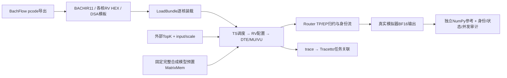

# latch：EP6 + TP8 全部修改与合并审查说明

> 审查版本冻结于2026-10-15。本文逐项解释从历史 `pcode_dev_jxc` 起点到开发终点的全部提交，供模拟器、pcode、TS、Router、存储和硬件同事讨论合理性。没有检查当前主分支，不代表已批准合并。

## 1. 精确范围、阅读路径与术语

| 项目 | 版本 / 范围 |
| --- | --- |
| 原始基线 | `pcode_dev_jxc`：`198c8dfaff331cb9c0d33a0004cf65f2e5052e1b` |
| 审查终点 | `pcode_dev_zlm`：`a1c728ba9e4852b05824d1eb193a020d01f95f48` |
| 提交与路径覆盖 | 15次提交、94个变更路径；逐提交文件并集等于净diff路径，无中途增删遗漏路径 |
| 配套 BachFlow 基线→终点 | `96853a104c0d803184a2b633ab973b2aed75c970` → `3f3642969bee23ead644f5f1e04a92b79af12f75` |

两个仓库的起点均来自用户指定的历史分支；最初临时名 `codex/ep6-tp8-single-token` 后改成 `pcode_dev_zlm`。本报告覆盖模拟器执行模型、测试驱动、参考计算、报告与Tracetto工具，不能把15个commit简单概括成“只增加测试”。

先看§2与§14可了解整体；实现同事再按§3–12及附录定位。全部commit链接固定到完整SHA，全部源码链接固定到审查终点，便于讨论时避免分支继续更新造成偏移。



术语：**task** 是TS调度单元，**macro** 是VU内部指令；RV执行段和DSA执行段可重叠，不能相加当任务延迟。**stream ID** 是某物理core本地的在途槽位，不是全网恒定token编号；**user ID/token ID**用于身份；**path ID**用于选择路由；**VC**是传输资源，不能与path混为一谈。logical core经坏核harvest映射成physical core；Tracetto展示物理core，三视图可切harvest。

GLM5最终配置：48chip、EP6/TP8、6144输入/输出、2048每专家中间维、256路由专家、1共享专家、外部给定8个不同专家及非负归一融合权重。EP0–4各43个、EP5为41个，全球编号连续；shared每EP部署相同副本，只在`user_id % 6`执行，系数1。FC13为不同FC1/FC3矩阵合并，后接SiLU×up/MXFP8与FC2。测试权重完整伪随机，并非真实GLM5 checkpoint。

**fixture**是受控测试输入/权重描述，**oracle/golden**是独立算出的期望值；**native**指运行编译后的latch程序，仍是仿真；**preload**指启动前设置存储初值，不是模拟外部权重加载。BF16/FP32分别为16/32位浮点，BF16精度较低，在哪一级转成BF16会改变舍入结果。

## 2. 全部15次提交时间线

| # | 日期（北京时间） | 提交 | 文件数 | 修改说明 |
| ---: | --- | --- | ---: | --- |
| 1 | 2026-10-10 | [`edd78ae`](https://github.com/perfechpitch/latch/commit/edd78ae695d43b26a146bab32cb522e57f2a57c1) feat(bach): execute pcode bundles with EP6 TP8 numerical verification | 33 | [说明](#l1)：首次真实pcode导出链执行。§3 BACHIR11、§4 RV/ABI/端口、§5 DTE头/TopK/引用、§6 MU模板/专家、§7归约/TS/Xbar；初始fixture/参考/单元回归。 |
| 2 | 2026-10-10 | [`27df2f1`](https://github.com/perfechpitch/latch/commit/27df2f19e26dc2a2cbbdd1dd847844f9d104b8e5) docs: rename EP6 development branch to pcode_dev_zlm | 1 | [说明](#l12)：仅PCODE_EP6说明将临时开发分支名改pcode_dev_zlm，无执行行为改变。 |
| 3 | 2026-10-10 | [`8755702`](https://github.com/perfechpitch/latch/commit/8755702b14a5b509092b1ca5fc7c2af7c596333c) fix(pcode): preserve user identity and honor VU load stride | 14 | [说明](#l6)：补齐user头字段，LU run/skip及分段scale；新增134计划/fixture与独立精度参考，诊断snapshot和回归。 |
| 4 | 2026-10-11 | [`e28a454`](https://github.com/perfechpitch/latch/commit/e28a454449f621fca8547c218f1163bb7cae23b1) test(pcode): record all 134 EP6 TP8 single-token integration results | 2 | [说明](#l12)：只封存134/134历史结果JSON和统计说明，未修改执行模型。 |
| 5 | 2026-10-11 | [`d7fff7a`](https://github.com/perfechpitch/latch/commit/d7fff7a50114171cc394086d9cb1be5028b7c566) test(pcode): execute paired tokens with isolated TopK stream tables | 9 | [说明](#l6)：TopK索引用AGCU已加SID的地址；驱动同一初始化双包、固定模型、身份匹配，新增52组计划和测试。 |
| 6 | 2026-10-11 | [`4095325`](https://github.com/perfechpitch/latch/commit/409532543d28d5c86c487fa34e0769aa3004488b) fix(pcode): preserve scale stride and hardware header flow across streams | 9 | [说明](#l6)：scale stride单位×32；pcode compute禁legacy头FIFO、后由1034b35扩展；诊断、assembly信用等待测试及双包超时设置。 |
| 7 | 2026-10-11 | [`1034b35`](https://github.com/perfechpitch/latch/commit/1034b35f8c89135daf8ad6df8c68c5c45c4246cf) fix(pcode): use DTE header storage for every exported core | 3 | [说明](#l6)：头FIFO禁用扩到全部pcode核，包括B/R自启动核；文档更正，不丢DTE头存储。 |
| 8 | 2026-10-11 | [`dcb623f`](https://github.com/perfechpitch/latch/commit/dcb623ffc57c620b148377dfb15e281dd49ae463) test(pcode): identify users in stalled two-token reductions | 1 | [说明](#l7)：仅失败日志增加user身份，便于识别归约/TS阻塞归属。 |
| 9 | 2026-10-11 | [`6a98ac0`](https://github.com/perfechpitch/latch/commit/6a98ac0a503fcddf0e479902e4f2ee7641593edb) test(pcode): reject incomplete reductions after token outputs | 1 | [说明](#l7)：有输出也要求无unfinished reduce/输入输出队列，防假通过。 |
| 10 | 2026-10-11 | [`0d282d6`](https://github.com/perfechpitch/latch/commit/0d282d6da42a7593898fa83d9b0ed00e85ad651f) Fix concurrent pcode reduction paths and reused token credit requests | 6 | [说明](#l7)：pcode同user多path共享32KiB/16user预算、retire；credit去重闲后可复用，扩大诊断并补回归。 |
| 11 | 2026-10-11 | [`8543acd`](https://github.com/perfechpitch/latch/commit/8543acd614e516073234600dd432cb46e672c779) Record verified EP6 TP8 two-token integration campaign | 3 | [说明](#l12)：记录52组104输出历史最终结果，新增独立重建104golden与程序/状态/fixture摘要审计工具。 |
| 12 | 2026-10-12 | [`fe1469b`](https://github.com/perfechpitch/latch/commit/fe1469b8073fc1192ea8355386aef5a2949d28be) Validate 96 GLM5 MoE cases with complete fixed model weights | 13 | [说明](#l8)：新增完整固定GLM5模型96单包：BankedMem镜像overlay、mmap预置/原生约束、参考/审计/relations/报告/测试。 |
| 13 | 2026-10-12 | [`d178932`](https://github.com/perfechpitch/latch/commit/d178932cbaefcd57e372ec5a4c190f264b1b1119) Validate dense GLM5 concurrent token pairs through pcode | 14 | [说明](#l9)：96完整双包、TS同时compute证据；RouterStation VC重映射包独占与reduce lane跨VC包独占，diag/测试/报告/验证。 |
| 14 | 2026-10-13 | [`7746906`](https://github.com/perfechpitch/latch/commit/774690623ef131f67526672387b8340a8d2be057) feat(tracetto): associate timing segments with pcode task chains | 9 | [说明](#l10)：Tracetto紧凑lane索引修复、虚拟列表/空cache/取数、task映射/API/交互/测试，pcode trace flush/输出控制。 |
| 15 | 2026-10-15 | [`a1c728b`](https://github.com/perfechpitch/latch/commit/a1c728ba9e4852b05824d1eb193a020d01f95f48) feat(mu): expose TopK reads for dynamic-VL pcode execution | 13 | [说明](#l11)：MU原始TopK读口与16KiB IO窗口、真实RV回归；dynamic-VL新96+96共288输出及逐task前后耗时审计/报告。 |

<a id="l1"></a>
## 3. 首次打通：装载协议与模式边界（edd78ae）

### 3.1 为什么不能用原latch内部编译器代替

用户要验证pcode生成的任务与配置。基线loader只认BACHIR10，使用原bundle较统一的image/配置组织；pcode导出为BACHIR11，每个物理core的任务、源码和模板可不同。如果临时用latch内部MoE compiler生成替代链，数值通过也不能证明pcode正确。

`bundle_load.h`现在同时接受10/11，11置`pcode`标志；`CorePlan`新增：

```cpp
std::array<std::string, 3> kernels{};
std::vector<std::tuple<uint64_t, uint64_t, uint64_t>> dsa_regs;
std::map<uint64_t, uint64_t> smem;
```

解析三种BACHIR11记录：`KERNELCORE chip core unit image`、`DSAREG chip core unit offset value`、`SMEM chip core offset value`。合法单元0/1/2对应DTE/MU/VU，legacy10不能使用新记录。对好core设pcode模式，预装DTE/MU寄存器、VU模板、4B little-endian ShareMem初值，再按核级kernel路径替代原全局image；没有per-core路径时仍回退原image。坏core跳过程序装载，保留路由透传处理。参见 [`src/bach/ip/bundle_load.h:214`](https://github.com/perfechpitch/latch/blob/a1c728ba9e4852b05824d1eb193a020d01f95f48/src/bach/ip/bundle_load.h#L214)、[`src/bach/ip/bundle_load.h:361`](https://github.com/perfechpitch/latch/blob/a1c728ba9e4852b05824d1eb193a020d01f95f48/src/bach/ip/bundle_load.h#L361)。

### 3.2 哪些隔离，哪些没有隔离

不能笼统说“全部由pcode_mode保护、legacy绝无影响”。模式传播从 `Core::SetPcodeMode()` 到TS、RV，后续还到ReduceModule；loader另设DTE/MU模式。以下是实际边界：

| 范围 | 是否pcode专用 | 需要兼容审查的原因 |
| --- | --- | --- |
| BACHIR11记录、MU模板/bitfield布局、pcode头布局、共享槽规则 | 是 | BACHIR10保留旧分支，但新分支本身仍须规格核对 |
| TS条件重发skip、Router Done path匹配、RV每入口ABI重置 | 是 | 控制流语义与真实runtime相关 |
| RV CSR译码、CSR寄存器依赖识别 | 否 | 原程序也经过同一ISA译码 |
| 全RV的CoreMem端口及绝对地址alias | 否 | 新端口可改变仲裁资源；基线只DTE RV有该访问 |
| DTE绝对地址归一、VU地址alias | 主要按地址窗口识别，无全局模式保护 | 地址落入新窗口的旧调用行为会变化 |
| Router按实际beat字节、mixed dtype、packet spill及跨VC包独占 | 否 | 修复共用数据通路，所有bundle都可能受影响 |
| BankedMem整镜像预置 | 仅调用者启用新API，读写实现是共用 | 需看原Poke/scale overlay是否仍正确 |
| 新MU TopK读窗口 | 非模式限定 | 新地址段读语义扩展，其他端口/地址布局需确认 |

<a id="l2"></a>
## 4. 首次打通：RV指令、地址与ABI（edd78ae）

### 4.1 对应硬件身份CSR，而非host伪造结果

pcode内核用CSR读stream/task、写user/path/VC。基线缺少这些CSR的功能映射。新增 `BachCsrInst`，将CSR读写接到既有同步task-control view：

| CSR | 语义 |
| --- | --- |
| 0xFC0 / 0xFC1 | stream ID / task ID |
| 0x7C0 / 0x7C1 | user ID / path ID |
| 0x7C2 | VC ID，taskctrl偏移0x1C，写入取低2bit |

支持CSRRW/CSRRS/CSRRC及immediate变体，rd=0不写回，set/clear的rs=0不写CSR，写入产生RV task完成身份和DTE/MU配置时采样的身份。`exec.h::RvDecodeRegs()`相应改SYSTEM依赖：funct3=0无rd；仅寄存器CSR形式1..3读rs1，5..7的zimm不是寄存器，避免错误依赖/时序。参见 [`src/bach/ip/chip/core/rv_core/custom0.h:165`](https://github.com/perfechpitch/latch/blob/a1c728ba9e4852b05824d1eb193a020d01f95f48/src/bach/ip/chip/core/rv_core/custom0.h#L165)、[`src/bach/ip/chip/core/rv_core/exec.h:88`](https://github.com/perfechpitch/latch/blob/a1c728ba9e4852b05824d1eb193a020d01f95f48/src/bach/ip/chip/core/rv_core/exec.h#L88)。

自定义 `dsar/dsaw/dsawi` 的原custom-0立即数/寄存器编码译码本次首提交没有重写；新增CSR让生成内核能正确为这些指令提供当前身份。后来a1c728b扩展MU IO窗口，才使0x3f00等已可编码的高地址读实际可到达，不应混说“修改了custom-0编码”。`custom0.cpp`在首提交增加硬件CSR读更新回归，末提交另测MU高地址。

### 4.2 绝对地址映射与CoreMem访问者

pcode用硬件绝对地址，原模型多用tagged endpoint或内部基址。现在：

| pcode地址 | 模型端点 / 偏移 |
| --- | --- |
| 0x48300000… | ShareMem alias（RV）；DTE完成写也归一成内部偏移 |
| 0x48400000… | CoreMem alias；MU/VU数据地址去绝对基址 |
| 0x48500000… | scale字节地址；DTE转成对应data-byte偏移×32 |
| 0x48C00000… | MatrixMem；MU/DTE转内部偏移 |
| 0x4802B000… | DTE HeaderTable |
| 0x48033000… | MU TopK表 |

VU路径选择RV需要读CoreMem里的包头，原先仅DTE RV具备CM端口。`core_mem.h`新增MU RV/VU RV master、总端口9→11；`core.h`实际连线；`rv_core.h`给三种RV都启用CM LSQ；`exec.h`MMIO映射与 `ToLsq()`识别同时扩展。不是让VU直接读取另一core的内存。参见 [`src/bach/ip/chip/core/core.h:583`](https://github.com/perfechpitch/latch/blob/a1c728ba9e4852b05824d1eb193a020d01f95f48/src/bach/ip/chip/core/core.h#L583)、[`src/bach/ip/chip/core/memory/core_mem.h:38`](https://github.com/perfechpitch/latch/blob/a1c728ba9e4852b05824d1eb193a020d01f95f48/src/bach/ip/chip/core/memory/core_mem.h#L38)、[`src/bach/ip/chip/core/rv_core/exec.h:314`](https://github.com/perfechpitch/latch/blob/a1c728ba9e4852b05824d1eb193a020d01f95f48/src/bach/ip/chip/core/rv_core/exec.h#L314)。

### 4.3 为什么每task启动重置ABI

BachFlow首提交去除GCC naked，生成C++可有数组与正常栈帧。任务通过task_done结束而非函数return，前一prologue压栈不会用普通epilogue恢复。`RvExec::Start`在pcode模式每入口调用既有 `ResetAbi()`，为新task恢复合法ABI起点，再设PC/解除halt；非pcode不新增该入口重置。若只有单次执行，栈泄漏可能暂时不明显；多次token/task会累积。

**合并评估**：端口和地址扩展是功能模型的实现选择，需硬件确认MU/VU RV是否确实可访问CM、仲裁优先级/带宽、绝对alias窗口和ABI启动约定。CSR访问权限、立即数副作用与RTL一致性也需补证。此处只证明当前模型能执行编译后的pcode，未做完整RV ISA一致性验证。

<a id="l3"></a>
## 5. 首次打通：DTE描述符、包头与TopK（edd78ae、8755702）

### 5.1 描述符在trigger时冻结pcode布局与身份

DTE regfile新增 `CfgWrite`供BACHIR boot初始化、pcode_mode和header_reader。trigger时把pcode标志写入descriptor，读取TS/RV传来的stream/task/user/path/VC；HeaderTable窗口的RV读通过reader取hmem项core_mask（0x3000起、每项128B映射）。ShareMem完成写的绝对地址归一。数据搬运仍由既有seg有效位、AGCU地址展开和Lane推进。

`Agcu::Tagged()`在Decode和ExpandOut两处统一绝对地址→原endpoint布局，不改变旧tag地址。Header段0参与造包/落库，TopK段经专用路径到MU，data与scale仍不同段。参见 [`src/bach/ip/chip/core/dte/agcu.h:52`](https://github.com/perfechpitch/latch/blob/a1c728ba9e4852b05824d1eb193a020d01f95f48/src/bach/ip/chip/core/dte/agcu.h#L52)、[`src/bach/ip/chip/core/dte/regfile.h:249`](https://github.com/perfechpitch/latch/blob/a1c728ba9e4852b05824d1eb193a020d01f95f48/src/bach/ip/chip/core/dte/regfile.h#L249)。

### 5.2 32B pcode头不能按legacy48B解释

legacy header context为48B；pcode用32B布局：byte0 hardware_used、byte2 mask16b、byte8 user16b（8755702补齐）、byte16 gpu64b、byte24 token64b。`HeaderToBytes/BytesToHeader`按mode序列化，Lane进核既支持HeaderTable，也支持B/R core的CoreMem；造出包从相同格式取身份并复制path_core_mask。

首提交遗漏了user_id offset8，导致UID非零、shared选择/check_flag会认错用户；`8755702`在HmemEntry、两种落点及序列化往返补齐，测试覆盖0/5/78/1023及mask/gpu/token，**不是修改测试输入来容忍错误身份**。参见 [`src/bach/ip/chip/core/dte/hmem.h:41`](https://github.com/perfechpitch/latch/blob/a1c728ba9e4852b05824d1eb193a020d01f95f48/src/bach/ip/chip/core/dte/hmem.h#L41)、[`src/bach/ip/chip/core/dte/lane.h:195`](https://github.com/perfechpitch/latch/blob/a1c728ba9e4852b05824d1eb193a020d01f95f48/src/bach/ip/chip/core/dte/lane.h#L195)。

### 5.3 TopK来源既可能是sideband，也可能仍在包数据

原Lane只读 `Message.topk`。pcode ingress在payload里带六组TopK，首次切段时sideband可能为空；此时pcode分支从本TopK段的data/slice取字节，交MU TopK专用端口。已有sideband不被覆盖。每组前2B为本EP routed数量，随后是专家本地编号与FP32系数；不含shared条目。

首提交的 `Descriptor::TopkIndex`最初按固定cfg基址求索引，只能偶然适合SID0；后续§8修成展开后实际地址。这个历史演进必须分开看，不能认为首提交已解决多stream。

### 5.4 首提交还修了一个独立生命周期错误

`Lane`出核时原代码先 `buffer.Pop(idx)` 再读队首引用`b.last`，引用可能失效。现在先保存 `bool last=b.last` 再Pop，后续判定是否TopK pending/issue_done使用局部值。该修复无pcode_mode保护，属于共用通路的潜在C++引用生命周期错误；需保留针对长包/TopK尾段回归。

**合并评估**：32B头、userdata偏移、HeaderTable读口只返回mask等是pcode ABI适配，应与DTE/packet协议负责人确认完整读语义，不可称“整个HeaderTable所有字段都完整可读”。新case覆盖当前kernel需要的字段，不是全寄存器协议覆盖。

<a id="l4"></a>
## 6. 首次打通：MU模板与动态专家执行（edd78ae）

基线MU寄存器布局和pcode生成primitive_mode不同，也没有按pcode静态模板叠加动态dirty字段的trigger行为。`MuRegfile`在pcode模式维护4组×10字段模板（0x1000起，每0x80字节一组），记动态写字段dirty；trigger按(v>>1)&3选模板，用dirty字段覆盖，再译码冻结task cfg。

pcode primitive_mode解释包括primitive_type、A输入类型、C输出BF16位、B类型、share_mask、expert_count、ep_reduce/task_last。MatrixMem/CM绝对地址在latched cfg归一；legacy译码仍留原分支。参见 [`src/bach/ip/chip/core/mu/regfile.h:217`](https://github.com/perfechpitch/latch/blob/a1c728ba9e4852b05824d1eb193a020d01f95f48/src/bach/ip/chip/core/mu/regfile.h#L217)。

真正的计算数量及专家索引如下：

```cpp
// pcode且是expert相关操作时，实际槽位数来自该stream TopK。
task_cfg.expert_count = ep->PcodeTopk(task_cfg.stream_id,
                                     task_cfg.expert_count).size() + 1;
// slot0 shared；slot1..r 紧凑存本EP激活routed
// 权重矩阵索引：slot i>0 → TopK[i-1].local_ep_index + 1
// 融合系数：slot0 → share_mask ? 1 : 0；slot i>0 → TopK系数
```

`PcodeTopk`先读2B count并检查不超过配置容量，跳过前缀后按旧条目解析器解码；`LocalEpOf/WeightOf`避免把compact slot误当实际专家ID。share_mask为0时shared权重读出的tile置零，保留shared输出槽但不产生贡献。FC13 slot按TopK顺序紧凑写，FC2按相同stride读入并融合，不会计算所有43/41个部署专家，也不是把global expert编号直接当激活slot。

这是后续动态VU能只算`r+1`的前提；若改变shared slot或FC13输出排序，VU优化必须随之重审。**待硬件确认**：disabled shared是实际计算零tile还是可跳过、TopK表count含义、融合weight应用阶段以及不同模板字段真实bit位。本实现是模型语义，不是实测硬件性能。

<a id="l5"></a>
## 7. 首次打通：归约数据和Router调度（edd78ae）

### 7.1 pcode数值归约没有16B软件前缀

legacy归约payload首16B软件信息必须跳过相加并原样复制；pcode数值段从byte0开始。新增Message `reduce_aux_bytes`默认旧16B，DTE pcode出包设置0，ReduceModule每ctx保存aux_bytes。元素计数、累加起点、就绪字节和结果打包全部引用该值。否则会漏掉前几个数或把元素数算错。参见 [`src/bach/common/message.h:55`](https://github.com/perfechpitch/latch/blob/a1c728ba9e4852b05824d1eb193a020d01f95f48/src/bach/common/message.h#L55)、[`src/bach/ip/chip/core/router/reduce_module.h:352`](https://github.com/perfechpitch/latch/blob/a1c728ba9e4852b05824d1eb193a020d01f95f48/src/bach/ip/chip/core/router/reduce_module.h#L352)。

### 7.2 不同lane可有不同输入精度

pcode路由允许本地FP32 partial与mesh已转BF16的结果相加。旧单一dtype不能正确估算字节/元素和分区。新增 `LaneDtype(dtype,lane)`：bit8置位时，bit0..2分别标三个lane的FP32，否则沿用单dtype。准入/预留函数增加lane参数，Router/Xbar/Core一路传递；累加解码、ReadyBytes、分区估算都按实际lane dtype处理。输出仍按route表的out_dtype转换，内部累加FP32。

### 7.3 真实beat可能128B，不能假定每flit256B

原`hi = tail ? message.size : lo + kFlitBytes`可能把尚未收到的数据提前当到齐。现在：

```cpp
uint64_t hi = std::min<uint64_t>(lo + f.bytes, f.msg->size);
LOGCHECK(!f.tail || hi == f.msg->size,
         "ReduceModule: tail before the payload was fully received");
AccumRange(c, payload, lo, hi, LaneDtype(c.in_dtype, lane));
```

`PCODE_TRACE_REDUCE`只加诊断，不改数值；Inspect增加各lane got字节数便于查停滞。`ShortBeatsWaitForActualBytes`覆盖128B beat，原一些测试用“最后一拍暗含整包剩余数据”的驱动不合法，改成实际分段发送，数值断言相应只对同一物理payload求和。`LockedToTailAcrossInputs`旧10+5+1000把两拍当两份不同数据，改成一份跨拍10和另一份1000，预期1010；不是放宽容差。

### 7.4 配对标识与完成事件属于不同层

legacy用发送task_id作为reduce_seq，但pcode跨core的task编号不同；首提交DTE pcode统一用path_id标记reduce_seq，保持同一路径输入可配对。与此同时TS消费Router Done还要匹配**当前task是归约且current path相同**，防止同user途经归约完成误结束另一路本地task（`TaskDone`的pcode分支）。二者分别解决跨core配对和本核事件归属。参见 [`src/bach/ip/chip/core/dte/commit.h:170`](https://github.com/perfechpitch/latch/blob/a1c728ba9e4852b05824d1eb193a020d01f95f48/src/bach/ip/chip/core/dte/commit.h#L170)、[`src/bach/ip/chip/core/ts/task_done.h:148`](https://github.com/perfechpitch/latch/blob/a1c728ba9e4852b05824d1eb193a020d01f95f48/src/bach/ip/chip/core/ts/task_done.h#L148)。

### 7.5 透传归约和可选重发不能绑死本核普通计算链

pcode可在本核计算stream退休后仍经过Router归约。`Core::WireRouterToTs`在pcode模式交由Rmem的bounded context准入，legacy仍要求本核准入用户及对应reduce task；没有取消容量限制。

TS `CfgReg::NonReissueMask()`在pcode模式查typeP2pReissueIn，构造该条件datain与其重发task的skip bitmap。`UserMatch::PlanFor`在非reissue路径把这些可选任务计入skip，使用 `done|skip`查datain；Bcast重发skip用`|=`保留前面跳过项。否则普通直发token会等待永远不触发的转存重发支路。实际reissue仍走它的条件链。参见 [`src/bach/ip/chip/core/ts/cfg_reg.h:55`](https://github.com/perfechpitch/latch/blob/a1c728ba9e4852b05824d1eb193a020d01f95f48/src/bach/ip/chip/core/ts/cfg_reg.h#L55)、[`src/bach/ip/chip/core/ts/user_match.h:132`](https://github.com/perfechpitch/latch/blob/a1c728ba9e4852b05824d1eb193a020d01f95f48/src/bach/ip/chip/core/ts/user_match.h#L132)。

### 7.6 Xbar：仲裁等待、链路背压和业务资源失败不同

旧stall_way遇任何ResourceOk失败都可能转存，甚至头已直发、后续body又转存，拆坏一个包。新逻辑分开：

| 状态 | 现在行为 |
| --- | --- |
| 本拍出口已被其他入口占用 | 等仲裁，不spill |
| 包所有权被别的入口占用 | 等当前包tail，不spill |
| link VC credit不足 | 等credit返回，不spill |
| stream/CoreMem业务分配失败且head允许stall_way | head选整包spill，后续所有body沿相同spill路径 |
| 已开始直接转发而中途credit耗尽 | 保持包归属，停body等待，不能改spill |

Xbar新增`spill_packet[input][vc]`记整包选择，`Spill()`统一落overflow及计数。`InspectRequests/OverflowCount`是验收/诊断接口，不给仿真额外资源。首提交四项仲裁回归分别覆盖仲裁、head后credit停、head credit停、CoreMem失败整包spill；4095325将assembly旧“credit耗尽即spill”测试改为耗光40credit、150cycle起归还，最终50包无丢失/无spill。

**合并评估**：§7的大部分是共用执行模型修复，需要Router规格确认“只因业务分配失败转存”的边界。不能因为pcode不希望overflow就把它当永远可忽略；本轮功能campaign要求无overflow，未覆盖真实外部转存压力与长流公平性。

<a id="l6"></a>
## 8. 扩展数值与双stream：早期未覆盖的问题（8755702、d7fff7a、4095325、1034b35）

### 8.1 VU LU真正执行run/skip（8755702）

pcode FC13交错gate/up，每专家需读取256元素、跳过另256。基线LU虽有stride字段但读流仍按连续地址，不同专家值混入。`VuLu`新增每笔128B对齐物理读计划 `StrideRead{addr,offset,bytes,logical_end}`，run/skip单位32元素；选择所需区间gather到逻辑buffer，credit按已消费的物理请求释放。逻辑have改用`buf.size()`，不能再用“收到几笔×128”估算有效数据。

MXFP8 stride响应提取对应物理scale；分段解码scale索引补上 `f->seg_base`，避免每个segment重复用起始scale。排除不适用stride的LdMask/LdSFp32，原连续load仍走旧路径。新增九专家BF16拆半、非对齐短tail、不同segment/stride scale三项VU回归。参见 [`src/bach/ip/chip/core/vu/lu.h:102`](https://github.com/perfechpitch/latch/blob/a1c728ba9e4852b05824d1eb193a020d01f95f48/src/bach/ip/chip/core/vu/lu.h#L102)、[`src/bach/ip/chip/core/vu/lu.h:423`](https://github.com/perfechpitch/latch/blob/a1c728ba9e4852b05824d1eb193a020d01f95f48/src/bach/ip/chip/core/vu/lu.h#L423)。

首提交还把VU流水观测从另一个BachModule协程改为VuDriver同协程after_step，避免普通VRF/counter读取竞态；没有修改VU算术或放宽原断言。该改动只在测试 `vu.cpp`。

### 8.2 TopK SID展开（d7fff7a）

原pcode TopKIndex按 `cfgaddr - 0x48033000`，对于所有stream cfgaddr相同，SID1覆盖SID0表。改为AGCU已经展开的 `s.dst_addr/256`或`s.src_addr/256`。既处理Router→MU表，也处理表→Router附包。测试SID0/1/15双向。单token通常SID0，所以原缺陷不显现。参见 [`src/bach/ip/chip/core/dte/dte_types.h:214`](https://github.com/perfechpitch/latch/blob/a1c728ba9e4852b05824d1eb193a020d01f95f48/src/bach/ip/chip/core/dte/dte_types.h#L214)。

### 8.3 scale的stride单位也必须转换（4095325）

首提交只把scale基地址×32，但SID stride仍用scale-byte数，SID>0会落到另一token数据的scale区域。新增 `EndpointStride(address,stride)` 对绝对scale窗口把stride也×32，源/目的同时用它。测试base0x48500018、stride0x800，SID0/1/15映成data偏移0x300+SID×0x10000。该case解释了单包为何无法证明多包地址正确。参见 [`src/bach/ip/chip/core/dte/agcu.h:63`](https://github.com/perfechpitch/latch/blob/a1c728ba9e4852b05824d1eb193a020d01f95f48/src/bach/ip/chip/core/dte/agcu.h#L63)。

### 8.4 Header FIFO积压：先修compute，随后修所有pcode核

基线CoreStation为软件管理kernel保留每包HeaderFIFO，并据其容量反压；pcode从TS拿身份、DTE将header落Hmem/CM，没人pop这份软件副本。第一包可能通过，后续逐渐把FIFO填满，甚至单token有多个内部包也可积压。

- `4095325`新增 `SetSoftwareHeaderQueue`，禁用时不入hdr_fifo、不受其空位限制，但仍保留payload out_buf和TS trigger；当时loader只对非self_start的pcode compute禁用。
- `1034b35`检查B/R pcode核也没有读取legacy软件FIFO，改成 `SetSoftwareHeaderQueue(!pcode)`，所有BACHIR11 core禁用，legacy默认true。

这不是丢掉header：pcode header仍由DTE进Hmem或CM并在出包读回。`HardwareHeadersDoNotFillSoftwareFifo`20包验证头深度0、trigger与payload全交付，legacy FullHeaderFifoBackpressures仍存在。参见 [`src/bach/ip/bundle_load.h:364`](https://github.com/perfechpitch/latch/blob/a1c728ba9e4852b05824d1eb193a020d01f95f48/src/bach/ip/bundle_load.h#L364)、[`src/bach/ip/chip/core/router/core_station.h:123`](https://github.com/perfechpitch/latch/blob/a1c728ba9e4852b05824d1eb193a020d01f95f48/src/bach/ip/chip/core/router/core_station.h#L123)。

### 8.5 双token驱动必须共享模型与同一初始化

`d7fff7a`给SpreadHarness增加可选 `input_source(now)` 与expected_outputs，仍遵守入口credit；未设置时原tokens/weights路径保持。pcode_bundle加载两个fixture后只初始化/启动一次，支持overlap与sequential；sequential等待先输出并且compute任务退休再发第二包。结果按(user,token)匹配，不按到达顺序猜，查重、查长度、分token落实际输出。

稀疏fixture的矩阵随机种子从输入种子分离，按固定matrix_seed和chip/core/stage/expert定系数，避免两包“碰巧各自使用不同模型”。`audit_shared_model()`解析两份fixture中重叠矩阵，逐字节一致才执行。完整稠密模型后来替代此主测，但旧52组保留为历史与兼容诊断。

<a id="l7"></a>
## 9. 多path归约、credit复用与验收加严（dcb623f、6a98ac0、0d282d6）

### 9.1 输出正确不代表pipeline已无残留

`dcb623f`只在归约和TS停滞日志增加user，帮助把同path的不同用户分开；无执行语义变更。`6a98ac0`在预期输出包数已达到时，仍检查每个好core：Inspect.tasks为空、OutQueued=0、三lane input_depth=0。否则不能把“输出已收到但旧task等死”当通过。`0d282d6`扩大失败诊断到所有chip/core，增加fsm/rmem/donebitmap/credit请求数等，避免只看EP0。

### 9.2 同user的多path不能只锁一个ctx（0d282d6）

旧ReduceModule `ctx[user]`一次只允许该user的一个path；当不同path在不同lane次序相反时，第二path挡在第一path缺失输入之前，单user也会死锁。pcode现在：

```cpp
using ContextKey = std::pair<uint64_t,uint64_t>;
ContextKey KeyOf(uint64_t user, uint64_t path) const {
  return {user, pcode_mode ? path : 0};
}
```

输出队列也保存path，查/取ctx按相同key，并校验reduce_seq/path。**这里不能独立区分同UID、同path的不同token轮次**：pcode出包的reduce_seq就是path，不含token ID；正确复用依赖前一token彻底退休后再使用相同UID，不能据此支持同UID并发。资源不是每path独立放大：最多16用户，**同用户所有busy/reserved path累计FP32数据字节≤32KiB**；`live_bytes/UserBytes/users`跟踪预算，ReserveHead在head前预留，emit清busy/占用，RetireUser遍历该user的所有path：空闲立即删，进行中标retired，交付后删。

参见 [`src/bach/ip/chip/core/router/reduce_module.h:599`](https://github.com/perfechpitch/latch/blob/a1c728ba9e4852b05824d1eb193a020d01f95f48/src/bach/ip/chip/core/router/reduce_module.h#L599)、[`src/bach/ip/chip/core/router/reduce_module.h:606`](https://github.com/perfechpitch/latch/blob/a1c728ba9e4852b05824d1eb193a020d01f95f48/src/bach/ip/chip/core/router/reduce_module.h#L606)。四项测试覆盖交错path并早retire、共用byte预算、16用户而非16path、legacy仍按user串行。

**关键合并待确认**：软件map表达了多path上下文，虽然限总字节，但真实Rmem还需要路径tag/metadata数量、lane阻塞规则、retire语义和有界ctx条目存储；“32KiB没超”并不能独立证明硬件支持无限个空闲path元信息。当前并发UID唯一，不允许同UID两token同时在途。

### 9.3 credit请求去重只覆盖连续保持的请求（0d282d6）

基线CreditMonitor按(user,task)长期去重，下一token复用UID/task可能被当旧请求，尤其SID回环后。新key含user/task/stream/path，端口Invalid时reset last_seen；连续held request只入队一次，端口空闲后相同四元组的新请求合法再接受。测试两段相同请求中隔idle，应收到两次grant。

该修复**非pcode_mode保护**，属于通用请求握手语义更改。需确认producer是否可能以Valid持续为1连续发送完全相同四元组的新事务；当前接口以idle/身份变化区分新请求，若硬件有额外sequence应对应建模。参见 [`src/bach/ip/chip/core/router/credit_monitor.h:141`](https://github.com/perfechpitch/latch/blob/a1c728ba9e4852b05824d1eb193a020d01f95f48/src/bach/ip/chip/core/router/credit_monitor.h#L141)。

<a id="l8"></a>
## 10. 完整GLM5模型与96个单token（fe1469b）

### 10.1 从稀疏诊断模型转向固定完整矩阵

早期134例矩阵每行少量K采样，某些覆盖所有tile，但不等于每个系数全密集，也包含仅shared诊断。用户要求完整GLM5尺寸、全256专家/关键边界、100例内，所以新增独立dense campaign而不把旧结果改名。

`pcode_glm5_dense.py`模型种子20261012：global expert、stage、TP part、logical slot组成SeedSequence；与token、TopK顺序无关，shared用global=-1且不含部署EP，保证六副本相同。所有系数位置都生成带符号合法非零MXFP8 code，scale125..128。逻辑矩阵FC13=4096×6144、FC2=6144×2048；本核分片512×768 / 768×256，FC13前256gate/后256up独立系数，按N128/K64 tile打包。

每例/每双包组预置全部部署专家，不只选择的8个：768 stage/core镜像、33536专家分片，data9,890,168,832B，另1/32 scale。EP0–4每stage/core44槽（shared+43），EP5为42槽。global256总计不含重复shared；最后合法255明确覆盖。

### 10.2 为什么新增BankedMem PreloadImage

若为近10GB权重逐行复制到稀疏map，多进程回归内存开销很大。新 `PreloadImage(addr,bytes,data,scale,owner)`接受只读完整行镜像，检查对齐/边界/不重叠，共享owner保持mmap生命周期；读请求仍走原bank仲裁/延迟管线，不用host直接返回GEMV结果。

当某行后来写入时，先从完整镜像复制整行建立mutable overlay，再改指定字节；scale同样先复制原scale行，避免partial write把未覆盖值清零。ReadBytes/ScaleAt优先overlay，否则回退镜像；没有image时保持原行为。参见 [`src/bach/ip/chip/core/memory/banked_mem.h:159`](https://github.com/perfechpitch/latch/blob/a1c728ba9e4852b05824d1eb193a020d01f95f48/src/bach/ip/chip/core/memory/banked_mem.h#L159)。memory.cpp两项回归覆盖跨边界读取、局部data/scale写、immutable原图不变、MU端口8cycle延迟。

`pcode_dense_model.h`使用POSIX mmap，逐镜像核对BACHIR实际地址、primitive shape、stride、部署count、文件大小和首尾读回；ValidateDenseFixture原生检查8不同合法专家、权重和1、UID≤1023、mask正确。模型manifest SHA、每expert分片SHA及shared128逻辑分片×6相同由Python verifier核验。**合并评估**：存储API可通用，但当前native loader依赖POSIX，Windows需替代；它是SRAM初值模型，不模拟外部权重加载带宽和时延。

### 10.3 96例为何足够本轮而非穷举

| 组别 | 数量 | 区别 |
| --- | ---: | --- |
| 全专家 | 32 | 每8连续编号一包，合计执行0..255 |
| EP分布 | 18 | 6集中、5相邻、4隔空、2交错、1全EP |
| 编号边界 | 18 | 各EP首/尾8，5相邻分界前后4，全局首尾 |
| 数值 | 16 | 8种输入profile×2种seed，非均匀系数 |
| TopK排列 | 6 | 3对正反序，专家和系数绑定 |
| shared副本 | 6 | 同输入/TopK换shared执行EP |

所有主例严格8 routed+1 shared；routed_mask按选择专家的EP按位OR，actual_mask再OR shared EP位。零系数/零输入不取消路由位。覆盖30种routed、46种actual，并非所有63mask；后续双包才覆盖全部63种routed。

### 10.4 独立参考、完整性审计及shared后处理例外

NumPy从完整权重镜像独立解码MXFP8，按32scale block/K64 primitive顺序FP32累加，模拟声明的TP/EP BF16转换，计算SiLU×up和量化、FC2加权、最终BF16；`PrecisionRoutes.evaluate`附Counter要求8个预期TP来源各一次，防止把漏路当正确golden。

`pcode_glm5_program_audit.py`核对12行384个目的地mask、768MU模板/shape/stride、855个**实际BACHIR引用**RV HEX；目录里的旧缓存镜像数不是程序引用数。该audit是格式/特定配置硬编码检查，不能解释为所有pcode程序通用验证器。

shared六副本一样，但把shared贡献放到不同EP会移动BF16舍入位置，最终输出可略异。最初附加后处理直接要求不同shared位置的final达到单例余弦阈值，出现误拒；改成各自对参考通过，另检查 `(actualB-actualA) - (referenceB-referenceA)` 的归一L2残差。权重及shared独立贡献仍要求相同，raw直接对比指标保留。

这次只修**附加后处理**，native96例没有因此重跑；保存 `executed_campaign.py`执行时源、修正后verifier/relations源SHA，全部96份参考重新生成并与实际比对。单例cos/L2阈值未改。这个例外与最新动态VL轮重新跑96+96是两回事，不能混淆。

<a id="l9"></a>
## 11. 完整权重双token与跨VC包边界（d178932）

### 11.1 新96组明确证明同时计算

原52组只是包生命周期重叠。新pcode harness从打拍TS快照读取身份，要求同一cycle两个user同时在compute core集合中且早于任一输出；不读取其他运行协程的可变表，不把宿主线程数当硬件并发。每组两UID不同、同一模型/程序初始化，两包之间不换权重、不reset。这里的“同时计算”精确定义是两个UID同时占有compute核集合里的有效TS槽；槽位可能正在等待，两个UID也可位于不同core。它证明计算任务生命周期相遇，不证明同一core或同一cycle两个算术单元均在执行，更不是吞吐验收。

96组：36组shared EP全部6×6有序组合并覆盖routed mask1..63；16组双8expert覆盖全256；18边界；16数值/反序；10竞争隔离（同专家、同payload异身份3/1023、部分重叠、EP5↔0、同actual不同routed、同routed不同shared、TopK重排、零系数、零输入）。所有token仍严格8 routed+1shared。

### 11.2 RouterStation的VC重映射会把两个包混入同FIFO

`expert_blocks_09`现场在chip31/core4把两份12288B包交织，第一帧累计15616B、第二帧8960B。输入不同VC被路由到相同next VC时，RouterStation轮询会把A_head、B_head、A_body…塞进同一个Xbar input/VC FIFO；Xbar只记input方向，已经无法拆开。

新增 `next_vc_owner[output][nextVC]` 记input VC+1，从head到tail入队保持所有权；同输出同nextVC的其他输入VC等待，独立输出/独立nextVC仍可推进。测试旧序列A,B,A,B,A,B变A,A,A,B,B,B，另两项验证未误阻独立通路。参见 [`src/bach/ip/chip/core/router/router_station.h:184`](https://github.com/perfechpitch/latch/blob/a1c728ba9e4852b05824d1eb193a020d01f95f48/src/bach/ip/chip/core/router/router_station.h#L184)。

`HeaderParser`只新增错误时或PCODE_TRACE_HEADER开关下诊断（frame/user/token/path/字节），没有放宽tail byte_count断言。

### 11.3 Reduce lane的一个FIFO也不能跨VC交错

Xbar原只对core出口跨VC包独占，每reduce lane也只有一个FIFO。`OwnerOk`扩展为core或reduce出口都检查其他VC owner；同lane完整包到tail后才让另VC进，不同reduce lane并行。两项回归分别测同lane连续性、不同lane进展。此修复无pcode_mode保护，是真正改变所有流量仲裁规则。参见 [`src/bach/ip/chip/core/router/xbar.h:515`](https://github.com/perfechpitch/latch/blob/a1c728ba9e4852b05824d1eb193a020d01f95f48/src/bach/ip/chip/core/router/xbar.h#L515)。

### 11.4 包边界修复后仍有VC环路，另一仓库共同修复

`boundary_pair_15`即使包不交织仍停：tokenA routed0x18/sharedEP0/actual0x19，tokenB routed0x04/sharedEP3/actual0x0c；chip23/core2普通EP path33与FC13 path2同占VC3。既有ReduceModule固定VC3流式输出，普通packet阻挡归约剩余输入，出口owner又被归约持有；private/shared credit各20，瓶颈是依赖环而非无credit。

对应BachFlow `e2e78fd`在导出时普通VC3→VC0、归约保留VC3，同步RTAB与TSRTAB。失败现场16000cycle无输出，配对修复后8652/8876cycle收到两包，2415cycle已证明同时计算；855个引用HEX与非VC记录保持一致。两个repo需一起评审，latch此commit没有偷偷改成非流式归约。

### 11.5 时序对齐重试与resume不能掩盖数值失败

驱动仅在“两个输出/身份/mask/模型/队列/数值全部正确，唯一native失败是compute_overlap_cycle=0”时允许换gap2048/4096或交换注入顺序。源fixture、参考、专家/权重、program/model/simulator及阈值不变，旧日志/实际输出逐份存档并哈希。其他失败不重试为PASS。

`boundary_pair_01`三次原顺序没有compute重叠；最终倒序+gap2048通过。不作泛化：该组允许改刺激到达顺序，是为了验证计算相遇时功能，不是证明原gap配置的吞吐。其余95组按原计划。

`--resume`通常严格校验身份和产物；另有明确例外：**只改driver时序控制**、其余sim/bundle/model/plan/reference/harness等哈希完全一致，且原driver源码按SHA保存在runner_sources，允许迁移已通过结果身份。`compatible_identity()`实际只机械验证除`runner_sha256`外所有identity相等、旧源码存在且SHA正确；它没有语义分析来证明runner差异“只涉及注入时序”，因此这条限制还依赖变更审查，不能单靠该函数作保证。最终verifier逐组核对实际运行driver及日志。不能声称所有脚本永远逐字节不变，也不能复用执行模型或程序改变后的旧native结果。header/VC修复后完整96组确实重新跑。

### 11.6 与单token对照的边界

全专家32个token另与单包实际输出比较；如果两轮bundle仅VC字段变更，verifier必须提供原bundle并证明只有RTAB/TSRTAB VC变、HEX/其他记录相同。历史报告32/32过、31逐位一致，1份有1/6144 BF16差异但满足阈值；不能把“通过”改写成32份全bit exact。相同payload异身份另要求输出对照通过。

**合并评估**：packet独占在现有单FIFO架构下有明确必要性，但应确认实际hardware FIFO组织、owner释放点、多播锁资源公平性。VC保留映射属于latch/pcode适配，未验证任意网络无死锁。模型/程序固定的双包没有覆盖同UID并发、16stream全满及长流。

<a id="l10"></a>
## 12. Tracetto空白、卡顿与任务链关联（7746906）

该commit同时包含此前发现的显示修复和最后任务关联，不能只按标题忽略性能与索引逻辑。

### 12.1 空白的原因：紧凑lane序号不等于物理索引文件序号

只Router转发的core没有计算lane，但索引物理core序列仍包含它。server以前用 `lane / lanes_per_core`直接取core文件，前面有Router-only core时读错文件，导致有任务计数却无对应时序块。现在从manifest逐核lane_base建立 `lane_cores[compact ordinal]=physical file ordinal`；窗口请求反查正确文件。测试构造两个计算核间穿插转发核，逐字节比对返回窗口。

### 12.2 展开多个core卡顿：虚拟目录与空窗口cache

前端滚动/画布同requestAnimationFrame更新侧栏，只渲染视口±2行；entries对象、a/b和选中lane不变不重建DOM。展开/折叠、fitAll、resize补scheduleFetch，CSS禁overflow-anchor避免虚拟节点替换造成浏览器自动跳scroll。空行cache字段从错误`covers`改成`win`；新窗口先清旧请求lane cache，再为未返回行记空覆盖，避免同一空行不断请求及沿用旧窗口。

### 12.3 task映射的来源和编号转换

`pcode_tasks.py`读取HTML内的map/topology/chip-cases/pcode-line-text，与实际BACHIR/HEX和trace建立关联：按bundle坏核mask选harvest；检查native TCHAIN集合；自启动核剥离独立DATAIN导致native重编号时转换；DATAIN native63映到pcode -1或原始首项。其他条件转发task保留在整链但标本次未执行，不能伪造周期。

每个事件匹配unit/native TID，记录原pcode调用、op/path、timings、物理核/逻辑核/harvest；若trace旁report有bundle SHA则检查；sidecar tasks.json保存trace source identity，server载入时检查未过期，错配拒绝。**限制**：如果缺少receipt的bundle摘要，不能把“task集合相同”当编译字节的完全证明；摘要目前包含目录全部HEX（含缓存），报告搬迁时要保持同一批文件。

### 12.4 交互和实际trace输出

server新增`/api/tasks?chip=&core=`；按core懒加载缓存、reload/build变化清状态，错误映射给出原因，普通无sidecar波形仍可用。前端点击精确块显示整条task链与当前调用/时间/native↔pcode TID，同行/跨TS/Core/DSA按同physical core、unit、user、task高亮；短任务按实际一像素标记命中。普通token任务在当前用户没有执行片段时明确显示不执行，不拿别用户周期顶替；`check_flag`是自启动控制轮询，`taskUserTimes()`特意不按点击token的user过滤，并标为“控制轮询”，不能把其轮询周期归给该token。hash链接跳BachFlow同harvest物理核任务卡。

HTML/CSS新增可收起task panel、长label短名回退、响应式布局、cache-busting/no-cache JS/CSS。`selftest_frontend.cjs`用实际app.js和轻量DOM模拟检查100core滚动、空cache、任务点击、条件分支、DATAIN映射/跨行高亮/链接；Python selftest覆盖HTTP转发核索引和task映射过期。

`pcode_bundle.cpp`另新增PCODE_TRACE_CHIPS / PCODE_TRACE_PREFIX与析构TraceFinalizer，保证模块信号flush后TraceDone，trace可覆盖全48chip。时序文件/索引/生成HTML不纳Git。**合并评估**：工具可拆分，不影响算子数值；仍需真实浏览器交互兼容性、较长trace性能和sidecar身份可移植性验证，node伪DOM测试不等同完整浏览器测试。

<a id="l11"></a>
## 13. MU TopK读接口与动态VL回归（a1c728b）

### 13.1 这次latch没有修改VU算术

BachFlow配套 `3f36429`新增MU RV-only task读取实际本地TopK routed count，写私有ShareMem，后续同core VU RV按`(r+1)×256`写TYPE_VL。latch原MU regfile读口不能读TopK，MU IO窗口只有4KiB，即使custom指令可编码0x3f00也到不了真实表，因此补**读路径**：

```cpp
uint32_t GenEpInfo::ReadTopkWord(uint64_t offset) const {
  // offset<16*256且4B对齐；同一个DTE写入的raw table
  auto const& bytes = TopkBytes(offset / kTopkBytesPerStream);
  uint64_t start = offset % kTopkBytesPerStream;
  uint32_t value = 0;
  for (uint64_t i=0; i<4 && start+i<bytes.size(); ++i)
    value |= uint32_t(bytes[start+i]) << (8*i);
  return value; // 尚未写入的字节补零
}
```

Regfile在0x3000..0x3fff转发，不返回host固定count也不读可能过期parsed cache；`Mu`构造时把实际`ep.get()`连给regfile。`rv_ports.h`新增kMuIoSize16KiB，RvExec的MU分支选此窗口，DTE/VU不因此改size。已有cfg读回延迟4cycle保持。参见 [`src/bach/ip/chip/core/mu/gen_ep_info.h:63`](https://github.com/perfechpitch/latch/blob/a1c728ba9e4852b05824d1eb193a020d01f95f48/src/bach/ip/chip/core/mu/gen_ep_info.h#L63)、[`src/bach/ip/chip/core/mu/regfile.h:201`](https://github.com/perfechpitch/latch/blob/a1c728ba9e4852b05824d1eb193a020d01f95f48/src/bach/ip/chip/core/mu/regfile.h#L201)、[`src/bach/ip/chip/core/rv_core/rv_ports.h:33`](https://github.com/perfechpitch/latch/blob/a1c728ba9e4852b05824d1eb193a020d01f95f48/src/bach/ip/chip/core/rv_core/rv_ports.h#L33)。

新MU单测以真实cfg/rdata接口读stream0、stream15、最后word0x3ffc，覆盖同SID重新写入后读新值且不trigger GEMV；custom0程序测试让MU RV真执行dsari0x3f00，读取后写另一寄存器再task_done。RunProgram仅新增可选unit参数，原默认DTE保持。

### 13.2 为什么新增一个MU RV任务，而不是DTE直接搬到ShareMem

MU和VU RV是同一个物理计算core的不同RV单元，ShareMem是该core本地共享；计数array每16stream×4B，MU store+fence后RVdone，VU task读取自己SID再trigger两macro。无需在包里新添r字段，也不跨core假定SID一样。

现有DTE确实能从MU TopK取字节附到Message.topk（commit.h），但完成写ShareMem写的是descriptor.smem_data配置值，endpoint enum只有CM/MM/Scale/TopK/Header，没有通用ShareMem DMA终点。当前支持的能力不足以直接表达“raw TopK→ShareMem搬运”；不能说硬件原理上不允许。真实硬件若有该能力，可另扩模型与生成器，不应凭当前模拟器接口擅自定义硬件。

### 13.3 新验收工具避免把旧报告当新版本

`pcode_dynamic_vl_verify.py`为本次新的native96单包+96双包做fresh审计：各288个fixture/真实输出重新比对，完整NumPy参考重建；校验log identity、三个mask、完整768image/33536分片、六shared副本、程序hash和动态VU每task紧邻前置MU count任务。另32份并发/单包对照、TopK排列、shared残差和同payload检查。

记录执行时HEAD与7个执行源SHA；native执行时最终修改尚未commit，所以报告中的`versions.*.base_commit`是6889dd8/7746906，配合source_sha256才确定实际新代码，**不是沿用旧binary的证据**。本次提交仅封存已验证内容，没有把所有历史JSON重写成最新commit。动态VL verifier重新检查最终成功native日志与输出，但只从summary统计`timing_alignment_attempts`数量；逐份存档重试日志/输出的深审计实现位于历史双包verifier，不能把两者的审计范围视为完全相同。

`pcode_dynamic_vl_timing.py`由before/after manifest加载同case/physical core/user匹配task spans，用trace实测RV/DSA/TS包络，count+VU是after.end-count.start，断言count无DSA、先结束再VU开始，两计时case输出12288B逐位相同；保存trace/meta/IR/simulator/fixture/actual摘要。报告是57对样本，r=0/1/2/8分别为1/32/16/8对，不是96例全部core性能统计；尤其r=0只观察到一个core样本。`configured_dynamic_vu_tasks=1128`统计`task_meta.json`内全部harvest配置的静态任务，不能当成某个token实际执行1128次；实际BACHIR选择每chip的一个harvest，本地前后结构核对新增48个count task。

| 本EP r | VL | VU DSA旧→新 | VU完整task旧→新 | 新count RV / 完整task | count+VU跨度 |
| ---: | ---: | ---: | ---: | ---: | ---: |
| 0 | 256 | 264→88 | 279→119 | 18 / 21 | 142 |
| 1 | 512 | 264→104 | 279→135 | 18 / 21 | 158 |
| 2 | 768 | 264→132 | 279→163 | 18 / 21 | 186 |
| 8 | 2304 | 264→264 | 279→295 | 18 / 21 | 318 |

VU RV13→29；r8算满仍超200，增加count和控制还会更慢。本次无多VU并行，不能宣布每级任务<200或5MTPS目标已达成。TYPE_VL表示总逻辑长度，LU stride仍保留gate/up拆分，二者不要混淆。

**硬件待确认**：TopK表是否可由MU RV读、对齐/范围/空字节语义和读延迟；IO空间扩大与各RV独立DSA端口不冲突；ShareMem/fence可见性；动态TYPE_VL和trigger maskbit0的行为；16stream/count缓存生命周期。当前验证只是现有cycle模型的结果。

<a id="l12"></a>
## 14. 所有测试、工具与结果文件的作用

### 14.1 验证层次及历史版本

| 历史阶段 | 保存位置 / 提交 | 实际覆盖与结果 |
| --- | --- | --- |
| 初始full/gap | PCODE_EP6.md，edd78ae | 受控非零稀疏、真实尺寸，两单token，6144 BF16逐位相同、余弦1 |
| 扩展134 | PCODE_CAMPAIGN.md、pcode_campaign_results.json；8755702/e28a454 | 63非空mask+7共享/UID诊断+64数值；134通过。含仅shared，不全是严格GLM5有效主例 |
| 稀疏双52 | PCODE_TWO_TOKEN.md、pcode_two_token_results.json；8543acd | 52组104输出；37生命周期重叠/15顺序，9组同UID顺序复用；不等于新版同时compute覆盖 |
| dense单96 | PCODE_GLM5_DENSE_96.md、pcode_glm5_dense_results.json/.txt；fe1469b | 固定全密度合成模型，全部部署预置，96通过；shared附加后处理修正例外见§10.4 |
| dense双96 | PCODE_GLM5_TWO_TOKEN.md、pcode_glm5_two_token_results.json/.txt；d178932 | 192输出，63routed/60actual mask，36shared有序组合，全256expert，有同时compute证据 |
| 动态VL全重跑 | pcode_dynamic_vl_results.json/.txt；a1c728b | 新binary/program下96单包+96双包，288输出全部独立重建验证，不是直接引用前两轮PASS |
| 动态VL时序 | pcode_dynamic_vl_timing_results.json/.csv；a1c728b | 两case57对core样本；same-input前后输出bit exact，逐task时间轴和摘要 |

历史134最低非零cos0.9999999508227205、maxL2 0.00031361530006680837；52组最低0.9999999895415747、maxL2 0.0001446541747489629。这里只引用已提交报告记录，不重新执行；它们不能证明后续所有改动兼容，也不能替代当前96+96。

最新动态VL记录：

| 指标 | 单96输出 | 双96组/192输出 |
| --- | ---: | ---: |
| 最低非零cos | 0.9999999777156279 | 0.9999999513380896 |
| 最大相对L2 | 0.0002111749947904292 | 0.00031204244883656005 |
| bit exact输出 | 8 | 18 |
| 零参考实际严格零 | 2 | 5 |

单例门槛cos≥0.99999、L2≤0.02，零参考不用伪造cos而要求实际严格全零；另查唯一正确身份、6144BF16长度、无MU drain/Router overflow、compute任务退休与归约队列清空。最新报告还记录32并发/单包比较，全部通过。仅1组alignment-only调整，见§11.5，不掩盖数值失败。

### 14.2 源码与单元测试不只是“跑了多少例”

| 工具/测试 | 目的 |
| --- | --- |
| pcode_reference.py / test_pcode_reference.py | 初始full/gap标量golden；故意删一路EP贡献应余弦失败 |
| pcode_campaign.py / test_pcode_campaign.py | 稀疏fixture、FP8/BF16/scale量化、mask和误差验收；负例含整体缩放错误（cos可仍为1） |
| pcode_case.h | 严格PCDTST02 fixture解析、TopK/input/scale消息组包，稀疏矩阵按真实模板地址装载 |
| pcode_precision_reference.py | 按配置精度/路由拓扑累加且检查TP来源恰好一次；不读实际数值作为参考 |
| pcode_snapshot_compare.py | 可选Join后CM调试快照，明确只采physical9/FC2地址0x1200，其他placement显式skip，不作为主验收 |
| pcode_two_token.py / verify.py / test_*.py | 固定两包模型、注入模式/身份/结果，重建104golden、校验hash/输出与导出结构 |
| pcode_glm5_dense.py / verify.py / test_*.py | 完整模型生成/矩阵参考/96计划/全部专家预置、manifest与fixture复核、覆盖/模型固定性测试 |
| pcode_glm5_program_audit.py | 导出结构、mask、shape/stride、引用HEX，不直接验证算术 |
| pcode_glm5_relations.py | shared位置差异随参考BF16舍入差异的残差检验 |
| pcode_glm5_two_token.py / verify.py / test_*.py | 全63routed/36shared对、native并发/状态、alignment-only/resume、192golden与32单包对照 |
| pcode_dynamic_vl_verify.py / timing.py | 本次全native回归fresh复核、动态count任务依赖、逐task前后时间与身份摘要 |
| run_pcode_*.sh | 使用相邻BachFlow隔离venv的CLI薄封装，不新装全局包 |

最新历史unit日志记录MU19、custom0 9、VU61通过；BachFlow73通过14跳过（旧PP产物快照未提供），campaign Python15通过。早期dense单报告有71native/17Python，双报告有138native/24Python等**各轮统计**，不可简单相加宣称覆盖数量或把当时旧binary日志当本次新binary回归。本文未重跑耗时campaign，可信依据是已存具体报告与其execution/source/hash记录。

### 14.3 已提交与未提交生成产物

Git内保存源码、小型JSON/TXT/CSV结果摘要与说明。trace、Tracetto索引、完整权重镜像、编译HEX/bundle、实际BF16、逐次native日志留ignored build/output或本地审计目录；不是把~10GB模型放进Git。结果JSON里的机器路径是历史取证位置，不是新机器可直接运行的通用命令；独立复现需要同版本生成program/model和运行native，而非只拿JSON就能复算输出。

## 15. 跨仓库依赖与建议评审顺序

| latch修改 | 必要配套BachFlow提交 | 不配套的后果 |
| --- | --- | --- |
| 首次BACHIR11/ABI/MU/header/归约 | [6059b94](https://github.com/perfechpitch/BachFlow/commit/6059b942bbb0081ffed646397ae2fc19b36fc3b9) | 旧reduction少第二次path、完成事件/stride/类型仍错 |
| LU stride/多样数值 | [e4c6e29](https://github.com/perfechpitch/BachFlow/commit/e4c6e2947025742689aa05ace9ba08c0bbcefde6) | gate/up读取和VRF格式需要同时正确 |
| 双token状态/多path | [28beaee](https://github.com/perfechpitch/BachFlow/commit/28beaeeead5036ec683f526ee13187d069a0164d)、[6128c44](https://github.com/perfechpitch/BachFlow/commit/6128c446b945175c629785f08264a48df16963b8)、[59d02f5](https://github.com/perfechpitch/BachFlow/commit/59d02f534277b8c47b170cf93cec55ac336d4c0e) | 源回环、inactive EP半份归约与cache过期不是latch单改能修 |
| 完整双包Router/VC | [e2e78fd](https://github.com/perfechpitch/BachFlow/commit/e2e78fdc45751a6e896fb843b47ab0939a029bc2) | 当前流式VC3与普通transfer冲突可死锁 |
| Tracetto任务链接 | [1ab4b35](https://github.com/perfechpitch/BachFlow/commit/1ab4b355c381a22626ffea4e9bc574fdb6b38cc4)、[6889dd8](https://github.com/perfechpitch/BachFlow/commit/6889dd868fbac79a3605b8c6ae110c1fb3e9e734) | 来源匹配报告与hash task定位功能不完整 |
| TopK读口 | [3f36429](https://github.com/perfechpitch/BachFlow/commit/3f3642969bee23ead644f5f1e04a92b79af12f75) | 仅扩读口不优化VU；仅pcode优化而无读口会读不到r |

| 组别 | 性质 | 评审重点 |
| --- | --- | --- |
| CSR/ABI/地址/模式 | pcode ABI适配 + 共用ISA路径 | 真实CSR与端口规格；unconditional CM端口对legacy影响 |
| DTE/scale/TopK SID/header | 布局正确性 | 单stream为何隐蔽、多stream/长流/full字段覆盖 |
| MU紧凑槽与shared | 模型语义适配 | TopK count/专家矩阵索引、weight应用与实际MU一致 |
| partial flit、mixed dtype、spill、包独占、credit去重 | 共用执行正确性修复 | legacy/多播/压力/公平性；不能按mode隔离免责 |
| 多path Rmem context | pcode执行支持、重要架构假设 | 有界metadata、同user共享32KiB与retire、RTL是否支持 |
| PreloadImage | 存储初始化/仿真规模优化 | 原延迟与overlay保持；POSIX可移植性 |
| TopK读窗口与动态VL | 新接口 + 性能配套 | 规格读延迟/窗口、内存序、r8仍超时 |
| 驱动/参考/报告/Tracetto | 验证和观测辅助 | 可拆分；真实checkpoint/长流/硬件性能均未覆盖 |

建议先确认packet/地址/CSR/TS/Router的硬件协议，再讨论哪些实现可通用、哪些应封装成pcode adapter；其次补齐legacy PP/全stream/长流与多拓扑回归，最后拆分模型修复、测试和工具PR。当前主分支是否已实现或冲突不在本轮范围；报告给出的是待评审证据与假设，不能替相关负责人作最终合并结论。

## 附录 A：每次提交完整SHA、全部文件与正文位置

### 1. edd78ae — feat(bach): execute pcode bundles with EP6 TP8 numerical verification

完整SHA：`edd78ae695d43b26a146bab32cb522e57f2a57c1`；提交：[GitHub diff](https://github.com/perfechpitch/latch/commit/edd78ae695d43b26a146bab32cb522e57f2a57c1)；时间：`2026-10-10T20:20:24+08:00`。

首次真实pcode导出链执行。§3 BACHIR11、§4 RV/ABI/端口、§5 DTE头/TopK/引用、§6 MU模板/专家、§7归约/TS/Xbar；初始fixture/参考/单元回归。 主题定位：[正文](#l1)。

涉及文件（33）：

- `src/bach/common/message.h`
- `src/bach/ip/bundle_load.h`
- `src/bach/ip/chip/core/core.h`
- `src/bach/ip/chip/core/dte/agcu.h`
- `src/bach/ip/chip/core/dte/commit.h`
- `src/bach/ip/chip/core/dte/dte.h`
- `src/bach/ip/chip/core/dte/dte_types.h`
- `src/bach/ip/chip/core/dte/hmem.h`
- `src/bach/ip/chip/core/dte/lane.h`
- `src/bach/ip/chip/core/dte/regfile.h`
- `src/bach/ip/chip/core/memory/core_mem.h`
- `src/bach/ip/chip/core/mu/gen_ep_info.h`
- `src/bach/ip/chip/core/mu/mu.h`
- `src/bach/ip/chip/core/mu/regfile.h`
- `src/bach/ip/chip/core/router/reduce_module.h`
- `src/bach/ip/chip/core/router/router.h`
- `src/bach/ip/chip/core/router/xbar.h`
- `src/bach/ip/chip/core/rv_core/custom0.h`
- `src/bach/ip/chip/core/rv_core/exec.h`
- `src/bach/ip/chip/core/rv_core/rv_core.h`
- `src/bach/ip/chip/core/ts/cfg_reg.h`
- `src/bach/ip/chip/core/ts/task_done.h`
- `src/bach/ip/chip/core/ts/user_match.h`
- `src/bach/ip/chip/core/vu/vu_types.h`
- `test/bach/PCODE_EP6.md`
- `test/bach/ip/chip/core/router/router_arbiter.cpp`
- `test/bach/ip/chip/core/router/router_reduce.cpp`
- `test/bach/ip/chip/core/rv_core/custom0.cpp`
- `test/bach/ip/chip/core/ts/ts_done.cpp`
- `test/bach/ip/chip/core/vu/vu.cpp`
- `test/bach/pcode_bundle.cpp`
- `test/bach/pcode_reference.py`
- `test/bach/test_pcode_reference.py`

### 2. 27df2f1 — docs: rename EP6 development branch to pcode_dev_zlm

完整SHA：`27df2f19e26dc2a2cbbdd1dd847844f9d104b8e5`；提交：[GitHub diff](https://github.com/perfechpitch/latch/commit/27df2f19e26dc2a2cbbdd1dd847844f9d104b8e5)；时间：`2026-10-10T20:24:21+08:00`。

仅PCODE_EP6说明将临时开发分支名改pcode_dev_zlm，无执行行为改变。 主题定位：[正文](#l12)。

涉及文件（1）：

- `test/bach/PCODE_EP6.md`

### 3. 8755702 — fix(pcode): preserve user identity and honor VU load stride

完整SHA：`8755702b14a5b509092b1ca5fc7c2af7c596333c`；提交：[GitHub diff](https://github.com/perfechpitch/latch/commit/8755702b14a5b509092b1ca5fc7c2af7c596333c)；时间：`2026-10-10T23:05:47+08:00`。

补齐user头字段，LU run/skip及分段scale；新增134计划/fixture与独立精度参考，诊断snapshot和回归。 主题定位：[正文](#l6)。

涉及文件（14）：

- `src/bach/ip/chip/core/dte/hmem.h`
- `src/bach/ip/chip/core/dte/lane.h`
- `src/bach/ip/chip/core/vu/lu.h`
- `test/bach/PCODE_CAMPAIGN.md`
- `test/bach/PCODE_EP6.md`
- `test/bach/ip/chip/core/dte/dte.cpp`
- `test/bach/ip/chip/core/vu/vu.cpp`
- `test/bach/pcode_bundle.cpp`
- `test/bach/pcode_campaign.py`
- `test/bach/pcode_case.h`
- `test/bach/pcode_precision_reference.py`
- `test/bach/pcode_snapshot_compare.py`
- `test/bach/run_pcode_campaign.sh`
- `test/bach/test_pcode_campaign.py`

### 4. e28a454 — test(pcode): record all 134 EP6 TP8 single-token integration results

完整SHA：`e28a454449f621fca8547c218f1163bb7cae23b1`；提交：[GitHub diff](https://github.com/perfechpitch/latch/commit/e28a454449f621fca8547c218f1163bb7cae23b1)；时间：`2026-10-11T01:27:27+08:00`。

只封存134/134历史结果JSON和统计说明，未修改执行模型。 主题定位：[正文](#l12)。

涉及文件（2）：

- `test/bach/PCODE_CAMPAIGN.md`
- `test/bach/pcode_campaign_results.json`

### 5. d7fff7a — test(pcode): execute paired tokens with isolated TopK stream tables

完整SHA：`d7fff7a50114171cc394086d9cb1be5028b7c566`；提交：[GitHub diff](https://github.com/perfechpitch/latch/commit/d7fff7a50114171cc394086d9cb1be5028b7c566)；时间：`2026-10-11T12:07:10+08:00`。

TopK索引用AGCU已加SID的地址；驱动同一初始化双包、固定模型、身份匹配，新增52组计划和测试。 主题定位：[正文](#l6)。

涉及文件（9）：

- `src/bach/ip/chip/core/dte/dte_types.h`
- `test/bach/PCODE_TWO_TOKEN.md`
- `test/bach/ip/chip/core/dte/dte_lane.cpp`
- `test/bach/ip/chip/moe_common.h`
- `test/bach/pcode_bundle.cpp`
- `test/bach/pcode_campaign.py`
- `test/bach/pcode_two_token.py`
- `test/bach/run_pcode_two_token.sh`
- `test/bach/test_pcode_two_token.py`

### 6. 4095325 — fix(pcode): preserve scale stride and hardware header flow across streams

完整SHA：`409532543d28d5c86c487fa34e0769aa3004488b`；提交：[GitHub diff](https://github.com/perfechpitch/latch/commit/409532543d28d5c86c487fa34e0769aa3004488b)；时间：`2026-10-11T12:31:47+08:00`。

scale stride单位×32；pcode compute禁legacy头FIFO、后由1034b35扩展；诊断、assembly信用等待测试及双包超时设置。 主题定位：[正文](#l6)。

涉及文件（9）：

- `src/bach/ip/bundle_load.h`
- `src/bach/ip/chip/core/dte/agcu.h`
- `src/bach/ip/chip/core/router/core_station.h`
- `test/bach/PCODE_TWO_TOKEN.md`
- `test/bach/ip/chip/core/dte/dte_lane.cpp`
- `test/bach/ip/chip/core/router/router_assembly.cpp`
- `test/bach/ip/chip/core/router/router_core_station.cpp`
- `test/bach/pcode_bundle.cpp`
- `test/bach/pcode_two_token.py`

### 7. 1034b35 — fix(pcode): use DTE header storage for every exported core

完整SHA：`1034b35f8c89135daf8ad6df8c68c5c45c4246cf`；提交：[GitHub diff](https://github.com/perfechpitch/latch/commit/1034b35f8c89135daf8ad6df8c68c5c45c4246cf)；时间：`2026-10-11T12:54:45+08:00`。

头FIFO禁用扩到全部pcode核，包括B/R自启动核；文档更正，不丢DTE头存储。 主题定位：[正文](#l6)。

涉及文件（3）：

- `src/bach/ip/bundle_load.h`
- `src/bach/ip/chip/core/router/core_station.h`
- `test/bach/PCODE_TWO_TOKEN.md`

### 8. dcb623f — test(pcode): identify users in stalled two-token reductions

完整SHA：`dcb623ffc57c620b148377dfb15e281dd49ae463`；提交：[GitHub diff](https://github.com/perfechpitch/latch/commit/dcb623ffc57c620b148377dfb15e281dd49ae463)；时间：`2026-10-11T14:22:12+08:00`。

仅失败日志增加user身份，便于识别归约/TS阻塞归属。 主题定位：[正文](#l7)。

涉及文件（1）：

- `test/bach/pcode_bundle.cpp`

### 9. 6a98ac0 — test(pcode): reject incomplete reductions after token outputs

完整SHA：`6a98ac0a503fcddf0e479902e4f2ee7641593edb`；提交：[GitHub diff](https://github.com/perfechpitch/latch/commit/6a98ac0a503fcddf0e479902e4f2ee7641593edb)；时间：`2026-10-11T14:34:23+08:00`。

有输出也要求无unfinished reduce/输入输出队列，防假通过。 主题定位：[正文](#l7)。

涉及文件（1）：

- `test/bach/pcode_bundle.cpp`

### 10. 0d282d6 — Fix concurrent pcode reduction paths and reused token credit requests

完整SHA：`0d282d6da42a7593898fa83d9b0ed00e85ad651f`；提交：[GitHub diff](https://github.com/perfechpitch/latch/commit/0d282d6da42a7593898fa83d9b0ed00e85ad651f)；时间：`2026-10-11T17:12:10+08:00`。

pcode同user多path共享32KiB/16user预算、retire；credit去重闲后可复用，扩大诊断并补回归。 主题定位：[正文](#l7)。

涉及文件（6）：

- `src/bach/ip/chip/core/core.h`
- `src/bach/ip/chip/core/router/credit_monitor.h`
- `src/bach/ip/chip/core/router/reduce_module.h`
- `test/bach/ip/chip/core/router/router_reduce.cpp`
- `test/bach/ip/chip/core/router/router_scenarios.cpp`
- `test/bach/pcode_bundle.cpp`

### 11. 8543acd — Record verified EP6 TP8 two-token integration campaign

完整SHA：`8543acd614e516073234600dd432cb46e672c779`；提交：[GitHub diff](https://github.com/perfechpitch/latch/commit/8543acd614e516073234600dd432cb46e672c779)；时间：`2026-10-11T19:26:08+08:00`。

记录52组104输出历史最终结果，新增独立重建104golden与程序/状态/fixture摘要审计工具。 主题定位：[正文](#l12)。

涉及文件（3）：

- `test/bach/PCODE_TWO_TOKEN.md`
- `test/bach/pcode_two_token_results.json`
- `test/bach/pcode_two_token_verify.py`

### 12. fe1469b — Validate 96 GLM5 MoE cases with complete fixed model weights

完整SHA：`fe1469b8073fc1192ea8355386aef5a2949d28be`；提交：[GitHub diff](https://github.com/perfechpitch/latch/commit/fe1469b8073fc1192ea8355386aef5a2949d28be)；时间：`2026-10-12T13:12:41+08:00`。

新增完整固定GLM5模型96单包：BankedMem镜像overlay、mmap预置/原生约束、参考/审计/relations/报告/测试。 主题定位：[正文](#l8)。

涉及文件（13）：

- `src/bach/ip/chip/core/memory/banked_mem.h`
- `test/bach/PCODE_GLM5_DENSE_96.md`
- `test/bach/ip/chip/core/memory/memory.cpp`
- `test/bach/pcode_bundle.cpp`
- `test/bach/pcode_dense_model.h`
- `test/bach/pcode_glm5_dense.py`
- `test/bach/pcode_glm5_dense_results.json`
- `test/bach/pcode_glm5_dense_results.txt`
- `test/bach/pcode_glm5_dense_verify.py`
- `test/bach/pcode_glm5_program_audit.py`
- `test/bach/pcode_glm5_relations.py`
- `test/bach/run_pcode_glm5_dense.sh`
- `test/bach/test_pcode_glm5_dense.py`

### 13. d178932 — Validate dense GLM5 concurrent token pairs through pcode

完整SHA：`d178932cbaefcd57e372ec5a4c190f264b1b1119`；提交：[GitHub diff](https://github.com/perfechpitch/latch/commit/d178932cbaefcd57e372ec5a4c190f264b1b1119)；时间：`2026-10-12T22:18:18+08:00`。

96完整双包、TS同时compute证据；RouterStation VC重映射包独占与reduce lane跨VC包独占，diag/测试/报告/验证。 主题定位：[正文](#l9)。

涉及文件（14）：

- `src/bach/ip/chip/core/dte/header_parser.h`
- `src/bach/ip/chip/core/router/router_station.h`
- `src/bach/ip/chip/core/router/xbar.h`
- `test/bach/PCODE_GLM5_TWO_TOKEN.md`
- `test/bach/ip/chip/core/router/router_arbiter.cpp`
- `test/bach/ip/chip/core/router/router_basic.cpp`
- `test/bach/pcode_bundle.cpp`
- `test/bach/pcode_dense_model.h`
- `test/bach/pcode_glm5_two_token.py`
- `test/bach/pcode_glm5_two_token_results.json`
- `test/bach/pcode_glm5_two_token_results.txt`
- `test/bach/pcode_glm5_two_token_verify.py`
- `test/bach/run_pcode_glm5_two_token.sh`
- `test/bach/test_pcode_glm5_two_token.py`

### 14. 7746906 — feat(tracetto): associate timing segments with pcode task chains

完整SHA：`774690623ef131f67526672387b8340a8d2be057`；提交：[GitHub diff](https://github.com/perfechpitch/latch/commit/774690623ef131f67526672387b8340a8d2be057)；时间：`2026-10-13T18:13:03+08:00`。

Tracetto紧凑lane索引修复、虚拟列表/空cache/取数、task映射/API/交互/测试，pcode trace flush/输出控制。 主题定位：[正文](#l10)。

涉及文件（9）：

- `src/utils/tracetto/Readme.md`
- `src/utils/tracetto/pcode_tasks.py`
- `src/utils/tracetto/selftest_frontend.cjs`
- `src/utils/tracetto/selftest_tracetto.py`
- `src/utils/tracetto/server.py`
- `src/utils/tracetto/web/app.js`
- `src/utils/tracetto/web/index.html`
- `src/utils/tracetto/web/style.css`
- `test/bach/pcode_bundle.cpp`

### 15. a1c728b — feat(mu): expose TopK reads for dynamic-VL pcode execution

完整SHA：`a1c728ba9e4852b05824d1eb193a020d01f95f48`；提交：[GitHub diff](https://github.com/perfechpitch/latch/commit/a1c728ba9e4852b05824d1eb193a020d01f95f48)；时间：`2026-10-15T19:47:49+08:00`。

MU原始TopK读口与16KiB IO窗口、真实RV回归；dynamic-VL新96+96共288输出及逐task前后耗时审计/报告。 主题定位：[正文](#l11)。

涉及文件（13）：

- `src/bach/ip/chip/core/mu/gen_ep_info.h`
- `src/bach/ip/chip/core/mu/mu.h`
- `src/bach/ip/chip/core/mu/regfile.h`
- `src/bach/ip/chip/core/rv_core/exec.h`
- `src/bach/ip/chip/core/rv_core/rv_ports.h`
- `test/bach/ip/chip/core/mu/mu.cpp`
- `test/bach/ip/chip/core/rv_core/custom0.cpp`
- `test/bach/pcode_dynamic_vl_results.json`
- `test/bach/pcode_dynamic_vl_results.txt`
- `test/bach/pcode_dynamic_vl_timing.py`
- `test/bach/pcode_dynamic_vl_timing_results.csv`
- `test/bach/pcode_dynamic_vl_timing_results.json`
- `test/bach/pcode_dynamic_vl_verify.py`


## 附录 B：94个变更文件的完整覆盖索引

每文件列出本范围**全部涉及提交**；固定终点源码链接和每个净diff hunk起点供定位。新增文件L1代表整文件新增，JSON/TXT/CSV报告按格式/统计/来源/边界审阅，不要求逐个重述几万个字段值。每次历史修改亦可直接点提交diff查看其原上下文。

| 文件（终点固定版本） | 全部涉及提交 | 说明 / 变更行 |
| --- | --- | --- |
| [`src/bach/common/message.h`](https://github.com/perfechpitch/latch/blob/a1c728ba9e4852b05824d1eb193a020d01f95f48/src/bach/common/message.h) | [`edd78ae`](https://github.com/perfechpitch/latch/commit/edd78ae695d43b26a146bab32cb522e57f2a57c1) | [§7.1 reduce_aux_bytes默认legacy16，pcode可设0。](#l5)；[L55](https://github.com/perfechpitch/latch/blob/a1c728ba9e4852b05824d1eb193a020d01f95f48/src/bach/common/message.h#L55) |
| [`src/bach/ip/bundle_load.h`](https://github.com/perfechpitch/latch/blob/a1c728ba9e4852b05824d1eb193a020d01f95f48/src/bach/ip/bundle_load.h) | [`edd78ae`](https://github.com/perfechpitch/latch/commit/edd78ae695d43b26a146bab32cb522e57f2a57c1), [`4095325`](https://github.com/perfechpitch/latch/commit/409532543d28d5c86c487fa34e0769aa3004488b), [`1034b35`](https://github.com/perfechpitch/latch/commit/1034b35f8c89135daf8ad6df8c68c5c45c4246cf) | [BACHIR10/11、per-core kernels/DSAREG/SMEM；§8所有pcode核头FIFO策略。](#l1)；[L24](https://github.com/perfechpitch/latch/blob/a1c728ba9e4852b05824d1eb193a020d01f95f48/src/bach/ip/bundle_load.h#L24), [L73](https://github.com/perfechpitch/latch/blob/a1c728ba9e4852b05824d1eb193a020d01f95f48/src/bach/ip/bundle_load.h#L73), [L174](https://github.com/perfechpitch/latch/blob/a1c728ba9e4852b05824d1eb193a020d01f95f48/src/bach/ip/bundle_load.h#L174), [L185](https://github.com/perfechpitch/latch/blob/a1c728ba9e4852b05824d1eb193a020d01f95f48/src/bach/ip/bundle_load.h#L185), [L214](https://github.com/perfechpitch/latch/blob/a1c728ba9e4852b05824d1eb193a020d01f95f48/src/bach/ip/bundle_load.h#L214), [L361](https://github.com/perfechpitch/latch/blob/a1c728ba9e4852b05824d1eb193a020d01f95f48/src/bach/ip/bundle_load.h#L361), [L380](https://github.com/perfechpitch/latch/blob/a1c728ba9e4852b05824d1eb193a020d01f95f48/src/bach/ip/bundle_load.h#L380) |
| [`src/bach/ip/chip/core/core.h`](https://github.com/perfechpitch/latch/blob/a1c728ba9e4852b05824d1eb193a020d01f95f48/src/bach/ip/chip/core/core.h) | [`edd78ae`](https://github.com/perfechpitch/latch/commit/edd78ae695d43b26a146bab32cb522e57f2a57c1), [`0d282d6`](https://github.com/perfechpitch/latch/commit/0d282d6da42a7593898fa83d9b0ed00e85ad651f) | [模式传播、MU/VU RV CoreMem端口；§7 lane准入/透传、§9多path模式。](#l2)；[L152](https://github.com/perfechpitch/latch/blob/a1c728ba9e4852b05824d1eb193a020d01f95f48/src/bach/ip/chip/core/core.h#L152), [L456](https://github.com/perfechpitch/latch/blob/a1c728ba9e4852b05824d1eb193a020d01f95f48/src/bach/ip/chip/core/core.h#L456), [L470](https://github.com/perfechpitch/latch/blob/a1c728ba9e4852b05824d1eb193a020d01f95f48/src/bach/ip/chip/core/core.h#L470), [L497](https://github.com/perfechpitch/latch/blob/a1c728ba9e4852b05824d1eb193a020d01f95f48/src/bach/ip/chip/core/core.h#L497), [L500](https://github.com/perfechpitch/latch/blob/a1c728ba9e4852b05824d1eb193a020d01f95f48/src/bach/ip/chip/core/core.h#L500), [L580](https://github.com/perfechpitch/latch/blob/a1c728ba9e4852b05824d1eb193a020d01f95f48/src/bach/ip/chip/core/core.h#L580), [L583](https://github.com/perfechpitch/latch/blob/a1c728ba9e4852b05824d1eb193a020d01f95f48/src/bach/ip/chip/core/core.h#L583) |
| [`src/bach/ip/chip/core/dte/agcu.h`](https://github.com/perfechpitch/latch/blob/a1c728ba9e4852b05824d1eb193a020d01f95f48/src/bach/ip/chip/core/dte/agcu.h) | [`edd78ae`](https://github.com/perfechpitch/latch/commit/edd78ae695d43b26a146bab32cb522e57f2a57c1), [`4095325`](https://github.com/perfechpitch/latch/commit/409532543d28d5c86c487fa34e0769aa3004488b) | [绝对地址endpoint；§8 scale地址/stride单位和SID。](#l3)；[L41](https://github.com/perfechpitch/latch/blob/a1c728ba9e4852b05824d1eb193a020d01f95f48/src/bach/ip/chip/core/dte/agcu.h#L41), [L51](https://github.com/perfechpitch/latch/blob/a1c728ba9e4852b05824d1eb193a020d01f95f48/src/bach/ip/chip/core/dte/agcu.h#L51), [L81](https://github.com/perfechpitch/latch/blob/a1c728ba9e4852b05824d1eb193a020d01f95f48/src/bach/ip/chip/core/dte/agcu.h#L81), [L86](https://github.com/perfechpitch/latch/blob/a1c728ba9e4852b05824d1eb193a020d01f95f48/src/bach/ip/chip/core/dte/agcu.h#L86) |
| [`src/bach/ip/chip/core/dte/commit.h`](https://github.com/perfechpitch/latch/blob/a1c728ba9e4852b05824d1eb193a020d01f95f48/src/bach/ip/chip/core/dte/commit.h) | [`edd78ae`](https://github.com/perfechpitch/latch/commit/edd78ae695d43b26a146bab32cb522e57f2a57c1) | [§7 path作为pcode reduce_seq/aux0；§5 pcode头解析和mask传播。](#l5)；[L166](https://github.com/perfechpitch/latch/blob/a1c728ba9e4852b05824d1eb193a020d01f95f48/src/bach/ip/chip/core/dte/commit.h#L166), [L170](https://github.com/perfechpitch/latch/blob/a1c728ba9e4852b05824d1eb193a020d01f95f48/src/bach/ip/chip/core/dte/commit.h#L170), [L181](https://github.com/perfechpitch/latch/blob/a1c728ba9e4852b05824d1eb193a020d01f95f48/src/bach/ip/chip/core/dte/commit.h#L181), [L194](https://github.com/perfechpitch/latch/blob/a1c728ba9e4852b05824d1eb193a020d01f95f48/src/bach/ip/chip/core/dte/commit.h#L194), [L196](https://github.com/perfechpitch/latch/blob/a1c728ba9e4852b05824d1eb193a020d01f95f48/src/bach/ip/chip/core/dte/commit.h#L196) |
| [`src/bach/ip/chip/core/dte/dte.h`](https://github.com/perfechpitch/latch/blob/a1c728ba9e4852b05824d1eb193a020d01f95f48/src/bach/ip/chip/core/dte/dte.h) | [`edd78ae`](https://github.com/perfechpitch/latch/commit/edd78ae695d43b26a146bab32cb522e57f2a57c1) | [HeaderTable读back连Hmem mask回调。](#l3)；[L69](https://github.com/perfechpitch/latch/blob/a1c728ba9e4852b05824d1eb193a020d01f95f48/src/bach/ip/chip/core/dte/dte.h#L69) |
| [`src/bach/ip/chip/core/dte/dte_types.h`](https://github.com/perfechpitch/latch/blob/a1c728ba9e4852b05824d1eb193a020d01f95f48/src/bach/ip/chip/core/dte/dte_types.h) | [`edd78ae`](https://github.com/perfechpitch/latch/commit/edd78ae695d43b26a146bab32cb522e57f2a57c1), [`d7fff7a`](https://github.com/perfechpitch/latch/commit/d7fff7a50114171cc394086d9cb1be5028b7c566) | [descriptor pcode标志；TopK base→expanded SID index。](#l6)；[L142](https://github.com/perfechpitch/latch/blob/a1c728ba9e4852b05824d1eb193a020d01f95f48/src/bach/ip/chip/core/dte/dte_types.h#L142), [L217](https://github.com/perfechpitch/latch/blob/a1c728ba9e4852b05824d1eb193a020d01f95f48/src/bach/ip/chip/core/dte/dte_types.h#L217), [L220](https://github.com/perfechpitch/latch/blob/a1c728ba9e4852b05824d1eb193a020d01f95f48/src/bach/ip/chip/core/dte/dte_types.h#L220) |
| [`src/bach/ip/chip/core/dte/header_parser.h`](https://github.com/perfechpitch/latch/blob/a1c728ba9e4852b05824d1eb193a020d01f95f48/src/bach/ip/chip/core/dte/header_parser.h) | [`d178932`](https://github.com/perfechpitch/latch/commit/d178932cbaefcd57e372ec5a4c190f264b1b1119) | [PCODE_TRACE_HEADER及非法tail长度现场诊断，原断言保留。](#l9)；[L99](https://github.com/perfechpitch/latch/blob/a1c728ba9e4852b05824d1eb193a020d01f95f48/src/bach/ip/chip/core/dte/header_parser.h#L99), [L118](https://github.com/perfechpitch/latch/blob/a1c728ba9e4852b05824d1eb193a020d01f95f48/src/bach/ip/chip/core/dte/header_parser.h#L118) |
| [`src/bach/ip/chip/core/dte/hmem.h`](https://github.com/perfechpitch/latch/blob/a1c728ba9e4852b05824d1eb193a020d01f95f48/src/bach/ip/chip/core/dte/hmem.h) | [`edd78ae`](https://github.com/perfechpitch/latch/commit/edd78ae695d43b26a146bab32cb522e57f2a57c1), [`8755702`](https://github.com/perfechpitch/latch/commit/8755702b14a5b509092b1ca5fc7c2af7c596333c) | [legacy48/pcode32头布局、8755702补user偏移8。](#l3)；[L41](https://github.com/perfechpitch/latch/blob/a1c728ba9e4852b05824d1eb193a020d01f95f48/src/bach/ip/chip/core/dte/hmem.h#L41), [L53](https://github.com/perfechpitch/latch/blob/a1c728ba9e4852b05824d1eb193a020d01f95f48/src/bach/ip/chip/core/dte/hmem.h#L53), [L58](https://github.com/perfechpitch/latch/blob/a1c728ba9e4852b05824d1eb193a020d01f95f48/src/bach/ip/chip/core/dte/hmem.h#L58), [L74](https://github.com/perfechpitch/latch/blob/a1c728ba9e4852b05824d1eb193a020d01f95f48/src/bach/ip/chip/core/dte/hmem.h#L74), [L76](https://github.com/perfechpitch/latch/blob/a1c728ba9e4852b05824d1eb193a020d01f95f48/src/bach/ip/chip/core/dte/hmem.h#L76), [L82](https://github.com/perfechpitch/latch/blob/a1c728ba9e4852b05824d1eb193a020d01f95f48/src/bach/ip/chip/core/dte/hmem.h#L82) |
| [`src/bach/ip/chip/core/dte/lane.h`](https://github.com/perfechpitch/latch/blob/a1c728ba9e4852b05824d1eb193a020d01f95f48/src/bach/ip/chip/core/dte/lane.h) | [`edd78ae`](https://github.com/perfechpitch/latch/commit/edd78ae695d43b26a146bab32cb522e57f2a57c1), [`8755702`](https://github.com/perfechpitch/latch/commit/8755702b14a5b509092b1ca5fc7c2af7c596333c) | [头序列化/身份落点、TopK payload后备、Pop前保存last避免失效引用。](#l3)；[L195](https://github.com/perfechpitch/latch/blob/a1c728ba9e4852b05824d1eb193a020d01f95f48/src/bach/ip/chip/core/dte/lane.h#L195), [L202](https://github.com/perfechpitch/latch/blob/a1c728ba9e4852b05824d1eb193a020d01f95f48/src/bach/ip/chip/core/dte/lane.h#L202), [L464](https://github.com/perfechpitch/latch/blob/a1c728ba9e4852b05824d1eb193a020d01f95f48/src/bach/ip/chip/core/dte/lane.h#L464), [L466](https://github.com/perfechpitch/latch/blob/a1c728ba9e4852b05824d1eb193a020d01f95f48/src/bach/ip/chip/core/dte/lane.h#L466), [L500](https://github.com/perfechpitch/latch/blob/a1c728ba9e4852b05824d1eb193a020d01f95f48/src/bach/ip/chip/core/dte/lane.h#L500) |
| [`src/bach/ip/chip/core/dte/regfile.h`](https://github.com/perfechpitch/latch/blob/a1c728ba9e4852b05824d1eb193a020d01f95f48/src/bach/ip/chip/core/dte/regfile.h) | [`edd78ae`](https://github.com/perfechpitch/latch/commit/edd78ae695d43b26a146bab32cb522e57f2a57c1) | [初始化CfgWrite、pcode descriptor、HeaderReader与ShareMem地址归一。](#l3)；[L1](https://github.com/perfechpitch/latch/blob/a1c728ba9e4852b05824d1eb193a020d01f95f48/src/bach/ip/chip/core/dte/regfile.h#L1), [L147](https://github.com/perfechpitch/latch/blob/a1c728ba9e4852b05824d1eb193a020d01f95f48/src/bach/ip/chip/core/dte/regfile.h#L147), [L219](https://github.com/perfechpitch/latch/blob/a1c728ba9e4852b05824d1eb193a020d01f95f48/src/bach/ip/chip/core/dte/regfile.h#L219), [L249](https://github.com/perfechpitch/latch/blob/a1c728ba9e4852b05824d1eb193a020d01f95f48/src/bach/ip/chip/core/dte/regfile.h#L249), [L282](https://github.com/perfechpitch/latch/blob/a1c728ba9e4852b05824d1eb193a020d01f95f48/src/bach/ip/chip/core/dte/regfile.h#L282), [L299](https://github.com/perfechpitch/latch/blob/a1c728ba9e4852b05824d1eb193a020d01f95f48/src/bach/ip/chip/core/dte/regfile.h#L299), [L326](https://github.com/perfechpitch/latch/blob/a1c728ba9e4852b05824d1eb193a020d01f95f48/src/bach/ip/chip/core/dte/regfile.h#L326) |
| [`src/bach/ip/chip/core/memory/banked_mem.h`](https://github.com/perfechpitch/latch/blob/a1c728ba9e4852b05824d1eb193a020d01f95f48/src/bach/ip/chip/core/memory/banked_mem.h) | [`fe1469b`](https://github.com/perfechpitch/latch/commit/fe1469b8073fc1192ea8355386aef5a2949d28be) | [完整immutable镜像、read回退、data/scale局部写overlay与边界。](#l8)；[L30](https://github.com/perfechpitch/latch/blob/a1c728ba9e4852b05824d1eb193a020d01f95f48/src/bach/ip/chip/core/memory/banked_mem.h#L30), [L156](https://github.com/perfechpitch/latch/blob/a1c728ba9e4852b05824d1eb193a020d01f95f48/src/bach/ip/chip/core/memory/banked_mem.h#L156), [L373](https://github.com/perfechpitch/latch/blob/a1c728ba9e4852b05824d1eb193a020d01f95f48/src/bach/ip/chip/core/memory/banked_mem.h#L373), [L383](https://github.com/perfechpitch/latch/blob/a1c728ba9e4852b05824d1eb193a020d01f95f48/src/bach/ip/chip/core/memory/banked_mem.h#L383), [L428](https://github.com/perfechpitch/latch/blob/a1c728ba9e4852b05824d1eb193a020d01f95f48/src/bach/ip/chip/core/memory/banked_mem.h#L428), [L452](https://github.com/perfechpitch/latch/blob/a1c728ba9e4852b05824d1eb193a020d01f95f48/src/bach/ip/chip/core/memory/banked_mem.h#L452), [L473](https://github.com/perfechpitch/latch/blob/a1c728ba9e4852b05824d1eb193a020d01f95f48/src/bach/ip/chip/core/memory/banked_mem.h#L473) |
| [`src/bach/ip/chip/core/memory/core_mem.h`](https://github.com/perfechpitch/latch/blob/a1c728ba9e4852b05824d1eb193a020d01f95f48/src/bach/ip/chip/core/memory/core_mem.h) | [`edd78ae`](https://github.com/perfechpitch/latch/commit/edd78ae695d43b26a146bab32cb522e57f2a57c1) | [新增MU/VU RV CM master，原共用仲裁的端口扩展。](#l2)；[L38](https://github.com/perfechpitch/latch/blob/a1c728ba9e4852b05824d1eb193a020d01f95f48/src/bach/ip/chip/core/memory/core_mem.h#L38), [L56](https://github.com/perfechpitch/latch/blob/a1c728ba9e4852b05824d1eb193a020d01f95f48/src/bach/ip/chip/core/memory/core_mem.h#L56) |
| [`src/bach/ip/chip/core/mu/gen_ep_info.h`](https://github.com/perfechpitch/latch/blob/a1c728ba9e4852b05824d1eb193a020d01f95f48/src/bach/ip/chip/core/mu/gen_ep_info.h) | [`edd78ae`](https://github.com/perfechpitch/latch/commit/edd78ae695d43b26a146bab32cb522e57f2a57c1), [`a1c728b`](https://github.com/perfechpitch/latch/commit/a1c728ba9e4852b05824d1eb193a020d01f95f48) | [§6 pcode count前缀解析；§13同DTE raw存储对齐字读。](#l11)；[L61](https://github.com/perfechpitch/latch/blob/a1c728ba9e4852b05824d1eb193a020d01f95f48/src/bach/ip/chip/core/mu/gen_ep_info.h#L61), [L84](https://github.com/perfechpitch/latch/blob/a1c728ba9e4852b05824d1eb193a020d01f95f48/src/bach/ip/chip/core/mu/gen_ep_info.h#L84) |
| [`src/bach/ip/chip/core/mu/mu.h`](https://github.com/perfechpitch/latch/blob/a1c728ba9e4852b05824d1eb193a020d01f95f48/src/bach/ip/chip/core/mu/mu.h) | [`edd78ae`](https://github.com/perfechpitch/latch/commit/edd78ae695d43b26a146bab32cb522e57f2a57c1), [`a1c728b`](https://github.com/perfechpitch/latch/commit/a1c728ba9e4852b05824d1eb193a020d01f95f48) | [§6 runtime r+1、compact→expert矩阵映射、shared屏蔽、系数；§13读口连线。](#l5)；[L62](https://github.com/perfechpitch/latch/blob/a1c728ba9e4852b05824d1eb193a020d01f95f48/src/bach/ip/chip/core/mu/mu.h#L62), [L99](https://github.com/perfechpitch/latch/blob/a1c728ba9e4852b05824d1eb193a020d01f95f48/src/bach/ip/chip/core/mu/mu.h#L99), [L111](https://github.com/perfechpitch/latch/blob/a1c728ba9e4852b05824d1eb193a020d01f95f48/src/bach/ip/chip/core/mu/mu.h#L111), [L238](https://github.com/perfechpitch/latch/blob/a1c728ba9e4852b05824d1eb193a020d01f95f48/src/bach/ip/chip/core/mu/mu.h#L238), [L323](https://github.com/perfechpitch/latch/blob/a1c728ba9e4852b05824d1eb193a020d01f95f48/src/bach/ip/chip/core/mu/mu.h#L323) |
| [`src/bach/ip/chip/core/mu/regfile.h`](https://github.com/perfechpitch/latch/blob/a1c728ba9e4852b05824d1eb193a020d01f95f48/src/bach/ip/chip/core/mu/regfile.h) | [`edd78ae`](https://github.com/perfechpitch/latch/commit/edd78ae695d43b26a146bab32cb522e57f2a57c1), [`a1c728b`](https://github.com/perfechpitch/latch/commit/a1c728ba9e4852b05824d1eb193a020d01f95f48) | [§6 pcode模板/dirty trigger/bitfield/地址；§13 0x3000..3fff读back。](#l11)；[L25](https://github.com/perfechpitch/latch/blob/a1c728ba9e4852b05824d1eb193a020d01f95f48/src/bach/ip/chip/core/mu/regfile.h#L25), [L92](https://github.com/perfechpitch/latch/blob/a1c728ba9e4852b05824d1eb193a020d01f95f48/src/bach/ip/chip/core/mu/regfile.h#L92), [L140](https://github.com/perfechpitch/latch/blob/a1c728ba9e4852b05824d1eb193a020d01f95f48/src/bach/ip/chip/core/mu/regfile.h#L140), [L201](https://github.com/perfechpitch/latch/blob/a1c728ba9e4852b05824d1eb193a020d01f95f48/src/bach/ip/chip/core/mu/regfile.h#L201), [L217](https://github.com/perfechpitch/latch/blob/a1c728ba9e4852b05824d1eb193a020d01f95f48/src/bach/ip/chip/core/mu/regfile.h#L217), [L243](https://github.com/perfechpitch/latch/blob/a1c728ba9e4852b05824d1eb193a020d01f95f48/src/bach/ip/chip/core/mu/regfile.h#L243), [L265](https://github.com/perfechpitch/latch/blob/a1c728ba9e4852b05824d1eb193a020d01f95f48/src/bach/ip/chip/core/mu/regfile.h#L265), [L278](https://github.com/perfechpitch/latch/blob/a1c728ba9e4852b05824d1eb193a020d01f95f48/src/bach/ip/chip/core/mu/regfile.h#L278), [L309](https://github.com/perfechpitch/latch/blob/a1c728ba9e4852b05824d1eb193a020d01f95f48/src/bach/ip/chip/core/mu/regfile.h#L309) |
| [`src/bach/ip/chip/core/router/core_station.h`](https://github.com/perfechpitch/latch/blob/a1c728ba9e4852b05824d1eb193a020d01f95f48/src/bach/ip/chip/core/router/core_station.h) | [`4095325`](https://github.com/perfechpitch/latch/commit/409532543d28d5c86c487fa34e0769aa3004488b), [`1034b35`](https://github.com/perfechpitch/latch/commit/1034b35f8c89135daf8ad6df8c68c5c45c4246cf) | [独立software_headers开关，只pcode禁legacy头副本、不禁payload/trigger。](#l6)；[L13](https://github.com/perfechpitch/latch/blob/a1c728ba9e4852b05824d1eb193a020d01f95f48/src/bach/ip/chip/core/router/core_station.h#L13), [L110](https://github.com/perfechpitch/latch/blob/a1c728ba9e4852b05824d1eb193a020d01f95f48/src/bach/ip/chip/core/router/core_station.h#L110), [L125](https://github.com/perfechpitch/latch/blob/a1c728ba9e4852b05824d1eb193a020d01f95f48/src/bach/ip/chip/core/router/core_station.h#L125), [L224](https://github.com/perfechpitch/latch/blob/a1c728ba9e4852b05824d1eb193a020d01f95f48/src/bach/ip/chip/core/router/core_station.h#L224), [L228](https://github.com/perfechpitch/latch/blob/a1c728ba9e4852b05824d1eb193a020d01f95f48/src/bach/ip/chip/core/router/core_station.h#L228), [L230](https://github.com/perfechpitch/latch/blob/a1c728ba9e4852b05824d1eb193a020d01f95f48/src/bach/ip/chip/core/router/core_station.h#L230), [L337](https://github.com/perfechpitch/latch/blob/a1c728ba9e4852b05824d1eb193a020d01f95f48/src/bach/ip/chip/core/router/core_station.h#L337) |
| [`src/bach/ip/chip/core/router/credit_monitor.h`](https://github.com/perfechpitch/latch/blob/a1c728ba9e4852b05824d1eb193a020d01f95f48/src/bach/ip/chip/core/router/credit_monitor.h) | [`0d282d6`](https://github.com/perfechpitch/latch/commit/0d282d6da42a7593898fa83d9b0ed00e85ad651f) | [held四元身份去重与idle后同身份复用。](#l7)；[L141](https://github.com/perfechpitch/latch/blob/a1c728ba9e4852b05824d1eb193a020d01f95f48/src/bach/ip/chip/core/router/credit_monitor.h#L141), [L150](https://github.com/perfechpitch/latch/blob/a1c728ba9e4852b05824d1eb193a020d01f95f48/src/bach/ip/chip/core/router/credit_monitor.h#L150), [L156](https://github.com/perfechpitch/latch/blob/a1c728ba9e4852b05824d1eb193a020d01f95f48/src/bach/ip/chip/core/router/credit_monitor.h#L156), [L158](https://github.com/perfechpitch/latch/blob/a1c728ba9e4852b05824d1eb193a020d01f95f48/src/bach/ip/chip/core/router/credit_monitor.h#L158), [L161](https://github.com/perfechpitch/latch/blob/a1c728ba9e4852b05824d1eb193a020d01f95f48/src/bach/ip/chip/core/router/credit_monitor.h#L161), [L195](https://github.com/perfechpitch/latch/blob/a1c728ba9e4852b05824d1eb193a020d01f95f48/src/bach/ip/chip/core/router/credit_monitor.h#L195), [L199](https://github.com/perfechpitch/latch/blob/a1c728ba9e4852b05824d1eb193a020d01f95f48/src/bach/ip/chip/core/router/credit_monitor.h#L199) |
| [`src/bach/ip/chip/core/router/reduce_module.h`](https://github.com/perfechpitch/latch/blob/a1c728ba9e4852b05824d1eb193a020d01f95f48/src/bach/ip/chip/core/router/reduce_module.h) | [`edd78ae`](https://github.com/perfechpitch/latch/commit/edd78ae695d43b26a146bab32cb522e57f2a57c1), [`0d282d6`](https://github.com/perfechpitch/latch/commit/0d282d6da42a7593898fa83d9b0ed00e85ad651f) | [§7 mixed lane/aux/实际beat；§9多path共享预算/retire/output key。](#l7)；[L45](https://github.com/perfechpitch/latch/blob/a1c728ba9e4852b05824d1eb193a020d01f95f48/src/bach/ip/chip/core/router/reduce_module.h#L45), [L143](https://github.com/perfechpitch/latch/blob/a1c728ba9e4852b05824d1eb193a020d01f95f48/src/bach/ip/chip/core/router/reduce_module.h#L143), [L150](https://github.com/perfechpitch/latch/blob/a1c728ba9e4852b05824d1eb193a020d01f95f48/src/bach/ip/chip/core/router/reduce_module.h#L150), [L158](https://github.com/perfechpitch/latch/blob/a1c728ba9e4852b05824d1eb193a020d01f95f48/src/bach/ip/chip/core/router/reduce_module.h#L158), [L161](https://github.com/perfechpitch/latch/blob/a1c728ba9e4852b05824d1eb193a020d01f95f48/src/bach/ip/chip/core/router/reduce_module.h#L161), [L164](https://github.com/perfechpitch/latch/blob/a1c728ba9e4852b05824d1eb193a020d01f95f48/src/bach/ip/chip/core/router/reduce_module.h#L164), [L167](https://github.com/perfechpitch/latch/blob/a1c728ba9e4852b05824d1eb193a020d01f95f48/src/bach/ip/chip/core/router/reduce_module.h#L167), [L183](https://github.com/perfechpitch/latch/blob/a1c728ba9e4852b05824d1eb193a020d01f95f48/src/bach/ip/chip/core/router/reduce_module.h#L183), [L194](https://github.com/perfechpitch/latch/blob/a1c728ba9e4852b05824d1eb193a020d01f95f48/src/bach/ip/chip/core/router/reduce_module.h#L194), [L207](https://github.com/perfechpitch/latch/blob/a1c728ba9e4852b05824d1eb193a020d01f95f48/src/bach/ip/chip/core/router/reduce_module.h#L207), [L244](https://github.com/perfechpitch/latch/blob/a1c728ba9e4852b05824d1eb193a020d01f95f48/src/bach/ip/chip/core/router/reduce_module.h#L244), [L262](https://github.com/perfechpitch/latch/blob/a1c728ba9e4852b05824d1eb193a020d01f95f48/src/bach/ip/chip/core/router/reduce_module.h#L262), [L272](https://github.com/perfechpitch/latch/blob/a1c728ba9e4852b05824d1eb193a020d01f95f48/src/bach/ip/chip/core/router/reduce_module.h#L272), [L283](https://github.com/perfechpitch/latch/blob/a1c728ba9e4852b05824d1eb193a020d01f95f48/src/bach/ip/chip/core/router/reduce_module.h#L283), [L307](https://github.com/perfechpitch/latch/blob/a1c728ba9e4852b05824d1eb193a020d01f95f48/src/bach/ip/chip/core/router/reduce_module.h#L307), [L312](https://github.com/perfechpitch/latch/blob/a1c728ba9e4852b05824d1eb193a020d01f95f48/src/bach/ip/chip/core/router/reduce_module.h#L312), [L316](https://github.com/perfechpitch/latch/blob/a1c728ba9e4852b05824d1eb193a020d01f95f48/src/bach/ip/chip/core/router/reduce_module.h#L316), [L328](https://github.com/perfechpitch/latch/blob/a1c728ba9e4852b05824d1eb193a020d01f95f48/src/bach/ip/chip/core/router/reduce_module.h#L328), [L352](https://github.com/perfechpitch/latch/blob/a1c728ba9e4852b05824d1eb193a020d01f95f48/src/bach/ip/chip/core/router/reduce_module.h#L352), [L355](https://github.com/perfechpitch/latch/blob/a1c728ba9e4852b05824d1eb193a020d01f95f48/src/bach/ip/chip/core/router/reduce_module.h#L355), [L357](https://github.com/perfechpitch/latch/blob/a1c728ba9e4852b05824d1eb193a020d01f95f48/src/bach/ip/chip/core/router/reduce_module.h#L357), [L362](https://github.com/perfechpitch/latch/blob/a1c728ba9e4852b05824d1eb193a020d01f95f48/src/bach/ip/chip/core/router/reduce_module.h#L362), [L365](https://github.com/perfechpitch/latch/blob/a1c728ba9e4852b05824d1eb193a020d01f95f48/src/bach/ip/chip/core/router/reduce_module.h#L365), [L371](https://github.com/perfechpitch/latch/blob/a1c728ba9e4852b05824d1eb193a020d01f95f48/src/bach/ip/chip/core/router/reduce_module.h#L371), [L386](https://github.com/perfechpitch/latch/blob/a1c728ba9e4852b05824d1eb193a020d01f95f48/src/bach/ip/chip/core/router/reduce_module.h#L386), [L391](https://github.com/perfechpitch/latch/blob/a1c728ba9e4852b05824d1eb193a020d01f95f48/src/bach/ip/chip/core/router/reduce_module.h#L391), [L395](https://github.com/perfechpitch/latch/blob/a1c728ba9e4852b05824d1eb193a020d01f95f48/src/bach/ip/chip/core/router/reduce_module.h#L395), [L400](https://github.com/perfechpitch/latch/blob/a1c728ba9e4852b05824d1eb193a020d01f95f48/src/bach/ip/chip/core/router/reduce_module.h#L400), [L428](https://github.com/perfechpitch/latch/blob/a1c728ba9e4852b05824d1eb193a020d01f95f48/src/bach/ip/chip/core/router/reduce_module.h#L428), [L441](https://github.com/perfechpitch/latch/blob/a1c728ba9e4852b05824d1eb193a020d01f95f48/src/bach/ip/chip/core/router/reduce_module.h#L441), [L447](https://github.com/perfechpitch/latch/blob/a1c728ba9e4852b05824d1eb193a020d01f95f48/src/bach/ip/chip/core/router/reduce_module.h#L447), [L454](https://github.com/perfechpitch/latch/blob/a1c728ba9e4852b05824d1eb193a020d01f95f48/src/bach/ip/chip/core/router/reduce_module.h#L454), [L463](https://github.com/perfechpitch/latch/blob/a1c728ba9e4852b05824d1eb193a020d01f95f48/src/bach/ip/chip/core/router/reduce_module.h#L463), [L466](https://github.com/perfechpitch/latch/blob/a1c728ba9e4852b05824d1eb193a020d01f95f48/src/bach/ip/chip/core/router/reduce_module.h#L466), [L468](https://github.com/perfechpitch/latch/blob/a1c728ba9e4852b05824d1eb193a020d01f95f48/src/bach/ip/chip/core/router/reduce_module.h#L468), [L470](https://github.com/perfechpitch/latch/blob/a1c728ba9e4852b05824d1eb193a020d01f95f48/src/bach/ip/chip/core/router/reduce_module.h#L470), [L500](https://github.com/perfechpitch/latch/blob/a1c728ba9e4852b05824d1eb193a020d01f95f48/src/bach/ip/chip/core/router/reduce_module.h#L500), [L549](https://github.com/perfechpitch/latch/blob/a1c728ba9e4852b05824d1eb193a020d01f95f48/src/bach/ip/chip/core/router/reduce_module.h#L549), [L552](https://github.com/perfechpitch/latch/blob/a1c728ba9e4852b05824d1eb193a020d01f95f48/src/bach/ip/chip/core/router/reduce_module.h#L552), [L556](https://github.com/perfechpitch/latch/blob/a1c728ba9e4852b05824d1eb193a020d01f95f48/src/bach/ip/chip/core/router/reduce_module.h#L556), [L563](https://github.com/perfechpitch/latch/blob/a1c728ba9e4852b05824d1eb193a020d01f95f48/src/bach/ip/chip/core/router/reduce_module.h#L563), [L598](https://github.com/perfechpitch/latch/blob/a1c728ba9e4852b05824d1eb193a020d01f95f48/src/bach/ip/chip/core/router/reduce_module.h#L598) |
| [`src/bach/ip/chip/core/router/router.h`](https://github.com/perfechpitch/latch/blob/a1c728ba9e4852b05824d1eb193a020d01f95f48/src/bach/ip/chip/core/router/router.h) | [`edd78ae`](https://github.com/perfechpitch/latch/commit/edd78ae695d43b26a146bab32cb522e57f2a57c1) | [准入/预留回调传reduce lane，配合混合精度预算。](#l5)；[L226](https://github.com/perfechpitch/latch/blob/a1c728ba9e4852b05824d1eb193a020d01f95f48/src/bach/ip/chip/core/router/router.h#L226) |
| [`src/bach/ip/chip/core/router/router_station.h`](https://github.com/perfechpitch/latch/blob/a1c728ba9e4852b05824d1eb193a020d01f95f48/src/bach/ip/chip/core/router/router_station.h) | [`d178932`](https://github.com/perfechpitch/latch/commit/d178932cbaefcd57e372ec5a4c190f264b1b1119) | [按output/nextVC锁input VC直到tail，防映射碰撞交织。](#l9)；[L181](https://github.com/perfechpitch/latch/blob/a1c728ba9e4852b05824d1eb193a020d01f95f48/src/bach/ip/chip/core/router/router_station.h#L181), [L209](https://github.com/perfechpitch/latch/blob/a1c728ba9e4852b05824d1eb193a020d01f95f48/src/bach/ip/chip/core/router/router_station.h#L209), [L366](https://github.com/perfechpitch/latch/blob/a1c728ba9e4852b05824d1eb193a020d01f95f48/src/bach/ip/chip/core/router/router_station.h#L366) |
| [`src/bach/ip/chip/core/router/xbar.h`](https://github.com/perfechpitch/latch/blob/a1c728ba9e4852b05824d1eb193a020d01f95f48/src/bach/ip/chip/core/router/xbar.h) | [`edd78ae`](https://github.com/perfechpitch/latch/commit/edd78ae695d43b26a146bab32cb522e57f2a57c1), [`d178932`](https://github.com/perfechpitch/latch/commit/d178932cbaefcd57e372ec5a4c190f264b1b1119) | [§7区分仲裁/credit/业务分配及整包spill；§11 reduce lane跨VC独占和owner诊断。](#l5)；[L138](https://github.com/perfechpitch/latch/blob/a1c728ba9e4852b05824d1eb193a020d01f95f48/src/bach/ip/chip/core/router/xbar.h#L138), [L178](https://github.com/perfechpitch/latch/blob/a1c728ba9e4852b05824d1eb193a020d01f95f48/src/bach/ip/chip/core/router/xbar.h#L178), [L365](https://github.com/perfechpitch/latch/blob/a1c728ba9e4852b05824d1eb193a020d01f95f48/src/bach/ip/chip/core/router/xbar.h#L365), [L375](https://github.com/perfechpitch/latch/blob/a1c728ba9e4852b05824d1eb193a020d01f95f48/src/bach/ip/chip/core/router/xbar.h#L375), [L385](https://github.com/perfechpitch/latch/blob/a1c728ba9e4852b05824d1eb193a020d01f95f48/src/bach/ip/chip/core/router/xbar.h#L385), [L389](https://github.com/perfechpitch/latch/blob/a1c728ba9e4852b05824d1eb193a020d01f95f48/src/bach/ip/chip/core/router/xbar.h#L389), [L398](https://github.com/perfechpitch/latch/blob/a1c728ba9e4852b05824d1eb193a020d01f95f48/src/bach/ip/chip/core/router/xbar.h#L398), [L423](https://github.com/perfechpitch/latch/blob/a1c728ba9e4852b05824d1eb193a020d01f95f48/src/bach/ip/chip/core/router/xbar.h#L423), [L429](https://github.com/perfechpitch/latch/blob/a1c728ba9e4852b05824d1eb193a020d01f95f48/src/bach/ip/chip/core/router/xbar.h#L429), [L436](https://github.com/perfechpitch/latch/blob/a1c728ba9e4852b05824d1eb193a020d01f95f48/src/bach/ip/chip/core/router/xbar.h#L436), [L458](https://github.com/perfechpitch/latch/blob/a1c728ba9e4852b05824d1eb193a020d01f95f48/src/bach/ip/chip/core/router/xbar.h#L458), [L513](https://github.com/perfechpitch/latch/blob/a1c728ba9e4852b05824d1eb193a020d01f95f48/src/bach/ip/chip/core/router/xbar.h#L513), [L630](https://github.com/perfechpitch/latch/blob/a1c728ba9e4852b05824d1eb193a020d01f95f48/src/bach/ip/chip/core/router/xbar.h#L630), [L638](https://github.com/perfechpitch/latch/blob/a1c728ba9e4852b05824d1eb193a020d01f95f48/src/bach/ip/chip/core/router/xbar.h#L638) |
| [`src/bach/ip/chip/core/rv_core/custom0.h`](https://github.com/perfechpitch/latch/blob/a1c728ba9e4852b05824d1eb193a020d01f95f48/src/bach/ip/chip/core/rv_core/custom0.h) | [`edd78ae`](https://github.com/perfechpitch/latch/commit/edd78ae695d43b26a146bab32cb522e57f2a57c1) | [硬件身份CSR映射和标准CSR读写/立即数语义；不是重写custom0编码。](#l2)；[L164](https://github.com/perfechpitch/latch/blob/a1c728ba9e4852b05824d1eb193a020d01f95f48/src/bach/ip/chip/core/rv_core/custom0.h#L164), [L196](https://github.com/perfechpitch/latch/blob/a1c728ba9e4852b05824d1eb193a020d01f95f48/src/bach/ip/chip/core/rv_core/custom0.h#L196) |
| [`src/bach/ip/chip/core/rv_core/exec.h`](https://github.com/perfechpitch/latch/blob/a1c728ba9e4852b05824d1eb193a020d01f95f48/src/bach/ip/chip/core/rv_core/exec.h) | [`edd78ae`](https://github.com/perfechpitch/latch/commit/edd78ae695d43b26a146bab32cb522e57f2a57c1), [`a1c728b`](https://github.com/perfechpitch/latch/commit/a1c728ba9e4852b05824d1eb193a020d01f95f48) | [CSR依赖、全RV LSQ/alias、pcode ABI、vcid；§13 MU IO大小。](#l2)；[L89](https://github.com/perfechpitch/latch/blob/a1c728ba9e4852b05824d1eb193a020d01f95f48/src/bach/ip/chip/core/rv_core/exec.h#L89), [L223](https://github.com/perfechpitch/latch/blob/a1c728ba9e4852b05824d1eb193a020d01f95f48/src/bach/ip/chip/core/rv_core/exec.h#L223), [L286](https://github.com/perfechpitch/latch/blob/a1c728ba9e4852b05824d1eb193a020d01f95f48/src/bach/ip/chip/core/rv_core/exec.h#L286), [L312](https://github.com/perfechpitch/latch/blob/a1c728ba9e4852b05824d1eb193a020d01f95f48/src/bach/ip/chip/core/rv_core/exec.h#L312), [L371](https://github.com/perfechpitch/latch/blob/a1c728ba9e4852b05824d1eb193a020d01f95f48/src/bach/ip/chip/core/rv_core/exec.h#L371), [L465](https://github.com/perfechpitch/latch/blob/a1c728ba9e4852b05824d1eb193a020d01f95f48/src/bach/ip/chip/core/rv_core/exec.h#L465), [L539](https://github.com/perfechpitch/latch/blob/a1c728ba9e4852b05824d1eb193a020d01f95f48/src/bach/ip/chip/core/rv_core/exec.h#L539), [L558](https://github.com/perfechpitch/latch/blob/a1c728ba9e4852b05824d1eb193a020d01f95f48/src/bach/ip/chip/core/rv_core/exec.h#L558), [L584](https://github.com/perfechpitch/latch/blob/a1c728ba9e4852b05824d1eb193a020d01f95f48/src/bach/ip/chip/core/rv_core/exec.h#L584) |
| [`src/bach/ip/chip/core/rv_core/rv_core.h`](https://github.com/perfechpitch/latch/blob/a1c728ba9e4852b05824d1eb193a020d01f95f48/src/bach/ip/chip/core/rv_core/rv_core.h) | [`edd78ae`](https://github.com/perfechpitch/latch/commit/edd78ae695d43b26a146bab32cb522e57f2a57c1) | [所有RV启用CoreMem LSQ，配合core实际连线。](#l2)；[L42](https://github.com/perfechpitch/latch/blob/a1c728ba9e4852b05824d1eb193a020d01f95f48/src/bach/ip/chip/core/rv_core/rv_core.h#L42) |
| [`src/bach/ip/chip/core/rv_core/rv_ports.h`](https://github.com/perfechpitch/latch/blob/a1c728ba9e4852b05824d1eb193a020d01f95f48/src/bach/ip/chip/core/rv_core/rv_ports.h) | [`a1c728b`](https://github.com/perfechpitch/latch/commit/a1c728ba9e4852b05824d1eb193a020d01f95f48) | [独立kMuIoSize16KiB，包含完整16stream TopK。](#l11)；[L33](https://github.com/perfechpitch/latch/blob/a1c728ba9e4852b05824d1eb193a020d01f95f48/src/bach/ip/chip/core/rv_core/rv_ports.h#L33) |
| [`src/bach/ip/chip/core/ts/cfg_reg.h`](https://github.com/perfechpitch/latch/blob/a1c728ba9e4852b05824d1eb193a020d01f95f48/src/bach/ip/chip/core/ts/cfg_reg.h) | [`edd78ae`](https://github.com/perfechpitch/latch/commit/edd78ae695d43b26a146bab32cb522e57f2a57c1) | [pcode模式及非reissue可跳过的P2p条件task bitmap。](#l5)；[L53](https://github.com/perfechpitch/latch/blob/a1c728ba9e4852b05824d1eb193a020d01f95f48/src/bach/ip/chip/core/ts/cfg_reg.h#L53), [L152](https://github.com/perfechpitch/latch/blob/a1c728ba9e4852b05824d1eb193a020d01f95f48/src/bach/ip/chip/core/ts/cfg_reg.h#L152) |
| [`src/bach/ip/chip/core/ts/task_done.h`](https://github.com/perfechpitch/latch/blob/a1c728ba9e4852b05824d1eb193a020d01f95f48/src/bach/ip/chip/core/ts/task_done.h) | [`edd78ae`](https://github.com/perfechpitch/latch/commit/edd78ae695d43b26a146bab32cb522e57f2a57c1) | [pcode Router Done只结束当前reduce task且path匹配。](#l5)；[L146](https://github.com/perfechpitch/latch/blob/a1c728ba9e4852b05824d1eb193a020d01f95f48/src/bach/ip/chip/core/ts/task_done.h#L146) |
| [`src/bach/ip/chip/core/ts/user_match.h`](https://github.com/perfechpitch/latch/blob/a1c728ba9e4852b05824d1eb193a020d01f95f48/src/bach/ip/chip/core/ts/user_match.h) | [`edd78ae`](https://github.com/perfechpitch/latch/commit/edd78ae695d43b26a146bab32cb522e57f2a57c1) | [done|skip查datain、条件转存非必经、保留bcast skip累积。](#l5)；[L130](https://github.com/perfechpitch/latch/blob/a1c728ba9e4852b05824d1eb193a020d01f95f48/src/bach/ip/chip/core/ts/user_match.h#L130), [L138](https://github.com/perfechpitch/latch/blob/a1c728ba9e4852b05824d1eb193a020d01f95f48/src/bach/ip/chip/core/ts/user_match.h#L138), [L141](https://github.com/perfechpitch/latch/blob/a1c728ba9e4852b05824d1eb193a020d01f95f48/src/bach/ip/chip/core/ts/user_match.h#L141) |
| [`src/bach/ip/chip/core/vu/lu.h`](https://github.com/perfechpitch/latch/blob/a1c728ba9e4852b05824d1eb193a020d01f95f48/src/bach/ip/chip/core/vu/lu.h) | [`8755702`](https://github.com/perfechpitch/latch/commit/8755702b14a5b509092b1ca5fc7c2af7c596333c) | [run/skip gather、物理读credit、短tail/有效buffer长度、scale物理/segment索引。](#l6)；[L102](https://github.com/perfechpitch/latch/blob/a1c728ba9e4852b05824d1eb193a020d01f95f48/src/bach/ip/chip/core/vu/lu.h#L102), [L107](https://github.com/perfechpitch/latch/blob/a1c728ba9e4852b05824d1eb193a020d01f95f48/src/bach/ip/chip/core/vu/lu.h#L107), [L234](https://github.com/perfechpitch/latch/blob/a1c728ba9e4852b05824d1eb193a020d01f95f48/src/bach/ip/chip/core/vu/lu.h#L234), [L265](https://github.com/perfechpitch/latch/blob/a1c728ba9e4852b05824d1eb193a020d01f95f48/src/bach/ip/chip/core/vu/lu.h#L265), [L278](https://github.com/perfechpitch/latch/blob/a1c728ba9e4852b05824d1eb193a020d01f95f48/src/bach/ip/chip/core/vu/lu.h#L278), [L295](https://github.com/perfechpitch/latch/blob/a1c728ba9e4852b05824d1eb193a020d01f95f48/src/bach/ip/chip/core/vu/lu.h#L295), [L344](https://github.com/perfechpitch/latch/blob/a1c728ba9e4852b05824d1eb193a020d01f95f48/src/bach/ip/chip/core/vu/lu.h#L344), [L423](https://github.com/perfechpitch/latch/blob/a1c728ba9e4852b05824d1eb193a020d01f95f48/src/bach/ip/chip/core/vu/lu.h#L423) |
| [`src/bach/ip/chip/core/vu/vu_types.h`](https://github.com/perfechpitch/latch/blob/a1c728ba9e4852b05824d1eb193a020d01f95f48/src/bach/ip/chip/core/vu/vu_types.h) | [`edd78ae`](https://github.com/perfechpitch/latch/commit/edd78ae695d43b26a146bab32cb522e57f2a57c1) | [load/store CM绝对地址alias，静态/动态选择后归一。](#l2)；[L692](https://github.com/perfechpitch/latch/blob/a1c728ba9e4852b05824d1eb193a020d01f95f48/src/bach/ip/chip/core/vu/vu_types.h#L692), [L696](https://github.com/perfechpitch/latch/blob/a1c728ba9e4852b05824d1eb193a020d01f95f48/src/bach/ip/chip/core/vu/vu_types.h#L696) |
| [`src/utils/tracetto/Readme.md`](https://github.com/perfechpitch/latch/blob/a1c728ba9e4852b05824d1eb193a020d01f95f48/src/utils/tracetto/Readme.md) | [`7746906`](https://github.com/perfechpitch/latch/commit/774690623ef131f67526672387b8340a8d2be057) | [任务sidecar生成/来源/编号/三视图链接/自检使用说明。](#l10)；[L51](https://github.com/perfechpitch/latch/blob/a1c728ba9e4852b05824d1eb193a020d01f95f48/src/utils/tracetto/Readme.md#L51) |
| [`src/utils/tracetto/pcode_tasks.py`](https://github.com/perfechpitch/latch/blob/a1c728ba9e4852b05824d1eb193a020d01f95f48/src/utils/tracetto/pcode_tasks.py) | [`7746906`](https://github.com/perfechpitch/latch/commit/774690623ef131f67526672387b8340a8d2be057) | [harvest/TID/DATAIN/chain校验与trace事件映射sidecar。](#l10)；[L1](https://github.com/perfechpitch/latch/blob/a1c728ba9e4852b05824d1eb193a020d01f95f48/src/utils/tracetto/pcode_tasks.py#L1) |
| [`src/utils/tracetto/selftest_frontend.cjs`](https://github.com/perfechpitch/latch/blob/a1c728ba9e4852b05824d1eb193a020d01f95f48/src/utils/tracetto/selftest_frontend.cjs) | [`7746906`](https://github.com/perfechpitch/latch/commit/774690623ef131f67526672387b8340a8d2be057) | [实际app.js的虚拟视口/空cache/选中/映射/链接测试。](#l10)；[L1](https://github.com/perfechpitch/latch/blob/a1c728ba9e4852b05824d1eb193a020d01f95f48/src/utils/tracetto/selftest_frontend.cjs#L1) |
| [`src/utils/tracetto/selftest_tracetto.py`](https://github.com/perfechpitch/latch/blob/a1c728ba9e4852b05824d1eb193a020d01f95f48/src/utils/tracetto/selftest_tracetto.py) | [`7746906`](https://github.com/perfechpitch/latch/commit/774690623ef131f67526672387b8340a8d2be057) | [转发核插入索引HTTP数据正确性、sidecar过期/任务API回归。](#l10)；[L771](https://github.com/perfechpitch/latch/blob/a1c728ba9e4852b05824d1eb193a020d01f95f48/src/utils/tracetto/selftest_tracetto.py#L771), [L878](https://github.com/perfechpitch/latch/blob/a1c728ba9e4852b05824d1eb193a020d01f95f48/src/utils/tracetto/selftest_tracetto.py#L878) |
| [`src/utils/tracetto/server.py`](https://github.com/perfechpitch/latch/blob/a1c728ba9e4852b05824d1eb193a020d01f95f48/src/utils/tracetto/server.py) | [`7746906`](https://github.com/perfechpitch/latch/commit/774690623ef131f67526672387b8340a8d2be057) | [sidecar身份、task API、compact lane→实际file索引和no-cache前端资源。](#l10)；[L75](https://github.com/perfechpitch/latch/blob/a1c728ba9e4852b05824d1eb193a020d01f95f48/src/utils/tracetto/server.py#L75), [L152](https://github.com/perfechpitch/latch/blob/a1c728ba9e4852b05824d1eb193a020d01f95f48/src/utils/tracetto/server.py#L152), [L168](https://github.com/perfechpitch/latch/blob/a1c728ba9e4852b05824d1eb193a020d01f95f48/src/utils/tracetto/server.py#L168), [L207](https://github.com/perfechpitch/latch/blob/a1c728ba9e4852b05824d1eb193a020d01f95f48/src/utils/tracetto/server.py#L207), [L243](https://github.com/perfechpitch/latch/blob/a1c728ba9e4852b05824d1eb193a020d01f95f48/src/utils/tracetto/server.py#L243) |
| [`src/utils/tracetto/web/app.js`](https://github.com/perfechpitch/latch/blob/a1c728ba9e4852b05824d1eb193a020d01f95f48/src/utils/tracetto/web/app.js) | [`7746906`](https://github.com/perfechpitch/latch/commit/774690623ef131f67526672387b8340a8d2be057) | [虚拟树/帧更新/懒取数/缓存、任务点击跨lane高亮/条件链/短块命中。](#l10)；[L33](https://github.com/perfechpitch/latch/blob/a1c728ba9e4852b05824d1eb193a020d01f95f48/src/utils/tracetto/web/app.js#L33), [L40](https://github.com/perfechpitch/latch/blob/a1c728ba9e4852b05824d1eb193a020d01f95f48/src/utils/tracetto/web/app.js#L40), [L42](https://github.com/perfechpitch/latch/blob/a1c728ba9e4852b05824d1eb193a020d01f95f48/src/utils/tracetto/web/app.js#L42), [L58](https://github.com/perfechpitch/latch/blob/a1c728ba9e4852b05824d1eb193a020d01f95f48/src/utils/tracetto/web/app.js#L58), [L83](https://github.com/perfechpitch/latch/blob/a1c728ba9e4852b05824d1eb193a020d01f95f48/src/utils/tracetto/web/app.js#L83), [L96](https://github.com/perfechpitch/latch/blob/a1c728ba9e4852b05824d1eb193a020d01f95f48/src/utils/tracetto/web/app.js#L96), [L106](https://github.com/perfechpitch/latch/blob/a1c728ba9e4852b05824d1eb193a020d01f95f48/src/utils/tracetto/web/app.js#L106), [L112](https://github.com/perfechpitch/latch/blob/a1c728ba9e4852b05824d1eb193a020d01f95f48/src/utils/tracetto/web/app.js#L112), [L130](https://github.com/perfechpitch/latch/blob/a1c728ba9e4852b05824d1eb193a020d01f95f48/src/utils/tracetto/web/app.js#L130), [L138](https://github.com/perfechpitch/latch/blob/a1c728ba9e4852b05824d1eb193a020d01f95f48/src/utils/tracetto/web/app.js#L138), [L143](https://github.com/perfechpitch/latch/blob/a1c728ba9e4852b05824d1eb193a020d01f95f48/src/utils/tracetto/web/app.js#L143), [L162](https://github.com/perfechpitch/latch/blob/a1c728ba9e4852b05824d1eb193a020d01f95f48/src/utils/tracetto/web/app.js#L162), [L273](https://github.com/perfechpitch/latch/blob/a1c728ba9e4852b05824d1eb193a020d01f95f48/src/utils/tracetto/web/app.js#L273), [L297](https://github.com/perfechpitch/latch/blob/a1c728ba9e4852b05824d1eb193a020d01f95f48/src/utils/tracetto/web/app.js#L297), [L302](https://github.com/perfechpitch/latch/blob/a1c728ba9e4852b05824d1eb193a020d01f95f48/src/utils/tracetto/web/app.js#L302), [L319](https://github.com/perfechpitch/latch/blob/a1c728ba9e4852b05824d1eb193a020d01f95f48/src/utils/tracetto/web/app.js#L319), [L411](https://github.com/perfechpitch/latch/blob/a1c728ba9e4852b05824d1eb193a020d01f95f48/src/utils/tracetto/web/app.js#L411), [L415](https://github.com/perfechpitch/latch/blob/a1c728ba9e4852b05824d1eb193a020d01f95f48/src/utils/tracetto/web/app.js#L415), [L423](https://github.com/perfechpitch/latch/blob/a1c728ba9e4852b05824d1eb193a020d01f95f48/src/utils/tracetto/web/app.js#L423), [L458](https://github.com/perfechpitch/latch/blob/a1c728ba9e4852b05824d1eb193a020d01f95f48/src/utils/tracetto/web/app.js#L458), [L474](https://github.com/perfechpitch/latch/blob/a1c728ba9e4852b05824d1eb193a020d01f95f48/src/utils/tracetto/web/app.js#L474), [L589](https://github.com/perfechpitch/latch/blob/a1c728ba9e4852b05824d1eb193a020d01f95f48/src/utils/tracetto/web/app.js#L589), [L629](https://github.com/perfechpitch/latch/blob/a1c728ba9e4852b05824d1eb193a020d01f95f48/src/utils/tracetto/web/app.js#L629), [L641](https://github.com/perfechpitch/latch/blob/a1c728ba9e4852b05824d1eb193a020d01f95f48/src/utils/tracetto/web/app.js#L641) |
| [`src/utils/tracetto/web/index.html`](https://github.com/perfechpitch/latch/blob/a1c728ba9e4852b05824d1eb193a020d01f95f48/src/utils/tracetto/web/index.html) | [`7746906`](https://github.com/perfechpitch/latch/commit/774690623ef131f67526672387b8340a8d2be057) | [任务panel DOM及静态资源cache版本。](#l10)；[L6](https://github.com/perfechpitch/latch/blob/a1c728ba9e4852b05824d1eb193a020d01f95f48/src/utils/tracetto/web/index.html#L6), [L29](https://github.com/perfechpitch/latch/blob/a1c728ba9e4852b05824d1eb193a020d01f95f48/src/utils/tracetto/web/index.html#L29), [L42](https://github.com/perfechpitch/latch/blob/a1c728ba9e4852b05824d1eb193a020d01f95f48/src/utils/tracetto/web/index.html#L42) |
| [`src/utils/tracetto/web/style.css`](https://github.com/perfechpitch/latch/blob/a1c728ba9e4852b05824d1eb193a020d01f95f48/src/utils/tracetto/web/style.css) | [`7746906`](https://github.com/perfechpitch/latch/commit/774690623ef131f67526672387b8340a8d2be057) | [scroll anchor禁用、任务panel/响应式样式，观察工具无数值作用。](#l10)；[L28](https://github.com/perfechpitch/latch/blob/a1c728ba9e4852b05824d1eb193a020d01f95f48/src/utils/tracetto/web/style.css#L28), [L59](https://github.com/perfechpitch/latch/blob/a1c728ba9e4852b05824d1eb193a020d01f95f48/src/utils/tracetto/web/style.css#L59) |
| [`test/bach/PCODE_CAMPAIGN.md`](https://github.com/perfechpitch/latch/blob/a1c728ba9e4852b05824d1eb193a020d01f95f48/test/bach/PCODE_CAMPAIGN.md) | [`8755702`](https://github.com/perfechpitch/latch/commit/8755702b14a5b509092b1ca5fc7c2af7c596333c), [`e28a454`](https://github.com/perfechpitch/latch/commit/e28a454449f621fca8547c218f1163bb7cae23b1) | [134稀疏单包计划/验收/环境/历史统计。](#l12)；[L1](https://github.com/perfechpitch/latch/blob/a1c728ba9e4852b05824d1eb193a020d01f95f48/test/bach/PCODE_CAMPAIGN.md#L1) |
| [`test/bach/PCODE_EP6.md`](https://github.com/perfechpitch/latch/blob/a1c728ba9e4852b05824d1eb193a020d01f95f48/test/bach/PCODE_EP6.md) | [`edd78ae`](https://github.com/perfechpitch/latch/commit/edd78ae695d43b26a146bab32cb522e57f2a57c1), [`27df2f1`](https://github.com/perfechpitch/latch/commit/27df2f19e26dc2a2cbbdd1dd847844f9d104b8e5), [`8755702`](https://github.com/perfechpitch/latch/commit/8755702b14a5b509092b1ca5fc7c2af7c596333c) | [初始full/gap、分支起点和重命名、扩展验证入口。](#l12)；[L1](https://github.com/perfechpitch/latch/blob/a1c728ba9e4852b05824d1eb193a020d01f95f48/test/bach/PCODE_EP6.md#L1) |
| [`test/bach/PCODE_GLM5_DENSE_96.md`](https://github.com/perfechpitch/latch/blob/a1c728ba9e4852b05824d1eb193a020d01f95f48/test/bach/PCODE_GLM5_DENSE_96.md) | [`fe1469b`](https://github.com/perfechpitch/latch/commit/fe1469b8073fc1192ea8355386aef5a2949d28be) | [完整模型/96设计/单包结果/shared后处理例外与复现。](#l8)；[L1](https://github.com/perfechpitch/latch/blob/a1c728ba9e4852b05824d1eb193a020d01f95f48/test/bach/PCODE_GLM5_DENSE_96.md#L1) |
| [`test/bach/PCODE_GLM5_TWO_TOKEN.md`](https://github.com/perfechpitch/latch/blob/a1c728ba9e4852b05824d1eb193a020d01f95f48/test/bach/PCODE_GLM5_TWO_TOKEN.md) | [`d178932`](https://github.com/perfechpitch/latch/commit/d178932cbaefcd57e372ec5a4c190f264b1b1119) | [96并发计划、包交织/VC修复、alignment/resume/结果边界。](#l9)；[L1](https://github.com/perfechpitch/latch/blob/a1c728ba9e4852b05824d1eb193a020d01f95f48/test/bach/PCODE_GLM5_TWO_TOKEN.md#L1) |
| [`test/bach/PCODE_TWO_TOKEN.md`](https://github.com/perfechpitch/latch/blob/a1c728ba9e4852b05824d1eb193a020d01f95f48/test/bach/PCODE_TWO_TOKEN.md) | [`d7fff7a`](https://github.com/perfechpitch/latch/commit/d7fff7a50114171cc394086d9cb1be5028b7c566), [`4095325`](https://github.com/perfechpitch/latch/commit/409532543d28d5c86c487fa34e0769aa3004488b), [`1034b35`](https://github.com/perfechpitch/latch/commit/1034b35f8c89135daf8ad6df8c68c5c45c4246cf), [`8543acd`](https://github.com/perfechpitch/latch/commit/8543acd614e516073234600dd432cb46e672c779) | [历史稀疏双包计划、SID/header/scale修复、52组结果。](#l6)；[L1](https://github.com/perfechpitch/latch/blob/a1c728ba9e4852b05824d1eb193a020d01f95f48/test/bach/PCODE_TWO_TOKEN.md#L1) |
| [`test/bach/ip/chip/core/dte/dte.cpp`](https://github.com/perfechpitch/latch/blob/a1c728ba9e4852b05824d1eb193a020d01f95f48/test/bach/ip/chip/core/dte/dte.cpp) | [`8755702`](https://github.com/perfechpitch/latch/commit/8755702b14a5b509092b1ca5fc7c2af7c596333c) | [pcode头user/mask/gpu/token往返布局测试。](#l3)；[L800](https://github.com/perfechpitch/latch/blob/a1c728ba9e4852b05824d1eb193a020d01f95f48/test/bach/ip/chip/core/dte/dte.cpp#L800) |
| [`test/bach/ip/chip/core/dte/dte_lane.cpp`](https://github.com/perfechpitch/latch/blob/a1c728ba9e4852b05824d1eb193a020d01f95f48/test/bach/ip/chip/core/dte/dte_lane.cpp) | [`d7fff7a`](https://github.com/perfechpitch/latch/commit/d7fff7a50114171cc394086d9cb1be5028b7c566), [`4095325`](https://github.com/perfechpitch/latch/commit/409532543d28d5c86c487fa34e0769aa3004488b) | [TopK SID0/1/15双向与scale stride×32测试。](#l6)；[L280](https://github.com/perfechpitch/latch/blob/a1c728ba9e4852b05824d1eb193a020d01f95f48/test/bach/ip/chip/core/dte/dte_lane.cpp#L280) |
| [`test/bach/ip/chip/core/memory/memory.cpp`](https://github.com/perfechpitch/latch/blob/a1c728ba9e4852b05824d1eb193a020d01f95f48/test/bach/ip/chip/core/memory/memory.cpp) | [`fe1469b`](https://github.com/perfechpitch/latch/commit/fe1469b8073fc1192ea8355386aef5a2949d28be) | [镜像跨边界/局部data/scale overlay/immutable与原8cycle延迟。](#l8)；[L87](https://github.com/perfechpitch/latch/blob/a1c728ba9e4852b05824d1eb193a020d01f95f48/test/bach/ip/chip/core/memory/memory.cpp#L87) |
| [`test/bach/ip/chip/core/mu/mu.cpp`](https://github.com/perfechpitch/latch/blob/a1c728ba9e4852b05824d1eb193a020d01f95f48/test/bach/ip/chip/core/mu/mu.cpp) | [`a1c728b`](https://github.com/perfechpitch/latch/commit/a1c728ba9e4852b05824d1eb193a020d01f95f48) | [真实reg cfg/rdata读stream0/15/末word及覆盖更新、不触发MU。](#l11)；[L430](https://github.com/perfechpitch/latch/blob/a1c728ba9e4852b05824d1eb193a020d01f95f48/test/bach/ip/chip/core/mu/mu.cpp#L430) |
| [`test/bach/ip/chip/core/router/router_arbiter.cpp`](https://github.com/perfechpitch/latch/blob/a1c728ba9e4852b05824d1eb193a020d01f95f48/test/bach/ip/chip/core/router/router_arbiter.cpp) | [`edd78ae`](https://github.com/perfechpitch/latch/commit/edd78ae695d43b26a146bab32cb522e57f2a57c1), [`d178932`](https://github.com/perfechpitch/latch/commit/d178932cbaefcd57e372ec5a4c190f264b1b1119) | [§7仲裁/credit不spill、业务失败整包spill；§11同reduce lane跨VC不交错。](#l5)；[L42](https://github.com/perfechpitch/latch/blob/a1c728ba9e4852b05824d1eb193a020d01f95f48/test/bach/ip/chip/core/router/router_arbiter.cpp#L42), [L83](https://github.com/perfechpitch/latch/blob/a1c728ba9e4852b05824d1eb193a020d01f95f48/test/bach/ip/chip/core/router/router_arbiter.cpp#L83), [L102](https://github.com/perfechpitch/latch/blob/a1c728ba9e4852b05824d1eb193a020d01f95f48/test/bach/ip/chip/core/router/router_arbiter.cpp#L102), [L104](https://github.com/perfechpitch/latch/blob/a1c728ba9e4852b05824d1eb193a020d01f95f48/test/bach/ip/chip/core/router/router_arbiter.cpp#L104), [L116](https://github.com/perfechpitch/latch/blob/a1c728ba9e4852b05824d1eb193a020d01f95f48/test/bach/ip/chip/core/router/router_arbiter.cpp#L116), [L123](https://github.com/perfechpitch/latch/blob/a1c728ba9e4852b05824d1eb193a020d01f95f48/test/bach/ip/chip/core/router/router_arbiter.cpp#L123), [L134](https://github.com/perfechpitch/latch/blob/a1c728ba9e4852b05824d1eb193a020d01f95f48/test/bach/ip/chip/core/router/router_arbiter.cpp#L134), [L179](https://github.com/perfechpitch/latch/blob/a1c728ba9e4852b05824d1eb193a020d01f95f48/test/bach/ip/chip/core/router/router_arbiter.cpp#L179) |
| [`test/bach/ip/chip/core/router/router_assembly.cpp`](https://github.com/perfechpitch/latch/blob/a1c728ba9e4852b05824d1eb193a020d01f95f48/test/bach/ip/chip/core/router/router_assembly.cpp) | [`4095325`](https://github.com/perfechpitch/latch/commit/409532543d28d5c86c487fa34e0769aa3004488b) | [40链路credit耗尽后等待、延迟归还50包全到且不spill。](#l5)；[L78](https://github.com/perfechpitch/latch/blob/a1c728ba9e4852b05824d1eb193a020d01f95f48/test/bach/ip/chip/core/router/router_assembly.cpp#L78), [L93](https://github.com/perfechpitch/latch/blob/a1c728ba9e4852b05824d1eb193a020d01f95f48/test/bach/ip/chip/core/router/router_assembly.cpp#L93), [L105](https://github.com/perfechpitch/latch/blob/a1c728ba9e4852b05824d1eb193a020d01f95f48/test/bach/ip/chip/core/router/router_assembly.cpp#L105), [L594](https://github.com/perfechpitch/latch/blob/a1c728ba9e4852b05824d1eb193a020d01f95f48/test/bach/ip/chip/core/router/router_assembly.cpp#L594), [L598](https://github.com/perfechpitch/latch/blob/a1c728ba9e4852b05824d1eb193a020d01f95f48/test/bach/ip/chip/core/router/router_assembly.cpp#L598), [L602](https://github.com/perfechpitch/latch/blob/a1c728ba9e4852b05824d1eb193a020d01f95f48/test/bach/ip/chip/core/router/router_assembly.cpp#L602), [L607](https://github.com/perfechpitch/latch/blob/a1c728ba9e4852b05824d1eb193a020d01f95f48/test/bach/ip/chip/core/router/router_assembly.cpp#L607), [L614](https://github.com/perfechpitch/latch/blob/a1c728ba9e4852b05824d1eb193a020d01f95f48/test/bach/ip/chip/core/router/router_assembly.cpp#L614), [L623](https://github.com/perfechpitch/latch/blob/a1c728ba9e4852b05824d1eb193a020d01f95f48/test/bach/ip/chip/core/router/router_assembly.cpp#L623), [L626](https://github.com/perfechpitch/latch/blob/a1c728ba9e4852b05824d1eb193a020d01f95f48/test/bach/ip/chip/core/router/router_assembly.cpp#L626) |
| [`test/bach/ip/chip/core/router/router_basic.cpp`](https://github.com/perfechpitch/latch/blob/a1c728ba9e4852b05824d1eb193a020d01f95f48/test/bach/ip/chip/core/router/router_basic.cpp) | [`d178932`](https://github.com/perfechpitch/latch/commit/d178932cbaefcd57e372ec5a4c190f264b1b1119) | [nextVC碰撞包连续性、不同VC/方向不被误阻。](#l9)；[L301](https://github.com/perfechpitch/latch/blob/a1c728ba9e4852b05824d1eb193a020d01f95f48/test/bach/ip/chip/core/router/router_basic.cpp#L301) |
| [`test/bach/ip/chip/core/router/router_core_station.cpp`](https://github.com/perfechpitch/latch/blob/a1c728ba9e4852b05824d1eb193a020d01f95f48/test/bach/ip/chip/core/router/router_core_station.cpp) | [`4095325`](https://github.com/perfechpitch/latch/commit/409532543d28d5c86c487fa34e0769aa3004488b) | [禁software header副本后20包trigger/data完整且FIFO0。](#l6)；[L439](https://github.com/perfechpitch/latch/blob/a1c728ba9e4852b05824d1eb193a020d01f95f48/test/bach/ip/chip/core/router/router_core_station.cpp#L439) |
| [`test/bach/ip/chip/core/router/router_reduce.cpp`](https://github.com/perfechpitch/latch/blob/a1c728ba9e4852b05824d1eb193a020d01f95f48/test/bach/ip/chip/core/router/router_reduce.cpp) | [`edd78ae`](https://github.com/perfechpitch/latch/commit/edd78ae695d43b26a146bab32cb522e57f2a57c1), [`0d282d6`](https://github.com/perfechpitch/latch/commit/0d282d6da42a7593898fa83d9b0ed00e85ad651f) | [§7真实短beat/合法分段；§9多path/字节预算/用户上限/legacy串行。](#l7)；[L100](https://github.com/perfechpitch/latch/blob/a1c728ba9e4852b05824d1eb193a020d01f95f48/test/bach/ip/chip/core/router/router_reduce.cpp#L100), [L162](https://github.com/perfechpitch/latch/blob/a1c728ba9e4852b05824d1eb193a020d01f95f48/test/bach/ip/chip/core/router/router_reduce.cpp#L162), [L258](https://github.com/perfechpitch/latch/blob/a1c728ba9e4852b05824d1eb193a020d01f95f48/test/bach/ip/chip/core/router/router_reduce.cpp#L258), [L571](https://github.com/perfechpitch/latch/blob/a1c728ba9e4852b05824d1eb193a020d01f95f48/test/bach/ip/chip/core/router/router_reduce.cpp#L571), [L607](https://github.com/perfechpitch/latch/blob/a1c728ba9e4852b05824d1eb193a020d01f95f48/test/bach/ip/chip/core/router/router_reduce.cpp#L607), [L621](https://github.com/perfechpitch/latch/blob/a1c728ba9e4852b05824d1eb193a020d01f95f48/test/bach/ip/chip/core/router/router_reduce.cpp#L621), [L715](https://github.com/perfechpitch/latch/blob/a1c728ba9e4852b05824d1eb193a020d01f95f48/test/bach/ip/chip/core/router/router_reduce.cpp#L715) |
| [`test/bach/ip/chip/core/router/router_scenarios.cpp`](https://github.com/perfechpitch/latch/blob/a1c728ba9e4852b05824d1eb193a020d01f95f48/test/bach/ip/chip/core/router/router_scenarios.cpp) | [`0d282d6`](https://github.com/perfechpitch/latch/commit/0d282d6da42a7593898fa83d9b0ed00e85ad651f) | [相同credit四元组空闲后再次接受，持续held只入一次。](#l7)；[L342](https://github.com/perfechpitch/latch/blob/a1c728ba9e4852b05824d1eb193a020d01f95f48/test/bach/ip/chip/core/router/router_scenarios.cpp#L342) |
| [`test/bach/ip/chip/core/rv_core/custom0.cpp`](https://github.com/perfechpitch/latch/blob/a1c728ba9e4852b05824d1eb193a020d01f95f48/test/bach/ip/chip/core/rv_core/custom0.cpp) | [`edd78ae`](https://github.com/perfechpitch/latch/commit/edd78ae695d43b26a146bab32cb522e57f2a57c1), [`a1c728b`](https://github.com/perfechpitch/latch/commit/a1c728ba9e4852b05824d1eb193a020d01f95f48) | [§4 CSR读写身份，§13新增unit参数及MU RV高地址真实custom读。](#l11)；[L210](https://github.com/perfechpitch/latch/blob/a1c728ba9e4852b05824d1eb193a020d01f95f48/test/bach/ip/chip/core/rv_core/custom0.cpp#L210), [L216](https://github.com/perfechpitch/latch/blob/a1c728ba9e4852b05824d1eb193a020d01f95f48/test/bach/ip/chip/core/rv_core/custom0.cpp#L216), [L273](https://github.com/perfechpitch/latch/blob/a1c728ba9e4852b05824d1eb193a020d01f95f48/test/bach/ip/chip/core/rv_core/custom0.cpp#L273), [L284](https://github.com/perfechpitch/latch/blob/a1c728ba9e4852b05824d1eb193a020d01f95f48/test/bach/ip/chip/core/rv_core/custom0.cpp#L284), [L429](https://github.com/perfechpitch/latch/blob/a1c728ba9e4852b05824d1eb193a020d01f95f48/test/bach/ip/chip/core/rv_core/custom0.cpp#L429) |
| [`test/bach/ip/chip/core/ts/ts_done.cpp`](https://github.com/perfechpitch/latch/blob/a1c728ba9e4852b05824d1eb193a020d01f95f48/test/bach/ip/chip/core/ts/ts_done.cpp) | [`edd78ae`](https://github.com/perfechpitch/latch/commit/edd78ae695d43b26a146bab32cb522e57f2a57c1) | [Router ACK可带path；wrong path不得结束pcode归约任务。](#l5)；[L60](https://github.com/perfechpitch/latch/blob/a1c728ba9e4852b05824d1eb193a020d01f95f48/test/bach/ip/chip/core/ts/ts_done.cpp#L60), [L94](https://github.com/perfechpitch/latch/blob/a1c728ba9e4852b05824d1eb193a020d01f95f48/test/bach/ip/chip/core/ts/ts_done.cpp#L94), [L127](https://github.com/perfechpitch/latch/blob/a1c728ba9e4852b05824d1eb193a020d01f95f48/test/bach/ip/chip/core/ts/ts_done.cpp#L127), [L132](https://github.com/perfechpitch/latch/blob/a1c728ba9e4852b05824d1eb193a020d01f95f48/test/bach/ip/chip/core/ts/ts_done.cpp#L132), [L229](https://github.com/perfechpitch/latch/blob/a1c728ba9e4852b05824d1eb193a020d01f95f48/test/bach/ip/chip/core/ts/ts_done.cpp#L229) |
| [`test/bach/ip/chip/core/vu/vu.cpp`](https://github.com/perfechpitch/latch/blob/a1c728ba9e4852b05824d1eb193a020d01f95f48/test/bach/ip/chip/core/vu/vu.cpp) | [`edd78ae`](https://github.com/perfechpitch/latch/commit/edd78ae695d43b26a146bab32cb522e57f2a57c1), [`8755702`](https://github.com/perfechpitch/latch/commit/8755702b14a5b509092b1ca5fc7c2af7c596333c) | [同协程观测消除测试竞态、九专家gather/短tail/segment scale回归。](#l6)；[L15](https://github.com/perfechpitch/latch/blob/a1c728ba9e4852b05824d1eb193a020d01f95f48/test/bach/ip/chip/core/vu/vu.cpp#L15), [L202](https://github.com/perfechpitch/latch/blob/a1c728ba9e4852b05824d1eb193a020d01f95f48/test/bach/ip/chip/core/vu/vu.cpp#L202), [L205](https://github.com/perfechpitch/latch/blob/a1c728ba9e4852b05824d1eb193a020d01f95f48/test/bach/ip/chip/core/vu/vu.cpp#L205), [L2228](https://github.com/perfechpitch/latch/blob/a1c728ba9e4852b05824d1eb193a020d01f95f48/test/bach/ip/chip/core/vu/vu.cpp#L2228), [L2238](https://github.com/perfechpitch/latch/blob/a1c728ba9e4852b05824d1eb193a020d01f95f48/test/bach/ip/chip/core/vu/vu.cpp#L2238), [L2248](https://github.com/perfechpitch/latch/blob/a1c728ba9e4852b05824d1eb193a020d01f95f48/test/bach/ip/chip/core/vu/vu.cpp#L2248), [L2261](https://github.com/perfechpitch/latch/blob/a1c728ba9e4852b05824d1eb193a020d01f95f48/test/bach/ip/chip/core/vu/vu.cpp#L2261) |
| [`test/bach/ip/chip/moe_common.h`](https://github.com/perfechpitch/latch/blob/a1c728ba9e4852b05824d1eb193a020d01f95f48/test/bach/ip/chip/moe_common.h) | [`d7fff7a`](https://github.com/perfechpitch/latch/commit/d7fff7a50114171cc394086d9cb1be5028b7c566) | [SpreadHarness可选输入源/输出数，仍入口credit控制、旧路径保留。](#l6)；[L412](https://github.com/perfechpitch/latch/blob/a1c728ba9e4852b05824d1eb193a020d01f95f48/test/bach/ip/chip/moe_common.h#L412), [L506](https://github.com/perfechpitch/latch/blob/a1c728ba9e4852b05824d1eb193a020d01f95f48/test/bach/ip/chip/moe_common.h#L506), [L533](https://github.com/perfechpitch/latch/blob/a1c728ba9e4852b05824d1eb193a020d01f95f48/test/bach/ip/chip/moe_common.h#L533) |
| [`test/bach/pcode_bundle.cpp`](https://github.com/perfechpitch/latch/blob/a1c728ba9e4852b05824d1eb193a020d01f95f48/test/bach/pcode_bundle.cpp) | [`edd78ae`](https://github.com/perfechpitch/latch/commit/edd78ae695d43b26a146bab32cb522e57f2a57c1), [`8755702`](https://github.com/perfechpitch/latch/commit/8755702b14a5b509092b1ca5fc7c2af7c596333c), [`d7fff7a`](https://github.com/perfechpitch/latch/commit/d7fff7a50114171cc394086d9cb1be5028b7c566), [`4095325`](https://github.com/perfechpitch/latch/commit/409532543d28d5c86c487fa34e0769aa3004488b), [`dcb623f`](https://github.com/perfechpitch/latch/commit/dcb623ffc57c620b148377dfb15e281dd49ae463), [`6a98ac0`](https://github.com/perfechpitch/latch/commit/6a98ac0a503fcddf0e479902e4f2ee7641593edb), [`0d282d6`](https://github.com/perfechpitch/latch/commit/0d282d6da42a7593898fa83d9b0ed00e85ad651f), [`fe1469b`](https://github.com/perfechpitch/latch/commit/fe1469b8073fc1192ea8355386aef5a2949d28be), [`d178932`](https://github.com/perfechpitch/latch/commit/d178932cbaefcd57e372ec5a4c190f264b1b1119), [`7746906`](https://github.com/perfechpitch/latch/commit/774690623ef131f67526672387b8340a8d2be057) | [实际导出程序native执行及fixture/完整模型/单双包/状态/诊断/快照/trace/同时compute集成入口；§3–13。](#l12)；[L1](https://github.com/perfechpitch/latch/blob/a1c728ba9e4852b05824d1eb193a020d01f95f48/test/bach/pcode_bundle.cpp#L1) |
| [`test/bach/pcode_campaign.py`](https://github.com/perfechpitch/latch/blob/a1c728ba9e4852b05824d1eb193a020d01f95f48/test/bach/pcode_campaign.py) | [`8755702`](https://github.com/perfechpitch/latch/commit/8755702b14a5b509092b1ca5fc7c2af7c596333c), [`d7fff7a`](https://github.com/perfechpitch/latch/commit/d7fff7a50114171cc394086d9cb1be5028b7c566) | [134计划/稀疏fixture/oracle/量化/比较/resume；双包分离matrix_seed固定模型。](#l12)；[L1](https://github.com/perfechpitch/latch/blob/a1c728ba9e4852b05824d1eb193a020d01f95f48/test/bach/pcode_campaign.py#L1) |
| [`test/bach/pcode_campaign_results.json`](https://github.com/perfechpitch/latch/blob/a1c728ba9e4852b05824d1eb193a020d01f95f48/test/bach/pcode_campaign_results.json) | [`e28a454`](https://github.com/perfechpitch/latch/commit/e28a454449f621fca8547c218f1163bb7cae23b1) | [e28a454封存134例参数、数值和来源；不视为新版本自动通过。](#l12)；[L1](https://github.com/perfechpitch/latch/blob/a1c728ba9e4852b05824d1eb193a020d01f95f48/test/bach/pcode_campaign_results.json#L1) |
| [`test/bach/pcode_case.h`](https://github.com/perfechpitch/latch/blob/a1c728ba9e4852b05824d1eb193a020d01f95f48/test/bach/pcode_case.h) | [`8755702`](https://github.com/perfechpitch/latch/commit/8755702b14a5b509092b1ca5fc7c2af7c596333c) | [PCDTST02严格解析、TopK/input/scale组包和稀疏权重真实地址装载。](#l12)；[L1](https://github.com/perfechpitch/latch/blob/a1c728ba9e4852b05824d1eb193a020d01f95f48/test/bach/pcode_case.h#L1) |
| [`test/bach/pcode_dense_model.h`](https://github.com/perfechpitch/latch/blob/a1c728ba9e4852b05824d1eb193a020d01f95f48/test/bach/pcode_dense_model.h) | [`fe1469b`](https://github.com/perfechpitch/latch/commit/fe1469b8073fc1192ea8355386aef5a2949d28be), [`d178932`](https://github.com/perfechpitch/latch/commit/d178932cbaefcd57e372ec5a4c190f264b1b1119) | [完整mmap镜像装载/地址shape部署检查，后允许双fixture同一模型。](#l8)；[L1](https://github.com/perfechpitch/latch/blob/a1c728ba9e4852b05824d1eb193a020d01f95f48/test/bach/pcode_dense_model.h#L1) |
| [`test/bach/pcode_dynamic_vl_results.json`](https://github.com/perfechpitch/latch/blob/a1c728ba9e4852b05824d1eb193a020d01f95f48/test/bach/pcode_dynamic_vl_results.json) | [`a1c728b`](https://github.com/perfechpitch/latch/commit/a1c728ba9e4852b05824d1eb193a020d01f95f48) | [最新96+96/288输出fresh审计详情、源码/执行身份、mask/关系证据。](#l11)；[L1](https://github.com/perfechpitch/latch/blob/a1c728ba9e4852b05824d1eb193a020d01f95f48/test/bach/pcode_dynamic_vl_results.json#L1) |
| [`test/bach/pcode_dynamic_vl_results.txt`](https://github.com/perfechpitch/latch/blob/a1c728ba9e4852b05824d1eb193a020d01f95f48/test/bach/pcode_dynamic_vl_results.txt) | [`a1c728b`](https://github.com/perfechpitch/latch/commit/a1c728ba9e4852b05824d1eb193a020d01f95f48) | [最新每token三个mask/counts/数值摘要，不含全矩阵。](#l11)；[L1](https://github.com/perfechpitch/latch/blob/a1c728ba9e4852b05824d1eb193a020d01f95f48/test/bach/pcode_dynamic_vl_results.txt#L1) |
| [`test/bach/pcode_dynamic_vl_timing.py`](https://github.com/perfechpitch/latch/blob/a1c728ba9e4852b05824d1eb193a020d01f95f48/test/bach/pcode_dynamic_vl_timing.py) | [`a1c728b`](https://github.com/perfechpitch/latch/commit/a1c728ba9e4852b05824d1eb193a020d01f95f48) | [before/after物理core/user/task匹配、无DSA count、真实包络和输出一致性。](#l11)；[L1](https://github.com/perfechpitch/latch/blob/a1c728ba9e4852b05824d1eb193a020d01f95f48/test/bach/pcode_dynamic_vl_timing.py#L1) |
| [`test/bach/pcode_dynamic_vl_timing_results.csv`](https://github.com/perfechpitch/latch/blob/a1c728ba9e4852b05824d1eb193a020d01f95f48/test/bach/pcode_dynamic_vl_timing_results.csv) | [`a1c728b`](https://github.com/perfechpitch/latch/commit/a1c728ba9e4852b05824d1eb193a020d01f95f48) | [57对样本逐task RV/DSA/完整task/count+VU统计表。](#l11)；[L1](https://github.com/perfechpitch/latch/blob/a1c728ba9e4852b05824d1eb193a020d01f95f48/test/bach/pcode_dynamic_vl_timing_results.csv#L1) |
| [`test/bach/pcode_dynamic_vl_timing_results.json`](https://github.com/perfechpitch/latch/blob/a1c728ba9e4852b05824d1eb193a020d01f95f48/test/bach/pcode_dynamic_vl_timing_results.json) | [`a1c728b`](https://github.com/perfechpitch/latch/commit/a1c728ba9e4852b05824d1eb193a020d01f95f48) | [r分组min/median/max、57样本及四trace/fixture/program来源摘要。](#l11)；[L1](https://github.com/perfechpitch/latch/blob/a1c728ba9e4852b05824d1eb193a020d01f95f48/test/bach/pcode_dynamic_vl_timing_results.json#L1) |
| [`test/bach/pcode_dynamic_vl_verify.py`](https://github.com/perfechpitch/latch/blob/a1c728ba9e4852b05824d1eb193a020d01f95f48/test/bach/pcode_dynamic_vl_verify.py) | [`a1c728b`](https://github.com/perfechpitch/latch/commit/a1c728ba9e4852b05824d1eb193a020d01f95f48) | [最新native结果完整fresh复核，288oracle、全部模型/动态任务/并发mask。](#l11)；[L1](https://github.com/perfechpitch/latch/blob/a1c728ba9e4852b05824d1eb193a020d01f95f48/test/bach/pcode_dynamic_vl_verify.py#L1) |
| [`test/bach/pcode_glm5_dense.py`](https://github.com/perfechpitch/latch/blob/a1c728ba9e4852b05824d1eb193a020d01f95f48/test/bach/pcode_glm5_dense.py) | [`fe1469b`](https://github.com/perfechpitch/latch/commit/fe1469b8073fc1192ea8355386aef5a2949d28be) | [固定完整模型/96计划/独立矩阵参考/fixture/native runner/关系检验。](#l8)；[L1](https://github.com/perfechpitch/latch/blob/a1c728ba9e4852b05824d1eb193a020d01f95f48/test/bach/pcode_glm5_dense.py#L1) |
| [`test/bach/pcode_glm5_dense_results.json`](https://github.com/perfechpitch/latch/blob/a1c728ba9e4852b05824d1eb193a020d01f95f48/test/bach/pcode_glm5_dense_results.json) | [`fe1469b`](https://github.com/perfechpitch/latch/commit/fe1469b8073fc1192ea8355386aef5a2949d28be) | [历史96单包全参数/哈希/统计及后处理修正来源。](#l8)；[L1](https://github.com/perfechpitch/latch/blob/a1c728ba9e4852b05824d1eb193a020d01f95f48/test/bach/pcode_glm5_dense_results.json#L1) |
| [`test/bach/pcode_glm5_dense_results.txt`](https://github.com/perfechpitch/latch/blob/a1c728ba9e4852b05824d1eb193a020d01f95f48/test/bach/pcode_glm5_dense_results.txt) | [`fe1469b`](https://github.com/perfechpitch/latch/commit/fe1469b8073fc1192ea8355386aef5a2949d28be) | [96单包逐例routed/shared/actual mask和数值/周期摘要。](#l8)；[L1](https://github.com/perfechpitch/latch/blob/a1c728ba9e4852b05824d1eb193a020d01f95f48/test/bach/pcode_glm5_dense_results.txt#L1) |
| [`test/bach/pcode_glm5_dense_verify.py`](https://github.com/perfechpitch/latch/blob/a1c728ba9e4852b05824d1eb193a020d01f95f48/test/bach/pcode_glm5_dense_verify.py) | [`fe1469b`](https://github.com/perfechpitch/latch/commit/fe1469b8073fc1192ea8355386aef5a2949d28be) | [重建96golden、fixture/源SHA/模型768镜像及shared128分片核验。](#l8)；[L1](https://github.com/perfechpitch/latch/blob/a1c728ba9e4852b05824d1eb193a020d01f95f48/test/bach/pcode_glm5_dense_verify.py#L1) |
| [`test/bach/pcode_glm5_program_audit.py`](https://github.com/perfechpitch/latch/blob/a1c728ba9e4852b05824d1eb193a020d01f95f48/test/bach/pcode_glm5_program_audit.py) | [`fe1469b`](https://github.com/perfechpitch/latch/commit/fe1469b8073fc1192ea8355386aef5a2949d28be) | [855引用HEX、384目的mask、768模板shape/stride及bypass审计。](#l8)；[L1](https://github.com/perfechpitch/latch/blob/a1c728ba9e4852b05824d1eb193a020d01f95f48/test/bach/pcode_glm5_program_audit.py#L1) |
| [`test/bach/pcode_glm5_relations.py`](https://github.com/perfechpitch/latch/blob/a1c728ba9e4852b05824d1eb193a020d01f95f48/test/bach/pcode_glm5_relations.py) | [`fe1469b`](https://github.com/perfechpitch/latch/commit/fe1469b8073fc1192ea8355386aef5a2949d28be) | [shared位置差异对参考舍入差异残差，保留raw比较。](#l8)；[L1](https://github.com/perfechpitch/latch/blob/a1c728ba9e4852b05824d1eb193a020d01f95f48/test/bach/pcode_glm5_relations.py#L1) |
| [`test/bach/pcode_glm5_two_token.py`](https://github.com/perfechpitch/latch/blob/a1c728ba9e4852b05824d1eb193a020d01f95f48/test/bach/pcode_glm5_two_token.py) | [`d178932`](https://github.com/perfechpitch/latch/commit/d178932cbaefcd57e372ec5a4c190f264b1b1119) | [96双包计划/哈希/并发原生证据、严格alignment-only与driver-only resume。](#l9)；[L1](https://github.com/perfechpitch/latch/blob/a1c728ba9e4852b05824d1eb193a020d01f95f48/test/bach/pcode_glm5_two_token.py#L1) |
| [`test/bach/pcode_glm5_two_token_results.json`](https://github.com/perfechpitch/latch/blob/a1c728ba9e4852b05824d1eb193a020d01f95f48/test/bach/pcode_glm5_two_token_results.json) | [`d178932`](https://github.com/perfechpitch/latch/commit/d178932cbaefcd57e372ec5a4c190f264b1b1119) | [历史96组192输出/mask/shared/并发/重试/单包对照完整取证。](#l9)；[L1](https://github.com/perfechpitch/latch/blob/a1c728ba9e4852b05824d1eb193a020d01f95f48/test/bach/pcode_glm5_two_token_results.json#L1) |
| [`test/bach/pcode_glm5_two_token_results.txt`](https://github.com/perfechpitch/latch/blob/a1c728ba9e4852b05824d1eb193a020d01f95f48/test/bach/pcode_glm5_two_token_results.txt) | [`d178932`](https://github.com/perfechpitch/latch/commit/d178932cbaefcd57e372ec5a4c190f264b1b1119) | [逐组/逐token专家/输入/mask/发送/输出/compute重叠/误差摘要。](#l9)；[L1](https://github.com/perfechpitch/latch/blob/a1c728ba9e4852b05824d1eb193a020d01f95f48/test/bach/pcode_glm5_two_token_results.txt#L1) |
| [`test/bach/pcode_glm5_two_token_verify.py`](https://github.com/perfechpitch/latch/blob/a1c728ba9e4852b05824d1eb193a020d01f95f48/test/bach/pcode_glm5_two_token_verify.py) | [`d178932`](https://github.com/perfechpitch/latch/commit/d178932cbaefcd57e372ec5a4c190f264b1b1119) | [192golden/原生log/摘要/重试档/原driver/VC等价性/32单包对照复核。](#l9)；[L1](https://github.com/perfechpitch/latch/blob/a1c728ba9e4852b05824d1eb193a020d01f95f48/test/bach/pcode_glm5_two_token_verify.py#L1) |
| [`test/bach/pcode_precision_reference.py`](https://github.com/perfechpitch/latch/blob/a1c728ba9e4852b05824d1eb193a020d01f95f48/test/bach/pcode_precision_reference.py) | [`8755702`](https://github.com/perfechpitch/latch/commit/8755702b14a5b509092b1ca5fc7c2af7c596333c) | [声明路由精度独立FP32/BF16求和、TP来源计数、拓扑精度图。](#l12)；[L1](https://github.com/perfechpitch/latch/blob/a1c728ba9e4852b05824d1eb193a020d01f95f48/test/bach/pcode_precision_reference.py#L1) |
| [`test/bach/pcode_reference.py`](https://github.com/perfechpitch/latch/blob/a1c728ba9e4852b05824d1eb193a020d01f95f48/test/bach/pcode_reference.py) | [`edd78ae`](https://github.com/perfechpitch/latch/commit/edd78ae695d43b26a146bab32cb522e57f2a57c1) | [初始可手算full/gap输出、量化、cos/严格bit验收。](#l12)；[L1](https://github.com/perfechpitch/latch/blob/a1c728ba9e4852b05824d1eb193a020d01f95f48/test/bach/pcode_reference.py#L1) |
| [`test/bach/pcode_snapshot_compare.py`](https://github.com/perfechpitch/latch/blob/a1c728ba9e4852b05824d1eb193a020d01f95f48/test/bach/pcode_snapshot_compare.py) | [`8755702`](https://github.com/perfechpitch/latch/commit/8755702b14a5b509092b1ca5fc7c2af7c596333c) | [Join后diagnostic，有限采样placement和地址显式skip，不是主验收。](#l12)；[L1](https://github.com/perfechpitch/latch/blob/a1c728ba9e4852b05824d1eb193a020d01f95f48/test/bach/pcode_snapshot_compare.py#L1) |
| [`test/bach/pcode_two_token.py`](https://github.com/perfechpitch/latch/blob/a1c728ba9e4852b05824d1eb193a020d01f95f48/test/bach/pcode_two_token.py) | [`d7fff7a`](https://github.com/perfechpitch/latch/commit/d7fff7a50114171cc394086d9cb1be5028b7c566), [`4095325`](https://github.com/perfechpitch/latch/commit/409532543d28d5c86c487fa34e0769aa3004488b) | [历史52组稀疏双包、共享模型字节审计、生命周期重叠/顺序/UID复用。](#l6)；[L1](https://github.com/perfechpitch/latch/blob/a1c728ba9e4852b05824d1eb193a020d01f95f48/test/bach/pcode_two_token.py#L1) |
| [`test/bach/pcode_two_token_results.json`](https://github.com/perfechpitch/latch/blob/a1c728ba9e4852b05824d1eb193a020d01f95f48/test/bach/pcode_two_token_results.json) | [`8543acd`](https://github.com/perfechpitch/latch/commit/8543acd614e516073234600dd432cb46e672c779) | [52组104输出、历史来源及模块回归证据。](#l12)；[L1](https://github.com/perfechpitch/latch/blob/a1c728ba9e4852b05824d1eb193a020d01f95f48/test/bach/pcode_two_token_results.json#L1) |
| [`test/bach/pcode_two_token_verify.py`](https://github.com/perfechpitch/latch/blob/a1c728ba9e4852b05824d1eb193a020d01f95f48/test/bach/pcode_two_token_verify.py) | [`8543acd`](https://github.com/perfechpitch/latch/commit/8543acd614e516073234600dd432cb46e672c779) | [重新生成104golden并审计fixture/模型/导出mask/身份/历史unit日志。](#l12)；[L1](https://github.com/perfechpitch/latch/blob/a1c728ba9e4852b05824d1eb193a020d01f95f48/test/bach/pcode_two_token_verify.py#L1) |
| [`test/bach/run_pcode_campaign.sh`](https://github.com/perfechpitch/latch/blob/a1c728ba9e4852b05824d1eb193a020d01f95f48/test/bach/run_pcode_campaign.sh) | [`8755702`](https://github.com/perfechpitch/latch/commit/8755702b14a5b509092b1ca5fc7c2af7c596333c) | [隔离venv启动134campaign，默认可覆盖bundle/catalog路径。](#l12)；[L1](https://github.com/perfechpitch/latch/blob/a1c728ba9e4852b05824d1eb193a020d01f95f48/test/bach/run_pcode_campaign.sh#L1) |
| [`test/bach/run_pcode_glm5_dense.sh`](https://github.com/perfechpitch/latch/blob/a1c728ba9e4852b05824d1eb193a020d01f95f48/test/bach/run_pcode_glm5_dense.sh) | [`fe1469b`](https://github.com/perfechpitch/latch/commit/fe1469b8073fc1192ea8355386aef5a2949d28be) | [隔离venv启动dense96单包。](#l8)；[L1](https://github.com/perfechpitch/latch/blob/a1c728ba9e4852b05824d1eb193a020d01f95f48/test/bach/run_pcode_glm5_dense.sh#L1) |
| [`test/bach/run_pcode_glm5_two_token.sh`](https://github.com/perfechpitch/latch/blob/a1c728ba9e4852b05824d1eb193a020d01f95f48/test/bach/run_pcode_glm5_two_token.sh) | [`d178932`](https://github.com/perfechpitch/latch/commit/d178932cbaefcd57e372ec5a4c190f264b1b1119) | [隔离venv启动dense96双包。](#l9)；[L1](https://github.com/perfechpitch/latch/blob/a1c728ba9e4852b05824d1eb193a020d01f95f48/test/bach/run_pcode_glm5_two_token.sh#L1) |
| [`test/bach/run_pcode_two_token.sh`](https://github.com/perfechpitch/latch/blob/a1c728ba9e4852b05824d1eb193a020d01f95f48/test/bach/run_pcode_two_token.sh) | [`d7fff7a`](https://github.com/perfechpitch/latch/commit/d7fff7a50114171cc394086d9cb1be5028b7c566) | [隔离venv启动历史52双包。](#l6)；[L1](https://github.com/perfechpitch/latch/blob/a1c728ba9e4852b05824d1eb193a020d01f95f48/test/bach/run_pcode_two_token.sh#L1) |
| [`test/bach/test_pcode_campaign.py`](https://github.com/perfechpitch/latch/blob/a1c728ba9e4852b05824d1eb193a020d01f95f48/test/bach/test_pcode_campaign.py) | [`8755702`](https://github.com/perfechpitch/latch/commit/8755702b14a5b509092b1ca5fc7c2af7c596333c) | [134计划、量化/精度路由/零参考/删贡献与整体scale负例。](#l12)；[L1](https://github.com/perfechpitch/latch/blob/a1c728ba9e4852b05824d1eb193a020d01f95f48/test/bach/test_pcode_campaign.py#L1) |
| [`test/bach/test_pcode_glm5_dense.py`](https://github.com/perfechpitch/latch/blob/a1c728ba9e4852b05824d1eb193a020d01f95f48/test/bach/test_pcode_glm5_dense.py) | [`fe1469b`](https://github.com/perfechpitch/latch/commit/fe1469b8073fc1192ea8355386aef5a2949d28be) | [96分组/全expert/mask/权重固定/完整系数tile布局及shared舍入关系。](#l8)；[L1](https://github.com/perfechpitch/latch/blob/a1c728ba9e4852b05824d1eb193a020d01f95f48/test/bach/test_pcode_glm5_dense.py#L1) |
| [`test/bach/test_pcode_glm5_two_token.py`](https://github.com/perfechpitch/latch/blob/a1c728ba9e4852b05824d1eb193a020d01f95f48/test/bach/test_pcode_glm5_two_token.py) | [`d178932`](https://github.com/perfechpitch/latch/commit/d178932cbaefcd57e372ec5a4c190f264b1b1119) | [96计划/63mask/36shared/模型固定/同payload/对齐重试/resume边界。](#l9)；[L1](https://github.com/perfechpitch/latch/blob/a1c728ba9e4852b05824d1eb193a020d01f95f48/test/bach/test_pcode_glm5_two_token.py#L1) |
| [`test/bach/test_pcode_reference.py`](https://github.com/perfechpitch/latch/blob/a1c728ba9e4852b05824d1eb193a020d01f95f48/test/bach/test_pcode_reference.py) | [`edd78ae`](https://github.com/perfechpitch/latch/commit/edd78ae695d43b26a146bab32cb522e57f2a57c1) | [full正确接受、漏EP贡献拒绝的验收自测。](#l12)；[L1](https://github.com/perfechpitch/latch/blob/a1c728ba9e4852b05824d1eb193a020d01f95f48/test/bach/test_pcode_reference.py#L1) |
| [`test/bach/test_pcode_two_token.py`](https://github.com/perfechpitch/latch/blob/a1c728ba9e4852b05824d1eb193a020d01f95f48/test/bach/test_pcode_two_token.py) | [`d7fff7a`](https://github.com/perfechpitch/latch/commit/d7fff7a50114171cc394086d9cb1be5028b7c566) | [52计划/并发UID与顺序同UID规则、immutable矩阵重叠审计。](#l6)；[L1](https://github.com/perfechpitch/latch/blob/a1c728ba9e4852b05824d1eb193a020d01f95f48/test/bach/test_pcode_two_token.py#L1) |
